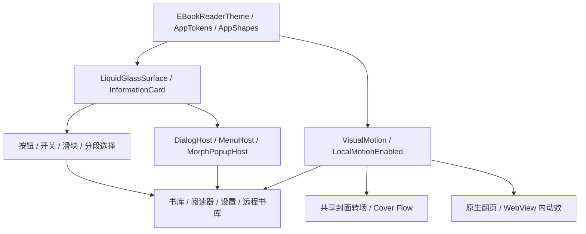

# My Books Android 共享组件与动画总览

> 盘点日期：2026-11-05（Asia/Shanghai）<br>
> 源码仓库：`mybooks`（Android，区别于服务端 `my-books`）<br>
> 源码基线：`main` / `3bb74d8`；版本 `2.3.10` / `2310`。<br>
> 本文描述当前工作树实现与可复用入口，不是效果设计稿，也不代表已安装 APK 的运行时验证。

## 1. 范围与阅读方式

本文把共享组件、共享状态/修饰符、主题基础、Compose 动画、原生 View 翻页和 WebView 内嵌动效集中到一个文件。覆盖 `app/src/main` 中 app 自身持有的实现；第三方 Compose、Material、Backdrop、Kyant Shapes、图标库等只记录 app 封装入口，不逐项抄录库内部组件。

“公共组件”指 `ui/components` 中的完整组件族；“领域共享”指书库、阅读器、远程书库、设置等模块内可复用的组件和配套状态，不表示所有入口都已被多个页面调用。页面本身和页面私有动画另有索引，避免把局部实现误认为通用 API。`internal` 表示 Kotlin 模块内可见，不能直接作为跨模块公共 API。

目录：

1. [主题与基础设施](#2-主题与基础设施)
2. [公共组件完整目录](#3-公共组件完整目录)
3. [领域共享组件与宿主](#4-领域共享组件与宿主)
4. [共享动画完整目录](#5-共享动画完整目录)
5. [关键交互的实际时序](#6-关键交互的实际时序)
6. [原生翻页、WebView 与系统动画](#7-原生翻页webview-与系统动画)
7. [复用示例与接入约束](#8-复用示例与接入约束)
8. [共享 API 参数索引](#9-共享-api-参数索引)
9. [全源码动画调用与参数索引](#10-全源码动画调用与参数索引)

### 1.1 整体关系



### 1.2 维护原则

- 优先使用现有封装，不在页面复制玻璃采样、按压阻尼或菜单定位算法。
- 源码数值优先用于判断“现在如何运行”；旧文档中的目标值和源码注释可能与实现不同。
- 本文记录的是基础时长。走 `VisualMotion` 的动画会受快速模式影响；弹簧没有固定的毫秒结束时间。
- 不把业务等待、网络超时、长按判定时间、TTS 播报时长算成动画时长。
- 页面关闭请求与退出完成是两件事；有 `onFinished` 的宿主必须等退出完成再移除。

## 2. 主题与基础设施

### 2.1 主题和降级

| 项目 | 当前职责 |
|---|---|
| `lumi` | 默认页面材质和品牌背景 |
| `fuguang` | 页面按 Lumi 解析，底部导航等限定子树采用玻璃 Dock |
| `material3` | Material 动态色与相应控件外观 |
| `liquid_glass` | 能力允许时启用背景采样、模糊、透镜与高光 |
| `LocalEInkMode` | 电子墨水下的高对比度、无装饰玻璃和空间动效回退 |
| `LocalReduceTransparency` | 减少装饰模糊/光学畸变，保留可读的底色/磨砂材质，不等同关闭动画 |
| `MotionPreference.STANDARD` | 正常时长与动效 |
| `MotionPreference.FAST` | `VisualMotion` 时长/延迟乘 `2/3`，弹簧 stiffness 乘 `2.25` |
| `MotionPreference.REDUCED` | `motionEnabled=false`；由组件决定直切、静止或短淡变 |

`EBookReaderTheme` 注入 `LocalMotionEnabled = !eInkMode && motionPreference.motionEnabled`，并设置 `VisualMotion`。单纯调用 `VisualMotion.tween()` 并不自动消除 REDUCED 模式下的位移，组件仍需判断 Local；这也是阅读旧工具函数时需要注意的边界。

玻璃能力检测集中在 `LiquidGlassCapability.kt`：API 31+、硬件加速、非电子墨水且 RenderEffect 初始化成功；HDR 是附加能力，要求 API 35+、HDR/广色域显示支持及玻璃能力。主题回退保留已保存偏好，不应在业务页面自行添加另一套 Android 版本判断。

### 2.2 设计令牌

| 令牌族 | 当前值/入口 |
|---|---|
| `AppType` | Huge 36sp、Display 32sp、Title 28sp、Section 20sp、Body 16sp、BodySmall 14sp、Caption 12sp |
| `AppSpace` | xs 4dp、sm 8dp、md 16dp、lg 24dp、xl 32dp |
| `AppRadius` | sm 8dp、md 14dp、lg 18dp、xl 22dp、capsule 28dp、full 999dp |
| `AppColors` | WindowBg、PageBg、CardBg、TextPrimary、TextSecondary、BgGray、Divider、Accent、OnAccent、ControlActive、Scrim 等动态 getter |
| `AppRoundedCornerShape` | Dp 重载表示 dp；Int 重载表示百分比；Float 重载表示像素圆角 |
| 全局 UI 字体 | `LocalGlobalFontMode` / `resolveAppFontFamily`；与阅读正文字体独立 |
| 图标 | `ui/icons/AppIcons.kt`、`IconPair`、`directionalIcon` |
| 自适应窗口 | `currentAdaptiveWindowInfo()`；600dp 及以上算 medium，且 width>height 才算宽横屏 |

### 2.3 主题基础文件完整目录

| 文件 | 用途 |
|---|---|

| [AppFontScale.kt](../app/src/main/java/com/huangder/lumibooks/ui/theme/AppFontScale.kt) | 应用字体缩放的计算与密度适配。 |

| [AppShapeDrawing.kt](../app/src/main/java/com/huangder/lumibooks/ui/theme/AppShapeDrawing.kt) | 矢量卡片描边和 Shape 绘制工具。 |

| [AppShapes.kt](../app/src/main/java/com/huangder/lumibooks/ui/theme/AppShapes.kt) | 连续曲率形状工厂与 AppRoundedCornerShape；按主题选择连续圆角或 Material 轮廓。 |

| [AppTokens.kt](../app/src/main/java/com/huangder/lumibooks/ui/theme/AppTokens.kt) | 颜色、字号、间距、圆角、字体入口、MotionPreference 和 CompositionLocal 开关。 |

| [Color.kt](../app/src/main/java/com/huangder/lumibooks/ui/theme/Color.kt) | 基础颜色调色板。 |

| [LiquidGlassCapability.kt](../app/src/main/java/com/huangder/lumibooks/ui/theme/LiquidGlassCapability.kt) | 玻璃/HDR 能力检测、有效主题解析、是否使用玻璃 Dock。 |

| [LumiBackground.kt](../app/src/main/java/com/huangder/lumibooks/ui/theme/LumiBackground.kt) | Lumi 品牌背景、场景切换和背景存在性 Local。 |

| [LumiBackgroundGeometry.kt](../app/src/main/java/com/huangder/lumibooks/ui/theme/LumiBackgroundGeometry.kt) | Lumi 主页面/二级页面插画的尺寸和安全区布局数学。 |

| [ReaderColors.kt](../app/src/main/java/com/huangder/lumibooks/ui/theme/ReaderColors.kt) | 阅读器主题颜色和阅读表面取色。 |

| [Theme.kt](../app/src/main/java/com/huangder/lumibooks/ui/theme/Theme.kt) | EBookReaderTheme：主题、动态色、字体、能力、动效偏好和系统表现的组合入口。 |

| [Type.kt](../app/src/main/java/com/huangder/lumibooks/ui/theme/Type.kt) | Material Typography 字阶。 |

### 2.4 主要环境开关

`LocalIsDarkTheme`、`LocalUseMaterial3Theme`、`LocalAppTheme`、`LocalAppThemeVariant`、`LocalAppAccentHex`、`LocalAppAccentColor`、`LocalOnAppAccentColor`、`LocalGlobalFontMode` 控制主题/字体。

`LocalLiquidGlassStyle`、`LocalLiquidGlassTransparency`（默认 `0.55`）、`LocalLiquidGlassHdrHighlightEnabled`、`LocalLiquidGlassCapability`、`LocalReduceTransparency` 控制玻璃能力与材质。

`LocalEInkMode`、`LocalMotionEnabled`、`LocalMotionPreference`、`LocalMenuAnimationStyle`、`LocalPredictiveBackEnabled` 控制动效和返回行为；`LocalCardOutlinesEnabled`、`LocalCoverReadingProgressEnabled` 控制卡片描边和封面进度显示。

Backdrop/浮层还使用 `LocalLiquidGlassBackdrop`、`LocalLiquidGlassLayer`、`LocalLiquidGlassDialogHost`、`LocalLiquidGlassMenuHost` 等内部上下文。大部分由页面/Activity 宿主提供，业务控件消费即可。

## 3. 公共组件完整目录

下面逐一列出 `ui/components` 当前所有 Kotlin 文件，包含可见组件及其共享实现基础。入口列不含 private 函数；类的方法详见源码，函数参数见第 9 节。

| 源文件 | 入口/类型/共享状态 | 用途 |
|---|---|---|

| [AnchoredLiquidGlassMenu.kt](../app/src/main/java/com/huangder/lumibooks/ui/components/AnchoredLiquidGlassMenu.kt) | `LiquidGlassMenuItem`、`LiquidGlassMenuMotion`、`LiquidGlassMenuSpec`、`LiquidGlassMenuMorph`、`LiquidGlassMenuHostState`、`LocalLiquidGlassMenuHost`、`LiquidGlassMenuHost` | 锚定按钮展开的菜单宿主、选项模型和可调弹簧；支持子菜单、自定义内容、穿透区域与窗口安全区。 |

| [AnnotationListFilters.kt](../app/src/main/java/com/huangder/lumibooks/ui/components/AnnotationListFilters.kt) | `AnnotationListFilters`、`annotationMenuWidth` | 笔记/标注列表的排序和过滤行；菜单宽度按翻译文字与字体缩放测量，依赖页面级菜单宿主。 |

| [AnnotationTagChips.kt](../app/src/main/java/com/huangder/lumibooks/ui/components/AnnotationTagChips.kt) | `AnnotationTagChips` | 标注标签的可换行 chips；窄卡片和大字体下保留标签可读性。 |

| [AnnotationTagSheet.kt](../app/src/main/java/com/huangder/lumibooks/ui/components/AnnotationTagSheet.kt) | `AnnotationTagSheet` | 选择、创建和管理标注标签的共享 Sheet。 |

| [AppMonthCalendar.kt](../app/src/main/java/com/huangder/lumibooks/ui/components/AppMonthCalendar.kt) | `AppMonthCalendarMode`、`monthCalendarCells`、`AppMonthCalendar` | 统计月历和单日编辑共用的月视图；模式区分热度统计与日期选择，不依赖 ViewModel。 |

| [AppUpdateDialog.kt](../app/src/main/java/com/huangder/lumibooks/ui/components/AppUpdateDialog.kt) | `AppUpdateDialog` | 应用更新说明与下载/安装入口弹窗。 |

| [BookCard.kt](../app/src/main/java/com/huangder/lumibooks/ui/components/BookCard.kt) | `BookCard` | 基础书籍卡片；显示封面、书名及阅读信息，业务操作由回调提供。 |

| [BookTransitionOverlay.kt](../app/src/main/java/com/huangder/lumibooks/ui/components/BookTransitionOverlay.kt) | `BookTransitionOverlay`、`BookTransitionTiming` | 打开书籍的加载页方案；封面、标题、进度、遮罩及预测性返回反馈。 |

| [BottomSheetMotion.kt](../app/src/main/java/com/huangder/lumibooks/ui/components/BottomSheetMotion.kt) | `Animatable`、`Animatable`、`bottomSheetEnterTransition`、`bottomSheetExitTransition`、`Modifier.materialBottomSheetMotion`、`LiquidGlassBottomSheetScaffold` | Sheet 进退场规范、预测性返回变换，以及跨主题底部 Sheet 骨架。 |

| [CloudBookUi.kt](../app/src/main/java/com/huangder/lumibooks/ui/components/CloudBookUi.kt) | `CloudBookDownloadDialog`、`CloudAwareBookDeleteDialog`、`BookCoverStatusBadge`、`BookCoverReadingProgress`、`BookProgressStatus`、`formatReadingProgressPercent`、`FinishedReadingIndicator` | 云书下载确认、云端/本机删除选择、封面云状态、阅读进度与读完标记。 |

| [ConfigurableBackNavigation.kt](../app/src/main/java/com/huangder/lumibooks/ui/components/ConfigurableBackNavigation.kt) | `LocalPredictiveBackEnabled`、`ConfigurableNavigationBack`、`ConfigurableActivityBack`、`ConfigurableBackHandler`、`ConfigurableBottomSheetBackHandler` | 统一导航返回、Activity 返回和返回手势开关；临时浮层可获得预测性返回进度。 |

| [EditInputDialog.kt](../app/src/main/java/com/huangder/lumibooks/ui/components/EditInputDialog.kt) | `EditInputDialog` | 多字段编辑弹窗；输入字段用列表传递，resetKey 控制复用弹窗时何时重置内容。 |

| [ExternalImportChoiceDialog.kt](../app/src/main/java/com/huangder/lumibooks/ui/components/ExternalImportChoiceDialog.kt) | `ExternalImportFolder`、`ExternalImportChoiceDialog` | 外部打开/分享书籍时选择复制进 app 或移入授权目录。 |

| [FloatingTabBar.kt](../app/src/main/java/com/huangder/lumibooks/ui/components/FloatingTabBar.kt) | `TabItem`、`tabs`、`Material3BottomNavigationBar`、`FloatingTabBar`、`dampedTabPanelOffset`、`LiquidGlassImportButton` | 三主题底部导航、Tab 模型与独立导入按钮；玻璃 Dock 的拖动棱镜不包含加号按钮。 |

| [G2ContinuousShape.kt](../app/src/main/java/com/huangder/lumibooks/ui/components/G2ContinuousShape.kt) | `G2ContinuousCornerShape` | 保留的旧 G2 超椭圆轮廓；主要用于 Material 3 兼容路径和已有测试，新 Lumi 形状优先使用 AppShapes。 |

| [ImmersiveMode.kt](../app/src/main/java/com/huangder/lumibooks/ui/components/ImmersiveMode.kt) | `ImmersiveMode`、`MainSystemBarStyle`、`ReaderSystemBarStyle` | 阅读沉浸模式、主页面系统栏恢复、阅读器系统栏颜色/图标策略。 |

| [InformationCard.kt](../app/src/main/java/com/huangder/lumibooks/ui/components/InformationCard.kt) | `InformationCard` | 带可选标题的信息分组卡片；统一内边距、描边、主题与电子墨水回退。 |

| [LiquidGlassButton.kt](../app/src/main/java/com/huangder/lumibooks/ui/components/LiquidGlassButton.kt) | `LiquidGlassButton`、`LiquidGlassTextButton` | 玻璃文字按钮和透明文字按钮；普通主题转交对应常规控件。 |

| [LiquidGlassButtonInteractionState.kt](../app/src/main/java/com/huangder/lumibooks/ui/components/LiquidGlassButtonInteractionState.kt) | `LiquidGlassButtonInteractionState`、`Modifier.liquidGlassButtonGesture`、`LiquidGlassButtonLayerTransform`、`LiquidGlassButtonContentFollow`、`liquidGlassButtonLayerTransform`、`liquidGlassButtonContentTransform`、`dampedLiquidGlassButtonOffset` | 按钮按压/拖动状态、阻尼、玻璃表面与内容的不同跟随幅度；内部实现。 |

| [LiquidGlassContrast.kt](../app/src/main/java/com/huangder/lumibooks/ui/components/LiquidGlassContrast.kt) | `LocalLiquidGlassContrastEnabled`、`liquidGlassContrastScrim`、`liquidGlassContrastTransparency` | 阅读器主动启用的玻璃可读性遮罩和透明度调节；不是全站亮度采样。 |

| [LiquidGlassControlEdge.kt](../app/src/main/java/com/huangder/lumibooks/ui/components/LiquidGlassControlEdge.kt) | `ControlEdgeDarkWidth`、`ControlEdgeLightWidth`、`LocalLiquidGlassControlEdgeEnabled`、`LocalLiquidGlassControlEdgeForceCanvas`、`ControlEdgePalette`、`controlEdgePalette`、`controlEdgeDarkAlpha`、`controlEdgeLightAlpha`、`controlEdgeUsesShader`、`Modifier.liquidGlassControlEdge`、`Modifier.liquidGlassControlEdge` | 玻璃控件光学细边；根据轮廓和系统能力选择 shader/Canvas，提供局部关闭开关。 |

| [LiquidGlassDampedMotionState.kt](../app/src/main/java/com/huangder/lumibooks/ui/components/LiquidGlassDampedMotionState.kt) | `LiquidGlassDampedMotionState` | 开关、滑块等共享的可打断按下→移动→释放状态；手指驱动同步更新，点击沿完整事务执行。 |

| [LiquidGlassDialog.kt](../app/src/main/java/com/huangder/lumibooks/ui/components/LiquidGlassDialog.kt) | `LiquidGlassDialogSpec`、`LiquidGlassDialogMotion`、`LiquidGlassDialogHostState`、`LocalLiquidGlassDialogHost`、`LiquidGlassDialogHost`、`LiquidGlassDialog`、`LiquidGlassAlertDialog` | 页面级 Dialog 宿主、居中对话框、底部弹窗模式与确认框；统一遮罩、内容切换和退出生命周期。 |

| [LiquidGlassIconButton.kt](../app/src/main/java/com/huangder/lumibooks/ui/components/LiquidGlassIconButton.kt) | `LiquidGlassIconButton` | 统一图标按钮；可关闭玻璃按压伸展而保留点击。 |

| [LiquidGlassMenuAnchor.kt](../app/src/main/java/com/huangder/lumibooks/ui/components/LiquidGlassMenuAnchor.kt) | `LiquidGlassMenuAnchorKind`、`LiquidGlassMenuAnchor`、`Modifier.liquidGlassMenuAnchor` | 将触发控件的可见图层交接给菜单形变；区分独立按钮与嵌入式触发区域。 |

| [LiquidGlassMorphPopup.kt](../app/src/main/java/com/huangder/lumibooks/ui/components/LiquidGlassMorphPopup.kt) | `LiquidGlassMorphPopupStyle`、`liquidGlassMorphPopupTargetRect`、`AnchoredLiquidGlassMorphPopup`、`LiquidGlassMorphPopup` | 小型弹窗从原始行矩形形变到目标矩形；处理根坐标、安全区、圆角、内容交接和关闭完成回调。 |

| [LiquidGlassMorphPopupHost.kt](../app/src/main/java/com/huangder/lumibooks/ui/components/LiquidGlassMorphPopupHost.kt) | `LocalLiquidGlassMorphPopupBackdrop`、`LiquidGlassMorphPopupHost` | 将页面内容与 popup 分槽捕获，防止弹窗反向采样自己；关闭动画完成前保持 active。 |

| [LiquidGlassMorphSelector.kt](../app/src/main/java/com/huangder/lumibooks/ui/components/LiquidGlassMorphSelector.kt) | `LiquidGlassMorphSelectorDefaults`、`LiquidGlassMorphSelector` | 紧凑单选内容和统一测量值；选项通过泛型和 label 回调提供，阅读状态只负责领域数据。 |

| [LiquidGlassSegmentedControl.kt](../app/src/main/java/com/huangder/lumibooks/ui/components/LiquidGlassSegmentedControl.kt) | `LiquidGlassSegmentGeometry`、`equalLiquidGlassSegmentGeometry`、`variableLiquidGlassSegmentGeometry`、`nearestEnabledLiquidGlassSegment`、`liquidGlassSegmentValueForCenter`、`cappedLiquidGlassSegmentValue`、`LiquidGlassSegmentedControl` | 等宽或自定义宽度的分段选择器；中性色块、拖动预览、松手提交、disabled、RTL 与外部 Pager 跟随。 |

| [LiquidGlassSurface.kt](../app/src/main/java/com/huangder/lumibooks/ui/components/LiquidGlassSurface.kt) | `LocalLiquidGlassBackdrop`、`LocalLiquidGlassLayer`、`LiquidGlassOutlineWidth`、`liquidGlassHighlight`、`liquidGlassFallbackOutlineBrush`、`ProvideLiquidGlassBackdrop`、`Modifier.liquidGlassBackdrop`、`supportsLiquidGlassLens`、`supportsLiquidGlassHighlight`、`Modifier.liquidGlassSheetSurface`、`LiquidGlassSheetContainer`、`LiquidGlassColumnSheetContainer`、`LiquidGlassSurface` | 玻璃基础表面、Backdrop 提供者、Sheet 表面和列容器；集中处理模糊、折射、高光及层数限制。 |

| [LiquidGlassSwitch.kt](../app/src/main/java/com/huangder/lumibooks/ui/components/LiquidGlassSwitch.kt) | `LiquidGlassSwitch`、`resolveSwitchTarget` | 跨主题开关；玻璃主题使用可拖动滑块和 Switch 语义，其他主题使用常规 Switch。 |

| [LiquidGlassTabDragState.kt](../app/src/main/java/com/huangder/lumibooks/ui/components/LiquidGlassTabDragState.kt) | `LiquidGlassTabMotionState`、`LiquidGlassTabInteractiveHighlight`、`Modifier.liquidGlassTabDrag` | 底部 Dock 的位置、升起高光、速度和拖动吸附；内部状态与 Modifier。 |

| [LiquidMenuGeometry.kt](../app/src/main/java/com/huangder/lumibooks/ui/components/LiquidMenuGeometry.kt) | `LiquidMenuGeometry`、`LiquidMenuFrame`、`LiquidMenuShape` | 菜单形变的共享轮廓、阶段与路径数学；外形、源控件交接和光学层共用一个进度。 |

| [LiquidMenuOptics.kt](../app/src/main/java/com/huangder/lumibooks/ui/components/LiquidMenuOptics.kt) | `LiquidMenuSurface`、`rememberMenuOptics`、`LiquidMenuOptics` | 锚定菜单专用光学层；任意路径不直接交给仅支持圆角矩形的 Backdrop lens。 |

| [LocalNetworkPermissionGate.kt](../app/src/main/java/com/huangder/lumibooks/ui/components/LocalNetworkPermissionGate.kt) | `rememberLocalNetworkPermissionGate` | 可见 WebDAV 流程共用的局域网权限说明与 Android 17 权限桥接。 |

| [LumiCardSurface.kt](../app/src/main/java/com/huangder/lumibooks/ui/components/LumiCardSurface.kt) | `Modifier.lumiCardSurface` | 普通 Lumi 卡片的 Modifier 装饰，集中应用背景、形状和卡片轮廓。 |

| [OutlinedLiquidGlassSurface.kt](../app/src/main/java/com/huangder/lumibooks/ui/components/OutlinedLiquidGlassSurface.kt) | `OutlinedLiquidGlassSurface` | 在玻璃表面外增加用户选择的卡片描边；outlineAlpha 可与形变同步淡入淡出。 |

| [OverlayPermissionDialog.kt](../app/src/main/java/com/huangder/lumibooks/ui/components/OverlayPermissionDialog.kt) | `OverlayPermissionDialog` | 悬浮字幕所需系统悬浮窗权限的引导弹窗。 |

| [PillSlider.kt](../app/src/main/java/com/huangder/lumibooks/ui/components/PillSlider.kt) | `PillSlider`、`snapSliderValue`、`sliderValueFromFraction`、`sliderFraction`、`sliderThumbOffsetPx` | 胶囊滑块；onDragValueChange 用于连续预览，onValueChange 用于吸附后的最终提交。 |

| [PolicyUpdateDialog.kt](../app/src/main/java/com/huangder/lumibooks/ui/components/PolicyUpdateDialog.kt) | `PolicyUpdateDialog` | 隐私政策/协议更新的共享确认弹窗。 |

| [ProgressiveTopBlur.kt](../app/src/main/java/com/huangder/lumibooks/ui/components/ProgressiveTopBlur.kt) | `PROGRESSIVE_BLUR_STEPS`、`PROGRESSIVE_BLUR_HEAVY_STOP`、`PROGRESSIVE_BLUR_MEDIUM_STOP`、`PROGRESSIVE_BLUR_LIGHT_STOP`、`PROGRESSIVE_BLUR_MEDIUM_RISE`、`PROGRESSIVE_BLUR_LIGHT_RISE`、`PROGRESSIVE_BLUR_LEVEL_LIGHT`、`PROGRESSIVE_BLUR_LEVEL_MEDIUM`、`PROGRESSIVE_BLUR_LEVEL_HEAVY`、`PROGRESSIVE_BLUR_HEAVY_RADIUS_RATIO`、`PROGRESSIVE_BLUR_MEDIUM_RADIUS_RATIO`、`PROGRESSIVE_BLUR_LIGHT_RADIUS_RATIO`、`PROGRESSIVE_BLUR_TINT_ALPHA`、`PROGRESSIVE_BLUR_TINT_ALPHA_DARK`、`PROGRESSIVE_TOP_SCRIM_ALPHA`、`ProgressiveTopBlurMaxRadius`、`ProgressiveTopBlurBandHeight`、`progressiveBlurStrength`、`quantizeBlurStrength`、`progressiveBlurEnabled`、`progressiveTopScrimEnabled`、`progressiveBlurLevelAlpha`、`progressiveBlurCoverage`、`progressiveTintAlpha`、`LARGE_TITLE_MIN_SCALE`、`LARGE_TITLE_FADE_END`、`SMALL_TITLE_FADE_START`、`largeTitleScale`、`largeTitleAlpha`、`smallTitleAlpha`、`smallTitleScale`、`ProgressiveTopBlur`、`ProgressiveTopScrim`、`ProgressiveBottomBlur`、`ProgressiveBottomScrim` | 顶部/底部渐进模糊和实色遮罩，以及大小标题缩放/交接数学；分级模糊避免矩形硬边。 |

| [PullToRefreshHint.kt](../app/src/main/java/com/huangder/lumibooks/ui/components/PullToRefreshHint.kt) | `PULL_TO_REFRESH_THRESHOLD_DP`、`PULL_TO_REFRESH_HINT_SLIDE_DP`、`pullToRefreshProgress`、`shouldTriggerPullActionOnRelease`、`PullToRefreshHint` | 首页松手继续阅读、书架松手同步共用的顶部提示与阈值判断；不承担实际网络请求。 |

| [ReadingChart.kt](../app/src/main/java/com/huangder/lumibooks/ui/components/ReadingChart.kt) | `ReadingChart` | 阅读统计柱图的基础 Canvas 组件。 |

| [RemoteNoticeDialog.kt](../app/src/main/java/com/huangder/lumibooks/ui/components/RemoteNoticeDialog.kt) | `RemoteNoticeDialog` | 远程通知弹窗。 |

| [ReplacingToast.kt](../app/src/main/java/com/huangder/lumibooks/ui/components/ReplacingToast.kt) | `ReplacingToast` | 新提示替换旧 Toast，避免同一交互连续排队显示过期消息。 |

| [SelectionMenuReorderState.kt](../app/src/main/java/com/huangder/lumibooks/ui/components/SelectionMenuReorderState.kt) | `SelectionMenuReorderState` | 阅读选择菜单的重排预览状态；仅完成拖放时提交偏好。 |

| [SelectionMenuSettingsEditor.kt](../app/src/main/java/com/huangder/lumibooks/ui/components/SelectionMenuSettingsEditor.kt) | `SelectionMenuAction.labelRes`、`SelectionMenuSettingsEditor`、`SelectionMenuSettingsDialog`、`SelectionMenuCapsuleButton` | 阅读选择菜单编辑器、设置对话框与胶囊按钮。 |

| [StatusGradient.kt](../app/src/main/java/com/huangder/lumibooks/ui/components/StatusGradient.kt) | `StatusGradientOverlay`、`NavigationGradientOverlay` | 状态栏和导航栏渐变/采样模糊；减少透明度时用可读遮罩，仍可导出已完成背景给上层控件。 |

| [SwipeRevealItem.kt](../app/src/main/java/com/huangder/lumibooks/ui/components/SwipeRevealItem.kt) | `SwipeRevealItem` | 列表左滑露出编辑/删除操作，区别于直接滑出删除动画。 |

### 3.1 表面和容器如何选择

- 普通信息分组优先 `InformationCard`；其子行已有触控内边距时传 `contentPadding = PaddingValues(0.dp)`，避免双重留白。
- 需要自定义底层表面使用 `LiquidGlassSurface`；需要用户设置的卡片外描边使用 `OutlinedLiquidGlassSurface`。
- 普通卡片 Modifier 使用 `lumiCardSurface`；统一圆角使用 `AppRoundedCornerShape`。
- 底部设置/操作 Sheet 优先复用 `LiquidGlassBottomSheetScaffold`；中心确认框使用 `LiquidGlassAlertDialog`。
- 锚定按钮的选项菜单用 `LiquidGlassMenuHost` + `liquidGlassMenuAnchor`；行内紧凑状态形变用 MorphPopup 组件族。

### 3.2 两套形变浮层的区别

| 组件族 | 适合场景 | 生命周期 |
|---|---|---|
| `LiquidGlassMenuHost` + `LiquidGlassMenuSpec` | 从按钮/胶囊展开的下拉菜单、子菜单、TTS 参数菜单 | 宿主接管源控件图层与关闭交接；几何和光学共用进度 |
| `LiquidGlassMorphPopupHost` + `AnchoredLiquidGlassMorphPopup` | 从一行信息变成小型单选卡片，例如阅读状态 | 请求关闭后保持挂载，等待 `onFinished` 再清空锚点/状态 |

两者都能保留材质回退，不能因名字相似就互换业务调用。`LiquidGlassMorphSelectorDefaults.contentHeight()` 按三项计算：默认宽 102dp、标题 28dp、行高 48dp、上下 padding 各 8dp；字体测量缩放限制到 1–1.8 倍。泛型 selector 本身接受任意选项列表，若改成非三项，需要调用方重新计算高度。

## 4. 领域共享组件与宿主

这些文件位于业务目录，允许在本领域内复用；其中有些同时持有页面、Activity 或状态，不能整文件直接搬到公共组件目录。主页面 `HomeScreen`、`BookshelfScreen`、`StatisticsScreen`、`ReaderScreen` 等属于入口，而不是无业务依赖的通用控件。

| 文件 | 共享职责 |
|---|---|

| [bookshelf/ContextMenuMotion.kt](../app/src/main/java/com/huangder/lumibooks/ui/bookshelf/ContextMenuMotion.kt) | 书籍与文件夹长按菜单共享的弹簧、延迟、遮罩和封面归位参数。 |

| [bookshelf/BookContextMenuState.kt](../app/src/main/java/com/huangder/lumibooks/ui/bookshelf/BookContextMenuState.kt) | 书籍长按菜单状态与动画生命周期。 |

| [bookshelf/FolderContextMenuState.kt](../app/src/main/java/com/huangder/lumibooks/ui/bookshelf/FolderContextMenuState.kt) | 文件夹长按菜单状态；复用 ContextMenuMotion。 |

| [bookshelf/BookContextMenuOverlay.kt](../app/src/main/java/com/huangder/lumibooks/ui/bookshelf/BookContextMenuOverlay.kt) | 书籍长按浮层的封面、信息与操作区域。 |

| [bookshelf/FolderContextMenuOverlay.kt](../app/src/main/java/com/huangder/lumibooks/ui/bookshelf/FolderContextMenuOverlay.kt) | 文件夹长按浮层。 |

| [bookshelf/LongPressBookEffect.kt](../app/src/main/java/com/huangder/lumibooks/ui/bookshelf/LongPressBookEffect.kt) | 封面长按识别、按压反馈与锚点交接 Modifier。 |

| [bookshelf/FolderCover.kt](../app/src/main/java/com/huangder/lumibooks/ui/bookshelf/FolderCover.kt) | 自定义文件夹封面与书籍封面拼图。 |

| [bookshelf/BookshelfFolderSheets.kt](../app/src/main/java/com/huangder/lumibooks/ui/bookshelf/BookshelfFolderSheets.kt) | 文件夹命名、操作、移动、迁移与面包屑共享 UI。 |

| [bookshelf/BookTagBottomSheet.kt](../app/src/main/java/com/huangder/lumibooks/ui/bookshelf/BookTagBottomSheet.kt) | 单书和批量书籍标签选择 Sheet。 |

| [bookshelf/BookshelfSearchOverlay.kt](../app/src/main/java/com/huangder/lumibooks/ui/bookshelf/BookshelfSearchOverlay.kt) | 书库搜索启动区域、搜索浮层和结果行。 |

| [bookshelf/BookshelfFolderHierarchy.kt](../app/src/main/java/com/huangder/lumibooks/ui/bookshelf/BookshelfFolderHierarchy.kt) | 层级、路径、后代、数量与展开树纯函数；属于 UI 组织基础，不绘制视图。 |

| [bookshelf/BookshelfBookFilters.kt](../app/src/main/java/com/huangder/lumibooks/ui/bookshelf/BookshelfBookFilters.kt) | 书库过滤纯逻辑；分类与主书库共用。 |

| [bookshelf/BookDetailsPager.kt](../app/src/main/java/com/huangder/lumibooks/ui/bookshelf/BookDetailsPager.kt) | 书籍详情多个页面共用的 Pager 宿主。 |

| [bookshelf/BookDetailsLayout.kt](../app/src/main/java/com/huangder/lumibooks/ui/bookshelf/BookDetailsLayout.kt) | 书籍详情纵横屏/宽窗口布局。 |

| [bookshelf/BookDetailsActivity.kt](../app/src/main/java/com/huangder/lumibooks/ui/bookshelf/BookDetailsActivity.kt) | 详情 Activity 与 BookHero、BookDetailsCover 等封面/标题共享构件。 |

| [bookshelf/BookNotesScreen.kt](../app/src/main/java/com/huangder/lumibooks/ui/bookshelf/BookNotesScreen.kt) | 笔记页面及 SegmentedTabBar、HighlightNoteItem、BookmarkItem 等跨笔记视图复用项。 |

| [bookshelf/MyBooksBookInfoCard.kt](../app/src/main/java/com/huangder/lumibooks/ui/bookshelf/MyBooksBookInfoCard.kt) | 书目信息、同步状态、文件、简介和重试行；详情和编辑等场景复用。 |

| [bookshelf/MyBooksEditSheet.kt](../app/src/main/java/com/huangder/lumibooks/ui/bookshelf/MyBooksEditSheet.kt) | 书籍编辑与导入确认使用的字段内容和 Sheet。 |

| [bookshelf/ReadingStatusMorph.kt](../app/src/main/java/com/huangder/lumibooks/ui/bookshelf/ReadingStatusMorph.kt) | 阅读状态领域适配，调用公共 MorphPopup 与 MorphSelector。 |

| [bookshelf/ReadingTimeline.kt](../app/src/main/java/com/huangder/lumibooks/ui/bookshelf/ReadingTimeline.kt) | 阅读轮次记录块与完整时间线页面。 |

| [bookshelf/ReadingTimelineDateDialog.kt](../app/src/main/java/com/huangder/lumibooks/ui/bookshelf/ReadingTimelineDateDialog.kt) | 阅读时间线单日编辑弹窗，复用 AppMonthCalendar。 |

| [bookshelf/CoverCropOverlay.kt](../app/src/main/java/com/huangder/lumibooks/ui/bookshelf/CoverCropOverlay.kt) | 封面裁剪操作浮层与拖动/缩放状态。 |

| [bookshelf/CustomCoverSourceSheet.kt](../app/src/main/java/com/huangder/lumibooks/ui/bookshelf/CustomCoverSourceSheet.kt) | 封面来源选择 Sheet。 |

| [bookshelf/CoverFlowActions.kt](../app/src/main/java/com/huangder/lumibooks/ui/bookshelf/CoverFlowActions.kt) | Cover Flow 操作条和文件夹导航。 |

| [bookshelf/CoverFlowAtmosphere.kt](../app/src/main/java/com/huangder/lumibooks/ui/bookshelf/CoverFlowAtmosphere.kt) | Cover Flow 环境氛围和封面倒影。 |

| [bookshelf/CoverFlowBookshelf.kt](../app/src/main/java/com/huangder/lumibooks/ui/bookshelf/CoverFlowBookshelf.kt) | Cover Flow 书架容器，组织手势、选中、导航和上下文菜单。 |

| [bookshelf/CoverFlowScene.kt](../app/src/main/java/com/huangder/lumibooks/ui/bookshelf/CoverFlowScene.kt) | Cover Flow 三维封面场景与共享封面绘制。 |

| [bookshelf/CoverFlowScrollbar.kt](../app/src/main/java/com/huangder/lumibooks/ui/bookshelf/CoverFlowScrollbar.kt) | Cover Flow 位置滚动条。 |

| [bookshelf/CoverFlowState.kt](../app/src/main/java/com/huangder/lumibooks/ui/bookshelf/CoverFlowState.kt) | Cover Flow 跟手、速度、吸附与可打断动画状态。 |

| [home/RecentBooksRow.kt](../app/src/main/java/com/huangder/lumibooks/ui/home/RecentBooksRow.kt) | 最近阅读横向书籍行。 |

| [home/HomePullToResume.kt](../app/src/main/java/com/huangder/lumibooks/ui/home/HomePullToResume.kt) | 首页下拉继续阅读的业务文案包装，底层复用 PullToRefreshHint。 |

| [home/ImportBooksSheet.kt](../app/src/main/java/com/huangder/lumibooks/ui/home/ImportBooksSheet.kt) | 导入操作、目标位置、批量确认和封面预览组件族。 |

| [home/ReadingGoalSheet.kt](../app/src/main/java/com/huangder/lumibooks/ui/home/ReadingGoalSheet.kt) | 阅读目标设置 Sheet。 |

| [home/remote/RemoteLibraryComponents.kt](../app/src/main/java/com/huangder/lumibooks/ui/home/remote/RemoteLibraryComponents.kt) | 远程书库封面、下载标签、大小格式化和下载目标 Sheet。 |

| [home/remote/RemotePageHeader.kt](../app/src/main/java/com/huangder/lumibooks/ui/home/remote/RemotePageHeader.kt) | 远程书库页面标题及图标按钮。 |

| [home/remote/RemoteBrowserControls.kt](../app/src/main/java/com/huangder/lumibooks/ui/home/remote/RemoteBrowserControls.kt) | 远程浏览排序、布局和强调胶囊。 |

| [home/remote/RemoteTextField.kt](../app/src/main/java/com/huangder/lumibooks/ui/home/remote/RemoteTextField.kt) | 远程连接表单输入框。 |

| [home/remote/RemoteBottomBar.kt](../app/src/main/java/com/huangder/lumibooks/ui/home/remote/RemoteBottomBar.kt) | 远程书库底部操作条。 |

| [home/remote/RemoteThemedContent.kt](../app/src/main/java/com/huangder/lumibooks/ui/home/remote/RemoteThemedContent.kt) | 远程独立 Activity 的主题与宿主装配。 |

| [home/remote/RemoteBrowserScreen.kt](../app/src/main/java/com/huangder/lumibooks/ui/home/remote/RemoteBrowserScreen.kt) | 远程浏览页面及 RemoteHeaderPill、RemotePrimaryButton 等领域控件。 |

| [home/remote/RemoteSourceScreens.kt](../app/src/main/java/com/huangder/lumibooks/ui/home/remote/RemoteSourceScreens.kt) | 远程来源页面及 RemoteEmptyState、RemoteInlineNotice 等空态/提示构件。 |

| [navigation/MainTabsPager.kt](../app/src/main/java/com/huangder/lumibooks/ui/navigation/MainTabsPager.kt) | 主 Tab 页容器和跨页共享动画上下文。 |

| [navigation/MainTabSelection.kt](../app/src/main/java/com/huangder/lumibooks/ui/navigation/MainTabSelection.kt) | 点击 Tab 的 700ms 交叉淡变状态，区别于手指横滑的 MainTabMotion。 |

| [navigation/ReaderOpeningPlaceholder.kt](../app/src/main/java/com/huangder/lumibooks/ui/navigation/ReaderOpeningPlaceholder.kt) | 阅读器建立期间的轻量占位 Shell。 |

| [layout/AdaptiveWindowInfo.kt](../app/src/main/java/com/huangder/lumibooks/ui/layout/AdaptiveWindowInfo.kt) | 统一窗口宽高判断，medium 阈值 600dp；宽横屏需同时满足 width>height。 |

| [icons/AppIcons.kt](../app/src/main/java/com/huangder/lumibooks/ui/icons/AppIcons.kt) | Fluent 图标的 app 语义封装、选中/未选中配对和方向镜像。 |

| [settings/CollapsingSettingsScaffold.kt](../app/src/main/java/com/huangder/lumibooks/ui/settings/CollapsingSettingsScaffold.kt) | 设置子页大标题、滚动折叠和顶部区域骨架。 |

| [settings/SettingsDetailScreens.kt](../app/src/main/java/com/huangder/lumibooks/ui/settings/SettingsDetailScreens.kt) | DetailPage、开关行、导航行、滑块行、下拉行、ActionRow 等公共设置积木；文件同时包含具体设置页面。 |

| [settings/SyncSettingsComponents.kt](../app/src/main/java/com/huangder/lumibooks/ui/settings/SyncSettingsComponents.kt) | 服务器与 WebDAV 共用的连接状态、同步按钮、模式/内容选择和说明卡片。 |

| [settings/LumiAboutHeader.kt](../app/src/main/java/com/huangder/lumibooks/ui/settings/LumiAboutHeader.kt) | 关于页品牌标题与装饰表现。 |

| [reader/ReaderTitleCapsule.kt](../app/src/main/java/com/huangder/lumibooks/ui/reader/ReaderTitleCapsule.kt) | 阅读器顶部标题胶囊。 |

| [reader/ReaderReturnChip.kt](../app/src/main/java/com/huangder/lumibooks/ui/reader/ReaderReturnChip.kt) | 返回阅读落点/听书恢复提示胶囊及提示过期状态。 |

| [reader/RasterReaderActions.kt](../app/src/main/java/com/huangder/lumibooks/ui/reader/RasterReaderActions.kt) | PDF/漫画阅读器操作行与操作胶囊。 |

| [reader/ReaderScreen.kt](../app/src/main/java/com/huangder/lumibooks/ui/reader/ReaderScreen.kt) | 正文阅读器以及 ActionCapsule、目录返回按钮、标注操作行、笔记输入/书签备注/笔记列表 Sheet 等领域共享部分。 |

| [reader/ThemeSettingsSheet.kt](../app/src/main/java/com/huangder/lumibooks/ui/reader/ThemeSettingsSheet.kt) | 主题设置、二级高级设置、ReaderSettingsSegmentedTag 与 SettingSlider。 |

| [reader/ReaderAnnotationTagControls.kt](../app/src/main/java/com/huangder/lumibooks/ui/reader/ReaderAnnotationTagControls.kt) | 阅读器标注标签状态与浮层控制。 |

| [reader/ReaderNoteWindow.kt](../app/src/main/java/com/huangder/lumibooks/ui/reader/ReaderNoteWindow.kt) | 阅读器笔记窗口。 |

| [reader/ReaderRememberChoice.kt](../app/src/main/java/com/huangder/lumibooks/ui/reader/ReaderRememberChoice.kt) | 阅读器记住选择的共享选项。 |

| [reader/TtsPlayerPanel.kt](../app/src/main/java/com/huangder/lumibooks/ui/reader/TtsPlayerPanel.kt) | 听书播放胶囊/面板与语速、音调、定时菜单。 |

| [reader/TtsStartDialog.kt](../app/src/main/java/com/huangder/lumibooks/ui/reader/TtsStartDialog.kt) | 听书开始选择与通知权限桥接。 |

| [reader/ListeningResumePrompt.kt](../app/src/main/java/com/huangder/lumibooks/ui/reader/ListeningResumePrompt.kt) | 监听听书恢复事件与恢复确认对话框。 |

| [reader/HighlightRulesSheet.kt](../app/src/main/java/com/huangder/lumibooks/ui/reader/HighlightRulesSheet.kt) | 高亮规则选择与管理 Sheet。 |

| [reader/LocalDictionarySheet.kt](../app/src/main/java/com/huangder/lumibooks/ui/reader/LocalDictionarySheet.kt) | 本地词典 Sheet 与可嵌入内容。 |

| [reader/ImageAdjustmentControls.kt](../app/src/main/java/com/huangder/lumibooks/ui/reader/ImageAdjustmentControls.kt) | 图像调整控件。 |

| [reader/RasterImageAdjustmentSheet.kt](../app/src/main/java/com/huangder/lumibooks/ui/reader/RasterImageAdjustmentSheet.kt) | PDF/漫画等栅格阅读器图像调整 Sheet。 |

| [reader/EpubImagePreview.kt](../app/src/main/java/com/huangder/lumibooks/ui/reader/EpubImagePreview.kt) | EPUB 图片全屏预览、缩放和退出。 |

| [reader/EpubNavigationOverlay.kt](../app/src/main/java/com/huangder/lumibooks/ui/reader/EpubNavigationOverlay.kt) | EPUB 跳转加载、失败提示和渲染失败覆盖层。 |

| [reader/EpubComicSwitchDialog.kt](../app/src/main/java/com/huangder/lumibooks/ui/reader/EpubComicSwitchDialog.kt) | EPUB 漫画识别/阅读模式切换确认。 |

| [reader/CbzTiledPage.kt](../app/src/main/java/com/huangder/lumibooks/ui/reader/CbzTiledPage.kt) | 漫画分块图像页面宿主。 |

| [reader/RasterCroppedBitmap.kt](../app/src/main/java/com/huangder/lumibooks/ui/reader/RasterCroppedBitmap.kt) | 栅格页面裁剪后的共享位图绘制。 |

| [reader/ReaderSerifFontFamily.kt](../app/src/main/java/com/huangder/lumibooks/ui/reader/ReaderSerifFontFamily.kt) | 阅读器衬线字体解析，与全局 UI 字体选择分离。 |

| [reader/ReaderImageFilters.kt](../app/src/main/java/com/huangder/lumibooks/ui/reader/ReaderImageFilters.kt) | 共享位图锐化等图像处理记忆状态。 |

| [excerpt/ExcerptActivity.kt](../app/src/main/java/com/huangder/lumibooks/ui/excerpt/ExcerptActivity.kt) | 摘录编辑 Sheet 和摘录预览；包含 Activity 宿主。 |

### 4.1 共享边界

- 公共 UI 只接收值、事件和内容槽；ViewModel、网络与数据库写入应由宿主承担。
- `ReadingStatusMorphOverlay` 保留阅读状态语义，不复制公共形变算法。
- `SyncSettingsComponents` 统一服务器/WebDAV 的界面积木，协议和鉴权继续由各自 ViewModel 管理。
- `AppMonthCalendar` 只处理月历布局与选日，日期是否合法由调用方按业务范围决定。
- PDF、CBZ、EPUB、Markdown 共用部分操作条/翻页表面，正文渲染引擎并非一个可互换 Composable。
- `SettingsDetailScreens.kt`、`ReaderScreen.kt` 等大文件同时包含屏幕与共享函数；复用其中函数时，应检查 private/公开边界和其 CompositionLocal 依赖。

## 5. 共享动画完整目录

### 5.1 `ui/animation` 全部文件

表中的毫秒数是基础值；`spring(a/b)` 的写法表示 dampingRatio / stiffness，不代表持续 a 或 b 毫秒。

| 文件 | 主要入口 | 当前行为和参数 |
|---|---|---|

| [AppEasing.kt](../app/src/main/java/com/huangder/lumibooks/ui/animation/AppEasing.kt) | AppEasing、LumiMotion | 缓动曲线和基础节奏；Press 120ms，Menu 180/140ms，Sheet 260/200ms，Page 240ms；程序弹簧 NoBouncy/500，手势弹簧 0.82/380。 |

| [AppTransitions.kt](../app/src/main/java/com/huangder/lumibooks/ui/animation/AppTransitions.kt) | PageTransitions | 进入：横向 1/4 宽、350ms，淡入 300ms；退出：300/200ms；返回进入：300/250ms；返回退出：300/200ms。仅描述定义，是否使用取决于路由接线。 |

| [BookReaderSharedTransition.kt](../app/src/main/java/com/huangder/lumibooks/ui/animation/BookReaderSharedTransition.kt) | BookReaderTransitionState、bookCoverTransitionAnchor、BookHeroWindowOverlay | 封面→阅读器共享窗口，状态机管理锚点、原路径返回与正文交接；位置和尺寸当前均为 650ms，正文显隐 180ms，加载指示器延迟 600ms。 |

| [ContainerAnimations.kt](../app/src/main/java/com/huangder/lumibooks/ui/animation/ContainerAnimations.kt) | BottomSheetContainer、ScrimOverlay、FadeContainer | 旧通用可见性容器；Fade 默认 300ms。ScrimOverlay 实际仅绘制压暗遮罩，不能仅凭旧注释认定带真实高斯模糊。 |

| [CoverFlowEntrance.kt](../app/src/main/java/com/huangder/lumibooks/ui/animation/CoverFlowEntrance.kt) | CoverFlowEntranceState、coverFlowEntranceItem、CoverFlowEntranceOverlay | Cover Flow 专用遮罩/标题/光扫/封面入场；遮罩进入 240ms，标题延迟 120ms 后 320ms；场景主进度 1500ms，光扫 850ms。减弱动态走 60–100ms 分支。 |

| [CoverFlowReaderTransition.kt](../app/src/main/java/com/huangder/lumibooks/ui/animation/CoverFlowReaderTransition.kt) | CoverFlowReaderMotion、CoverFlowReaderOverlay | Cover Flow 打开书的专用表现：侧封面离场、中心封面溶解、正文出现；共用阅读器转场状态，非另一套独立业务导航。 |

| [DataAnimations.kt](../app/src/main/java/com/huangder/lumibooks/ui/animation/DataAnimations.kt) | animateIntAsState、animateProgressAsState、animateArcProgressAsState | 数字默认 800ms，线性进度 600ms，环形进度 1000ms；都从 0 插值。文件自身没有 LocalMotionEnabled 判断，不能视为自动支持全部减弱动态策略。 |

| [FeedbackAnimations.kt](../app/src/main/java/com/huangder/lumibooks/ui/animation/FeedbackAnimations.kt) | lumiPressable、pressEffect、cardPressEffect、shimmerBrush、ShimmerBox | 通用按压默认缩放 0.97、alpha 0.88、120ms；pressEffect 为 0.95/0.8，cardPressEffect 为 0.96/1；骨架 shimmer 周期 1200ms。 |

| [ListAnimations.kt](../app/src/main/java/com/huangder/lumibooks/ui/animation/ListAnimations.kt) | StaggeredItem、SwipeToDeleteItem | 旧列表入场每项延迟默认 50ms、位移 400ms、淡入 350ms；SwipeToDeleteItem 实现是向上 slideOutVertically 300ms 加淡出 200ms，旧“向左/高度收缩”注释不能代表实际行为。 |

| [MainTabMotion.kt](../app/src/main/java/com/huangder/lumibooks/ui/animation/MainTabMotion.kt) | MainTabMotion、mainTabEntrance | 主 Tab 手势按纵向 7 个分带跟随，最大错位延迟 110ms、320ms 追齐、收尾上限常量 480ms；自定义阻尼计算 omega=27、damping=0.68，最大越界约 0.025 页。 |

| [MicroInteractions.kt](../app/src/main/java/com/huangder/lumibooks/ui/animation/MicroInteractions.kt) | animateTabScale、animateBounceScale、animateColorChange、animateRotation、bounceEnter、animateBounceEnter | Tab 选中缩放 1.15；点赞到 1.3 后回弹；颜色默认 300ms；旋转每圈 1000ms；bounceEnter 仅设置 scale=0.8/alpha=0，本身不启动动画。 |

| [OverscrollBounce.kt](../app/src/main/java/com/huangder/lumibooks/ui/animation/OverscrollBounce.kt) | OverscrollBounce、HorizontalOverscrollBounce、OverscrollBounceState | 纵向剩余手势位移乘 0.4，松手 spring(0.65/400)；横向阻力 0.44/(1+abs(offset)/72)，spring(0.62/360)。禁用原生 overscroll 拉伸。 |

| [PageEntranceAnimation.kt](../app/src/main/java/com/huangder/lumibooks/ui/animation/PageEntranceAnimation.kt) | PageEntranceTracker、PageEntranceItem | 页面入场限频 10s，同一 back-stack entry 不重播；偏移 10dp、缩放 0.985，交错 index×4ms 最多 20ms，alpha 200ms、位移/缩放 220ms。play 由调用方控制。 |

| [PageFlipAnimation.kt](../app/src/main/java/com/huangder/lumibooks/ui/animation/PageFlipAnimation.kt) | PageFlipAnimation、SlideCoverAnimation、SimpleSlideAnimation、pageFlipAnimations | WebView 注入脚本的翻页接口与覆盖/平移实现；不是 Compose 过渡。与阅读器原生 PageAnimationController 体系分别收录，不能合并成一个配置项。 |

| [VisualMotion.kt](../app/src/main/java/com/huangder/lumibooks/ui/animation/VisualMotion.kt) | VisualMotion | 统一 tween/spring 与纯时长缩放；快速模式时长乘 2/3，弹簧 stiffness 乘 2.25。REDUCED 的空间动画开关由调用方读取 LocalMotionEnabled。 |

### 5.2 公共缓动曲线

| 名称 | CubicBezierEasing |
|---|---|
| Smooth | `(0.2, 0.8, 0.2, 1)` |
| Bounce | `(0.25, 0.9, 0.25, 1)` |
| Decelerate | `(0, 0, 0.2, 1)` |
| Accelerate | `(0.4, 0, 1, 1)` |
| Standard | `(0.4, 0, 0.2, 1)` |
| SpringBounce | `(0.175, 0.885, 0.32, 1.275)` |

### 5.3 已存在工具与实际效果的边界

以下是阅读代码时需要知道的现状，不表示本次修改了这些行为：

- `bounceEnter()` 只生成初始隐藏态，不能单独用来“播放入场”。`animateBounceEnter()` 的 scale 完成后才启动 alpha，不能误写成两个动画并行。
- `SwipeToDeleteItem` 的名字/注释与内部向上滑出的实现不同；它没有完整的左滑动作按钮交互。左滑露出按钮应看 `SwipeRevealItem`。
- `ScrimOverlay` 本身只有压暗背景，真实玻璃模糊由 Backdrop/Surface 体系处理。
- `BottomSheetContainer` 外层有 `if (visible)`，调用方直接令 visible=false 会立即移除组合树，不能把其声明的 exit 当成可靠的退出保活方案；需要退出保活时使用现行宿主。
- `DataAnimations` 和 `shimmerBrush` 没有在自身实现里统一读取减弱动态开关；`PageEntranceItem` 则由 `play` 参数控制。不要仅因放在共享目录就认定所有无障碍回退已自动处理。
- 存在公共定义不等于当前所有页面均在调用它。第 9 节附带按源码可见性解析的跨文件引用样例，便于识别接线位置。

## 6. 关键交互的实际时序

### 6.1 点击/拖动控件

| 控件 | 手势和视觉 | 参数/提交方式 |
|---|---|---|
| 普通按压 | 按下缩小/降低 alpha，释放恢复 | `lumiPressable` 默认 120ms、0.97/0.88 |
| 玻璃按钮 | 表面有限伸展，文字/图标较弱跟随 | 交互状态弹簧 0.5/300，内容跟随系数 0.55 |
| 玻璃 Switch | 滑块拖动跟手，松手选开/关 | 轨道 58×30dp、滑块 32×24dp、行程 20dp；归一值 0.5 判定，支持 RTL |
| PillSlider | 连续预览，松手按 step 吸附 | 玻璃轨道 6dp、滑块 40×24dp；`onDragValueChange` 预览，`onValueChange` 最终提交 |
| 分段选择器 | 中性移动色块，不使用强调色作为选中底 | 0.68/520 弹簧；拖动只预览，释放提交；点击直接提交 |
| 底部 Dock | 点击时升起→移动→落下；拖动按速度投影吸附 | 玻璃主栏/导入按钮 72dp；非玻璃栏 56dp；加号独立，不计入 Tab 索引 |

共享阻尼状态的常规位置动画和 80/100/180ms 的按下/释放阶段见第 10 节自动参数索引。分段选择可传 `externalPosition` 跟随内容 Pager，此时不要再额外开启一套相互争夺位置的动画。

### 6.2 锚定菜单

`LiquidGlassMenuMotion` 当前默认展开 stiffness=150、damping=0.62；关闭 stiffness=220、damping=0.80，额外初速度默认为 0。这些值可通过 spec 覆盖，并非所有菜单固定同速。

触发源先压缩，随后表面从锚点长成菜单；源图层和菜单内容进行交接，内容按最终宽度测量，避免把文字一起缩放。`liquidGlassMenuAnchor` 应置于触发控件 background/clip 之前。`Standalone` 与 `Embedded` 对应独立按钮和嵌入式触发区；TTS 播放胶囊可使用 pass-through 区域保持播放操作可用。

紧凑 `LiquidGlassMorphPopup` 的液态分支使用 damping=0.9、展开 stiffness=300、关闭 stiffness=360；普通菜单风格使用展开 190ms / 关闭 140ms；`LocalMotionEnabled=false` 时直接 snap 到目标。默认几何是起始圆角 8dp、目标 24dp、屏幕边距 8dp、锚点内缩 2dp。

### 6.3 书籍/文件夹长按菜单

实际共用 `ui/bookshelf/ContextMenuMotion.kt`：

| 部分 | 入场 | 退出 |
|---|---|---|
| 信息面板 | 延迟 0ms；spring 0.75/420 | 延迟 60ms；spring 0.88/320 |
| 操作面板 | 延迟 60ms；spring 0.72/380 | 延迟 0ms；spring 0.88/320 |
| 封面 | 缩放到 1.08，spring 0.62/420；位置 spring 0.72/380 | 260ms 归位 |
| 遮罩 | 180ms 压暗 | 260ms 淡出 |
| 原位置书本 | 80ms 隐藏；按压恢复常量 140ms | 与共享状态交接 |
| 切换下一张 Sheet | 菜单开始退出 90ms 后挂载新 Sheet | 两个容器短暂交叠 |

这套参数被书籍/文件夹状态复用，不能只修改某个列表布局的同名局部值。

### 6.4 Sheet、Dialog 与返回

- `animateBottomSheetIn()`：到 entryOffset=0，NoBouncy/500 弹簧；`animateBottomSheetOut()`：到 1，220ms。
- `bottomSheetEnterTransition()`：从底部全高滑入、scale 0.86→1（底边中心），spring stiffness=500，加 120ms 淡入。
- `bottomSheetExitTransition()`：220ms 下滑/缩放到 0.86，加 200ms 淡出。
- `materialBottomSheetMotion()` 同时接收 entryOffset 与 predictiveBackProgress；玻璃与非玻璃的形变分支不同，减少动态时保留可读透明度路径。
- `LiquidGlassDialogHost` 根据 `LiquidGlassDialogMotion.DIALOG/BOTTOM_SHEET` 和菜单风格分支选择中心形变或底部 Sheet 进退场，不能给所有 Dialog 填一个统一毫秒数。其全部 tween/spring 参数列于第 10 节。
- `ConfigurableBackHandler` 返回手势进度，完成后可保持 1 直到宿主卸载；取消需要回到初态。`LocalPredictiveBackEnabled` 是独立行为偏好。

### 6.5 主 Tab 和普通页面

手指横滑使用 Pager + `MainTabMotion` 逐带跟随与轻微收尾；点击 Tab 使用 `MainTabSelection`：先 `scrollToPage()`，随后进行 700ms 交叉淡变，不经过中间 Tab。

`PageEntranceTracker` 限制重复入场；`PageEntranceItem` 带少量交错并叠加 `mainTabEntrance()`。`PageTransitions` 是另一组导航 transition 定义，实际路由使用情况应看 `NavGraph.kt`，不能将其参数直接描述成所有 Activity 的系统动画。

### 6.6 打开书籍与返回书库

**共享封面方案**：`bookCoverTransitionAnchor` 记录源封面；`BookReaderTransitionState` 控制 Library、打开/正文交接、Reader 与返回阶段，状态名称和允许流转见源码。位置/尺寸现行基准均为 **650ms**，不再使用旧设计文档中的“位置 600ms”。

- 封面沿二次贝塞尔路径到阅读器，路径偏移基准 28dp；保持封面比例。
- 封面阶段到总进度 0.30，即 195ms；交叉淡变窗口占进度 0.08。
- 阅读正文显隐基准 180ms；加载指示器等待 600ms，避免快速打开时闪现。
- 书库最大模糊 18dp、压暗 alpha=0.28、缩放到 0.90；是否启用受主题/减少透明度等路径控制。
- 返回等待书库布局稳定，重新寻找当前锚点，沿共享路径归位；不存在锚点时采用回退。
- Cover Flow 使用独立的视觉进度映射叠层，共用业务转场状态。

**加载页方案**：`BookTransitionOverlay`。其 reveal 延迟常量 500ms，显示后最短可见时间常量 300ms，加载说明淡入/淡出 140/100ms；它们是加载页自身策略，与共享封面 600ms 的指示器延迟是不同入口。用户选择加载页、入口没有共享锚点或回退条件触发时，不应强行套用 Hero。

### 6.7 滚动、提示与数据

- `OverscrollBounce` 提供越界位移，`PullToRefreshHint` 只负责顶部提示。达到内容位移 96dp 的释放阈值后，调用方决定继续阅读或同步；提示位移范围 12dp。
- `ProgressiveTopBlur` 使用 24 级强度量化，最大模糊 28dp、默认带高 120dp，heavy/medium/light 半径比例为 1/0.45/0.18；它是滚动驱动的渐进材质，不是一直循环的时间动画。
- 大标题缩放最小 0.625，淡出区间上限 0.70；小标题从 0.35 开始交接，具体数学见同文件。
- 数据/图表动画优先在首次展示或目标值变化时执行，不要因为页面重组重复清零。统计页面自己的图表参数也收录在局部动画索引。

## 7. 原生翻页、WebView 与系统动画

### 7.1 原生阅读器翻页

| 用户模式 | 设置默认时长 | 用户可选范围 | 步长 |
|---|---:|---:|---:|
| slide | 260ms | 100–1000ms | 10ms |
| scroll | 260ms | 100–1000ms | 10ms |
| fade | 400ms | 100–1000ms | 10ms |
| curl | 800ms | 300–1200ms | 25ms |

以上来自 `ReaderPageAnimationSettings`。手势收尾可能按剩余距离缩短；运行时允许保留速度换算后的毫秒精度，不能再用用户设置步长重复量化。`NoPageAnim` 为无动画路径。

| 文件 | 职责 |
|---|---|

| [ui/reader/engine/PageAnimationController.kt](../app/src/main/java/com/huangder/lumibooks/ui/reader/engine/PageAnimationController.kt) | 原生翻页控制基类：方向、手势、翻页确认、Scroller、取消/完成与边界回弹。 |

| [ui/reader/engine/PageAnimationSurface.kt](../app/src/main/java/com/huangder/lumibooks/ui/reader/engine/PageAnimationSurface.kt) | Canvas/View 翻页共用的页面位图、纸色和翻页表面抽象。 |

| [ui/reader/engine/PageSurfaceView.kt](../app/src/main/java/com/huangder/lumibooks/ui/reader/engine/PageSurfaceView.kt) | 原生阅读页表面承载。 |

| [ui/reader/engine/PageTurnLayers.kt](../app/src/main/java/com/huangder/lumibooks/ui/reader/engine/PageTurnLayers.kt) | 翻页前后图层的布局与职责。 |

| [ui/reader/engine/SlidePageAnim.kt](../app/src/main/java/com/huangder/lumibooks/ui/reader/engine/SlidePageAnim.kt) | 水平覆盖式翻页，基类默认 260ms。 |

| [ui/reader/engine/ScrollPageAnim.kt](../app/src/main/java/com/huangder/lumibooks/ui/reader/engine/ScrollPageAnim.kt) | 纵向翻页；拖动松手按剩余距离缩短时长。 |

| [ui/reader/engine/FadePageAnim.kt](../app/src/main/java/com/huangder/lumibooks/ui/reader/engine/FadePageAnim.kt) | 两页透明度交接，默认 400ms。 |

| [ui/reader/engine/CurlPageAnim.kt](../app/src/main/java/com/huangder/lumibooks/ui/reader/engine/CurlPageAnim.kt) | 仿真卷页几何、手指交互和收尾动画，默认 800ms。 |

| [ui/reader/engine/NoPageAnim.kt](../app/src/main/java/com/huangder/lumibooks/ui/reader/engine/NoPageAnim.kt) | 无翻页动画模式。 |

| [ui/reader/engine/CurlAnimationTiming.kt](../app/src/main/java/com/huangder/lumibooks/ui/reader/engine/CurlAnimationTiming.kt) | 卷页收尾线性插值、按剩余行程计算时长，下限基准 120ms；加速收尾为基准 0.3 倍并限制在缩放后的 120–240ms。 |

| [ui/reader/engine/SimulationCurlTurnMotion.kt](../app/src/main/java/com/huangder/lumibooks/ui/reader/engine/SimulationCurlTurnMotion.kt) | 仿真翻页的时序/进度映射。 |

| [ui/reader/engine/ReaderPageTurnQueue.kt](../app/src/main/java/com/huangder/lumibooks/ui/reader/engine/ReaderPageTurnQueue.kt) | 翻页请求排队/合并，控制业务翻页顺序。 |

| [ui/reader/engine/ReaderCurlTurnSequencer.kt](../app/src/main/java/com/huangder/lumibooks/ui/reader/engine/ReaderCurlTurnSequencer.kt) | 卷页请求串行与交接状态。 |

| [ui/reader/engine/CurlGestureHelpers.kt](../app/src/main/java/com/huangder/lumibooks/ui/reader/engine/CurlGestureHelpers.kt) | 卷页手势辅助判断。 |

| [ui/reader/engine/BookmarkPullGestureTracker.kt](../app/src/main/java/com/huangder/lumibooks/ui/reader/engine/BookmarkPullGestureTracker.kt) | 下拉书签手势状态与阈值判断。 |

| [ui/reader/engine/ReadView.kt](../app/src/main/java/com/huangder/lumibooks/ui/reader/engine/ReadView.kt) | 原生阅读器 View 总宿主，连接动画模式、页面和手势。 |

| [ui/reader/EpubPageTurnHost.kt](../app/src/main/java/com/huangder/lumibooks/ui/reader/EpubPageTurnHost.kt) | WebView 页面快照/图层和原生翻页控制器之间的桥接。 |

| [ui/reader/MarkdownPageTransition.kt](../app/src/main/java/com/huangder/lumibooks/ui/reader/MarkdownPageTransition.kt) | Markdown 两个视口快照的翻页/淡变桥接；释放时取消动画并回收快照。 |

| [domain/model/ReaderPageAnimationSettings.kt](../app/src/main/java/com/huangder/lumibooks/domain/model/ReaderPageAnimationSettings.kt) | 用户翻页时长、范围、步长和运行时精度规则。 |

| [util/epub/EpubDocumentTransformer.kt](../app/src/main/java/com/huangder/lumibooks/util/epub/EpubDocumentTransformer.kt) | EPUB 内嵌 CSS/JS：脚注弹窗、旋转加载、搜索高亮脉冲及 WebView 页面相关表现。 |

| [service/FloatingSubtitleOverlayController.kt](../app/src/main/java/com/huangder/lumibooks/service/FloatingSubtitleOverlayController.kt) | 系统悬浮字幕窗口的横向文字滚动，由 ValueAnimator 驱动。 |

| [tts/FloatingSubtitleScroll.kt](../app/src/main/java/com/huangder/lumibooks/tts/FloatingSubtitleScroll.kt) | 字幕滚动时长按超出宽度/速度计算；起始等待 600ms、最短 900ms、速度 60dp/s。 |

### 7.2 WebView 文档内部动效

`EpubDocumentTransformer.kt` 生成的 CSS/JS 另有一层动效：脚注弹窗进入 190ms、退出 150ms，加载旋转 800ms 一圈，搜索结果高亮脉冲 2000ms。CSS 使用 `--lumi-motion-scale`；`prefers-reduced-motion` 分支和 app 注入逻辑共同决定回退，不应只修改 Compose 时长而漏掉文档内表现。

`ui/animation/PageFlipAnimation.kt` 里的覆盖/平移脚本与 `EpubPageTurnHost`/原生翻页桥接分别存在。脚本和 Canvas/View 路径应按实际调用链判断，不根据类名推断同一书籍格式永远只走某一种。

### 7.3 Activity 与系统返回

设置页、授权目录书籍页等独立 Activity 的跨页面动画交给 Android/OEM；当前这些宿主没有自定义一套固定 Activity 动画时长。Launcher 跳板使用 `overridePendingTransition(0, 0)` 消除中转。页面内部的淡变、目录进入/返回仍由 Compose 或阅读器状态控制，不能与系统跨 Activity 动画混写。

### 7.4 系统悬浮字幕

悬浮字幕的长文本横向滚动在服务窗口中使用 `ValueAnimator`，按超出宽度与 60dp/s 计算基础滚动时长，先等待 600ms、最短滚动 900ms，并使用 `VisualMotion` 缩放。它属于 app 自有动画，虽然不位于 `ui/animation`，仍在本目录收录。

## 8. 复用示例与接入约束

以下片段展示实际参数名称；假定调用环境已提供主题，省略 imports。它们不是独立可运行页面。

### 8.1 信息卡片

```kotlin
InformationCard(title = "书籍信息") {
    Text("作者：示例作者", color = AppColors.TextPrimary)
    Text("译者：示例译者", color = AppColors.TextSecondary)
}
```

若子项自带触控 padding，使用 `contentPadding = PaddingValues(0.dp)`。

### 8.2 分段选择器

```kotlin
val labels = listOf("周", "月", "年")
LiquidGlassSegmentedControl(
    itemCount = labels.size,
    selectedIndex = selectedIndex,
    onSelected = onSelected
) { index, _ ->
    Text(labels[index], color = AppColors.TextPrimary)
}
```

需要不同宽度时传 `segmentWidths`，数量必须等于 itemCount；支持禁用项时传 `itemEnabled`，不在业务回调里事后“撤销选中”。

### 8.3 统一底部 Sheet

```kotlin
LiquidGlassBottomSheetScaffold(
    onDismiss = onDismiss,
    onRequestDismiss = { !saving }
) { requestDismiss ->
    Text("设置", fontSize = AppType.Section)
    LiquidGlassButton(onClick = requestDismiss) {
        Text("完成")
    }
}
```

有未保存草稿时通过 onRequestDismiss 拦截，而不是在多个返回入口各写一份判断。

### 8.4 按压反馈与手势所有权

`lumiPressable` 依赖 PressInteraction。若使用自定义 clickable，必须让 clickable 与修饰符消费同一个 `MutableInteractionSource`；若只需要现成按压识别，可用 `pressEffect`/`cardPressEffect`。玻璃按钮已经管理手势与形变，不应再叠加另一套缩放状态。

### 8.5 动画偏好

```kotlin
val motion = LocalMotionEnabled.current
LaunchedEffect(target, motion) {
    if (motion) {
        progress.animateTo(target, VisualMotion.tween(180))
    } else {
        progress.snapTo(target)
    }
}
```

时长/延迟通过 `VisualMotion` 处理；物理手指位移不要当作时长缩放。`REDUCED`、电子墨水、减少透明度是不同偏好，不能用一个 Boolean 同时覆盖。

### 8.6 Backdrop、生命周期与可访问性

- 一个页面保持明确的背景捕获所有权；popup 不采样自身，阅读页静止正文不持续为不可见玻璃做采样。
- `LocalLiquidGlassLayer` 限制玻璃深度，超过三层回退；不要绕开公共表面继续叠加透镜。
- `LiquidGlassMorphPopupHost.active` 需覆盖退出阶段。先发 closeRequested，再在 onFinished 清空数据；原行与 popup 的坐标都必须在约定坐标空间内。
- 菜单内容交接期和关闭期不接受重复提交；滑块/分段选择器区分预览与最终提交。
- 动态高度内容参与父布局测量，不能把唯一内容层设为 matchParentSize；装饰层才适合该修饰符。
- 复用时保留 enabled、选中语义、TalkBack、RTL、安全区和大字体处理；不能只复制视觉 Modifier。

## 9. 共享 API 参数索引

本节从当前 Kotlin 源码提取**非 private 顶层函数**的参数签名，保留默认参数；返回类型和函数体以链接源码为准。类/对象的成员方法没有展开，避免把内部数学方法误当成组件入口。包含公共目录、主题基础，以及上文列出的领域/原生支撑文件。

“引用样例”按包名、显式 import/通配 import 和函数名调用进行静态匹配，用于找代码，不等价于编译器调用图，也不证明运行时一定会执行。无匹配不代表可安全删除。

<details>
<summary>ui/components/AnchoredLiquidGlassMenu.kt（1 个函数入口）</summary>

源码：[AnchoredLiquidGlassMenu.kt](../app/src/main/java/com/huangder/lumibooks/ui/components/AnchoredLiquidGlassMenu.kt)

**`LiquidGlassMenuHost`** · public · [源码定位](../app/src/main/java/com/huangder/lumibooks/ui/components/AnchoredLiquidGlassMenu.kt#L565)

```kotlin
fun LiquidGlassMenuHost(
    modifier: Modifier = Modifier,
    backdrop: Backdrop? = LocalLiquidGlassBackdrop.current,
    content: @Composable BoxScope.() -> Unit
)
```

跨文件引用样例：[ui/bookshelf/AnnotationFeedScreen.kt](../app/src/main/java/com/huangder/lumibooks/ui/bookshelf/AnnotationFeedScreen.kt#L200)、[ui/bookshelf/BookDetailsActivity.kt](../app/src/main/java/com/huangder/lumibooks/ui/bookshelf/BookDetailsActivity.kt#L214)、[ui/bookshelf/BookNotesScreen.kt](../app/src/main/java/com/huangder/lumibooks/ui/bookshelf/BookNotesScreen.kt#L196)（另有 7 个匹配文件）。

</details>

<details>
<summary>ui/components/AnnotationListFilters.kt（2 个函数入口）</summary>

源码：[AnnotationListFilters.kt](../app/src/main/java/com/huangder/lumibooks/ui/components/AnnotationListFilters.kt)

**`AnnotationListFilters`** · internal · [源码定位](../app/src/main/java/com/huangder/lumibooks/ui/components/AnnotationListFilters.kt#L42)

```kotlin
internal fun AnnotationListFilters(
    tags: List<String>, selectedTag: String?, onTagSelected: (String?) -> Unit,
    colors: List<String>, selectedColor: String?, onColorSelected: (String?) -> Unit,
    selectedLine: Int?, onLineSelected: (Int?) -> Unit, showLines: Boolean,
    modifier: Modifier = Modifier
)
```

跨文件引用样例：[ui/bookshelf/AnnotationFeedScreen.kt](../app/src/main/java/com/huangder/lumibooks/ui/bookshelf/AnnotationFeedScreen.kt#L299)、[ui/bookshelf/BookNotesScreen.kt](../app/src/main/java/com/huangder/lumibooks/ui/bookshelf/BookNotesScreen.kt#L275)、[ui/reader/ReaderScreen.kt](../app/src/main/java/com/huangder/lumibooks/ui/reader/ReaderScreen.kt#L11848)。

**`annotationMenuWidth`** · internal · [源码定位](../app/src/main/java/com/huangder/lumibooks/ui/components/AnnotationListFilters.kt#L158)

```kotlin
internal fun annotationMenuWidth(labels: List<String>, extraWidth: Dp, fontSize: TextUnit = 13.sp)
```

跨文件引用样例：[ui/components/AnnotationTagSheet.kt](../app/src/main/java/com/huangder/lumibooks/ui/components/AnnotationTagSheet.kt#L205)。

</details>

<details>
<summary>ui/components/AnnotationTagChips.kt（1 个函数入口）</summary>

源码：[AnnotationTagChips.kt](../app/src/main/java/com/huangder/lumibooks/ui/components/AnnotationTagChips.kt)

**`AnnotationTagChips`** · public · [源码定位](../app/src/main/java/com/huangder/lumibooks/ui/components/AnnotationTagChips.kt#L26)

```kotlin
fun AnnotationTagChips(
    tags: List<String>,
    onEdit: (() -> Unit)? = null,
    modifier: Modifier = Modifier,
    icon: ImageVector = AppIcons.Tag
)
```

跨文件引用样例：[ui/bookshelf/BookNotesScreen.kt](../app/src/main/java/com/huangder/lumibooks/ui/bookshelf/BookNotesScreen.kt#L696)、[ui/reader/ReaderScreen.kt](../app/src/main/java/com/huangder/lumibooks/ui/reader/ReaderScreen.kt#L9534)。

</details>

<details>
<summary>ui/components/AnnotationTagSheet.kt（1 个函数入口）</summary>

源码：[AnnotationTagSheet.kt](../app/src/main/java/com/huangder/lumibooks/ui/components/AnnotationTagSheet.kt)

**`AnnotationTagSheet`** · public · [源码定位](../app/src/main/java/com/huangder/lumibooks/ui/components/AnnotationTagSheet.kt#L41)

```kotlin
fun AnnotationTagSheet(
    selected: List<String>, available: List<String>,
    onSave: suspend (List<String>) -> Unit, onDismiss: () -> Unit,
    onRename: ((String, String) -> Unit)? = null,
    onDelete: ((String) -> Unit)? = null,
    managementOnly: Boolean = false,
    backdrop: Backdrop? = null,
    onCreate: (suspend (String) -> Unit)? = null
)
```

跨文件引用样例：[ui/bookshelf/AnnotationFeedScreen.kt](../app/src/main/java/com/huangder/lumibooks/ui/bookshelf/AnnotationFeedScreen.kt#L333)、[ui/bookshelf/BookNotesScreen.kt](../app/src/main/java/com/huangder/lumibooks/ui/bookshelf/BookNotesScreen.kt#L381)、[ui/reader/ReaderAnnotationTagControls.kt](../app/src/main/java/com/huangder/lumibooks/ui/reader/ReaderAnnotationTagControls.kt#L72)（另有 1 个匹配文件）。

</details>

<details>
<summary>ui/components/AppMonthCalendar.kt（2 个函数入口）</summary>

源码：[AppMonthCalendar.kt](../app/src/main/java/com/huangder/lumibooks/ui/components/AppMonthCalendar.kt)

**`monthCalendarCells`** · internal · [源码定位](../app/src/main/java/com/huangder/lumibooks/ui/components/AppMonthCalendar.kt#L42)

```kotlin
internal fun monthCalendarCells(month: YearMonth, firstDay: DayOfWeek)
```

静态扫描未找到其他 Kotlin 文件的同包/导入调用；可能由本文件组合、宿主间接接线或暂未使用。

**`AppMonthCalendar`** · internal · [源码定位](../app/src/main/java/com/huangder/lumibooks/ui/components/AppMonthCalendar.kt#L50)

```kotlin
internal fun AppMonthCalendar(
    month: YearMonth,
    onPreviousMonth: () -> Unit,
    onNextMonth: () -> Unit,
    mode: AppMonthCalendarMode,
    modifier: Modifier = Modifier,
    nextEnabled: Boolean = true,
    previousEnabled: Boolean = true,
    dailyData: Map<String, Long> = emptyMap(),
    selectedDate: LocalDate? = null,
    onDateSelected: (LocalDate) -> Unit = {},
    subtitle: @Composable () -> Unit = {}
)
```

跨文件引用样例：[ui/bookshelf/ReadingTimelineDateDialog.kt](../app/src/main/java/com/huangder/lumibooks/ui/bookshelf/ReadingTimelineDateDialog.kt#L103)、[ui/statistics/StatisticsScreen.kt](../app/src/main/java/com/huangder/lumibooks/ui/statistics/StatisticsScreen.kt#L583)。

</details>

<details>
<summary>ui/components/AppUpdateDialog.kt（1 个函数入口）</summary>

源码：[AppUpdateDialog.kt](../app/src/main/java/com/huangder/lumibooks/ui/components/AppUpdateDialog.kt)

**`AppUpdateDialog`** · public · [源码定位](../app/src/main/java/com/huangder/lumibooks/ui/components/AppUpdateDialog.kt#L26)

```kotlin
fun AppUpdateDialog(
    appVersion: String,
    updateTitle: String = "",
    updateMessage: String = "",
    changelog: String = "",
    force: Boolean = false,
    onDownload: () -> Unit,
    onLater: () -> Unit,
    onIgnoreVersion: (() -> Unit)? = null
)
```

跨文件引用样例：[MainActivity.kt](../app/src/main/java/com/huangder/lumibooks/MainActivity.kt#L918)、[ui/settings/SettingsDetailScreens.kt](../app/src/main/java/com/huangder/lumibooks/ui/settings/SettingsDetailScreens.kt#L2614)。

</details>

<details>
<summary>ui/components/BookCard.kt（1 个函数入口）</summary>

源码：[BookCard.kt](../app/src/main/java/com/huangder/lumibooks/ui/components/BookCard.kt)

**`BookCard`** · public · [源码定位](../app/src/main/java/com/huangder/lumibooks/ui/components/BookCard.kt#L24)

```kotlin
fun BookCard(
    book: Book,
    onClick: () -> Unit,
    modifier: Modifier = Modifier
)
```

静态扫描未找到其他 Kotlin 文件的同包/导入调用；可能由本文件组合、宿主间接接线或暂未使用。

</details>

<details>
<summary>ui/components/BookTransitionOverlay.kt（1 个函数入口）</summary>

源码：[BookTransitionOverlay.kt](../app/src/main/java/com/huangder/lumibooks/ui/components/BookTransitionOverlay.kt)

**`BookTransitionOverlay`** · public · [源码定位](../app/src/main/java/com/huangder/lumibooks/ui/components/BookTransitionOverlay.kt#L74)

```kotlin
fun BookTransitionOverlay(
    title: String,
    coverPath: String? = null,
    isReady: Boolean,
    onBackNavigationStarted: () -> Unit,
    onBack: () -> Unit,
    onTransitionComplete: () -> Unit
)
```

跨文件引用样例：[ui/navigation/NavGraph.kt](../app/src/main/java/com/huangder/lumibooks/ui/navigation/NavGraph.kt#L1497)。

</details>

<details>
<summary>ui/components/BottomSheetMotion.kt（6 个函数入口）</summary>

源码：[BottomSheetMotion.kt](../app/src/main/java/com/huangder/lumibooks/ui/components/BottomSheetMotion.kt)

**`Animatable`** · public · [源码定位](../app/src/main/java/com/huangder/lumibooks/ui/components/BottomSheetMotion.kt#L51)

```kotlin
suspend fun Animatable<Float, AnimationVector1D>.animateBottomSheetIn()
```

跨文件引用样例：[ui/components/AnchoredLiquidGlassMenu.kt](../app/src/main/java/com/huangder/lumibooks/ui/components/AnchoredLiquidGlassMenu.kt#L577)、[ui/components/AnnotationTagSheet.kt](../app/src/main/java/com/huangder/lumibooks/ui/components/AnnotationTagSheet.kt#L62)、[ui/components/BookTransitionOverlay.kt](../app/src/main/java/com/huangder/lumibooks/ui/components/BookTransitionOverlay.kt#L82)（另有 11 个匹配文件）。

**`Animatable`** · public · [源码定位](../app/src/main/java/com/huangder/lumibooks/ui/components/BottomSheetMotion.kt#L62)

```kotlin
suspend fun Animatable<Float, AnimationVector1D>.animateBottomSheetOut()
```

跨文件引用样例：[ui/components/AnchoredLiquidGlassMenu.kt](../app/src/main/java/com/huangder/lumibooks/ui/components/AnchoredLiquidGlassMenu.kt#L577)、[ui/components/AnnotationTagSheet.kt](../app/src/main/java/com/huangder/lumibooks/ui/components/AnnotationTagSheet.kt#L62)、[ui/components/BookTransitionOverlay.kt](../app/src/main/java/com/huangder/lumibooks/ui/components/BookTransitionOverlay.kt#L82)（另有 11 个匹配文件）。

**`bottomSheetEnterTransition`** · public · [源码定位](../app/src/main/java/com/huangder/lumibooks/ui/components/BottomSheetMotion.kt#L76)

```kotlin
fun bottomSheetEnterTransition()
```

跨文件引用样例：[ui/components/LiquidGlassDialog.kt](../app/src/main/java/com/huangder/lumibooks/ui/components/LiquidGlassDialog.kt#L221)。

**`bottomSheetExitTransition`** · public · [源码定位](../app/src/main/java/com/huangder/lumibooks/ui/components/BottomSheetMotion.kt#L86)

```kotlin
fun bottomSheetExitTransition()
```

跨文件引用样例：[ui/components/LiquidGlassDialog.kt](../app/src/main/java/com/huangder/lumibooks/ui/components/LiquidGlassDialog.kt#L243)。

**`Modifier.materialBottomSheetMotion`** · public · [源码定位](../app/src/main/java/com/huangder/lumibooks/ui/components/BottomSheetMotion.kt#L98)

```kotlin
fun Modifier.materialBottomSheetMotion(
    entryOffset: Float,
    predictiveBackProgress: Float,
    alpha: Float = 1f
)
```

跨文件引用样例：[ui/components/AnnotationTagSheet.kt](../app/src/main/java/com/huangder/lumibooks/ui/components/AnnotationTagSheet.kt#L94)、[ui/components/SelectionMenuSettingsEditor.kt](../app/src/main/java/com/huangder/lumibooks/ui/components/SelectionMenuSettingsEditor.kt#L201)、[ui/excerpt/ExcerptActivity.kt](../app/src/main/java/com/huangder/lumibooks/ui/excerpt/ExcerptActivity.kt#L204)（另有 9 个匹配文件）。

**`LiquidGlassBottomSheetScaffold`** · public · [源码定位](../app/src/main/java/com/huangder/lumibooks/ui/components/BottomSheetMotion.kt#L159)

```kotlin
fun LiquidGlassBottomSheetScaffold(
    onDismiss: () -> Unit,
    modifier: Modifier = Modifier,
    onRequestDismiss: () -> Boolean = { true },
    maxHeightFraction: Float = 0.82f,
    shape: Shape = AppRoundedCornerShape(AppRadius.capsule),
    fallbackColor: Color = AppColors.CardBg,
    contentPadding: PaddingValues = PaddingValues(horizontal = AppSpace.lg, vertical = AppSpace.md),
    glassContentScrimColor: Color = fallbackColor.copy(alpha = 0.82f),
    content: @Composable ColumnScope.(requestDismiss: () -> Unit) -> Unit
)
```

跨文件引用样例：[ui/bookshelf/MyBooksEditSheet.kt](../app/src/main/java/com/huangder/lumibooks/ui/bookshelf/MyBooksEditSheet.kt#L139)、[ui/bookshelf/ReadingTimelineDateDialog.kt](../app/src/main/java/com/huangder/lumibooks/ui/bookshelf/ReadingTimelineDateDialog.kt#L56)。

</details>

<details>
<summary>ui/components/CloudBookUi.kt（7 个函数入口）</summary>

源码：[CloudBookUi.kt](../app/src/main/java/com/huangder/lumibooks/ui/components/CloudBookUi.kt)

**`CloudBookDownloadDialog`** · public · [源码定位](../app/src/main/java/com/huangder/lumibooks/ui/components/CloudBookUi.kt#L40)

```kotlin
fun CloudBookDownloadDialog(
    book: Book,
    onDismiss: () -> Unit,
    onDownload: () -> Unit
)
```

跨文件引用样例：[ui/navigation/NavGraph.kt](../app/src/main/java/com/huangder/lumibooks/ui/navigation/NavGraph.kt#L1344)。

**`CloudAwareBookDeleteDialog`** · public · [源码定位](../app/src/main/java/com/huangder/lumibooks/ui/components/CloudBookUi.kt#L71)

```kotlin
fun CloudAwareBookDeleteDialog(
    bookCount: Int,
    hasRemoteBooks: Boolean,
    hasMyBooksBooks: Boolean = false,
    canWriteMyBooksServer: Boolean = com.huangder.lumibooks.data.sync.MyBooksConfig.hasWriteToken(),
    onDismiss: () -> Unit,
    onDelete: (BookDeleteMode) -> Unit
)
```

跨文件引用样例：[ui/bookshelf/BookDetailsActivity.kt](../app/src/main/java/com/huangder/lumibooks/ui/bookshelf/BookDetailsActivity.kt#L784)、[ui/bookshelf/BookshelfCategoriesActivity.kt](../app/src/main/java/com/huangder/lumibooks/ui/bookshelf/BookshelfCategoriesActivity.kt#L1254)、[ui/bookshelf/BookshelfScreen.kt](../app/src/main/java/com/huangder/lumibooks/ui/bookshelf/BookshelfScreen.kt#L1541)（另有 1 个匹配文件）。

**`BookCoverStatusBadge`** · public · [源码定位](../app/src/main/java/com/huangder/lumibooks/ui/components/CloudBookUi.kt#L146)

```kotlin
fun BookCoverStatusBadge(
    book: Book,
    modifier: Modifier = Modifier,
    compact: Boolean = false
)
```

跨文件引用样例：[ui/bookshelf/BookshelfScreen.kt](../app/src/main/java/com/huangder/lumibooks/ui/bookshelf/BookshelfScreen.kt#L2735)、[ui/bookshelf/BookshelfSearchOverlay.kt](../app/src/main/java/com/huangder/lumibooks/ui/bookshelf/BookshelfSearchOverlay.kt#L669)、[ui/home/HomeScreen.kt](../app/src/main/java/com/huangder/lumibooks/ui/home/HomeScreen.kt#L568)。

**`BookCoverReadingProgress`** · public · [源码定位](../app/src/main/java/com/huangder/lumibooks/ui/components/CloudBookUi.kt#L179)

```kotlin
fun BookCoverReadingProgress(
    book: Book,
    modifier: Modifier = Modifier,
    compact: Boolean = false
)
```

静态扫描未找到其他 Kotlin 文件的同包/导入调用；可能由本文件组合、宿主间接接线或暂未使用。

**`BookProgressStatus`** · public · [源码定位](../app/src/main/java/com/huangder/lumibooks/ui/components/CloudBookUi.kt#L214)

```kotlin
fun BookProgressStatus(
    book: Book,
    downloadState: BookDownloadState? = null,
    modifier: Modifier = Modifier,
    compact: Boolean = false,
    color: Color = AppColors.TextSecondary,
    progressColor: Color = AppColors.Accent
)
```

跨文件引用样例：[ui/bookshelf/BookshelfScreen.kt](../app/src/main/java/com/huangder/lumibooks/ui/bookshelf/BookshelfScreen.kt#L2803)、[ui/bookshelf/BookshelfSearchOverlay.kt](../app/src/main/java/com/huangder/lumibooks/ui/bookshelf/BookshelfSearchOverlay.kt#L699)、[ui/bookshelf/CoverFlowBookshelf.kt](../app/src/main/java/com/huangder/lumibooks/ui/bookshelf/CoverFlowBookshelf.kt#L380)（另有 1 个匹配文件）。

**`formatReadingProgressPercent`** · internal · [源码定位](../app/src/main/java/com/huangder/lumibooks/ui/components/CloudBookUi.kt#L257)

```kotlin
internal fun formatReadingProgressPercent(progress: Float)
```

静态扫描未找到其他 Kotlin 文件的同包/导入调用；可能由本文件组合、宿主间接接线或暂未使用。

**`FinishedReadingIndicator`** · public · [源码定位](../app/src/main/java/com/huangder/lumibooks/ui/components/CloudBookUi.kt#L267)

```kotlin
fun FinishedReadingIndicator(
    modifier: Modifier = Modifier,
    compact: Boolean = false,
    showContainer: Boolean = false,
    tint: Color? = null,
    containerCornerRadius: Dp = 4.dp
)
```

跨文件引用样例：[ui/home/ReadingGoalSheet.kt](../app/src/main/java/com/huangder/lumibooks/ui/home/ReadingGoalSheet.kt#L405)。

</details>

<details>
<summary>ui/components/ConfigurableBackNavigation.kt（4 个函数入口）</summary>

源码：[ConfigurableBackNavigation.kt](../app/src/main/java/com/huangder/lumibooks/ui/components/ConfigurableBackNavigation.kt)

**`ConfigurableNavigationBack`** · public · [源码定位](../app/src/main/java/com/huangder/lumibooks/ui/components/ConfigurableBackNavigation.kt#L32)

```kotlin
fun ConfigurableNavigationBack(
    predictiveBackEnabled: Boolean,
    bridgeEnabled: Boolean,
    content: @Composable () -> Unit
)
```

跨文件引用样例：[ui/navigation/NavGraph.kt](../app/src/main/java/com/huangder/lumibooks/ui/navigation/NavGraph.kt#L802)。

**`ConfigurableActivityBack`** · public · [源码定位](../app/src/main/java/com/huangder/lumibooks/ui/components/ConfigurableBackNavigation.kt#L56)

```kotlin
fun ConfigurableActivityBack(
    predictiveBackEnabled: Boolean,
    onBack: () -> Unit
)
```

跨文件引用样例：[ui/bookshelf/BookDetailsActivity.kt](../app/src/main/java/com/huangder/lumibooks/ui/bookshelf/BookDetailsActivity.kt#L196)、[ui/bookshelf/BookReviewActivity.kt](../app/src/main/java/com/huangder/lumibooks/ui/bookshelf/BookReviewActivity.kt#L152)、[ui/bookshelf/BookshelfCategoriesActivity.kt](../app/src/main/java/com/huangder/lumibooks/ui/bookshelf/BookshelfCategoriesActivity.kt#L171)（另有 7 个匹配文件）。

**`ConfigurableBackHandler`** · public · [源码定位](../app/src/main/java/com/huangder/lumibooks/ui/components/ConfigurableBackNavigation.kt#L70)

```kotlin
fun ConfigurableBackHandler(
    enabled: Boolean = true,
    onBack: () -> Unit
)
```

跨文件引用样例：[ui/bookshelf/AnnotationFeedScreen.kt](../app/src/main/java/com/huangder/lumibooks/ui/bookshelf/AnnotationFeedScreen.kt#L176)、[ui/bookshelf/BookContextMenuOverlay.kt](../app/src/main/java/com/huangder/lumibooks/ui/bookshelf/BookContextMenuOverlay.kt#L105)、[ui/bookshelf/BookshelfCategoriesActivity.kt](../app/src/main/java/com/huangder/lumibooks/ui/bookshelf/BookshelfCategoriesActivity.kt#L985)（另有 10 个匹配文件）。

**`ConfigurableBottomSheetBackHandler`** · public · [源码定位](../app/src/main/java/com/huangder/lumibooks/ui/components/ConfigurableBackNavigation.kt#L81)

```kotlin
fun ConfigurableBottomSheetBackHandler(
    enabled: Boolean = true,
    onBack: () -> Unit
)
```

跨文件引用样例：[ui/components/AnnotationTagSheet.kt](../app/src/main/java/com/huangder/lumibooks/ui/components/AnnotationTagSheet.kt#L71)、[ui/components/SelectionMenuSettingsEditor.kt](../app/src/main/java/com/huangder/lumibooks/ui/components/SelectionMenuSettingsEditor.kt#L187)、[ui/home/ReadingGoalSheet.kt](../app/src/main/java/com/huangder/lumibooks/ui/home/ReadingGoalSheet.kt#L151)（另有 2 个匹配文件）。

</details>

<details>
<summary>ui/components/EditInputDialog.kt（1 个函数入口）</summary>

源码：[EditInputDialog.kt](../app/src/main/java/com/huangder/lumibooks/ui/components/EditInputDialog.kt)

**`EditInputDialog`** · public · [源码定位](../app/src/main/java/com/huangder/lumibooks/ui/components/EditInputDialog.kt#L88)

```kotlin
fun EditInputDialog(
    title: String,
    fields: List<Triple<String, String, String>>,  // (label, placeholder, initialValue)
    onBack: () -> Unit,
    onConfirm: (List<String>) -> Unit,
    resetKey: Any? = null
)
```

跨文件引用样例：[ui/bookshelf/BookDetailsActivity.kt](../app/src/main/java/com/huangder/lumibooks/ui/bookshelf/BookDetailsActivity.kt#L1296)、[ui/bookshelf/BookshelfCategoriesActivity.kt](../app/src/main/java/com/huangder/lumibooks/ui/bookshelf/BookshelfCategoriesActivity.kt#L1231)、[ui/bookshelf/BookshelfFolderSheets.kt](../app/src/main/java/com/huangder/lumibooks/ui/bookshelf/BookshelfFolderSheets.kt#L112)。

</details>

<details>
<summary>ui/components/ExternalImportChoiceDialog.kt（1 个函数入口）</summary>

源码：[ExternalImportChoiceDialog.kt](../app/src/main/java/com/huangder/lumibooks/ui/components/ExternalImportChoiceDialog.kt)

**`ExternalImportChoiceDialog`** · public · [源码定位](../app/src/main/java/com/huangder/lumibooks/ui/components/ExternalImportChoiceDialog.kt#L36)

```kotlin
fun ExternalImportChoiceDialog(
    fileCount: Int,
    folders: List<ExternalImportFolder>,
    onCopyIntoApp: () -> Unit,
    onMoveToFolder: (ExternalImportFolder) -> Unit,
    onDismiss: () -> Unit
)
```

跨文件引用样例：[MainActivity.kt](../app/src/main/java/com/huangder/lumibooks/MainActivity.kt#L986)。

</details>

<details>
<summary>ui/components/FloatingTabBar.kt（4 个函数入口）</summary>

源码：[FloatingTabBar.kt](../app/src/main/java/com/huangder/lumibooks/ui/components/FloatingTabBar.kt)

**`Material3BottomNavigationBar`** · public · [源码定位](../app/src/main/java/com/huangder/lumibooks/ui/components/FloatingTabBar.kt#L138)

```kotlin
fun Material3BottomNavigationBar(
    selectedIndex: Int,
    onTabSelected: (Int) -> Unit,
    modifier: Modifier = Modifier
)
```

跨文件引用样例：[ui/navigation/NavGraph.kt](../app/src/main/java/com/huangder/lumibooks/ui/navigation/NavGraph.kt#L1204)。

**`FloatingTabBar`** · public · [源码定位](../app/src/main/java/com/huangder/lumibooks/ui/components/FloatingTabBar.kt#L171)

```kotlin
fun FloatingTabBar(
    selectedIndex: Int,
    onTabSelected: (Int) -> Unit,
    modifier: Modifier = Modifier,
    hazeState: HazeState? = null,
    liquidGlassBackdrop: Backdrop? = null,
    reserveImportButtonSpace: Boolean = false
)
```

跨文件引用样例：[ui/navigation/NavGraph.kt](../app/src/main/java/com/huangder/lumibooks/ui/navigation/NavGraph.kt#L1244)。

**`dampedTabPanelOffset`** · internal · [源码定位](../app/src/main/java/com/huangder/lumibooks/ui/components/FloatingTabBar.kt#L617)

```kotlin
internal fun dampedTabPanelOffset(
    dragDistancePx: Float,
    panelWidthPx: Float,
    maxOffsetPx: Float
)
```

静态扫描未找到其他 Kotlin 文件的同包/导入调用；可能由本文件组合、宿主间接接线或暂未使用。

**`LiquidGlassImportButton`** · public · [源码定位](../app/src/main/java/com/huangder/lumibooks/ui/components/FloatingTabBar.kt#L628)

```kotlin
fun LiquidGlassImportButton(
    onClick: () -> Unit,
    liquidGlassBackdrop: Backdrop,
    modifier: Modifier = Modifier
)
```

跨文件引用样例：[ui/navigation/NavGraph.kt](../app/src/main/java/com/huangder/lumibooks/ui/navigation/NavGraph.kt#L1238)。

</details>

<details>
<summary>ui/components/ImmersiveMode.kt（3 个函数入口）</summary>

源码：[ImmersiveMode.kt](../app/src/main/java/com/huangder/lumibooks/ui/components/ImmersiveMode.kt)

**`ImmersiveMode`** · public · [源码定位](../app/src/main/java/com/huangder/lumibooks/ui/components/ImmersiveMode.kt#L20)

```kotlin
fun ImmersiveMode()
```

跨文件引用样例：[ui/navigation/NavGraph.kt](../app/src/main/java/com/huangder/lumibooks/ui/navigation/NavGraph.kt#L741)。

**`MainSystemBarStyle`** · public · [源码定位](../app/src/main/java/com/huangder/lumibooks/ui/components/ImmersiveMode.kt#L48)

```kotlin
fun MainSystemBarStyle()
```

跨文件引用样例：[ui/navigation/NavGraph.kt](../app/src/main/java/com/huangder/lumibooks/ui/navigation/NavGraph.kt#L743)。

**`ReaderSystemBarStyle`** · public · [源码定位](../app/src/main/java/com/huangder/lumibooks/ui/components/ImmersiveMode.kt#L66)

```kotlin
fun ReaderSystemBarStyle(
    backgroundColor: Color,
    useDarkIcons: Boolean
)
```

跨文件引用样例：[ui/reader/RasterReaderScreen.kt](../app/src/main/java/com/huangder/lumibooks/ui/reader/RasterReaderScreen.kt#L543)、[ui/reader/ReaderScreen.kt](../app/src/main/java/com/huangder/lumibooks/ui/reader/ReaderScreen.kt#L2820)。

</details>

<details>
<summary>ui/components/InformationCard.kt（1 个函数入口）</summary>

源码：[InformationCard.kt](../app/src/main/java/com/huangder/lumibooks/ui/components/InformationCard.kt)

**`InformationCard`** · public · [源码定位](../app/src/main/java/com/huangder/lumibooks/ui/components/InformationCard.kt#L39)

```kotlin
fun InformationCard(
    modifier: Modifier = Modifier,
    title: String? = null,
    contentPadding: PaddingValues = PaddingValues(AppSpace.md),
    verticalArrangement: Arrangement.Vertical = Arrangement.spacedBy(AppSpace.sm),
    content: @Composable ColumnScope.() -> Unit
)
```

跨文件引用样例：[ui/bookshelf/BookDetailsActivity.kt](../app/src/main/java/com/huangder/lumibooks/ui/bookshelf/BookDetailsActivity.kt#L638)、[ui/bookshelf/ReadingTimeline.kt](../app/src/main/java/com/huangder/lumibooks/ui/bookshelf/ReadingTimeline.kt#L70)。

</details>

<details>
<summary>ui/components/LiquidGlassButton.kt（2 个函数入口）</summary>

源码：[LiquidGlassButton.kt](../app/src/main/java/com/huangder/lumibooks/ui/components/LiquidGlassButton.kt)

**`LiquidGlassButton`** · public · [源码定位](../app/src/main/java/com/huangder/lumibooks/ui/components/LiquidGlassButton.kt#L31)

```kotlin
fun LiquidGlassButton(
    onClick: () -> Unit,
    modifier: Modifier = Modifier,
    enabled: Boolean = true,
    shape: Shape = AppRoundedCornerShape(50),
    tintedColor: Color? = null,
    /** Retained for source compatibility; transparent buttons use their glass rim for depth. */
    prominentShadow: Boolean = false,
    contentColor: Color = if (tintedColor != null) AppColors.OnAccent else AppColors.TextPrimary,
    /** Optional decoration for controls that share a local surface treatment. */
    decorationModifier: Modifier? = null,
    /** Smaller visual capsule for dense filter rows; other buttons keep their default size. */
    compact: Boolean = false,
    content: @Composable RowScope.() -> Unit
)
```

跨文件引用样例：[ui/bookshelf/BookshelfCategoriesActivity.kt](../app/src/main/java/com/huangder/lumibooks/ui/bookshelf/BookshelfCategoriesActivity.kt#L1294)、[ui/bookshelf/BookshelfFolderSheets.kt](../app/src/main/java/com/huangder/lumibooks/ui/bookshelf/BookshelfFolderSheets.kt#L438)、[ui/bookshelf/BookshelfScreen.kt](../app/src/main/java/com/huangder/lumibooks/ui/bookshelf/BookshelfScreen.kt#L2212)（另有 18 个匹配文件）。

**`LiquidGlassTextButton`** · public · [源码定位](../app/src/main/java/com/huangder/lumibooks/ui/components/LiquidGlassButton.kt#L103)

```kotlin
fun LiquidGlassTextButton(
    text: String,
    onClick: () -> Unit,
    modifier: Modifier = Modifier,
    enabled: Boolean = true,
    tintedColor: Color? = null,
    prominentShadow: Boolean = false,
    contentColor: Color = if (tintedColor != null) AppColors.OnAccent else AppColors.TextPrimary
)
```

跨文件引用样例：[dictionary/DictionaryUi.kt](../app/src/main/java/com/huangder/lumibooks/dictionary/DictionaryUi.kt#L67)、[translation/TranslationUi.kt](../app/src/main/java/com/huangder/lumibooks/translation/TranslationUi.kt#L76)、[ui/bookshelf/BookDetailsActivity.kt](../app/src/main/java/com/huangder/lumibooks/ui/bookshelf/BookDetailsActivity.kt#L730)（另有 27 个匹配文件）。

</details>

<details>
<summary>ui/components/LiquidGlassButtonInteractionState.kt（4 个函数入口）</summary>

源码：[LiquidGlassButtonInteractionState.kt](../app/src/main/java/com/huangder/lumibooks/ui/components/LiquidGlassButtonInteractionState.kt)

**`Modifier.liquidGlassButtonGesture`** · internal · [源码定位](../app/src/main/java/com/huangder/lumibooks/ui/components/LiquidGlassButtonInteractionState.kt#L99)

```kotlin
internal fun Modifier.liquidGlassButtonGesture(
    state: LiquidGlassButtonInteractionState,
    enabled: Boolean
)
```

跨文件引用样例：[ui/components/LiquidGlassSurface.kt](../app/src/main/java/com/huangder/lumibooks/ui/components/LiquidGlassSurface.kt#L511)。

**`liquidGlassButtonLayerTransform`** · internal · [源码定位](../app/src/main/java/com/huangder/lumibooks/ui/components/LiquidGlassButtonInteractionState.kt#L187)

```kotlin
internal fun liquidGlassButtonLayerTransform(
    width: Float,
    height: Float,
    pressProgress: Float,
    dragOffset: Offset,
    expansionPx: Float,
    motionEnabled: Boolean
)
```

跨文件引用样例：[ui/components/LiquidGlassSurface.kt](../app/src/main/java/com/huangder/lumibooks/ui/components/LiquidGlassSurface.kt#L189)。

**`liquidGlassButtonContentTransform`** · internal · [源码定位](../app/src/main/java/com/huangder/lumibooks/ui/components/LiquidGlassButtonInteractionState.kt#L225)

```kotlin
internal fun liquidGlassButtonContentTransform(
    surfaceTransform: LiquidGlassButtonLayerTransform
)
```

跨文件引用样例：[ui/components/LiquidGlassSurface.kt](../app/src/main/java/com/huangder/lumibooks/ui/components/LiquidGlassSurface.kt#L615)。

**`dampedLiquidGlassButtonOffset`** · internal · [源码定位](../app/src/main/java/com/huangder/lumibooks/ui/components/LiquidGlassButtonInteractionState.kt#L234)

```kotlin
internal fun dampedLiquidGlassButtonOffset(offset: Float, maxOffset: Float)
```

静态扫描未找到其他 Kotlin 文件的同包/导入调用；可能由本文件组合、宿主间接接线或暂未使用。

</details>

<details>
<summary>ui/components/LiquidGlassContrast.kt（2 个函数入口）</summary>

源码：[LiquidGlassContrast.kt](../app/src/main/java/com/huangder/lumibooks/ui/components/LiquidGlassContrast.kt)

**`liquidGlassContrastScrim`** · internal · [源码定位](../app/src/main/java/com/huangder/lumibooks/ui/components/LiquidGlassContrast.kt#L10)

```kotlin
internal fun liquidGlassContrastScrim(enabled: Boolean, surfaceColor: Color)
```

跨文件引用样例：[ui/components/LiquidGlassSurface.kt](../app/src/main/java/com/huangder/lumibooks/ui/components/LiquidGlassSurface.kt#L280)、[ui/components/LiquidMenuOptics.kt](../app/src/main/java/com/huangder/lumibooks/ui/components/LiquidMenuOptics.kt#L55)。

**`liquidGlassContrastTransparency`** · internal · [源码定位](../app/src/main/java/com/huangder/lumibooks/ui/components/LiquidGlassContrast.kt#L19)

```kotlin
internal fun liquidGlassContrastTransparency(enabled: Boolean, transparency: Float)
```

跨文件引用样例：[ui/components/LiquidGlassSurface.kt](../app/src/main/java/com/huangder/lumibooks/ui/components/LiquidGlassSurface.kt#L284)、[ui/components/LiquidMenuOptics.kt](../app/src/main/java/com/huangder/lumibooks/ui/components/LiquidMenuOptics.kt#L48)。

</details>

<details>
<summary>ui/components/LiquidGlassControlEdge.kt（6 个函数入口）</summary>

源码：[LiquidGlassControlEdge.kt](../app/src/main/java/com/huangder/lumibooks/ui/components/LiquidGlassControlEdge.kt)

**`controlEdgePalette`** · internal · [源码定位](../app/src/main/java/com/huangder/lumibooks/ui/components/LiquidGlassControlEdge.kt#L51)

```kotlin
internal fun controlEdgePalette(material: Color, isDark: Boolean)
```

静态扫描未找到其他 Kotlin 文件的同包/导入调用；可能由本文件组合、宿主间接接线或暂未使用。

**`controlEdgeDarkAlpha`** · internal · [源码定位](../app/src/main/java/com/huangder/lumibooks/ui/components/LiquidGlassControlEdge.kt#L65)

```kotlin
internal fun controlEdgeDarkAlpha(normalX: Float)
```

静态扫描未找到其他 Kotlin 文件的同包/导入调用；可能由本文件组合、宿主间接接线或暂未使用。

**`controlEdgeLightAlpha`** · internal · [源码定位](../app/src/main/java/com/huangder/lumibooks/ui/components/LiquidGlassControlEdge.kt#L67)

```kotlin
internal fun controlEdgeLightAlpha(normalX: Float, normalY: Float)
```

静态扫描未找到其他 Kotlin 文件的同包/导入调用；可能由本文件组合、宿主间接接线或暂未使用。

**`controlEdgeUsesShader`** · internal · [源码定位](../app/src/main/java/com/huangder/lumibooks/ui/components/LiquidGlassControlEdge.kt#L74)

```kotlin
internal fun controlEdgeUsesShader(sdk: Int, outline: Outline)
```

静态扫描未找到其他 Kotlin 文件的同包/导入调用；可能由本文件组合、宿主间接接线或暂未使用。

**`Modifier.liquidGlassControlEdge`** · internal · [源码定位](../app/src/main/java/com/huangder/lumibooks/ui/components/LiquidGlassControlEdge.kt#L86)

```kotlin
internal fun Modifier.liquidGlassControlEdge(
    shape: Shape,
    material: Color,
    isDark: Boolean,
    // Used by the debug comparison fixture to exercise Android 12 rendering on newer devices.
    forceCanvas: Boolean = false
)
```

跨文件引用样例：[ui/components/FloatingTabBar.kt](../app/src/main/java/com/huangder/lumibooks/ui/components/FloatingTabBar.kt#L306)、[ui/components/LiquidGlassSurface.kt](../app/src/main/java/com/huangder/lumibooks/ui/components/LiquidGlassSurface.kt#L249)、[ui/components/LiquidMenuOptics.kt](../app/src/main/java/com/huangder/lumibooks/ui/components/LiquidMenuOptics.kt#L40)（另有 1 个匹配文件）。

**`Modifier.liquidGlassControlEdge`** · internal · [源码定位](../app/src/main/java/com/huangder/lumibooks/ui/components/LiquidGlassControlEdge.kt#L95)

```kotlin
internal fun Modifier.liquidGlassControlEdge(
    shape: () -> Shape,
    material: Color,
    isDark: Boolean,
    forceCanvas: Boolean = false
)
```

跨文件引用样例：[ui/components/FloatingTabBar.kt](../app/src/main/java/com/huangder/lumibooks/ui/components/FloatingTabBar.kt#L306)、[ui/components/LiquidGlassSurface.kt](../app/src/main/java/com/huangder/lumibooks/ui/components/LiquidGlassSurface.kt#L249)、[ui/components/LiquidMenuOptics.kt](../app/src/main/java/com/huangder/lumibooks/ui/components/LiquidMenuOptics.kt#L40)（另有 1 个匹配文件）。

</details>

<details>
<summary>ui/components/LiquidGlassDialog.kt（3 个函数入口）</summary>

源码：[LiquidGlassDialog.kt](../app/src/main/java/com/huangder/lumibooks/ui/components/LiquidGlassDialog.kt)

**`LiquidGlassDialogHost`** · public · [源码定位](../app/src/main/java/com/huangder/lumibooks/ui/components/LiquidGlassDialog.kt#L152)

```kotlin
fun LiquidGlassDialogHost(
    modifier: Modifier = Modifier,
    backdrop: Backdrop? = null,
    content: @Composable () -> Unit
)
```

跨文件引用样例：[MainActivity.kt](../app/src/main/java/com/huangder/lumibooks/MainActivity.kt#L836)、[ui/bookshelf/BookDetailsActivity.kt](../app/src/main/java/com/huangder/lumibooks/ui/bookshelf/BookDetailsActivity.kt#L201)、[ui/bookshelf/BookReviewActivity.kt](../app/src/main/java/com/huangder/lumibooks/ui/bookshelf/BookReviewActivity.kt#L155)（另有 11 个匹配文件）。

**`LiquidGlassDialog`** · public · [源码定位](../app/src/main/java/com/huangder/lumibooks/ui/components/LiquidGlassDialog.kt#L329)

```kotlin
fun LiquidGlassDialog(
    onDismissRequest: () -> Unit,
    modifier: Modifier = Modifier,
    backdrop: Backdrop? = null,
    shape: Shape = AppRoundedCornerShape(28.dp),
    alignment: Alignment = Alignment.Center,
    contentScrimColor: Color = AppColors.CardBg.copy(alpha = 0.78f),
    backgroundScrimColor: Color = Color.Black.copy(alpha = 0.20f),
    backgroundBlurRadius: androidx.compose.ui.unit.Dp = 0.dp,
    transparencyOverride: Float? = null,
    properties: DialogProperties = DialogProperties(),
    motion: LiquidGlassDialogMotion = LiquidGlassDialogMotion.DIALOG,
    content: @Composable BoxScope.() -> Unit
)
```

跨文件引用样例：[ui/bookshelf/BookDetailsActivity.kt](../app/src/main/java/com/huangder/lumibooks/ui/bookshelf/BookDetailsActivity.kt#L1295)、[ui/bookshelf/BookshelfCategoriesActivity.kt](../app/src/main/java/com/huangder/lumibooks/ui/bookshelf/BookshelfCategoriesActivity.kt#L1225)、[ui/bookshelf/BookshelfFolderSheets.kt](../app/src/main/java/com/huangder/lumibooks/ui/bookshelf/BookshelfFolderSheets.kt#L97)（另有 14 个匹配文件）。

**`LiquidGlassAlertDialog`** · public · [源码定位](../app/src/main/java/com/huangder/lumibooks/ui/components/LiquidGlassDialog.kt#L407)

```kotlin
fun LiquidGlassAlertDialog(
    onDismissRequest: () -> Unit,
    confirmButton: @Composable () -> Unit,
    modifier: Modifier = Modifier,
    backdrop: Backdrop? = null,
    dismissButton: (@Composable () -> Unit)? = null,
    title: (@Composable () -> Unit)? = null,
    text: (@Composable () -> Unit)? = null,
    properties: DialogProperties = DialogProperties(),
    contentScrimColor: Color = AppColors.CardBg.copy(alpha = 0.82f),
    backgroundScrimColor: Color = Color.Black.copy(alpha = 0.20f),
    backgroundBlurRadius: androidx.compose.ui.unit.Dp = 0.dp,
    transparencyOverride: Float? = null
)
```

跨文件引用样例：[dictionary/DictionaryUi.kt](../app/src/main/java/com/huangder/lumibooks/dictionary/DictionaryUi.kt#L126)、[ui/bookshelf/BookDetailsActivity.kt](../app/src/main/java/com/huangder/lumibooks/ui/bookshelf/BookDetailsActivity.kt#L700)、[ui/bookshelf/BookshelfCategoriesActivity.kt](../app/src/main/java/com/huangder/lumibooks/ui/bookshelf/BookshelfCategoriesActivity.kt#L413)（另有 16 个匹配文件）。

</details>

<details>
<summary>ui/components/LiquidGlassIconButton.kt（1 个函数入口）</summary>

源码：[LiquidGlassIconButton.kt](../app/src/main/java/com/huangder/lumibooks/ui/components/LiquidGlassIconButton.kt)

**`LiquidGlassIconButton`** · public · [源码定位](../app/src/main/java/com/huangder/lumibooks/ui/components/LiquidGlassIconButton.kt#L21)

```kotlin
fun LiquidGlassIconButton(
    imageVector: ImageVector,
    contentDescription: String?,
    onClick: () -> Unit,
    modifier: Modifier = Modifier,
    size: Dp = 48.dp,
    iconSize: Dp = 20.dp,
    contentColor: Color = AppColors.TextPrimary,
    normalContainerColor: Color = Color.Transparent,
    liquidContainerColor: Color = AppColors.CardBg,
    liquidScrimColor: Color? = null,
    settingsBackButton: Boolean = false,
    /** Disable the liquid-glass press stretch/highlight while keeping the click action. */
    pressFeedbackEnabled: Boolean = true,
    enabled: Boolean = true,
    forceFallback: Boolean = false
)
```

跨文件引用样例：[ui/bookshelf/AnnotationFeedScreen.kt](../app/src/main/java/com/huangder/lumibooks/ui/bookshelf/AnnotationFeedScreen.kt#L258)、[ui/bookshelf/BookDetailsActivity.kt](../app/src/main/java/com/huangder/lumibooks/ui/bookshelf/BookDetailsActivity.kt#L476)、[ui/bookshelf/BookNotesScreen.kt](../app/src/main/java/com/huangder/lumibooks/ui/bookshelf/BookNotesScreen.kt#L232)（另有 35 个匹配文件）。

</details>

<details>
<summary>ui/components/LiquidGlassMenuAnchor.kt（1 个函数入口）</summary>

源码：[LiquidGlassMenuAnchor.kt](../app/src/main/java/com/huangder/lumibooks/ui/components/LiquidGlassMenuAnchor.kt)

**`Modifier.liquidGlassMenuAnchor`** · public · [源码定位](../app/src/main/java/com/huangder/lumibooks/ui/components/LiquidGlassMenuAnchor.kt#L37)

```kotlin
fun Modifier.liquidGlassMenuAnchor(
    id: Any? = null,
    kind: LiquidGlassMenuAnchorKind = LiquidGlassMenuAnchorKind.Standalone,
    cornerRadius: Dp? = null
)
```

跨文件引用样例：[ui/bookshelf/BookDetailsActivity.kt](../app/src/main/java/com/huangder/lumibooks/ui/bookshelf/BookDetailsActivity.kt#L578)、[ui/bookshelf/BookshelfScreen.kt](../app/src/main/java/com/huangder/lumibooks/ui/bookshelf/BookshelfScreen.kt#L2098)、[ui/bookshelf/CoverFlowActions.kt](../app/src/main/java/com/huangder/lumibooks/ui/bookshelf/CoverFlowActions.kt#L103)（另有 14 个匹配文件）。

</details>

<details>
<summary>ui/components/LiquidGlassMorphPopup.kt（3 个函数入口）</summary>

源码：[LiquidGlassMorphPopup.kt](../app/src/main/java/com/huangder/lumibooks/ui/components/LiquidGlassMorphPopup.kt)

**`liquidGlassMorphPopupTargetRect`** · internal · [源码定位](../app/src/main/java/com/huangder/lumibooks/ui/components/LiquidGlassMorphPopup.kt#L65)

```kotlin
internal fun liquidGlassMorphPopupTargetRect(
    originCenterX: Float,
    originCenterY: Float,
    widthPx: Float,
    heightPx: Float,
    hostWidthPx: Float,
    hostHeightPx: Float,
    safeTopPx: Float,
    safeBottomPx: Float,
    marginPx: Float
)
```

静态扫描未找到其他 Kotlin 文件的同包/导入调用；可能由本文件组合、宿主间接接线或暂未使用。

**`AnchoredLiquidGlassMorphPopup`** · public · [源码定位](../app/src/main/java/com/huangder/lumibooks/ui/components/LiquidGlassMorphPopup.kt#L94)

```kotlin
fun AnchoredLiquidGlassMorphPopup(
    anchorBounds: Rect,
    originCenter: Offset,
    width: Dp,
    height: Dp,
    closeRequested: Boolean,
    onDismiss: () -> Unit,
    onFinished: () -> Unit,
    modifier: Modifier = Modifier,
    style: LiquidGlassMorphPopupStyle = LiquidGlassMorphPopupStyle(),
    startContent: @Composable BoxScope.() -> Unit,
    content: @Composable BoxScope.(enabled: Boolean) -> Unit
)
```

跨文件引用样例：[ui/bookshelf/ReadingStatusMorph.kt](../app/src/main/java/com/huangder/lumibooks/ui/bookshelf/ReadingStatusMorph.kt#L75)。

**`LiquidGlassMorphPopup`** · public · [源码定位](../app/src/main/java/com/huangder/lumibooks/ui/components/LiquidGlassMorphPopup.kt#L150)

```kotlin
fun LiquidGlassMorphPopup(
    startRect: Rect,
    targetRect: Rect,
    closeRequested: Boolean,
    onDismiss: () -> Unit,
    onFinished: () -> Unit,
    modifier: Modifier = Modifier,
    style: LiquidGlassMorphPopupStyle = LiquidGlassMorphPopupStyle(),
    /** Content can keep the original row alignment when the glass is inset. */
    startContentRect: Rect = startRect,
    /** Capture of the page only; the popup must never sample its own glass. */
    backdrop: Backdrop? = LocalLiquidGlassMorphPopupBackdrop.current,
    startContent: @Composable BoxScope.() -> Unit,
    content: @Composable BoxScope.(enabled: Boolean) -> Unit
)
```

静态扫描未找到其他 Kotlin 文件的同包/导入调用；可能由本文件组合、宿主间接接线或暂未使用。

</details>

<details>
<summary>ui/components/LiquidGlassMorphPopupHost.kt（1 个函数入口）</summary>

源码：[LiquidGlassMorphPopupHost.kt](../app/src/main/java/com/huangder/lumibooks/ui/components/LiquidGlassMorphPopupHost.kt)

**`LiquidGlassMorphPopupHost`** · public · [源码定位](../app/src/main/java/com/huangder/lumibooks/ui/components/LiquidGlassMorphPopupHost.kt#L27)

```kotlin
fun LiquidGlassMorphPopupHost(
    active: Boolean,
    modifier: Modifier = Modifier,
    content: @Composable BoxScope.() -> Unit,
    popup: @Composable BoxScope.() -> Unit
)
```

跨文件引用样例：[ui/bookshelf/BookDetailsActivity.kt](../app/src/main/java/com/huangder/lumibooks/ui/bookshelf/BookDetailsActivity.kt#L466)。

</details>

<details>
<summary>ui/components/LiquidGlassMorphSelector.kt（1 个函数入口）</summary>

源码：[LiquidGlassMorphSelector.kt](../app/src/main/java/com/huangder/lumibooks/ui/components/LiquidGlassMorphSelector.kt)

**`LiquidGlassMorphSelector`** · public · [源码定位](../app/src/main/java/com/huangder/lumibooks/ui/components/LiquidGlassMorphSelector.kt#L47)

```kotlin
fun <T> LiquidGlassMorphSelector(
    title: String,
    options: List<T>,
    selected: T,
    enabled: Boolean,
    onSelect: (T) -> Unit,
    optionLabel: @Composable (T) -> String,
    modifier: Modifier = Modifier,
    optionModifier: (T) -> Modifier = { Modifier }
)
```

跨文件引用样例：[ui/bookshelf/ReadingStatusMorph.kt](../app/src/main/java/com/huangder/lumibooks/ui/bookshelf/ReadingStatusMorph.kt#L86)。

</details>

<details>
<summary>ui/components/LiquidGlassSegmentedControl.kt（6 个函数入口）</summary>

源码：[LiquidGlassSegmentedControl.kt](../app/src/main/java/com/huangder/lumibooks/ui/components/LiquidGlassSegmentedControl.kt)

**`equalLiquidGlassSegmentGeometry`** · internal · [源码定位](../app/src/main/java/com/huangder/lumibooks/ui/components/LiquidGlassSegmentedControl.kt#L80)

```kotlin
internal fun equalLiquidGlassSegmentGeometry(
    totalWidthPx: Float,
    count: Int,
    spacingPx: Float = 0f
)
```

静态扫描未找到其他 Kotlin 文件的同包/导入调用；可能由本文件组合、宿主间接接线或暂未使用。

**`variableLiquidGlassSegmentGeometry`** · internal · [源码定位](../app/src/main/java/com/huangder/lumibooks/ui/components/LiquidGlassSegmentedControl.kt#L95)

```kotlin
internal fun variableLiquidGlassSegmentGeometry(
    widthsPx: List<Float>,
    spacingPx: Float = 0f
)
```

静态扫描未找到其他 Kotlin 文件的同包/导入调用；可能由本文件组合、宿主间接接线或暂未使用。

**`nearestEnabledLiquidGlassSegment`** · internal · [源码定位](../app/src/main/java/com/huangder/lumibooks/ui/components/LiquidGlassSegmentedControl.kt#L115)

```kotlin
internal fun nearestEnabledLiquidGlassSegment(
    value: Float,
    enabled: List<Boolean>
)
```

静态扫描未找到其他 Kotlin 文件的同包/导入调用；可能由本文件组合、宿主间接接线或暂未使用。

**`liquidGlassSegmentValueForCenter`** · internal · [源码定位](../app/src/main/java/com/huangder/lumibooks/ui/components/LiquidGlassSegmentedControl.kt#L126)

```kotlin
internal fun liquidGlassSegmentValueForCenter(
    physicalCenterPx: Float,
    geometry: LiquidGlassSegmentGeometry,
    isLtr: Boolean
)
```

静态扫描未找到其他 Kotlin 文件的同包/导入调用；可能由本文件组合、宿主间接接线或暂未使用。

**`cappedLiquidGlassSegmentValue`** · internal · [源码定位](../app/src/main/java/com/huangder/lumibooks/ui/components/LiquidGlassSegmentedControl.kt#L142)

```kotlin
internal fun cappedLiquidGlassSegmentValue(
    value: Float,
    origin: Float,
    target: Int,
    geometry: LiquidGlassSegmentGeometry,
    maximumOvershootPx: Float
)
```

静态扫描未找到其他 Kotlin 文件的同包/导入调用；可能由本文件组合、宿主间接接线或暂未使用。

**`LiquidGlassSegmentedControl`** · public · [源码定位](../app/src/main/java/com/huangder/lumibooks/ui/components/LiquidGlassSegmentedControl.kt#L214)

```kotlin
fun LiquidGlassSegmentedControl(
    itemCount: Int,
    selectedIndex: Int,
    onSelected: (Int) -> Unit,
    modifier: Modifier = Modifier,
    enabled: Boolean = true,
    itemEnabled: (Int) -> Boolean = { true },
    segmentWidths: List<Dp>? = null,
    spacing: Dp = 0.dp,
    trackHeight: Dp = 40.dp,
    trackPadding: Dp = 2.dp,
    backdrop: Backdrop? = LocalLiquidGlassBackdrop.current,
    // Non-null values follow a content pager; null retains the selector's own motion.
    externalPosition: (() -> Float?)? = null,
    content: @Composable BoxScope.(index: Int, selected: Boolean) -> Unit
)
```

跨文件引用样例：[ui/bookshelf/BookDetailsPager.kt](../app/src/main/java/com/huangder/lumibooks/ui/bookshelf/BookDetailsPager.kt#L177)、[ui/bookshelf/BookNotesScreen.kt](../app/src/main/java/com/huangder/lumibooks/ui/bookshelf/BookNotesScreen.kt#L435)、[ui/bookshelf/MyBooksEditSheet.kt](../app/src/main/java/com/huangder/lumibooks/ui/bookshelf/MyBooksEditSheet.kt#L954)（另有 7 个匹配文件）。

</details>

<details>
<summary>ui/components/LiquidGlassSurface.kt（10 个函数入口）</summary>

源码：[LiquidGlassSurface.kt](../app/src/main/java/com/huangder/lumibooks/ui/components/LiquidGlassSurface.kt)

**`liquidGlassHighlight`** · internal · [源码定位](../app/src/main/java/com/huangder/lumibooks/ui/components/LiquidGlassSurface.kt#L88)

```kotlin
internal fun liquidGlassHighlight(alpha: Float = 1f)
```

跨文件引用样例：[ui/components/FloatingTabBar.kt](../app/src/main/java/com/huangder/lumibooks/ui/components/FloatingTabBar.kt#L297)、[ui/components/LiquidGlassSegmentedControl.kt](../app/src/main/java/com/huangder/lumibooks/ui/components/LiquidGlassSegmentedControl.kt#L358)。

**`liquidGlassFallbackOutlineBrush`** · internal · [源码定位](../app/src/main/java/com/huangder/lumibooks/ui/components/LiquidGlassSurface.kt#L91)

```kotlin
internal fun liquidGlassFallbackOutlineBrush(alpha: Float = 1f)
```

跨文件引用样例：[ui/components/FloatingTabBar.kt](../app/src/main/java/com/huangder/lumibooks/ui/components/FloatingTabBar.kt#L315)、[ui/components/LiquidGlassSegmentedControl.kt](../app/src/main/java/com/huangder/lumibooks/ui/components/LiquidGlassSegmentedControl.kt#L366)。

**`ProvideLiquidGlassBackdrop`** · public · [源码定位](../app/src/main/java/com/huangder/lumibooks/ui/components/LiquidGlassSurface.kt#L119)

```kotlin
fun ProvideLiquidGlassBackdrop(
    backdrop: Backdrop?,
    content: @Composable () -> Unit
)
```

跨文件引用样例：[ui/bookshelf/BookDetailsActivity.kt](../app/src/main/java/com/huangder/lumibooks/ui/bookshelf/BookDetailsActivity.kt#L213)、[ui/bookshelf/BookNotesScreen.kt](../app/src/main/java/com/huangder/lumibooks/ui/bookshelf/BookNotesScreen.kt#L324)、[ui/bookshelf/BookshelfCategoriesActivity.kt](../app/src/main/java/com/huangder/lumibooks/ui/bookshelf/BookshelfCategoriesActivity.kt#L1024)（另有 12 个匹配文件）。

**`Modifier.liquidGlassBackdrop`** · internal · [源码定位](../app/src/main/java/com/huangder/lumibooks/ui/components/LiquidGlassSurface.kt#L129)

```kotlin
internal fun Modifier.liquidGlassBackdrop(
    backdrop: Backdrop,
    shape: Shape,
    lensShape: Shape = shape,
    isDark: Boolean,
    transparency: Float,
    contentScrimColor: Color = Color.Transparent,
    contrastScrimColor: Color = Color.Transparent,
    tintColor: Color? = null,
    pressProgress: Float = 0f,
    scaleOnPress: Boolean = true,
    buttonInteractionState: LiquidGlassButtonInteractionState? = null,
    buttonInteraction: Boolean = false,
    motionEnabled: Boolean = true,
    reduceTransparency: Boolean = false,
    /** Extra blur on top of the transparency-derived amount, for animated glass. */
    blurBoostPx: Float = 0f,
    shadowRadius: Dp = 24.dp,
    shadowAlpha: Float = 0.16f,
    pressedShadowAlpha: Float = 0.08f,
    controlEdge: Boolean = false,
    controlEdgeColor: Color = tintColor ?: contentScrimColor,
    controlEdgeForceCanvas: Boolean = false,
    /** Animated surfaces can fade their rim in without changing the glass body. */
    outlineAlpha: Float = 1f
)
```

静态扫描未找到其他 Kotlin 文件的同包/导入调用；可能由本文件组合、宿主间接接线或暂未使用。

**`supportsLiquidGlassLens`** · internal · [源码定位](../app/src/main/java/com/huangder/lumibooks/ui/components/LiquidGlassSurface.kt#L261)

```kotlin
internal fun supportsLiquidGlassLens(shape: Shape)
```

跨文件引用样例：[ui/components/OutlinedLiquidGlassSurface.kt](../app/src/main/java/com/huangder/lumibooks/ui/components/OutlinedLiquidGlassSurface.kt#L55)。

**`supportsLiquidGlassHighlight`** · internal · [源码定位](../app/src/main/java/com/huangder/lumibooks/ui/components/LiquidGlassSurface.kt#L266)

```kotlin
internal fun supportsLiquidGlassHighlight(shape: Shape)
```

静态扫描未找到其他 Kotlin 文件的同包/导入调用；可能由本文件组合、宿主间接接线或暂未使用。

**`Modifier.liquidGlassSheetSurface`** · public · [源码定位](../app/src/main/java/com/huangder/lumibooks/ui/components/LiquidGlassSurface.kt#L270)

```kotlin
fun Modifier.liquidGlassSheetSurface(
    fallbackColor: Color,
    shape: Shape,
    backdrop: Backdrop? = null,
    forceFallback: Boolean = false
)
```

跨文件引用样例：[ui/reader/ThemeSettingsSheet.kt](../app/src/main/java/com/huangder/lumibooks/ui/reader/ThemeSettingsSheet.kt#L351)。

**`LiquidGlassSheetContainer`** · public · [源码定位](../app/src/main/java/com/huangder/lumibooks/ui/components/LiquidGlassSurface.kt#L333)

```kotlin
fun LiquidGlassSheetContainer(
    fallbackColor: Color,
    shape: Shape,
    modifier: Modifier = Modifier,
    contentModifier: Modifier = Modifier,
    backdrop: Backdrop? = null,
    forceFallback: Boolean = false,
    surfaceVisible: Boolean = true,
    contentAlignment: Alignment = Alignment.TopStart,
    content: @Composable BoxScope.() -> Unit
)
```

跨文件引用样例：[ui/reader/ReaderScreen.kt](../app/src/main/java/com/huangder/lumibooks/ui/reader/ReaderScreen.kt#L9748)。

**`LiquidGlassColumnSheetContainer`** · public · [源码定位](../app/src/main/java/com/huangder/lumibooks/ui/components/LiquidGlassSurface.kt#L398)

```kotlin
fun LiquidGlassColumnSheetContainer(
    fallbackColor: Color,
    shape: Shape,
    modifier: Modifier = Modifier,
    contentModifier: Modifier = Modifier,
    backdrop: Backdrop? = null,
    forceFallback: Boolean = false,
    surfaceVisible: Boolean = true,
    verticalArrangement: Arrangement.Vertical = Arrangement.Top,
    content: @Composable ColumnScope.() -> Unit
)
```

跨文件引用样例：[ui/components/AnnotationTagSheet.kt](../app/src/main/java/com/huangder/lumibooks/ui/components/AnnotationTagSheet.kt#L91)、[ui/components/SelectionMenuSettingsEditor.kt](../app/src/main/java/com/huangder/lumibooks/ui/components/SelectionMenuSettingsEditor.kt#L199)、[ui/excerpt/ExcerptActivity.kt](../app/src/main/java/com/huangder/lumibooks/ui/excerpt/ExcerptActivity.kt#L202)（另有 7 个匹配文件）。

**`LiquidGlassSurface`** · public · [源码定位](../app/src/main/java/com/huangder/lumibooks/ui/components/LiquidGlassSurface.kt#L426)

```kotlin
fun LiquidGlassSurface(
    shape: Shape,
    fallbackColor: Color,
    modifier: Modifier = Modifier,
    backdrop: Backdrop? = null,
    contentScrimColor: Color = Color.Transparent,
    tintColor: Color? = null,
    transparencyOverride: Float? = null,
    forceFallback: Boolean = false,
    enabled: Boolean = true,
    onClick: (() -> Unit)? = null,
    interactive: Boolean = onClick != null,
    pressFeedbackEnabled: Boolean = true,
    effectPadding: Dp = 0.dp,
    /** Extra blur used by animated glass (menus); 0 keeps the surface untouched. */
    blurBoost: Dp = 0.dp,
    decorationModifier: Modifier? = null,
    contentAlignment: Alignment = Alignment.Center,
    /** Optical control rim; large surfaces keep their existing edge unless explicitly opted in. */
    controlEdge: Boolean = false,
    /** The body keeps its material; only the rim/highlight fades with this value. */
    outlineAlpha: Float = 1f,
    content: @Composable BoxScope.() -> Unit
)
```

跨文件引用样例：[ui/bookshelf/AnnotationFeedScreen.kt](../app/src/main/java/com/huangder/lumibooks/ui/bookshelf/AnnotationFeedScreen.kt#L589)、[ui/bookshelf/BookContextMenuOverlay.kt](../app/src/main/java/com/huangder/lumibooks/ui/bookshelf/BookContextMenuOverlay.kt#L349)、[ui/bookshelf/BookDetailsActivity.kt](../app/src/main/java/com/huangder/lumibooks/ui/bookshelf/BookDetailsActivity.kt#L1229)（另有 33 个匹配文件）。

</details>

<details>
<summary>ui/components/LiquidGlassSwitch.kt（2 个函数入口）</summary>

源码：[LiquidGlassSwitch.kt](../app/src/main/java/com/huangder/lumibooks/ui/components/LiquidGlassSwitch.kt)

**`LiquidGlassSwitch`** · public · [源码定位](../app/src/main/java/com/huangder/lumibooks/ui/components/LiquidGlassSwitch.kt#L80)

```kotlin
fun LiquidGlassSwitch(
    checked: Boolean,
    onCheckedChange: ((Boolean) -> Unit)?,
    modifier: Modifier = Modifier,
    enabled: Boolean = true
)
```

跨文件引用样例：[dictionary/DictionaryUi.kt](../app/src/main/java/com/huangder/lumibooks/dictionary/DictionaryUi.kt#L80)、[ui/components/SelectionMenuSettingsEditor.kt](../app/src/main/java/com/huangder/lumibooks/ui/components/SelectionMenuSettingsEditor.kt#L279)、[ui/reader/HighlightRulesSheet.kt](../app/src/main/java/com/huangder/lumibooks/ui/reader/HighlightRulesSheet.kt#L314)（另有 3 个匹配文件）。

**`resolveSwitchTarget`** · internal · [源码定位](../app/src/main/java/com/huangder/lumibooks/ui/components/LiquidGlassSwitch.kt#L320)

```kotlin
internal fun resolveSwitchTarget(
    currentChecked: Boolean,
    hasDragged: Boolean,
    dragValue: Float
)
```

静态扫描未找到其他 Kotlin 文件的同包/导入调用；可能由本文件组合、宿主间接接线或暂未使用。

</details>

<details>
<summary>ui/components/LiquidGlassTabDragState.kt（1 个函数入口）</summary>

源码：[LiquidGlassTabDragState.kt](../app/src/main/java/com/huangder/lumibooks/ui/components/LiquidGlassTabDragState.kt)

**`Modifier.liquidGlassTabDrag`** · internal · [源码定位](../app/src/main/java/com/huangder/lumibooks/ui/components/LiquidGlassTabDragState.kt#L238)

```kotlin
internal fun Modifier.liquidGlassTabDrag(
    state: LiquidGlassTabMotionState,
    onDragStart: () -> Unit = {},
    onDrag: (size: IntSize, dragAmount: Offset) -> Unit,
    onDragEnd: () -> Unit,
    onDragCancel: () -> Unit
)
```

跨文件引用样例：[ui/components/FloatingTabBar.kt](../app/src/main/java/com/huangder/lumibooks/ui/components/FloatingTabBar.kt#L541)。

</details>

<details>
<summary>ui/components/LiquidMenuOptics.kt（2 个函数入口）</summary>

源码：[LiquidMenuOptics.kt](../app/src/main/java/com/huangder/lumibooks/ui/components/LiquidMenuOptics.kt)

**`LiquidMenuSurface`** · internal · [源码定位](../app/src/main/java/com/huangder/lumibooks/ui/components/LiquidMenuOptics.kt#L29)

```kotlin
internal fun LiquidMenuSurface(
    frame: () -> LiquidMenuFrame,
    shape: () -> Shape,
    backdrop: Backdrop?,
    baseColor: Color,
    isDark: Boolean,
    transparency: Float,
    modifier: Modifier = Modifier
)
```

跨文件引用样例：[ui/components/AnchoredLiquidGlassMenu.kt](../app/src/main/java/com/huangder/lumibooks/ui/components/AnchoredLiquidGlassMenu.kt#L1079)。

**`rememberMenuOptics`** · internal · [源码定位](../app/src/main/java/com/huangder/lumibooks/ui/components/LiquidMenuOptics.kt#L94)

```kotlin
internal fun rememberMenuOptics()
```

跨文件引用样例：[ui/components/AnchoredLiquidGlassMenu.kt](../app/src/main/java/com/huangder/lumibooks/ui/components/AnchoredLiquidGlassMenu.kt#L1042)。

</details>

<details>
<summary>ui/components/LocalNetworkPermissionGate.kt（1 个函数入口）</summary>

源码：[LocalNetworkPermissionGate.kt](../app/src/main/java/com/huangder/lumibooks/ui/components/LocalNetworkPermissionGate.kt)

**`rememberLocalNetworkPermissionGate`** · public · [源码定位](../app/src/main/java/com/huangder/lumibooks/ui/components/LocalNetworkPermissionGate.kt#L29)

```kotlin
fun rememberLocalNetworkPermissionGate(
    accessManager: LocalNetworkAccessManager,
    onPermissionGranted: () -> Unit = {}
)
```

跨文件引用样例：[MainActivity.kt](../app/src/main/java/com/huangder/lumibooks/MainActivity.kt#L809)、[ui/settings/DetailActivity.kt](../app/src/main/java/com/huangder/lumibooks/ui/settings/DetailActivity.kt#L111)、[ui/home/remote/RemoteLibraryActivity.kt](../app/src/main/java/com/huangder/lumibooks/ui/home/remote/RemoteLibraryActivity.kt#L50)（另有 1 个匹配文件）。

</details>

<details>
<summary>ui/components/LumiCardSurface.kt（1 个函数入口）</summary>

源码：[LumiCardSurface.kt](../app/src/main/java/com/huangder/lumibooks/ui/components/LumiCardSurface.kt)

**`Modifier.lumiCardSurface`** · public · [源码定位](../app/src/main/java/com/huangder/lumibooks/ui/components/LumiCardSurface.kt#L19)

```kotlin
fun Modifier.lumiCardSurface(
    color: Color = AppColors.CardBg,
    shape: Shape = RectangleShape,
    controlEdge: Boolean = false
)
```

跨文件引用样例：[dictionary/DictionaryUi.kt](../app/src/main/java/com/huangder/lumibooks/dictionary/DictionaryUi.kt#L154)、[ui/bookshelf/BookNotesScreen.kt](../app/src/main/java/com/huangder/lumibooks/ui/bookshelf/BookNotesScreen.kt#L652)、[ui/components/LiquidGlassSurface.kt](../app/src/main/java/com/huangder/lumibooks/ui/components/LiquidGlassSurface.kt#L525)（另有 19 个匹配文件）。

</details>

<details>
<summary>ui/components/OutlinedLiquidGlassSurface.kt（1 个函数入口）</summary>

源码：[OutlinedLiquidGlassSurface.kt](../app/src/main/java/com/huangder/lumibooks/ui/components/OutlinedLiquidGlassSurface.kt)

**`OutlinedLiquidGlassSurface`** · public · [源码定位](../app/src/main/java/com/huangder/lumibooks/ui/components/OutlinedLiquidGlassSurface.kt#L30)

```kotlin
fun OutlinedLiquidGlassSurface(
    shape: Shape,
    fallbackColor: Color,
    modifier: Modifier = Modifier,
    backdrop: Backdrop? = null,
    contentScrimColor: Color = Color.Transparent,
    transparencyOverride: Float? = null,
    contentAlignment: Alignment = Alignment.TopStart,
    outlineAlpha: Float = 1f,
    content: @Composable BoxScope.() -> Unit
)
```

跨文件引用样例：[ui/components/LiquidGlassDialog.kt](../app/src/main/java/com/huangder/lumibooks/ui/components/LiquidGlassDialog.kt#L300)、[ui/components/LiquidGlassMorphPopup.kt](../app/src/main/java/com/huangder/lumibooks/ui/components/LiquidGlassMorphPopup.kt#L246)。

</details>

<details>
<summary>ui/components/OverlayPermissionDialog.kt（1 个函数入口）</summary>

源码：[OverlayPermissionDialog.kt](../app/src/main/java/com/huangder/lumibooks/ui/components/OverlayPermissionDialog.kt)

**`OverlayPermissionDialog`** · public · [源码定位](../app/src/main/java/com/huangder/lumibooks/ui/components/OverlayPermissionDialog.kt#L18)

```kotlin
fun OverlayPermissionDialog(
    onGoSettings: () -> Unit,
    onDismiss: () -> Unit
)
```

跨文件引用样例：[ui/settings/SettingsDetailScreens.kt](../app/src/main/java/com/huangder/lumibooks/ui/settings/SettingsDetailScreens.kt#L763)。

</details>

<details>
<summary>ui/components/PillSlider.kt（5 个函数入口）</summary>

源码：[PillSlider.kt](../app/src/main/java/com/huangder/lumibooks/ui/components/PillSlider.kt)

**`PillSlider`** · public · [源码定位](../app/src/main/java/com/huangder/lumibooks/ui/components/PillSlider.kt#L85)

```kotlin
fun PillSlider(
    value: Float,
    onValueChange: (Float) -> Unit,
    valueRange: ClosedFloatingPointRange<Float>,
    modifier: Modifier = Modifier,
    step: Float = 0.1f,
    trackHeight: Dp = 28.dp,
    activeColor: Color = AppColors.ControlActive,
    inactiveColor: Color = AppColors.BgGray,
    opaqueLiquidThumb: Boolean = false,
    forceNonGlass: Boolean = false,
    onDragValueChange: ((Float) -> Unit)? = null,
    onInteractionChange: ((Boolean) -> Unit)? = null
)
```

跨文件引用样例：[ui/bookshelf/MyBooksEditSheet.kt](../app/src/main/java/com/huangder/lumibooks/ui/bookshelf/MyBooksEditSheet.kt#L834)、[ui/settings/ReaderSettingsPreviewActivity.kt](../app/src/main/java/com/huangder/lumibooks/ui/settings/ReaderSettingsPreviewActivity.kt#L1624)。

**`snapSliderValue`** · internal · [源码定位](../app/src/main/java/com/huangder/lumibooks/ui/components/PillSlider.kt#L384)

```kotlin
internal fun snapSliderValue(
    value: Float,
    range: ClosedFloatingPointRange<Float>,
    step: Float
)
```

静态扫描未找到其他 Kotlin 文件的同包/导入调用；可能由本文件组合、宿主间接接线或暂未使用。

**`sliderValueFromFraction`** · internal · [源码定位](../app/src/main/java/com/huangder/lumibooks/ui/components/PillSlider.kt#L394)

```kotlin
internal fun sliderValueFromFraction(
    fraction: Float,
    range: ClosedFloatingPointRange<Float>,
    isLtr: Boolean
)
```

静态扫描未找到其他 Kotlin 文件的同包/导入调用；可能由本文件组合、宿主间接接线或暂未使用。

**`sliderFraction`** · internal · [源码定位](../app/src/main/java/com/huangder/lumibooks/ui/components/PillSlider.kt#L403)

```kotlin
internal fun sliderFraction(
    value: Float,
    range: ClosedFloatingPointRange<Float>,
    isLtr: Boolean
)
```

静态扫描未找到其他 Kotlin 文件的同包/导入调用；可能由本文件组合、宿主间接接线或暂未使用。

**`sliderThumbOffsetPx`** · internal · [源码定位](../app/src/main/java/com/huangder/lumibooks/ui/components/PillSlider.kt#L413)

```kotlin
internal fun sliderThumbOffsetPx(fraction: Float, trackWidthPx: Float, thumbWidthPx: Float)
```

静态扫描未找到其他 Kotlin 文件的同包/导入调用；可能由本文件组合、宿主间接接线或暂未使用。

</details>

<details>
<summary>ui/components/PolicyUpdateDialog.kt（1 个函数入口）</summary>

源码：[PolicyUpdateDialog.kt](../app/src/main/java/com/huangder/lumibooks/ui/components/PolicyUpdateDialog.kt)

**`PolicyUpdateDialog`** · public · [源码定位](../app/src/main/java/com/huangder/lumibooks/ui/components/PolicyUpdateDialog.kt#L35)

```kotlin
fun PolicyUpdateDialog(
    hasTermsUpdate: Boolean,
    termsVersion: Int,
    hasPrivacyUpdate: Boolean,
    privacyVersion: Int,
    onAccept: () -> Unit,
    onDecline: () -> Unit,
    onViewTerms: () -> Unit,
    onViewPrivacy: () -> Unit
)
```

跨文件引用样例：[MainActivity.kt](../app/src/main/java/com/huangder/lumibooks/MainActivity.kt#L956)、[ui/settings/SettingsDetailScreens.kt](../app/src/main/java/com/huangder/lumibooks/ui/settings/SettingsDetailScreens.kt#L2595)。

</details>

<details>
<summary>ui/components/ProgressiveTopBlur.kt（15 个函数入口）</summary>

源码：[ProgressiveTopBlur.kt](../app/src/main/java/com/huangder/lumibooks/ui/components/ProgressiveTopBlur.kt)

**`progressiveBlurStrength`** · internal · [源码定位](../app/src/main/java/com/huangder/lumibooks/ui/components/ProgressiveTopBlur.kt#L88)

```kotlin
internal fun progressiveBlurStrength(strength: Float)
```

静态扫描未找到其他 Kotlin 文件的同包/导入调用；可能由本文件组合、宿主间接接线或暂未使用。

**`quantizeBlurStrength`** · internal · [源码定位](../app/src/main/java/com/huangder/lumibooks/ui/components/ProgressiveTopBlur.kt#L95)

```kotlin
internal fun quantizeBlurStrength(strength: Float, steps: Int = PROGRESSIVE_BLUR_STEPS)
```

跨文件引用样例：[ui/bookshelf/AnnotationFeedScreen.kt](../app/src/main/java/com/huangder/lumibooks/ui/bookshelf/AnnotationFeedScreen.kt#L526)、[ui/settings/CollapsingSettingsScaffold.kt](../app/src/main/java/com/huangder/lumibooks/ui/settings/CollapsingSettingsScaffold.kt#L261)。

**`progressiveBlurEnabled`** · internal · [源码定位](../app/src/main/java/com/huangder/lumibooks/ui/components/ProgressiveTopBlur.kt#L102)

```kotlin
internal fun progressiveBlurEnabled(
    supported: Boolean,
    eInkMode: Boolean,
    reduceTransparency: Boolean = false
)
```

跨文件引用样例：[ui/bookshelf/AnnotationFeedScreen.kt](../app/src/main/java/com/huangder/lumibooks/ui/bookshelf/AnnotationFeedScreen.kt#L143)、[ui/settings/CollapsingSettingsScaffold.kt](../app/src/main/java/com/huangder/lumibooks/ui/settings/CollapsingSettingsScaffold.kt#L104)、[ui/settings/ReaderSettingsPreviewActivity.kt](../app/src/main/java/com/huangder/lumibooks/ui/settings/ReaderSettingsPreviewActivity.kt#L491)（另有 2 个匹配文件）。

**`progressiveTopScrimEnabled`** · internal · [源码定位](../app/src/main/java/com/huangder/lumibooks/ui/components/ProgressiveTopBlur.kt#L109)

```kotlin
internal fun progressiveTopScrimEnabled(
    supported: Boolean,
    eInkMode: Boolean,
    reduceTransparency: Boolean = false
)
```

跨文件引用样例：[ui/bookshelf/AnnotationFeedScreen.kt](../app/src/main/java/com/huangder/lumibooks/ui/bookshelf/AnnotationFeedScreen.kt#L144)、[ui/settings/CollapsingSettingsScaffold.kt](../app/src/main/java/com/huangder/lumibooks/ui/settings/CollapsingSettingsScaffold.kt#L105)、[ui/settings/ReaderSettingsPreviewActivity.kt](../app/src/main/java/com/huangder/lumibooks/ui/settings/ReaderSettingsPreviewActivity.kt#L492)（另有 2 个匹配文件）。

**`progressiveBlurLevelAlpha`** · internal · [源码定位](../app/src/main/java/com/huangder/lumibooks/ui/components/ProgressiveTopBlur.kt#L135)

```kotlin
internal fun progressiveBlurLevelAlpha(level: Int, fraction: Float)
```

静态扫描未找到其他 Kotlin 文件的同包/导入调用；可能由本文件组合、宿主间接接线或暂未使用。

**`progressiveBlurCoverage`** · internal · [源码定位](../app/src/main/java/com/huangder/lumibooks/ui/components/ProgressiveTopBlur.kt#L160)

```kotlin
internal fun progressiveBlurCoverage(fraction: Float)
```

静态扫描未找到其他 Kotlin 文件的同包/导入调用；可能由本文件组合、宿主间接接线或暂未使用。

**`progressiveTintAlpha`** · internal · [源码定位](../app/src/main/java/com/huangder/lumibooks/ui/components/ProgressiveTopBlur.kt#L169)

```kotlin
internal fun progressiveTintAlpha(fraction: Float)
```

静态扫描未找到其他 Kotlin 文件的同包/导入调用；可能由本文件组合、宿主间接接线或暂未使用。

**`largeTitleScale`** · internal · [源码定位](../app/src/main/java/com/huangder/lumibooks/ui/components/ProgressiveTopBlur.kt#L183)

```kotlin
internal fun largeTitleScale(fraction: Float)
```

跨文件引用样例：[ui/settings/CollapsingSettingsScaffold.kt](../app/src/main/java/com/huangder/lumibooks/ui/settings/CollapsingSettingsScaffold.kt#L159)。

**`largeTitleAlpha`** · internal · [源码定位](../app/src/main/java/com/huangder/lumibooks/ui/components/ProgressiveTopBlur.kt#L188)

```kotlin
internal fun largeTitleAlpha(fraction: Float)
```

跨文件引用样例：[ui/settings/CollapsingSettingsScaffold.kt](../app/src/main/java/com/huangder/lumibooks/ui/settings/CollapsingSettingsScaffold.kt#L162)。

**`smallTitleAlpha`** · internal · [源码定位](../app/src/main/java/com/huangder/lumibooks/ui/components/ProgressiveTopBlur.kt#L193)

```kotlin
internal fun smallTitleAlpha(fraction: Float)
```

跨文件引用样例：[ui/settings/CollapsingSettingsScaffold.kt](../app/src/main/java/com/huangder/lumibooks/ui/settings/CollapsingSettingsScaffold.kt#L229)。

**`smallTitleScale`** · internal · [源码定位](../app/src/main/java/com/huangder/lumibooks/ui/components/ProgressiveTopBlur.kt#L198)

```kotlin
internal fun smallTitleScale(fraction: Float)
```

跨文件引用样例：[ui/settings/CollapsingSettingsScaffold.kt](../app/src/main/java/com/huangder/lumibooks/ui/settings/CollapsingSettingsScaffold.kt#L226)。

**`ProgressiveTopBlur`** · public · [源码定位](../app/src/main/java/com/huangder/lumibooks/ui/components/ProgressiveTopBlur.kt#L213)

```kotlin
fun ProgressiveTopBlur(
    backdrop: Backdrop,
    strength: Float,
    modifier: Modifier = Modifier,
    maxBlurRadius: Dp = ProgressiveTopBlurMaxRadius,
    bandHeight: Dp = ProgressiveTopBlurBandHeight,
    tint: Color? = null,
)
```

跨文件引用样例：[ui/bookshelf/AnnotationFeedScreen.kt](../app/src/main/java/com/huangder/lumibooks/ui/bookshelf/AnnotationFeedScreen.kt#L528)、[ui/settings/CollapsingSettingsScaffold.kt](../app/src/main/java/com/huangder/lumibooks/ui/settings/CollapsingSettingsScaffold.kt#L263)、[ui/settings/ReaderSettingsPreviewActivity.kt](../app/src/main/java/com/huangder/lumibooks/ui/settings/ReaderSettingsPreviewActivity.kt#L540)（另有 1 个匹配文件）。

**`ProgressiveTopScrim`** · public · [源码定位](../app/src/main/java/com/huangder/lumibooks/ui/components/ProgressiveTopBlur.kt#L286)

```kotlin
fun ProgressiveTopScrim(
    strength: Float,
    modifier: Modifier = Modifier,
    bandHeight: Dp = ProgressiveTopBlurBandHeight,
    tint: Color? = null,
)
```

跨文件引用样例：[ui/settings/ReaderSettingsPreviewActivity.kt](../app/src/main/java/com/huangder/lumibooks/ui/settings/ReaderSettingsPreviewActivity.kt#L551)、[ui/settings/SelectionMenuSettingsScreen.kt](../app/src/main/java/com/huangder/lumibooks/ui/settings/SelectionMenuSettingsScreen.kt#L70)。

**`ProgressiveBottomBlur`** · public · [源码定位](../app/src/main/java/com/huangder/lumibooks/ui/components/ProgressiveTopBlur.kt#L310)

```kotlin
fun ProgressiveBottomBlur(
    backdrop: Backdrop,
    modifier: Modifier = Modifier,
    maxBlurRadius: Dp = ProgressiveTopBlurMaxRadius,
    bandHeight: Dp = ProgressiveTopBlurBandHeight,
    tint: Color? = null,
)
```

跨文件引用样例：[ui/home/remote/RemoteBottomBar.kt](../app/src/main/java/com/huangder/lumibooks/ui/home/remote/RemoteBottomBar.kt#L59)。

**`ProgressiveBottomScrim`** · public · [源码定位](../app/src/main/java/com/huangder/lumibooks/ui/components/ProgressiveTopBlur.kt#L322)

```kotlin
fun ProgressiveBottomScrim(
    modifier: Modifier = Modifier,
    bandHeight: Dp = ProgressiveTopBlurBandHeight,
    tint: Color,
)
```

跨文件引用样例：[ui/home/remote/RemoteBottomBar.kt](../app/src/main/java/com/huangder/lumibooks/ui/home/remote/RemoteBottomBar.kt#L66)。

</details>

<details>
<summary>ui/components/PullToRefreshHint.kt（3 个函数入口）</summary>

源码：[PullToRefreshHint.kt](../app/src/main/java/com/huangder/lumibooks/ui/components/PullToRefreshHint.kt)

**`pullToRefreshProgress`** · internal · [源码定位](../app/src/main/java/com/huangder/lumibooks/ui/components/PullToRefreshHint.kt#L36)

```kotlin
internal fun pullToRefreshProgress(offsetPx: Float, thresholdPx: Float)
```

跨文件引用样例：[ui/home/HomePullToResume.kt](../app/src/main/java/com/huangder/lumibooks/ui/home/HomePullToResume.kt#L41)。

**`shouldTriggerPullActionOnRelease`** · internal · [源码定位](../app/src/main/java/com/huangder/lumibooks/ui/components/PullToRefreshHint.kt#L42)

```kotlin
internal fun shouldTriggerPullActionOnRelease(releasedOffsetPx: Float, thresholdPx: Float)
```

跨文件引用样例：[ui/home/HomePullToResume.kt](../app/src/main/java/com/huangder/lumibooks/ui/home/HomePullToResume.kt#L45)。

**`PullToRefreshHint`** · internal · [源码定位](../app/src/main/java/com/huangder/lumibooks/ui/components/PullToRefreshHint.kt#L50)

```kotlin
internal fun PullToRefreshHint(
    text: String,
    progress: Float,
    topPadding: Dp,
    slideDistanceDp: Float = PULL_TO_REFRESH_HINT_SLIDE_DP,
    modifier: Modifier = Modifier
)
```

跨文件引用样例：[ui/home/HomePullToResume.kt](../app/src/main/java/com/huangder/lumibooks/ui/home/HomePullToResume.kt#L59)。

</details>

<details>
<summary>ui/components/ReadingChart.kt（1 个函数入口）</summary>

源码：[ReadingChart.kt](../app/src/main/java/com/huangder/lumibooks/ui/components/ReadingChart.kt)

**`ReadingChart`** · public · [源码定位](../app/src/main/java/com/huangder/lumibooks/ui/components/ReadingChart.kt#L19)

```kotlin
fun ReadingChart(
    data: List<DailyReading>,
    modifier: Modifier = Modifier,
    barColor: Color = MaterialTheme.colorScheme.primary,
    backgroundColor: Color = MaterialTheme.colorScheme.surfaceVariant
)
```

静态扫描未找到其他 Kotlin 文件的同包/导入调用；可能由本文件组合、宿主间接接线或暂未使用。

</details>

<details>
<summary>ui/components/RemoteNoticeDialog.kt（1 个函数入口）</summary>

源码：[RemoteNoticeDialog.kt](../app/src/main/java/com/huangder/lumibooks/ui/components/RemoteNoticeDialog.kt)

**`RemoteNoticeDialog`** · public · [源码定位](../app/src/main/java/com/huangder/lumibooks/ui/components/RemoteNoticeDialog.kt#L26)

```kotlin
fun RemoteNoticeDialog(
    title: String,
    message: String,
    onConfirm: () -> Unit
)
```

跨文件引用样例：[MainActivity.kt](../app/src/main/java/com/huangder/lumibooks/MainActivity.kt#L942)。

</details>

<details>
<summary>ui/components/SelectionMenuSettingsEditor.kt（4 个函数入口）</summary>

源码：[SelectionMenuSettingsEditor.kt](../app/src/main/java/com/huangder/lumibooks/ui/components/SelectionMenuSettingsEditor.kt)

**`SelectionMenuAction.labelRes`** · internal · [源码定位](../app/src/main/java/com/huangder/lumibooks/ui/components/SelectionMenuSettingsEditor.kt#L57)

```kotlin
internal fun SelectionMenuAction.labelRes()
```

跨文件引用样例：[ui/reader/ReaderScreen.kt](../app/src/main/java/com/huangder/lumibooks/ui/reader/ReaderScreen.kt#L10634)。

**`SelectionMenuSettingsEditor`** · internal · [源码定位](../app/src/main/java/com/huangder/lumibooks/ui/components/SelectionMenuSettingsEditor.kt#L70)

```kotlin
internal fun SelectionMenuSettingsEditor(
    settings: SelectionMenuSettings,
    onChange: (SelectionMenuSettings) -> Unit,
    modifier: Modifier = Modifier,
    listState: LazyListState = rememberLazyListState(),
    contentPadding: PaddingValues = PaddingValues(AppSpace.md),
    onDraggingChange: (Boolean) -> Unit = {}
)
```

跨文件引用样例：[ui/settings/SelectionMenuSettingsScreen.kt](../app/src/main/java/com/huangder/lumibooks/ui/settings/SelectionMenuSettingsScreen.kt#L52)。

**`SelectionMenuSettingsDialog`** · internal · [源码定位](../app/src/main/java/com/huangder/lumibooks/ui/components/SelectionMenuSettingsEditor.kt#L174)

```kotlin
internal fun SelectionMenuSettingsDialog(
    visible: Boolean,
    currentItems: SelectionMenuSettings,
    onDismiss: () -> Unit,
    onSave: (SelectionMenuSettings) -> Unit,
    backdrop: Backdrop? = null
)
```

跨文件引用样例：[ui/reader/ReaderScreen.kt](../app/src/main/java/com/huangder/lumibooks/ui/reader/ReaderScreen.kt#L5333)。

**`SelectionMenuCapsuleButton`** · internal · [源码定位](../app/src/main/java/com/huangder/lumibooks/ui/components/SelectionMenuSettingsEditor.kt#L295)

```kotlin
internal fun SelectionMenuCapsuleButton(
    text: String, icon: ImageVector, onClick: () -> Unit,
    modifier: Modifier = Modifier, selected: Boolean = false
)
```

跨文件引用样例：[ui/settings/SelectionMenuSettingsScreen.kt](../app/src/main/java/com/huangder/lumibooks/ui/settings/SelectionMenuSettingsScreen.kt#L84)。

</details>

<details>
<summary>ui/components/StatusGradient.kt（2 个函数入口）</summary>

源码：[StatusGradient.kt](../app/src/main/java/com/huangder/lumibooks/ui/components/StatusGradient.kt)

**`StatusGradientOverlay`** · public · [源码定位](../app/src/main/java/com/huangder/lumibooks/ui/components/StatusGradient.kt#L29)

```kotlin
fun StatusGradientOverlay(
    backdrop: Backdrop? = null,
    exportedBackdrop: LayerBackdrop? = null,
    height: Dp = 96.dp,
    blurRadius: Dp = 30.dp,
    solidFraction: Float = 0.12f
)
```

跨文件引用样例：[ui/bookshelf/BookshelfScreen.kt](../app/src/main/java/com/huangder/lumibooks/ui/bookshelf/BookshelfScreen.kt#L1064)、[ui/home/HomeScreen.kt](../app/src/main/java/com/huangder/lumibooks/ui/home/HomeScreen.kt#L283)、[ui/statistics/StatisticsScreen.kt](../app/src/main/java/com/huangder/lumibooks/ui/statistics/StatisticsScreen.kt#L259)。

**`NavigationGradientOverlay`** · public · [源码定位](../app/src/main/java/com/huangder/lumibooks/ui/components/StatusGradient.kt#L134)

```kotlin
fun NavigationGradientOverlay()
```

静态扫描未找到其他 Kotlin 文件的同包/导入调用；可能由本文件组合、宿主间接接线或暂未使用。

</details>

<details>
<summary>ui/components/SwipeRevealItem.kt（1 个函数入口）</summary>

源码：[SwipeRevealItem.kt](../app/src/main/java/com/huangder/lumibooks/ui/components/SwipeRevealItem.kt)

**`SwipeRevealItem`** · public · [源码定位](../app/src/main/java/com/huangder/lumibooks/ui/components/SwipeRevealItem.kt#L49)

```kotlin
fun SwipeRevealItem(
    onEdit: (() -> Unit)? = null,
    onDelete: () -> Unit,
    modifier: Modifier = Modifier,
    onClick: (() -> Unit)? = null,
    resetRevealedKey: Int = 0,
    onRevealedChanged: (Boolean) -> Unit = {},
    onEditTags: (() -> Unit)? = null,
    onShare: (() -> Unit)? = null,
    content: @Composable RowScope.() -> Unit
)
```

跨文件引用样例：[ui/bookshelf/BookNotesScreen.kt](../app/src/main/java/com/huangder/lumibooks/ui/bookshelf/BookNotesScreen.kt#L635)、[ui/reader/RasterReaderScreen.kt](../app/src/main/java/com/huangder/lumibooks/ui/reader/RasterReaderScreen.kt#L4718)、[ui/reader/ReaderScreen.kt](../app/src/main/java/com/huangder/lumibooks/ui/reader/ReaderScreen.kt#L9491)（另有 2 个匹配文件）。

</details>

<details>
<summary>ui/theme/AppFontScale.kt（1 个函数入口）</summary>

源码：[AppFontScale.kt](../app/src/main/java/com/huangder/lumibooks/ui/theme/AppFontScale.kt)

**`appFontDensity`** · internal · [源码定位](../app/src/main/java/com/huangder/lumibooks/ui/theme/AppFontScale.kt#L14)

```kotlin
internal fun appFontDensity(base: Density, size: AppFontSize)
```

跨文件引用样例：[ui/theme/Theme.kt](../app/src/main/java/com/huangder/lumibooks/ui/theme/Theme.kt#L155)。

</details>

<details>
<summary>ui/theme/AppShapeDrawing.kt（4 个函数入口）</summary>

源码：[AppShapeDrawing.kt](../app/src/main/java/com/huangder/lumibooks/ui/theme/AppShapeDrawing.kt)

**`Outline.toAppPath`** · internal · [源码定位](../app/src/main/java/com/huangder/lumibooks/ui/theme/AppShapeDrawing.kt#L22)

```kotlin
internal fun Outline.toAppPath()
```

跨文件引用样例：[ui/animation/BookReaderSharedTransition.kt](../app/src/main/java/com/huangder/lumibooks/ui/animation/BookReaderSharedTransition.kt#L1042)、[ui/bookshelf/CoverCropOverlay.kt](../app/src/main/java/com/huangder/lumibooks/ui/bookshelf/CoverCropOverlay.kt#L149)、[ui/components/LiquidMenuGeometry.kt](../app/src/main/java/com/huangder/lumibooks/ui/components/LiquidMenuGeometry.kt#L96)（另有 1 个匹配文件）。

**`DrawScope.drawAppShape`** · internal · [源码定位](../app/src/main/java/com/huangder/lumibooks/ui/theme/AppShapeDrawing.kt#L28)

```kotlin
internal fun DrawScope.drawAppShape(
    shape: Shape,
    color: Color,
    topLeft: Offset = Offset.Zero,
    size: Size = this.size,
    style: DrawStyle = Fill
)
```

跨文件引用样例：[ui/bookshelf/BookshelfScreen.kt](../app/src/main/java/com/huangder/lumibooks/ui/bookshelf/BookshelfScreen.kt#L2648)、[ui/components/PillSlider.kt](../app/src/main/java/com/huangder/lumibooks/ui/components/PillSlider.kt#L264)、[ui/reader/ReaderScreen.kt](../app/src/main/java/com/huangder/lumibooks/ui/reader/ReaderScreen.kt#L5827)（另有 3 个匹配文件）。

**`DrawScope.drawAppShape`** · internal · [源码定位](../app/src/main/java/com/huangder/lumibooks/ui/theme/AppShapeDrawing.kt#L40)

```kotlin
internal fun DrawScope.drawAppShape(
    shape: Shape,
    brush: Brush,
    topLeft: Offset = Offset.Zero,
    size: Size = this.size,
    style: DrawStyle = Fill
)
```

跨文件引用样例：[ui/bookshelf/BookshelfScreen.kt](../app/src/main/java/com/huangder/lumibooks/ui/bookshelf/BookshelfScreen.kt#L2648)、[ui/components/PillSlider.kt](../app/src/main/java/com/huangder/lumibooks/ui/components/PillSlider.kt#L264)、[ui/reader/ReaderScreen.kt](../app/src/main/java/com/huangder/lumibooks/ui/reader/ReaderScreen.kt#L5827)（另有 3 个匹配文件）。

**`Modifier.vectorCardOutline`** · internal · [源码定位](../app/src/main/java/com/huangder/lumibooks/ui/theme/AppShapeDrawing.kt#L53)

```kotlin
internal fun Modifier.vectorCardOutline(width: Dp, color: Color, shape: Shape)
```

跨文件引用样例：[ui/components/InformationCard.kt](../app/src/main/java/com/huangder/lumibooks/ui/components/InformationCard.kt#L62)、[ui/theme/AppTokens.kt](../app/src/main/java/com/huangder/lumibooks/ui/theme/AppTokens.kt#L50)。

</details>

<details>
<summary>ui/theme/AppShapes.kt（4 个函数入口）</summary>

源码：[AppShapes.kt](../app/src/main/java/com/huangder/lumibooks/ui/theme/AppShapes.kt)

**`AppRoundedCornerShape`** · public · [源码定位](../app/src/main/java/com/huangder/lumibooks/ui/theme/AppShapes.kt#L59)

```kotlin
fun AppRoundedCornerShape(size: Dp)
```

跨文件引用样例：[dictionary/DictionaryUi.kt](../app/src/main/java/com/huangder/lumibooks/dictionary/DictionaryUi.kt#L153)、[ui/animation/BookReaderSharedTransition.kt](../app/src/main/java/com/huangder/lumibooks/ui/animation/BookReaderSharedTransition.kt#L1022)、[ui/animation/FeedbackAnimations.kt](../app/src/main/java/com/huangder/lumibooks/ui/animation/FeedbackAnimations.kt#L165)（另有 76 个匹配文件）。

**`AppRoundedCornerShape`** · public · [源码定位](../app/src/main/java/com/huangder/lumibooks/ui/theme/AppShapes.kt#L63)

```kotlin
fun AppRoundedCornerShape(percent: Int)
```

跨文件引用样例：[dictionary/DictionaryUi.kt](../app/src/main/java/com/huangder/lumibooks/dictionary/DictionaryUi.kt#L153)、[ui/animation/BookReaderSharedTransition.kt](../app/src/main/java/com/huangder/lumibooks/ui/animation/BookReaderSharedTransition.kt#L1022)、[ui/animation/FeedbackAnimations.kt](../app/src/main/java/com/huangder/lumibooks/ui/animation/FeedbackAnimations.kt#L165)（另有 76 个匹配文件）。

**`AppRoundedCornerShape`** · public · [源码定位](../app/src/main/java/com/huangder/lumibooks/ui/theme/AppShapes.kt#L67)

```kotlin
fun AppRoundedCornerShape(size: Float)
```

跨文件引用样例：[dictionary/DictionaryUi.kt](../app/src/main/java/com/huangder/lumibooks/dictionary/DictionaryUi.kt#L153)、[ui/animation/BookReaderSharedTransition.kt](../app/src/main/java/com/huangder/lumibooks/ui/animation/BookReaderSharedTransition.kt#L1022)、[ui/animation/FeedbackAnimations.kt](../app/src/main/java/com/huangder/lumibooks/ui/animation/FeedbackAnimations.kt#L165)（另有 76 个匹配文件）。

**`AppRoundedCornerShape`** · public · [源码定位](../app/src/main/java/com/huangder/lumibooks/ui/theme/AppShapes.kt#L71)

```kotlin
fun AppRoundedCornerShape(
    topStart: Dp = 0.dp,
    topEnd: Dp = 0.dp,
    bottomEnd: Dp = 0.dp,
    bottomStart: Dp = 0.dp
)
```

跨文件引用样例：[dictionary/DictionaryUi.kt](../app/src/main/java/com/huangder/lumibooks/dictionary/DictionaryUi.kt#L153)、[ui/animation/BookReaderSharedTransition.kt](../app/src/main/java/com/huangder/lumibooks/ui/animation/BookReaderSharedTransition.kt#L1022)、[ui/animation/FeedbackAnimations.kt](../app/src/main/java/com/huangder/lumibooks/ui/animation/FeedbackAnimations.kt#L165)（另有 76 个匹配文件）。

</details>

<details>
<summary>ui/theme/AppTokens.kt（3 个函数入口）</summary>

源码：[AppTokens.kt](../app/src/main/java/com/huangder/lumibooks/ui/theme/AppTokens.kt)

**`Modifier.cardOutline`** · public · [源码定位](../app/src/main/java/com/huangder/lumibooks/ui/theme/AppTokens.kt#L45)

```kotlin
fun Modifier.cardOutline(shape: Shape, alpha: Float = 1f)
```

跨文件引用样例：[ui/components/LiquidGlassSurface.kt](../app/src/main/java/com/huangder/lumibooks/ui/components/LiquidGlassSurface.kt#L695)、[ui/components/SelectionMenuSettingsEditor.kt](../app/src/main/java/com/huangder/lumibooks/ui/components/SelectionMenuSettingsEditor.kt#L259)、[ui/home/HomeScreen.kt](../app/src/main/java/com/huangder/lumibooks/ui/home/HomeScreen.kt#L498)（另有 3 个匹配文件）。

**`fangSongFamily`** · public · [源码定位](../app/src/main/java/com/huangder/lumibooks/ui/theme/AppTokens.kt#L91)

```kotlin
fun fangSongFamily()
```

跨文件引用样例：[ui/bookshelf/MyBooksNotesActivity.kt](../app/src/main/java/com/huangder/lumibooks/ui/bookshelf/MyBooksNotesActivity.kt#L188)、[ui/reader/ThemeSettingsSheet.kt](../app/src/main/java/com/huangder/lumibooks/ui/reader/ThemeSettingsSheet.kt#L1547)、[ui/settings/CollapsingSettingsScaffold.kt](../app/src/main/java/com/huangder/lumibooks/ui/settings/CollapsingSettingsScaffold.kt#L167)（另有 1 个匹配文件）。

**`resolveAppFontFamily`** · public · [源码定位](../app/src/main/java/com/huangder/lumibooks/ui/theme/AppTokens.kt#L101)

```kotlin
fun resolveAppFontFamily(defaultFontFamily: FontFamily)
```

跨文件引用样例：[ui/animation/BookReaderSharedTransition.kt](../app/src/main/java/com/huangder/lumibooks/ui/animation/BookReaderSharedTransition.kt#L1265)、[ui/bookshelf/AnnotationFeedScreen.kt](../app/src/main/java/com/huangder/lumibooks/ui/bookshelf/AnnotationFeedScreen.kt#L477)、[ui/bookshelf/BookContextMenuOverlay.kt](../app/src/main/java/com/huangder/lumibooks/ui/bookshelf/BookContextMenuOverlay.kt#L370)（另有 20 个匹配文件）。

</details>

<details>
<summary>ui/theme/LiquidGlassCapability.kt（4 个函数入口）</summary>

源码：[LiquidGlassCapability.kt](../app/src/main/java/com/huangder/lumibooks/ui/theme/LiquidGlassCapability.kt)

**`effectiveAppTheme`** · public · [源码定位](../app/src/main/java/com/huangder/lumibooks/ui/theme/LiquidGlassCapability.kt#L27)

```kotlin
fun effectiveAppTheme(appTheme: String, capability: LiquidGlassCapability)
```

跨文件引用样例：[MainActivity.kt](../app/src/main/java/com/huangder/lumibooks/MainActivity.kt#L737)、[ui/bookshelf/AnnotationFeedActivity.kt](../app/src/main/java/com/huangder/lumibooks/ui/bookshelf/AnnotationFeedActivity.kt#L59)、[ui/bookshelf/BookDetailsActivity.kt](../app/src/main/java/com/huangder/lumibooks/ui/bookshelf/BookDetailsActivity.kt#L172)（另有 21 个匹配文件）。

**`usesLiquidGlassDock`** · public · [源码定位](../app/src/main/java/com/huangder/lumibooks/ui/theme/LiquidGlassCapability.kt#L34)

```kotlin
fun usesLiquidGlassDock(appTheme: String, capability: LiquidGlassCapability)
```

跨文件引用样例：[ui/navigation/NavGraph.kt](../app/src/main/java/com/huangder/lumibooks/ui/navigation/NavGraph.kt#L374)、[ui/theme/Theme.kt](../app/src/main/java/com/huangder/lumibooks/ui/theme/Theme.kt#L191)。

**`detectLiquidGlassCapability`** · public · [源码定位](../app/src/main/java/com/huangder/lumibooks/ui/theme/LiquidGlassCapability.kt#L38)

```kotlin
fun detectLiquidGlassCapability(view: View, eInkMode: Boolean = false)
```

静态扫描未找到其他 Kotlin 文件的同包/导入调用；可能由本文件组合、宿主间接接线或暂未使用。

**`rememberLiquidGlassCapability`** · public · [源码定位](../app/src/main/java/com/huangder/lumibooks/ui/theme/LiquidGlassCapability.kt#L59)

```kotlin
fun rememberLiquidGlassCapability(
    eInkMode: Boolean = false,
    view: View = LocalView.current
)
```

跨文件引用样例：[MainActivity.kt](../app/src/main/java/com/huangder/lumibooks/MainActivity.kt#L736)、[ui/bookshelf/AnnotationFeedActivity.kt](../app/src/main/java/com/huangder/lumibooks/ui/bookshelf/AnnotationFeedActivity.kt#L58)、[ui/bookshelf/BookDetailsActivity.kt](../app/src/main/java/com/huangder/lumibooks/ui/bookshelf/BookDetailsActivity.kt#L171)（另有 21 个匹配文件）。

</details>

<details>
<summary>ui/theme/LumiBackground.kt（2 个函数入口）</summary>

源码：[LumiBackground.kt](../app/src/main/java/com/huangder/lumibooks/ui/theme/LumiBackground.kt)

**`LumiBackgroundHost`** · public · [源码定位](../app/src/main/java/com/huangder/lumibooks/ui/theme/LumiBackground.kt#L46)

```kotlin
fun LumiBackgroundHost(
    scene: LumiBackgroundScene,
    modifier: Modifier = Modifier,
    bookshelfHeaderBottom: Float = 0f,
    backgroundBackdrop: LayerBackdrop? = null,
    content: @Composable BoxScope.() -> Unit
)
```

跨文件引用样例：[ui/bookshelf/BookReviewActivity.kt](../app/src/main/java/com/huangder/lumibooks/ui/bookshelf/BookReviewActivity.kt#L153)、[ui/bookshelf/ReadingTimelineActivity.kt](../app/src/main/java/com/huangder/lumibooks/ui/bookshelf/ReadingTimelineActivity.kt#L93)、[ui/navigation/NavGraph.kt](../app/src/main/java/com/huangder/lumibooks/ui/navigation/NavGraph.kt#L784)（另有 1 个匹配文件）。

**`rememberLumiMainPosition`** · internal · [源码定位](../app/src/main/java/com/huangder/lumibooks/ui/theme/LumiBackground.kt#L122)

```kotlin
internal fun rememberLumiMainPosition(
    scene: LumiBackgroundScene,
    geometry: LumiMainPlacement,
    motion: Boolean,
    viewportKey: Any
)
```

静态扫描未找到其他 Kotlin 文件的同包/导入调用；可能由本文件组合、宿主间接接线或暂未使用。

</details>

<details>
<summary>ui/theme/LumiBackgroundGeometry.kt（2 个函数入口）</summary>

源码：[LumiBackgroundGeometry.kt](../app/src/main/java/com/huangder/lumibooks/ui/theme/LumiBackgroundGeometry.kt)

**`lumiMainPlacement`** · internal · [源码定位](../app/src/main/java/com/huangder/lumibooks/ui/theme/LumiBackgroundGeometry.kt#L7)

```kotlin
internal fun lumiMainPlacement(
    width: Float, height: Float, safeTop: Float, safeBottom: Float, density: Float, headerBottom: Float
)
```

跨文件引用样例：[ui/theme/LumiBackground.kt](../app/src/main/java/com/huangder/lumibooks/ui/theme/LumiBackground.kt#L88)。

**`lumiSecondaryPlacement`** · internal · [源码定位](../app/src/main/java/com/huangder/lumibooks/ui/theme/LumiBackgroundGeometry.kt#L18)

```kotlin
internal fun lumiSecondaryPlacement(
    width: Float, height: Float, safeTop: Float, safeBottom: Float, density: Float
)
```

跨文件引用样例：[ui/theme/LumiBackground.kt](../app/src/main/java/com/huangder/lumibooks/ui/theme/LumiBackground.kt#L98)。

</details>

<details>
<summary>ui/theme/Theme.kt（1 个函数入口）</summary>

源码：[Theme.kt](../app/src/main/java/com/huangder/lumibooks/ui/theme/Theme.kt)

**`EBookReaderTheme`** · public · [源码定位](../app/src/main/java/com/huangder/lumibooks/ui/theme/Theme.kt#L135)

```kotlin
fun EBookReaderTheme(
    darkTheme: Boolean = isSystemInDarkTheme(),
    dynamicColor: Boolean = false,
    appTheme: String = "lumi",
    appAccentColor: String = DEFAULT_APP_ACCENT_HEX,
    reduceTransparencyEnabled: Boolean = LocalReduceTransparency.current,
    liquidGlassStyle: LiquidGlassStyle = LocalLiquidGlassStyle.current,
    liquidGlassTransparency: Float = 0.55f,
    liquidGlassHdrHighlightEnabled: Boolean = false,
    cardOutlinesEnabled: Boolean = false,
    coverReadingProgressEnabled: Boolean = LocalCoverReadingProgressEnabled.current,
    eInkMode: Boolean = false,
    globalFontMode: String = GlobalFontMode.DEFAULT,
    appFontSize: AppFontSize = LocalAppFontSize.current,
    motionPreference: MotionPreference = MotionPreference.STANDARD,
    menuAnimationStyle: com.huangder.lumibooks.domain.model.MenuAnimationStyle = LocalMenuAnimationStyle.current,
    lumiBackgroundScene: LumiBackgroundScene? = null,
    content: @Composable () -> Unit
)
```

跨文件引用样例：[MainActivity.kt](../app/src/main/java/com/huangder/lumibooks/MainActivity.kt#L792)、[ui/bookshelf/AnnotationFeedActivity.kt](../app/src/main/java/com/huangder/lumibooks/ui/bookshelf/AnnotationFeedActivity.kt#L68)、[ui/bookshelf/BookDetailsActivity.kt](../app/src/main/java/com/huangder/lumibooks/ui/bookshelf/BookDetailsActivity.kt#L179)（另有 22 个匹配文件）。

</details>

<details>
<summary>ui/animation/BookReaderSharedTransition.kt（9 个函数入口）</summary>

源码：[BookReaderSharedTransition.kt](../app/src/main/java/com/huangder/lumibooks/ui/animation/BookReaderSharedTransition.kt)

**`BookReaderTransitionPhase.canTransitionTo`** · internal · [源码定位](../app/src/main/java/com/huangder/lumibooks/ui/animation/BookReaderSharedTransition.kt#L97)

```kotlin
internal fun BookReaderTransitionPhase.canTransitionTo(
    next: BookReaderTransitionPhase
)
```

静态扫描未找到其他 Kotlin 文件的同包/导入调用；可能由本文件组合、宿主间接接线或暂未使用。

**`bookCoverMemoryCacheKey`** · internal · [源码定位](../app/src/main/java/com/huangder/lumibooks/ui/animation/BookReaderSharedTransition.kt#L285)

```kotlin
internal fun bookCoverMemoryCacheKey(bookId: String, coverPath: String?)
```

跨文件引用样例：[ui/bookshelf/BookshelfSearchOverlay.kt](../app/src/main/java/com/huangder/lumibooks/ui/bookshelf/BookshelfSearchOverlay.kt#L651)、[ui/bookshelf/CoverFlowScene.kt](../app/src/main/java/com/huangder/lumibooks/ui/bookshelf/CoverFlowScene.kt#L174)、[ui/home/HomeScreen.kt](../app/src/main/java/com/huangder/lumibooks/ui/home/HomeScreen.kt#L560)。

**`rememberBookReaderTransitionState`** · internal · [源码定位](../app/src/main/java/com/huangder/lumibooks/ui/animation/BookReaderSharedTransition.kt#L900)

```kotlin
internal fun rememberBookReaderTransitionState()
```

跨文件引用样例：[ui/navigation/NavGraph.kt](../app/src/main/java/com/huangder/lumibooks/ui/navigation/NavGraph.kt#L335)。

**`Modifier.bookCoverTransitionAnchor`** · internal · [源码定位](../app/src/main/java/com/huangder/lumibooks/ui/animation/BookReaderSharedTransition.kt#L906)

```kotlin
internal fun Modifier.bookCoverTransitionAnchor(
    bookId: String,
    cornerRadiusDp: Float,
    anchorId: Any? = null,
    titleStyle: BookCoverTitleStyle? = null,
    showReadingProgress: Boolean = com.huangder.lumibooks.ui.theme.LocalCoverReadingProgressEnabled.current,
    presentation: BookReaderPresentation = BookReaderPresentation.Window
)
```

跨文件引用样例：[ui/bookshelf/BookshelfScreen.kt](../app/src/main/java/com/huangder/lumibooks/ui/bookshelf/BookshelfScreen.kt#L2675)、[ui/bookshelf/BookshelfSearchOverlay.kt](../app/src/main/java/com/huangder/lumibooks/ui/bookshelf/BookshelfSearchOverlay.kt#L629)、[ui/bookshelf/CoverFlowScene.kt](../app/src/main/java/com/huangder/lumibooks/ui/bookshelf/CoverFlowScene.kt#L231)（另有 1 个匹配文件）。

**`Modifier.bookReaderLibraryLayer`** · internal · [源码定位](../app/src/main/java/com/huangder/lumibooks/ui/animation/BookReaderSharedTransition.kt#L972)

```kotlin
internal fun Modifier.bookReaderLibraryLayer(
    transition: BookReaderTransitionState,
    blurEnabled: Boolean
)
```

跨文件引用样例：[ui/navigation/NavGraph.kt](../app/src/main/java/com/huangder/lumibooks/ui/navigation/NavGraph.kt#L1142)。

**`BookReaderLibraryLayer`** · internal · [源码定位](../app/src/main/java/com/huangder/lumibooks/ui/animation/BookReaderSharedTransition.kt#L1002)

```kotlin
internal fun BookReaderLibraryLayer(
    transition: BookReaderTransitionState,
    blurEnabled: Boolean,
    content: @Composable () -> Unit
)
```

跨文件引用样例：[ui/navigation/NavGraph.kt](../app/src/main/java/com/huangder/lumibooks/ui/navigation/NavGraph.kt#L897)。

**`Modifier.bookReaderWindowClip`** · internal · [源码定位](../app/src/main/java/com/huangder/lumibooks/ui/animation/BookReaderSharedTransition.kt#L1018)

```kotlin
internal fun Modifier.bookReaderWindowClip(
    transition: BookReaderTransitionState,
    outside: Boolean = false
)
```

跨文件引用样例：[ui/navigation/NavGraph.kt](../app/src/main/java/com/huangder/lumibooks/ui/navigation/NavGraph.kt#L1045)。

**`rememberBookLoadingIndicatorVisible`** · internal · [源码定位](../app/src/main/java/com/huangder/lumibooks/ui/animation/BookReaderSharedTransition.kt#L1056)

```kotlin
internal fun rememberBookLoadingIndicatorVisible(transition: BookReaderTransitionState)
```

跨文件引用样例：[ui/animation/CoverFlowReaderTransition.kt](../app/src/main/java/com/huangder/lumibooks/ui/animation/CoverFlowReaderTransition.kt#L60)。

**`BookHeroWindowOverlay`** · internal · [源码定位](../app/src/main/java/com/huangder/lumibooks/ui/animation/BookReaderSharedTransition.kt#L1072)

```kotlin
internal fun BookHeroWindowOverlay(
    transition: BookReaderTransitionState,
    modifier: Modifier = Modifier
)
```

跨文件引用样例：[ui/navigation/NavGraph.kt](../app/src/main/java/com/huangder/lumibooks/ui/navigation/NavGraph.kt#L1490)。

</details>

<details>
<summary>ui/animation/ContainerAnimations.kt（3 个函数入口）</summary>

源码：[ContainerAnimations.kt](../app/src/main/java/com/huangder/lumibooks/ui/animation/ContainerAnimations.kt)

**`BottomSheetContainer`** · public · [源码定位](../app/src/main/java/com/huangder/lumibooks/ui/animation/ContainerAnimations.kt#L32)

```kotlin
fun BottomSheetContainer(
    visible: Boolean,
    onDismiss: () -> Unit,
    content: @Composable BoxScope.() -> Unit
)
```

静态扫描未找到其他 Kotlin 文件的同包/导入调用；可能由本文件组合、宿主间接接线或暂未使用。

**`ScrimOverlay`** · public · [源码定位](../app/src/main/java/com/huangder/lumibooks/ui/animation/ContainerAnimations.kt#L74)

```kotlin
fun ScrimOverlay(
    alpha: Float = 1f,
    onClick: () -> Unit = {}
)
```

静态扫描未找到其他 Kotlin 文件的同包/导入调用；可能由本文件组合、宿主间接接线或暂未使用。

**`FadeContainer`** · public · [源码定位](../app/src/main/java/com/huangder/lumibooks/ui/animation/ContainerAnimations.kt#L94)

```kotlin
fun FadeContainer(
    visible: Boolean,
    duration: Int = 300,
    content: @Composable () -> Unit
)
```

静态扫描未找到其他 Kotlin 文件的同包/导入调用；可能由本文件组合、宿主间接接线或暂未使用。

</details>

<details>
<summary>ui/animation/CoverFlowEntrance.kt（3 个函数入口）</summary>

源码：[CoverFlowEntrance.kt](../app/src/main/java/com/huangder/lumibooks/ui/animation/CoverFlowEntrance.kt)

**`rememberCoverFlowEntranceState`** · internal · [源码定位](../app/src/main/java/com/huangder/lumibooks/ui/animation/CoverFlowEntrance.kt#L97)

```kotlin
internal fun rememberCoverFlowEntranceState()
```

静态扫描未找到其他 Kotlin 文件的同包/导入调用；可能由本文件组合、宿主间接接线或暂未使用。

**`Modifier.coverFlowEntranceItem`** · internal · [源码定位](../app/src/main/java/com/huangder/lumibooks/ui/animation/CoverFlowEntrance.kt#L103)

```kotlin
internal fun Modifier.coverFlowEntranceItem(order: Int)
```

跨文件引用样例：[ui/bookshelf/BookshelfScreen.kt](../app/src/main/java/com/huangder/lumibooks/ui/bookshelf/BookshelfScreen.kt#L2169)、[ui/bookshelf/CoverFlowActions.kt](../app/src/main/java/com/huangder/lumibooks/ui/bookshelf/CoverFlowActions.kt#L156)、[ui/bookshelf/CoverFlowBookshelf.kt](../app/src/main/java/com/huangder/lumibooks/ui/bookshelf/CoverFlowBookshelf.kt#L229)（另有 1 个匹配文件）。

**`CoverFlowEntranceOverlay`** · internal · [源码定位](../app/src/main/java/com/huangder/lumibooks/ui/animation/CoverFlowEntrance.kt#L115)

```kotlin
internal fun CoverFlowEntranceOverlay(state: CoverFlowEntranceState)
```

静态扫描未找到其他 Kotlin 文件的同包/导入调用；可能由本文件组合、宿主间接接线或暂未使用。

</details>

<details>
<summary>ui/animation/CoverFlowReaderTransition.kt（1 个函数入口）</summary>

源码：[CoverFlowReaderTransition.kt](../app/src/main/java/com/huangder/lumibooks/ui/animation/CoverFlowReaderTransition.kt)

**`CoverFlowReaderOverlay`** · internal · [源码定位](../app/src/main/java/com/huangder/lumibooks/ui/animation/CoverFlowReaderTransition.kt#L32)

```kotlin
internal fun CoverFlowReaderOverlay(transition: BookReaderTransitionState, modifier: Modifier)
```

跨文件引用样例：[ui/animation/BookReaderSharedTransition.kt](../app/src/main/java/com/huangder/lumibooks/ui/animation/BookReaderSharedTransition.kt#L1077)。

</details>

<details>
<summary>ui/animation/DataAnimations.kt（3 个函数入口）</summary>

源码：[DataAnimations.kt](../app/src/main/java/com/huangder/lumibooks/ui/animation/DataAnimations.kt)

**`animateIntAsState`** · public · [源码定位](../app/src/main/java/com/huangder/lumibooks/ui/animation/DataAnimations.kt#L18)

```kotlin
fun animateIntAsState(
    targetValue: Int,
    duration: Int = 800
)
```

静态扫描未找到其他 Kotlin 文件的同包/导入调用；可能由本文件组合、宿主间接接线或暂未使用。

**`animateProgressAsState`** · public · [源码定位](../app/src/main/java/com/huangder/lumibooks/ui/animation/DataAnimations.kt#L41)

```kotlin
fun animateProgressAsState(
    targetProgress: Float,
    duration: Int = 600
)
```

静态扫描未找到其他 Kotlin 文件的同包/导入调用；可能由本文件组合、宿主间接接线或暂未使用。

**`animateArcProgressAsState`** · public · [源码定位](../app/src/main/java/com/huangder/lumibooks/ui/animation/DataAnimations.kt#L61)

```kotlin
fun animateArcProgressAsState(
    targetProgress: Float,
    duration: Int = 1000
)
```

静态扫描未找到其他 Kotlin 文件的同包/导入调用；可能由本文件组合、宿主间接接线或暂未使用。

</details>

<details>
<summary>ui/animation/FeedbackAnimations.kt（5 个函数入口）</summary>

源码：[FeedbackAnimations.kt](../app/src/main/java/com/huangder/lumibooks/ui/animation/FeedbackAnimations.kt)

**`Modifier.lumiPressable`** · public · [源码定位](../app/src/main/java/com/huangder/lumibooks/ui/animation/FeedbackAnimations.kt#L42)

```kotlin
fun Modifier.lumiPressable(
    interactionSource: MutableInteractionSource? = null,
    pressedScale: Float = 0.97f,
    pressedAlpha: Float = 0.88f
)
```

静态扫描未找到其他 Kotlin 文件的同包/导入调用；可能由本文件组合、宿主间接接线或暂未使用。

**`Modifier.pressEffect`** · public · [源码定位](../app/src/main/java/com/huangder/lumibooks/ui/animation/FeedbackAnimations.kt#L78)

```kotlin
fun Modifier.pressEffect()
```

跨文件引用样例：[ui/statistics/StatisticsScreen.kt](../app/src/main/java/com/huangder/lumibooks/ui/statistics/StatisticsScreen.kt#L855)。

**`Modifier.cardPressEffect`** · public · [源码定位](../app/src/main/java/com/huangder/lumibooks/ui/animation/FeedbackAnimations.kt#L105)

```kotlin
fun Modifier.cardPressEffect()
```

跨文件引用样例：[ui/home/HomeScreen.kt](../app/src/main/java/com/huangder/lumibooks/ui/home/HomeScreen.kt#L501)、[ui/reader/RasterReaderScreen.kt](../app/src/main/java/com/huangder/lumibooks/ui/reader/RasterReaderScreen.kt#L3306)、[ui/statistics/StatisticsScreen.kt](../app/src/main/java/com/huangder/lumibooks/ui/statistics/StatisticsScreen.kt#L946)。

**`shimmerBrush`** · public · [源码定位](../app/src/main/java/com/huangder/lumibooks/ui/animation/FeedbackAnimations.kt#L133)

```kotlin
fun shimmerBrush()
```

静态扫描未找到其他 Kotlin 文件的同包/导入调用；可能由本文件组合、宿主间接接线或暂未使用。

**`ShimmerBox`** · public · [源码定位](../app/src/main/java/com/huangder/lumibooks/ui/animation/FeedbackAnimations.kt#L160)

```kotlin
fun ShimmerBox(
    modifier: Modifier = Modifier
)
```

静态扫描未找到其他 Kotlin 文件的同包/导入调用；可能由本文件组合、宿主间接接线或暂未使用。

</details>

<details>
<summary>ui/animation/ListAnimations.kt（2 个函数入口）</summary>

源码：[ListAnimations.kt](../app/src/main/java/com/huangder/lumibooks/ui/animation/ListAnimations.kt)

**`StaggeredItem`** · public · [源码定位](../app/src/main/java/com/huangder/lumibooks/ui/animation/ListAnimations.kt#L29)

```kotlin
fun StaggeredItem(
    index: Int,
    delayPerItem: Int = 50,
    content: @Composable () -> Unit
)
```

静态扫描未找到其他 Kotlin 文件的同包/导入调用；可能由本文件组合、宿主间接接线或暂未使用。

**`SwipeToDeleteItem`** · public · [源码定位](../app/src/main/java/com/huangder/lumibooks/ui/animation/ListAnimations.kt#L61)

```kotlin
fun SwipeToDeleteItem(
    visible: Boolean,
    content: @Composable () -> Unit
)
```

静态扫描未找到其他 Kotlin 文件的同包/导入调用；可能由本文件组合、宿主间接接线或暂未使用。

</details>

<details>
<summary>ui/animation/MainTabMotion.kt（1 个函数入口）</summary>

源码：[MainTabMotion.kt](../app/src/main/java/com/huangder/lumibooks/ui/animation/MainTabMotion.kt)

**`Modifier.mainTabEntrance`** · internal · [源码定位](../app/src/main/java/com/huangder/lumibooks/ui/animation/MainTabMotion.kt#L183)

```kotlin
internal fun Modifier.mainTabEntrance()
```

跨文件引用样例：[ui/animation/PageEntranceAnimation.kt](../app/src/main/java/com/huangder/lumibooks/ui/animation/PageEntranceAnimation.kt#L63)、[ui/bookshelf/BookshelfScreen.kt](../app/src/main/java/com/huangder/lumibooks/ui/bookshelf/BookshelfScreen.kt#L1723)、[ui/statistics/StatisticsScreen.kt](../app/src/main/java/com/huangder/lumibooks/ui/statistics/StatisticsScreen.kt#L209)。

</details>

<details>
<summary>ui/animation/MicroInteractions.kt（6 个函数入口）</summary>

源码：[MicroInteractions.kt](../app/src/main/java/com/huangder/lumibooks/ui/animation/MicroInteractions.kt)

**`animateTabScale`** · public · [源码定位](../app/src/main/java/com/huangder/lumibooks/ui/animation/MicroInteractions.kt#L23)

```kotlin
fun animateTabScale(isSelected: Boolean)
```

静态扫描未找到其他 Kotlin 文件的同包/导入调用；可能由本文件组合、宿主间接接线或暂未使用。

**`animateBounceScale`** · public · [源码定位](../app/src/main/java/com/huangder/lumibooks/ui/animation/MicroInteractions.kt#L44)

```kotlin
fun animateBounceScale(trigger: Boolean)
```

静态扫描未找到其他 Kotlin 文件的同包/导入调用；可能由本文件组合、宿主间接接线或暂未使用。

**`animateColorChange`** · public · [源码定位](../app/src/main/java/com/huangder/lumibooks/ui/animation/MicroInteractions.kt#L65)

```kotlin
fun animateColorChange(
    targetColor: Color,
    duration: Int = 300
)
```

静态扫描未找到其他 Kotlin 文件的同包/导入调用；可能由本文件组合、宿主间接接线或暂未使用。

**`animateRotation`** · public · [源码定位](../app/src/main/java/com/huangder/lumibooks/ui/animation/MicroInteractions.kt#L82)

```kotlin
fun animateRotation(trigger: Boolean)
```

静态扫描未找到其他 Kotlin 文件的同包/导入调用；可能由本文件组合、宿主间接接线或暂未使用。

**`Modifier.bounceEnter`** · public · [源码定位](../app/src/main/java/com/huangder/lumibooks/ui/animation/MicroInteractions.kt#L101)

```kotlin
fun Modifier.bounceEnter()
```

静态扫描未找到其他 Kotlin 文件的同包/导入调用；可能由本文件组合、宿主间接接线或暂未使用。

**`animateBounceEnter`** · public · [源码定位](../app/src/main/java/com/huangder/lumibooks/ui/animation/MicroInteractions.kt#L111)

```kotlin
fun animateBounceEnter()
```

静态扫描未找到其他 Kotlin 文件的同包/导入调用；可能由本文件组合、宿主间接接线或暂未使用。

</details>

<details>
<summary>ui/animation/OverscrollBounce.kt（2 个函数入口）</summary>

源码：[OverscrollBounce.kt](../app/src/main/java/com/huangder/lumibooks/ui/animation/OverscrollBounce.kt)

**`OverscrollBounce`** · public · [源码定位](../app/src/main/java/com/huangder/lumibooks/ui/animation/OverscrollBounce.kt#L43)

```kotlin
fun OverscrollBounce(
    modifier: Modifier = Modifier,
    state: OverscrollBounceState = remember { OverscrollBounceState() },
    onTopPullRelease: ((offsetPx: Float) -> Unit)? = null,
    content: @Composable BoxScope.() -> Unit
)
```

跨文件引用样例：[ui/bookshelf/BookshelfScreen.kt](../app/src/main/java/com/huangder/lumibooks/ui/bookshelf/BookshelfScreen.kt#L866)、[ui/home/HomeScreen.kt](../app/src/main/java/com/huangder/lumibooks/ui/home/HomeScreen.kt#L190)、[ui/statistics/StatisticsScreen.kt](../app/src/main/java/com/huangder/lumibooks/ui/statistics/StatisticsScreen.kt#L147)。

**`HorizontalOverscrollBounce`** · public · [源码定位](../app/src/main/java/com/huangder/lumibooks/ui/animation/OverscrollBounce.kt#L72)

```kotlin
fun HorizontalOverscrollBounce(
    modifier: Modifier = Modifier,
    content: @Composable BoxScope.() -> Unit
)
```

跨文件引用样例：[ui/bookshelf/BookshelfSearchOverlay.kt](../app/src/main/java/com/huangder/lumibooks/ui/bookshelf/BookshelfSearchOverlay.kt#L777)。

</details>

<details>
<summary>ui/animation/PageEntranceAnimation.kt（1 个函数入口）</summary>

源码：[PageEntranceAnimation.kt](../app/src/main/java/com/huangder/lumibooks/ui/animation/PageEntranceAnimation.kt)

**`PageEntranceItem`** · public · [源码定位](../app/src/main/java/com/huangder/lumibooks/ui/animation/PageEntranceAnimation.kt#L41)

```kotlin
fun PageEntranceItem(
    play: Boolean,
    index: Int,
    modifier: Modifier = Modifier,
    content: @Composable () -> Unit
)
```

跨文件引用样例：[ui/bookshelf/BookshelfScreen.kt](../app/src/main/java/com/huangder/lumibooks/ui/bookshelf/BookshelfScreen.kt#L1840)、[ui/home/HomeScreen.kt](../app/src/main/java/com/huangder/lumibooks/ui/home/HomeScreen.kt#L207)、[ui/statistics/StatisticsScreen.kt](../app/src/main/java/com/huangder/lumibooks/ui/statistics/StatisticsScreen.kt#L162)。

</details>

<details>
<summary>ui/bookshelf/BookContextMenuState.kt（1 个函数入口）</summary>

源码：[BookContextMenuState.kt](../app/src/main/java/com/huangder/lumibooks/ui/bookshelf/BookContextMenuState.kt)

**`rememberBookContextMenuState`** · public · [源码定位](../app/src/main/java/com/huangder/lumibooks/ui/bookshelf/BookContextMenuState.kt#L265)

```kotlin
fun rememberBookContextMenuState()
```

跨文件引用样例：[ui/bookshelf/BookshelfCategoriesActivity.kt](../app/src/main/java/com/huangder/lumibooks/ui/bookshelf/BookshelfCategoriesActivity.kt#L920)、[ui/bookshelf/BookshelfScreen.kt](../app/src/main/java/com/huangder/lumibooks/ui/bookshelf/BookshelfScreen.kt#L227)。

</details>

<details>
<summary>ui/bookshelf/FolderContextMenuState.kt（1 个函数入口）</summary>

源码：[FolderContextMenuState.kt](../app/src/main/java/com/huangder/lumibooks/ui/bookshelf/FolderContextMenuState.kt)

**`rememberFolderContextMenuState`** · internal · [源码定位](../app/src/main/java/com/huangder/lumibooks/ui/bookshelf/FolderContextMenuState.kt#L140)

```kotlin
internal fun rememberFolderContextMenuState()
```

跨文件引用样例：[ui/bookshelf/BookshelfScreen.kt](../app/src/main/java/com/huangder/lumibooks/ui/bookshelf/BookshelfScreen.kt#L229)。

</details>

<details>
<summary>ui/bookshelf/BookContextMenuOverlay.kt（1 个函数入口）</summary>

源码：[BookContextMenuOverlay.kt](../app/src/main/java/com/huangder/lumibooks/ui/bookshelf/BookContextMenuOverlay.kt)

**`BookContextMenuOverlay`** · public · [源码定位](../app/src/main/java/com/huangder/lumibooks/ui/bookshelf/BookContextMenuOverlay.kt#L88)

```kotlin
fun BookContextMenuOverlay(
    state: BookContextMenuState,
    onDelete: (Book) -> Unit = {},
    onFavorite: (Book) -> Unit = {},
    onPin: (Book) -> Unit = {},
    onCustomCover: (Book) -> Unit = {},
    onRemoveCustomCover: (Book) -> Unit = {},
    onBookmarksNotes: (Book) -> Unit = {},
    onTags: (Book) -> Unit = {},
    onEditInfo: (Book) -> Unit = {},
    onBookDetails: (Book) -> Unit = {},
    onToggleReadStatus: (Book) -> Unit = {},
    onMoveToFolder: (Book) -> Unit = {}
)
```

跨文件引用样例：[ui/bookshelf/BookshelfCategoriesActivity.kt](../app/src/main/java/com/huangder/lumibooks/ui/bookshelf/BookshelfCategoriesActivity.kt#L1096)、[ui/bookshelf/BookshelfScreen.kt](../app/src/main/java/com/huangder/lumibooks/ui/bookshelf/BookshelfScreen.kt#L1202)。

</details>

<details>
<summary>ui/bookshelf/FolderContextMenuOverlay.kt（1 个函数入口）</summary>

源码：[FolderContextMenuOverlay.kt](../app/src/main/java/com/huangder/lumibooks/ui/bookshelf/FolderContextMenuOverlay.kt)

**`FolderContextMenuOverlay`** · internal · [源码定位](../app/src/main/java/com/huangder/lumibooks/ui/bookshelf/FolderContextMenuOverlay.kt#L58)

```kotlin
internal fun FolderContextMenuOverlay(
    state: FolderContextMenuState,
    bookCount: Int,
    previewBooks: List<Book?> = List(4) { null },
    onRename: (LibraryFolder) -> Unit,
    onDelete: (LibraryFolder) -> Unit,
    onSetCover: (LibraryFolder) -> Unit,
    onRemoveCover: (LibraryFolder) -> Unit,
    onMove: (LibraryFolder) -> Unit
)
```

跨文件引用样例：[ui/bookshelf/BookshelfScreen.kt](../app/src/main/java/com/huangder/lumibooks/ui/bookshelf/BookshelfScreen.kt#L1240)。

</details>

<details>
<summary>ui/bookshelf/LongPressBookEffect.kt（1 个函数入口）</summary>

源码：[LongPressBookEffect.kt](../app/src/main/java/com/huangder/lumibooks/ui/bookshelf/LongPressBookEffect.kt)

**`Modifier.longPressBookEffect`** · public · [源码定位](../app/src/main/java/com/huangder/lumibooks/ui/bookshelf/LongPressBookEffect.kt#L24)

```kotlin
fun Modifier.longPressBookEffect(
    state: BookContextMenuState,
    book: () -> Book,
    onClick: () -> Unit,
    onCoverBounds: (Rect) -> Unit,
    onHaptic: () -> Unit = {}
)
```

静态扫描未找到其他 Kotlin 文件的同包/导入调用；可能由本文件组合、宿主间接接线或暂未使用。

</details>

<details>
<summary>ui/bookshelf/FolderCover.kt（1 个函数入口）</summary>

源码：[FolderCover.kt](../app/src/main/java/com/huangder/lumibooks/ui/bookshelf/FolderCover.kt)

**`FolderCover`** · internal · [源码定位](../app/src/main/java/com/huangder/lumibooks/ui/bookshelf/FolderCover.kt#L47)

```kotlin
internal fun FolderCover(
    folder: LibraryFolder,
    cornerRadius: Dp,
    previewBooks: List<Book?> = List(4) { null },
    modifier: Modifier = Modifier
)
```

跨文件引用样例：[ui/bookshelf/BookshelfScreen.kt](../app/src/main/java/com/huangder/lumibooks/ui/bookshelf/BookshelfScreen.kt#L2855)、[ui/bookshelf/FolderContextMenuOverlay.kt](../app/src/main/java/com/huangder/lumibooks/ui/bookshelf/FolderContextMenuOverlay.kt#L138)。

</details>

<details>
<summary>ui/bookshelf/BookshelfFolderSheets.kt（5 个函数入口）</summary>

源码：[BookshelfFolderSheets.kt](../app/src/main/java/com/huangder/lumibooks/ui/bookshelf/BookshelfFolderSheets.kt)

**`FolderNameDialog`** · internal · [源码定位](../app/src/main/java/com/huangder/lumibooks/ui/bookshelf/BookshelfFolderSheets.kt#L65)

```kotlin
internal fun FolderNameDialog(
    title: String,
    initialName: String = "",
    onDismiss: () -> Unit,
    onConfirm: (String) -> Unit,
    storageChoices: List<Pair<String, String?>> = emptyList(),
    onConfirmWithStorage: ((String, String?) -> Unit)? = null
)
```

跨文件引用样例：[ui/bookshelf/BookshelfCategoriesActivity.kt](../app/src/main/java/com/huangder/lumibooks/ui/bookshelf/BookshelfCategoriesActivity.kt#L385)、[ui/bookshelf/BookshelfScreen.kt](../app/src/main/java/com/huangder/lumibooks/ui/bookshelf/BookshelfScreen.kt#L1461)。

**`FolderActionsSheet`** · internal · [源码定位](../app/src/main/java/com/huangder/lumibooks/ui/bookshelf/BookshelfFolderSheets.kt#L195)

```kotlin
internal fun FolderActionsSheet(
    folder: LibraryFolder,
    onDismiss: () -> Unit,
    onRename: () -> Unit,
    onSetCover: () -> Unit,
    onRemoveCover: () -> Unit,
    onMove: () -> Unit,
    onDelete: () -> Unit
)
```

跨文件引用样例：[ui/bookshelf/BookshelfCategoriesActivity.kt](../app/src/main/java/com/huangder/lumibooks/ui/bookshelf/BookshelfCategoriesActivity.kt#L344)。

**`FolderMoveSheet`** · internal · [源码定位](../app/src/main/java/com/huangder/lumibooks/ui/bookshelf/BookshelfFolderSheets.kt#L330)

```kotlin
internal fun FolderMoveSheet(
    folders: List<LibraryFolder>,
    selectedBookCount: Int,
    sourceFolderId: String?,
    onDismiss: () -> Unit,
    onCreateFolder: (String, String?) -> Unit,
    onMove: (String?) -> Unit
)
```

跨文件引用样例：[ui/bookshelf/BookDetailsActivity.kt](../app/src/main/java/com/huangder/lumibooks/ui/bookshelf/BookDetailsActivity.kt#L760)、[ui/bookshelf/BookshelfCategoriesActivity.kt](../app/src/main/java/com/huangder/lumibooks/ui/bookshelf/BookshelfCategoriesActivity.kt#L1170)、[ui/bookshelf/BookshelfScreen.kt](../app/src/main/java/com/huangder/lumibooks/ui/bookshelf/BookshelfScreen.kt#L1407)。

**`FolderRelocationSheet`** · internal · [源码定位](../app/src/main/java/com/huangder/lumibooks/ui/bookshelf/BookshelfFolderSheets.kt#L497)

```kotlin
internal fun FolderRelocationSheet(
    folders: List<LibraryFolder>,
    sourceFolder: LibraryFolder,
    onDismiss: () -> Unit,
    onCreateFolder: (String, String?) -> Unit,
    onMove: (String?) -> Unit
)
```

跨文件引用样例：[ui/bookshelf/BookshelfCategoriesActivity.kt](../app/src/main/java/com/huangder/lumibooks/ui/bookshelf/BookshelfCategoriesActivity.kt#L398)、[ui/bookshelf/BookshelfScreen.kt](../app/src/main/java/com/huangder/lumibooks/ui/bookshelf/BookshelfScreen.kt#L1499)。

**`FolderBreadcrumb`** · internal · [源码定位](../app/src/main/java/com/huangder/lumibooks/ui/bookshelf/BookshelfFolderSheets.kt#L674)

```kotlin
internal fun FolderBreadcrumb(
    path: List<LibraryFolder>,
    onRootClick: () -> Unit,
    onFolderClick: (LibraryFolder) -> Unit,
    modifier: Modifier = Modifier
)
```

静态扫描未找到其他 Kotlin 文件的同包/导入调用；可能由本文件组合、宿主间接接线或暂未使用。

</details>

<details>
<summary>ui/bookshelf/BookTagBottomSheet.kt（2 个函数入口）</summary>

源码：[BookTagBottomSheet.kt](../app/src/main/java/com/huangder/lumibooks/ui/bookshelf/BookTagBottomSheet.kt)

**`BookTagBottomSheet`** · public · [源码定位](../app/src/main/java/com/huangder/lumibooks/ui/bookshelf/BookTagBottomSheet.kt#L70)

```kotlin
fun BookTagBottomSheet(
    tags: List<LibraryTag>,
    selectedTagIds: Set<String>,
    onDismiss: () -> Unit,
    onTagCheckedChange: (LibraryTag, Boolean) -> Unit,
    onCreateTag: (String, String?) -> Unit,
    onDeleteTag: (LibraryTag, Boolean) -> Unit
)
```

跨文件引用样例：[ui/bookshelf/BookDetailsActivity.kt](../app/src/main/java/com/huangder/lumibooks/ui/bookshelf/BookDetailsActivity.kt#L759)、[ui/bookshelf/BookshelfCategoriesActivity.kt](../app/src/main/java/com/huangder/lumibooks/ui/bookshelf/BookshelfCategoriesActivity.kt#L1142)、[ui/bookshelf/BookshelfScreen.kt](../app/src/main/java/com/huangder/lumibooks/ui/bookshelf/BookshelfScreen.kt#L1370)。

**`BatchBookTagSheet`** · public · [源码定位](../app/src/main/java/com/huangder/lumibooks/ui/bookshelf/BookTagBottomSheet.kt#L525)

```kotlin
fun BatchBookTagSheet(
    tags: List<LibraryTag>,
    selectedBookCount: Int,
    onDismiss: () -> Unit,
    onCreateTag: (String) -> Unit,
    onApply: (Set<String>) -> Unit
)
```

跨文件引用样例：[ui/bookshelf/BookshelfCategoriesActivity.kt](../app/src/main/java/com/huangder/lumibooks/ui/bookshelf/BookshelfCategoriesActivity.kt#L1156)、[ui/bookshelf/BookshelfScreen.kt](../app/src/main/java/com/huangder/lumibooks/ui/bookshelf/BookshelfScreen.kt#L1390)。

</details>

<details>
<summary>ui/bookshelf/BookshelfSearchOverlay.kt（6 个函数入口）</summary>

源码：[BookshelfSearchOverlay.kt](../app/src/main/java/com/huangder/lumibooks/ui/bookshelf/BookshelfSearchOverlay.kt)

**`BookshelfSearchLauncher`** · internal · [源码定位](../app/src/main/java/com/huangder/lumibooks/ui/bookshelf/BookshelfSearchOverlay.kt#L114)

```kotlin
internal fun BookshelfSearchLauncher(
    onClick: () -> Unit,
    onBoundsChanged: (Rect) -> Unit = {},
    modifier: Modifier = Modifier
)
```

跨文件引用样例：[ui/bookshelf/BookshelfScreen.kt](../app/src/main/java/com/huangder/lumibooks/ui/bookshelf/BookshelfScreen.kt#L2448)。

**`BookshelfSearchOverlay`** · internal · [源码定位](../app/src/main/java/com/huangder/lumibooks/ui/bookshelf/BookshelfSearchOverlay.kt#L167)

```kotlin
internal fun BookshelfSearchOverlay(
    visible: Boolean,
    query: String,
    books: List<Book>,
    tagNamesByBook: Map<String, List<String>>,
    expandedBookId: String?,
    deletingBookIds: Set<String>,
    syncedBookIds: Set<String>,
    downloadStates: Map<String, BookDownloadState>,
    onQueryChange: (String) -> Unit,
    onDismiss: () -> Unit,
    onExpandedBookChange: (String?) -> Unit,
    onBookClick: (Book) -> Unit,
    onEditInfo: (Book) -> Unit,
    onBookDetails: (Book) -> Unit,
    onMoveToFolder: (Book) -> Unit,
    onDelete: (Book) -> Unit,
    onFavorite: (Book) -> Unit,
    onCustomCover: (Book) -> Unit,
    onRemoveCustomCover: (Book) -> Unit,
    onTags: (Book) -> Unit,
    onBookmarksNotes: (Book) -> Unit,
    onToggleReadStatus: (Book) -> Unit,
    launcherBounds: Rect,
    modifier: Modifier = Modifier
)
```

跨文件引用样例：[ui/bookshelf/BookshelfScreen.kt](../app/src/main/java/com/huangder/lumibooks/ui/bookshelf/BookshelfScreen.kt#L1139)。

**`BookshelfSearchResultItem`** · internal · [源码定位](../app/src/main/java/com/huangder/lumibooks/ui/bookshelf/BookshelfSearchOverlay.kt#L465)

```kotlin
internal fun BookshelfSearchResultItem(
    book: Book,
    tagNames: List<String>,
    expanded: Boolean,
    isDeleting: Boolean,
    isSynced: Boolean = false,
    downloadState: BookDownloadState? = null,
    onExpandedChange: () -> Unit,
    onClick: () -> Unit,
    onEditInfo: () -> Unit,
    onBookDetails: () -> Unit = {},
    onMoveToFolder: () -> Unit = {},
    onDelete: () -> Unit,
    onFavorite: () -> Unit,
    onCustomCover: () -> Unit,
    onRemoveCustomCover: () -> Unit,
    onTags: () -> Unit,
    onBookmarksNotes: () -> Unit,
    onToggleReadStatus: () -> Unit = {},
    selectionMode: Boolean = false,
    selected: Boolean = false,
    onSelectionToggle: () -> Unit = {},
    coverModifier: Modifier = Modifier,
    selectionScaleEnabled: Boolean = true
)
```

跨文件引用样例：[ui/bookshelf/BookshelfScreen.kt](../app/src/main/java/com/huangder/lumibooks/ui/bookshelf/BookshelfScreen.kt#L1781)、[ui/bookshelf/CoverFlowBookshelf.kt](../app/src/main/java/com/huangder/lumibooks/ui/bookshelf/CoverFlowBookshelf.kt#L290)。

**`FolderListActionRow`** · internal · [源码定位](../app/src/main/java/com/huangder/lumibooks/ui/bookshelf/BookshelfSearchOverlay.kt#L885)

```kotlin
internal fun FolderListActionRow(
    folder: LibraryFolder,
    visible: Boolean,
    onRename: () -> Unit,
    onDelete: () -> Unit,
    onSetCover: () -> Unit,
    onRemoveCover: () -> Unit,
    onMove: () -> Unit
)
```

跨文件引用样例：[ui/bookshelf/BookshelfScreen.kt](../app/src/main/java/com/huangder/lumibooks/ui/bookshelf/BookshelfScreen.kt#L2928)。

**`SearchActionButton`** · internal · [源码定位](../app/src/main/java/com/huangder/lumibooks/ui/bookshelf/BookshelfSearchOverlay.kt#L955)

```kotlin
internal fun SearchActionButton(
    icon: androidx.compose.ui.graphics.vector.ImageVector,
    contentDescription: String,
    onClick: () -> Unit,
    label: String? = null,
    width: androidx.compose.ui.unit.Dp = 36.dp,
    tintedColor: Color? = null,
    contentColor: Color = AppColors.TextPrimary,
    visible: Boolean,
    animationIndex: Int
)
```

静态扫描未找到其他 Kotlin 文件的同包/导入调用；可能由本文件组合、宿主间接接线或暂未使用。

**`filterBookshelfSearchResults`** · internal · [源码定位](../app/src/main/java/com/huangder/lumibooks/ui/bookshelf/BookshelfSearchOverlay.kt#L1063)

```kotlin
internal fun filterBookshelfSearchResults(
    books: List<Book>,
    query: String,
    tagNamesByBook: Map<String, List<String>>
)
```

静态扫描未找到其他 Kotlin 文件的同包/导入调用；可能由本文件组合、宿主间接接线或暂未使用。

</details>

<details>
<summary>ui/bookshelf/BookshelfFolderHierarchy.kt（9 个函数入口）</summary>

源码：[BookshelfFolderHierarchy.kt](../app/src/main/java/com/huangder/lumibooks/ui/bookshelf/BookshelfFolderHierarchy.kt)

**`directChildFolders`** · internal · [源码定位](../app/src/main/java/com/huangder/lumibooks/ui/bookshelf/BookshelfFolderHierarchy.kt#L7)

```kotlin
internal fun directChildFolders(
    folders: List<LibraryFolder>,
    parentId: String?
)
```

跨文件引用样例：[ui/bookshelf/BookshelfFolderSheets.kt](../app/src/main/java/com/huangder/lumibooks/ui/bookshelf/BookshelfFolderSheets.kt#L342)。

**`foldersWithMatchingBooks`** · internal · [源码定位](../app/src/main/java/com/huangder/lumibooks/ui/bookshelf/BookshelfFolderHierarchy.kt#L12)

```kotlin
internal fun foldersWithMatchingBooks(
    folders: List<LibraryFolder>,
    parentId: String?,
    folderBookCounts: Map<String, Int>,
    filterActive: Boolean
)
```

跨文件引用样例：[ui/bookshelf/BookshelfScreen.kt](../app/src/main/java/com/huangder/lumibooks/ui/bookshelf/BookshelfScreen.kt#L594)。

**`booksAtFolderLevel`** · internal · [源码定位](../app/src/main/java/com/huangder/lumibooks/ui/bookshelf/BookshelfFolderHierarchy.kt#L26)

```kotlin
internal fun booksAtFolderLevel(
    books: List<Book>,
    links: List<BookFolderLink>,
    folderId: String?
)
```

跨文件引用样例：[ui/bookshelf/BookshelfScreen.kt](../app/src/main/java/com/huangder/lumibooks/ui/bookshelf/BookshelfScreen.kt#L536)。

**`booksForCoverFlow`** · internal · [源码定位](../app/src/main/java/com/huangder/lumibooks/ui/bookshelf/BookshelfFolderHierarchy.kt#L35)

```kotlin
internal fun booksForCoverFlow(
    books: List<Book>,
    links: List<BookFolderLink>,
    folderId: String?
)
```

跨文件引用样例：[ui/bookshelf/BookshelfScreen.kt](../app/src/main/java/com/huangder/lumibooks/ui/bookshelf/BookshelfScreen.kt#L545)。

**`folderPath`** · internal · [源码定位](../app/src/main/java/com/huangder/lumibooks/ui/bookshelf/BookshelfFolderHierarchy.kt#L45)

```kotlin
internal fun folderPath(
    folders: List<LibraryFolder>,
    folderId: String?
)
```

跨文件引用样例：[ui/bookshelf/BookDetailsActivity.kt](../app/src/main/java/com/huangder/lumibooks/ui/bookshelf/BookDetailsActivity.kt#L419)、[ui/bookshelf/BookshelfFolderSheets.kt](../app/src/main/java/com/huangder/lumibooks/ui/bookshelf/BookshelfFolderSheets.kt#L344)、[ui/bookshelf/BookshelfScreen.kt](../app/src/main/java/com/huangder/lumibooks/ui/bookshelf/BookshelfScreen.kt#L533)。

**`descendantFolderIds`** · internal · [源码定位](../app/src/main/java/com/huangder/lumibooks/ui/bookshelf/BookshelfFolderHierarchy.kt#L61)

```kotlin
internal fun descendantFolderIds(
    folders: List<LibraryFolder>,
    folderId: String
)
```

跨文件引用样例：[ui/bookshelf/BookshelfFolderSheets.kt](../app/src/main/java/com/huangder/lumibooks/ui/bookshelf/BookshelfFolderSheets.kt#L506)、[ui/bookshelf/BookshelfScreen.kt](../app/src/main/java/com/huangder/lumibooks/ui/bookshelf/BookshelfScreen.kt#L606)。

**`folderBookCounts`** · internal · [源码定位](../app/src/main/java/com/huangder/lumibooks/ui/bookshelf/BookshelfFolderHierarchy.kt#L76)

```kotlin
internal fun folderBookCounts(
    folders: List<LibraryFolder>,
    links: List<BookFolderLink>,
    includedBookIds: Set<String>? = null
)
```

跨文件引用样例：[ui/bookshelf/BookshelfCategoriesActivity.kt](../app/src/main/java/com/huangder/lumibooks/ui/bookshelf/BookshelfCategoriesActivity.kt#L332)、[ui/bookshelf/BookshelfScreen.kt](../app/src/main/java/com/huangder/lumibooks/ui/bookshelf/BookshelfScreen.kt#L551)。

**`booksInFolderTree`** · internal · [源码定位](../app/src/main/java/com/huangder/lumibooks/ui/bookshelf/BookshelfFolderHierarchy.kt#L87)

```kotlin
internal fun booksInFolderTree(
    books: List<Book>,
    links: List<BookFolderLink>,
    folders: List<LibraryFolder>,
    folderId: String
)
```

跨文件引用样例：[ui/bookshelf/BookshelfCategoriesActivity.kt](../app/src/main/java/com/huangder/lumibooks/ui/bookshelf/BookshelfCategoriesActivity.kt#L494)。

**`flattenFolderTree`** · internal · [源码定位](../app/src/main/java/com/huangder/lumibooks/ui/bookshelf/BookshelfFolderHierarchy.kt#L115)

```kotlin
internal fun flattenFolderTree(
    folders: List<LibraryFolder>,
    collapsedFolderIds: Set<String> = emptySet()
)
```

跨文件引用样例：[ui/bookshelf/BookshelfCategoriesActivity.kt](../app/src/main/java/com/huangder/lumibooks/ui/bookshelf/BookshelfCategoriesActivity.kt#L539)。

</details>

<details>
<summary>ui/bookshelf/BookshelfBookFilters.kt（3 个函数入口）</summary>

源码：[BookshelfBookFilters.kt](../app/src/main/java/com/huangder/lumibooks/ui/bookshelf/BookshelfBookFilters.kt)

**`Book.isEpubMobi`** · internal · [源码定位](../app/src/main/java/com/huangder/lumibooks/ui/bookshelf/BookshelfBookFilters.kt#L8)

```kotlin
internal fun Book.isEpubMobi()
```

静态扫描未找到其他 Kotlin 文件的同包/导入调用；可能由本文件组合、宿主间接接线或暂未使用。

**`Book.isRasterPageFormat`** · internal · [源码定位](../app/src/main/java/com/huangder/lumibooks/ui/bookshelf/BookshelfBookFilters.kt#L12)

```kotlin
internal fun Book.isRasterPageFormat()
```

静态扫描未找到其他 Kotlin 文件的同包/导入调用；可能由本文件组合、宿主间接接线或暂未使用。

**`BookTagLink.effectiveTagIds`** · internal · [源码定位](../app/src/main/java/com/huangder/lumibooks/ui/bookshelf/BookshelfBookFilters.kt#L15)

```kotlin
internal fun BookTagLink.effectiveTagIds(tagsById: Map<String, LibraryTag>)
```

跨文件引用样例：[ui/bookshelf/BookshelfCategoriesActivity.kt](../app/src/main/java/com/huangder/lumibooks/ui/bookshelf/BookshelfCategoriesActivity.kt#L265)、[ui/bookshelf/BookshelfScreen.kt](../app/src/main/java/com/huangder/lumibooks/ui/bookshelf/BookshelfScreen.kt#L522)。

</details>

<details>
<summary>ui/bookshelf/BookDetailsPager.kt（1 个函数入口）</summary>

源码：[BookDetailsPager.kt](../app/src/main/java/com/huangder/lumibooks/ui/bookshelf/BookDetailsPager.kt)

**`BookDetailsPager`** · internal · [源码定位](../app/src/main/java/com/huangder/lumibooks/ui/bookshelf/BookDetailsPager.kt#L81)

```kotlin
internal fun BookDetailsPager(
    bookId: String,
    modifier: Modifier = Modifier,
    bottomContentPadding: Dp = AppSpace.md,
    content: LazyListScope.(BookDetailsPage) -> Unit
)
```

跨文件引用样例：[ui/bookshelf/BookDetailsActivity.kt](../app/src/main/java/com/huangder/lumibooks/ui/bookshelf/BookDetailsActivity.kt#L604)。

</details>

<details>
<summary>ui/bookshelf/BookDetailsLayout.kt（2 个函数入口）</summary>

源码：[BookDetailsLayout.kt](../app/src/main/java/com/huangder/lumibooks/ui/bookshelf/BookDetailsLayout.kt)

**`bookDetailsLayoutSpec`** · internal · [源码定位](../app/src/main/java/com/huangder/lumibooks/ui/bookshelf/BookDetailsLayout.kt#L35)

```kotlin
internal fun bookDetailsLayoutSpec(
    widthDp: Float,
    heightDp: Float,
    fontScale: Float
)
```

静态扫描未找到其他 Kotlin 文件的同包/导入调用；可能由本文件组合、宿主间接接线或暂未使用。

**`BookDetailsLayout`** · internal · [源码定位](../app/src/main/java/com/huangder/lumibooks/ui/bookshelf/BookDetailsLayout.kt#L60)

```kotlin
internal fun BookDetailsLayout(
    modifier: Modifier = Modifier,
    topBar: @Composable (showHero: Boolean) -> Unit,
    hero: @Composable (twoPane: Boolean, compact: Boolean) -> Unit,
    actions: @Composable () -> Unit,
    content: @Composable (bottomOverlayHeight: Dp) -> Unit
)
```

跨文件引用样例：[ui/bookshelf/BookDetailsActivity.kt](../app/src/main/java/com/huangder/lumibooks/ui/bookshelf/BookDetailsActivity.kt#L469)。

</details>

<details>
<summary>ui/bookshelf/BookDetailsActivity.kt（4 个函数入口）</summary>

源码：[BookDetailsActivity.kt](../app/src/main/java/com/huangder/lumibooks/ui/bookshelf/BookDetailsActivity.kt)

**`BookDetailsScreen`** · public · [源码定位](../app/src/main/java/com/huangder/lumibooks/ui/bookshelf/BookDetailsActivity.kt#L259)

```kotlin
fun BookDetailsScreen(
    bookId: String,
    onBack: () -> Unit,
    onOpenReader: (String) -> Unit,
    detailsViewModel: BookDetailsViewModel = hiltViewModel(),
    homeViewModel: HomeViewModel = hiltViewModel(),
    notesViewModel: MyBooksNotesViewModel = hiltViewModel(),
    editViewModel: MyBooksEditViewModel = hiltViewModel()
)
```

静态扫描未找到其他 Kotlin 文件的同包/导入调用；可能由本文件组合、宿主间接接线或暂未使用。

**`BookHero`** · internal · [源码定位](../app/src/main/java/com/huangder/lumibooks/ui/bookshelf/BookDetailsActivity.kt#L798)

```kotlin
internal fun BookHero(
    book: Book,
    folder: String,
    formatLabel: String,
    compact: Boolean,
    twoPane: Boolean = false,
    onCover: () -> Unit
)
```

静态扫描未找到其他 Kotlin 文件的同包/导入调用；可能由本文件组合、宿主间接接线或暂未使用。

**`BookDetailsCover`** · internal · [源码定位](../app/src/main/java/com/huangder/lumibooks/ui/bookshelf/BookDetailsActivity.kt#L860)

```kotlin
internal fun BookDetailsCover(book: Book, modifier: Modifier, onCover: () -> Unit)
```

静态扫描未找到其他 Kotlin 文件的同包/导入调用；可能由本文件组合、宿主间接接线或暂未使用。

**`shouldStackDetailRow`** · internal · [源码定位](../app/src/main/java/com/huangder/lumibooks/ui/bookshelf/BookDetailsActivity.kt#L1219)

```kotlin
internal fun shouldStackDetailRow(
    labelWidthPx: Float,
    valueWidthPx: Float,
    availableWidthPx: Float,
    gapWidthPx: Float
)
```

静态扫描未找到其他 Kotlin 文件的同包/导入调用；可能由本文件组合、宿主间接接线或暂未使用。

</details>

<details>
<summary>ui/bookshelf/BookNotesScreen.kt（5 个函数入口）</summary>

源码：[BookNotesScreen.kt](../app/src/main/java/com/huangder/lumibooks/ui/bookshelf/BookNotesScreen.kt)

**`BookNotesScreen`** · public · [源码定位](../app/src/main/java/com/huangder/lumibooks/ui/bookshelf/BookNotesScreen.kt#L108)

```kotlin
fun BookNotesScreen(
    onNavigateBack: () -> Unit,
    initialTab: Int = BookNotesActivity.TAB_HIGHLIGHTS,
    targetNoteId: Long? = null,
    viewModel: BookNotesViewModel = hiltViewModel()
)
```

跨文件引用样例：[ui/bookshelf/BookNotesActivity.kt](../app/src/main/java/com/huangder/lumibooks/ui/bookshelf/BookNotesActivity.kt#L106)。

**`segmentedTabHeight`** · internal · [源码定位](../app/src/main/java/com/huangder/lumibooks/ui/bookshelf/BookNotesScreen.kt#L421)

```kotlin
internal fun segmentedTabHeight(fontScale: Float)
```

跨文件引用样例：[ui/bookshelf/BookDetailsPager.kt](../app/src/main/java/com/huangder/lumibooks/ui/bookshelf/BookDetailsPager.kt#L173)。

**`SegmentedTabBar`** · internal · [源码定位](../app/src/main/java/com/huangder/lumibooks/ui/bookshelf/BookNotesScreen.kt#L425)

```kotlin
internal fun SegmentedTabBar(
    selectedTab: Int,
    tabs: List<String>,
    onTabSelected: (Int) -> Unit,
    modifier: Modifier = Modifier,
    backdrop: Backdrop? = null,
    labelFontSize: TextUnit = 14.sp
)
```

跨文件引用样例：[ui/bookshelf/AnnotationFeedScreen.kt](../app/src/main/java/com/huangder/lumibooks/ui/bookshelf/AnnotationFeedScreen.kt#L288)。

**`HighlightNoteItem`** · internal · [源码定位](../app/src/main/java/com/huangder/lumibooks/ui/bookshelf/BookNotesScreen.kt#L620)

```kotlin
internal fun HighlightNoteItem(
    note: Note,
    onShare: () -> Unit,
    onEditTags: () -> Unit,
    onDelete: () -> Unit,
    header: (@Composable () -> Unit)? = null,
    dateText: String = formatDate(note.createdAt),
    /** Cross-book feed: tapping a clipped card shows the whole passage instead of navigating. */
    expandable: Boolean = false,
    cornerRadius: Dp = 12.dp
)
```

跨文件引用样例：[ui/bookshelf/AnnotationFeedScreen.kt](../app/src/main/java/com/huangder/lumibooks/ui/bookshelf/AnnotationFeedScreen.kt#L429)。

**`BookmarkItem`** · internal · [源码定位](../app/src/main/java/com/huangder/lumibooks/ui/bookshelf/BookNotesScreen.kt#L724)

```kotlin
internal fun BookmarkItem(
    bookmark: Bookmark,
    onShare: () -> Unit,
    onEditRemark: () -> Unit,
    onEditTags: () -> Unit,
    onDelete: () -> Unit,
    header: (@Composable () -> Unit)? = null,
    dateText: String = formatDate(bookmark.createdAt),
    cornerRadius: Dp = 12.dp
)
```

跨文件引用样例：[ui/bookshelf/AnnotationFeedScreen.kt](../app/src/main/java/com/huangder/lumibooks/ui/bookshelf/AnnotationFeedScreen.kt#L439)。

</details>

<details>
<summary>ui/bookshelf/MyBooksBookInfoCard.kt（7 个函数入口）</summary>

源码：[MyBooksBookInfoCard.kt](../app/src/main/java/com/huangder/lumibooks/ui/bookshelf/MyBooksBookInfoCard.kt)

**`rememberMyBooksMeta`** · public · [源码定位](../app/src/main/java/com/huangder/lumibooks/ui/bookshelf/MyBooksBookInfoCard.kt#L83)

```kotlin
fun rememberMyBooksMeta(book: Book)
```

静态扫描未找到其他 Kotlin 文件的同包/导入调用；可能由本文件组合、宿主间接接线或暂未使用。

**`MyBooksDetailRows`** · internal · [源码定位](../app/src/main/java/com/huangder/lumibooks/ui/bookshelf/MyBooksBookInfoCard.kt#L125)

```kotlin
internal fun MyBooksDetailRows(
    meta: ServerBookMeta,
    statusText: String? = null,
    statusClickable: Boolean = false,
    statusHidden: Boolean = false,
    onStatusClick: () -> Unit = {},
    onStatusTap: ((Offset) -> Unit)? = null,
    onStatusBounds: (Rect) -> Unit = {}
)
```

跨文件引用样例：[ui/bookshelf/BookDetailsActivity.kt](../app/src/main/java/com/huangder/lumibooks/ui/bookshelf/BookDetailsActivity.kt#L1031)。

**`ReadingStatusDetailRow`** · internal · [源码定位](../app/src/main/java/com/huangder/lumibooks/ui/bookshelf/MyBooksBookInfoCard.kt#L156)

```kotlin
internal fun ReadingStatusDetailRow(
    label: String,
    value: String,
    clickable: Boolean,
    onClick: () -> Unit,
    onBounds: (Rect) -> Unit,
    hidden: Boolean = false,
    onTapAt: ((Offset) -> Unit)? = null,
    modifier: Modifier = Modifier
)
```

跨文件引用样例：[ui/bookshelf/BookDetailsActivity.kt](../app/src/main/java/com/huangder/lumibooks/ui/bookshelf/BookDetailsActivity.kt#L1020)。

**`MyBooksSyncRows`** · internal · [源码定位](../app/src/main/java/com/huangder/lumibooks/ui/bookshelf/MyBooksBookInfoCard.kt#L201)

```kotlin
internal fun MyBooksSyncRows(notesState: MyBooksNotesUiState?, syncBadge: MyBooksSyncBadge?)
```

跨文件引用样例：[ui/bookshelf/BookDetailsActivity.kt](../app/src/main/java/com/huangder/lumibooks/ui/bookshelf/BookDetailsActivity.kt#L1072)。

**`MyBooksFileRows`** · public · [源码定位](../app/src/main/java/com/huangder/lumibooks/ui/bookshelf/MyBooksBookInfoCard.kt#L261)

```kotlin
fun MyBooksFileRows(book: Book, metaState: MyBooksMetaUiState)
```

跨文件引用样例：[ui/bookshelf/BookDetailsActivity.kt](../app/src/main/java/com/huangder/lumibooks/ui/bookshelf/BookDetailsActivity.kt#L1096)。

**`SummaryRow`** · internal · [源码定位](../app/src/main/java/com/huangder/lumibooks/ui/bookshelf/MyBooksBookInfoCard.kt#L269)

```kotlin
internal fun SummaryRow(summary: String, expanded: Boolean, onExpandedChange: (Boolean) -> Unit)
```

跨文件引用样例：[ui/bookshelf/BookDetailsActivity.kt](../app/src/main/java/com/huangder/lumibooks/ui/bookshelf/BookDetailsActivity.kt#L1003)。

**`MetaRetryRow`** · internal · [源码定位](../app/src/main/java/com/huangder/lumibooks/ui/bookshelf/MyBooksBookInfoCard.kt#L322)

```kotlin
internal fun MetaRetryRow(onRetry: () -> Unit)
```

跨文件引用样例：[ui/bookshelf/BookDetailsActivity.kt](../app/src/main/java/com/huangder/lumibooks/ui/bookshelf/BookDetailsActivity.kt#L1071)。

</details>

<details>
<summary>ui/bookshelf/MyBooksEditSheet.kt（2 个函数入口）</summary>

源码：[MyBooksEditSheet.kt](../app/src/main/java/com/huangder/lumibooks/ui/bookshelf/MyBooksEditSheet.kt)

**`MyBooksEditSheet`** · public · [源码定位](../app/src/main/java/com/huangder/lumibooks/ui/bookshelf/MyBooksEditSheet.kt#L106)

```kotlin
fun MyBooksEditSheet(
    book: Book?,
    meta: ServerBookMeta?,
    onDismiss: (MyBooksCreatedBook?) -> Unit,
    createSource: MyBooksCreateSource? = null,
    localImport: Boolean = false,
    onLocalImportSaved: ((String) -> Unit)? = null,
    viewModel: MyBooksEditViewModel = hiltViewModel()
)
```

跨文件引用样例：[ui/bookshelf/BookDetailsActivity.kt](../app/src/main/java/com/huangder/lumibooks/ui/bookshelf/BookDetailsActivity.kt#L692)、[ui/bookshelf/BookshelfCategoriesActivity.kt](../app/src/main/java/com/huangder/lumibooks/ui/bookshelf/BookshelfCategoriesActivity.kt#L1218)、[ui/bookshelf/BookshelfScreen.kt](../app/src/main/java/com/huangder/lumibooks/ui/bookshelf/BookshelfScreen.kt#L1318)（另有 1 个匹配文件）。

**`ColumnScope.EditSheetContent`** · internal · [源码定位](../app/src/main/java/com/huangder/lumibooks/ui/bookshelf/MyBooksEditSheet.kt#L245)

```kotlin
internal fun ColumnScope.EditSheetContent(
    state: MyBooksEditUiState,
    createMode: Boolean,
    localImport: Boolean = false,
    onClose: () -> Unit,
    onCancel: () -> Unit,
    onSave: () -> Unit,
    viewModel: MyBooksEditActions
)
```

静态扫描未找到其他 Kotlin 文件的同包/导入调用；可能由本文件组合、宿主间接接线或暂未使用。

</details>

<details>
<summary>ui/bookshelf/ReadingStatusMorph.kt（1 个函数入口）</summary>

源码：[ReadingStatusMorph.kt](../app/src/main/java/com/huangder/lumibooks/ui/bookshelf/ReadingStatusMorph.kt)

**`ReadingStatusMorphOverlay`** · internal · [源码定位](../app/src/main/java/com/huangder/lumibooks/ui/bookshelf/ReadingStatusMorph.kt#L47)

```kotlin
internal fun ReadingStatusMorphOverlay(
    anchor: ReadingStatusMorphAnchor,
    selected: ReadingStatus,
    saving: Boolean,
    closeRequested: Boolean,
    onSelect: (ReadingStatus) -> Unit,
    onDismiss: () -> Unit,
    onFinished: () -> Unit,
    nextRound: Int? = null,
    activeRound: Int? = null,
    onStartNextReading: () -> Unit = {},
    onAbandonReading: () -> Unit = {}
)
```

跨文件引用样例：[ui/bookshelf/BookDetailsActivity.kt](../app/src/main/java/com/huangder/lumibooks/ui/bookshelf/BookDetailsActivity.kt#L667)。

</details>

<details>
<summary>ui/bookshelf/ReadingTimeline.kt（3 个函数入口）</summary>

源码：[ReadingTimeline.kt](../app/src/main/java/com/huangder/lumibooks/ui/bookshelf/ReadingTimeline.kt)

**`ReadingRecordBlock`** · internal · [源码定位](../app/src/main/java/com/huangder/lumibooks/ui/bookshelf/ReadingTimeline.kt#L64)

```kotlin
internal fun ReadingRecordBlock(
    meta: ServerBookMeta,
    events: List<ReadingTimelineEvent>,
    onClick: () -> Unit
)
```

跨文件引用样例：[ui/bookshelf/BookDetailsActivity.kt](../app/src/main/java/com/huangder/lumibooks/ui/bookshelf/BookDetailsActivity.kt#L634)。

**`ReadingTimelineDetailsScreen`** · internal · [源码定位](../app/src/main/java/com/huangder/lumibooks/ui/bookshelf/ReadingTimeline.kt#L97)

```kotlin
internal fun ReadingTimelineDetailsScreen(
    bookTitle: String,
    meta: ServerBookMeta?,
    events: List<ReadingTimelineEvent>,
    onBack: () -> Unit,
    loading: Boolean = false,
    onEditEvent: ((ReadingTimelineEvent) -> Unit)? = null
)
```

跨文件引用样例：[ui/bookshelf/ReadingTimelineActivity.kt](../app/src/main/java/com/huangder/lumibooks/ui/bookshelf/ReadingTimelineActivity.kt#L120)。

**`readingRoundLabel`** · internal · [源码定位](../app/src/main/java/com/huangder/lumibooks/ui/bookshelf/ReadingTimeline.kt#L239)

```kotlin
internal fun readingRoundLabel(round: Int)
```

跨文件引用样例：[ui/bookshelf/ReadingStatusMorph.kt](../app/src/main/java/com/huangder/lumibooks/ui/bookshelf/ReadingStatusMorph.kt#L63)。

</details>

<details>
<summary>ui/bookshelf/ReadingTimelineDateDialog.kt（1 个函数入口）</summary>

源码：[ReadingTimelineDateDialog.kt](../app/src/main/java/com/huangder/lumibooks/ui/bookshelf/ReadingTimelineDateDialog.kt)

**`ReadingTimelineDateDialog`** · internal · [源码定位](../app/src/main/java/com/huangder/lumibooks/ui/bookshelf/ReadingTimelineDateDialog.kt#L36)

```kotlin
internal fun ReadingTimelineDateDialog(
    event: ReadingTimelineEvent,
    saving: Boolean,
    ready: Boolean,
    error: String?,
    onDismiss: () -> Unit,
    onSave: (LocalDate) -> Unit
)
```

跨文件引用样例：[ui/bookshelf/ReadingTimelineActivity.kt](../app/src/main/java/com/huangder/lumibooks/ui/bookshelf/ReadingTimelineActivity.kt#L134)。

</details>

<details>
<summary>ui/bookshelf/CoverCropOverlay.kt（1 个函数入口）</summary>

源码：[CoverCropOverlay.kt](../app/src/main/java/com/huangder/lumibooks/ui/bookshelf/CoverCropOverlay.kt)

**`CoverCropOverlay`** · public · [源码定位](../app/src/main/java/com/huangder/lumibooks/ui/bookshelf/CoverCropOverlay.kt#L46)

```kotlin
fun CoverCropOverlay(
    visible: Boolean,
    frame: Rect?,
    containerSize: Size,
    onFrameChange: (Rect) -> Unit,
    modifier: Modifier = Modifier,
    aspectRatio: Float = 0.75f,
    decorationsHidden: Boolean = false
)
```

跨文件引用样例：[ui/bookshelf/CoverSearchActivity.kt](../app/src/main/java/com/huangder/lumibooks/ui/bookshelf/CoverSearchActivity.kt#L434)。

</details>

<details>
<summary>ui/bookshelf/CustomCoverSourceSheet.kt（1 个函数入口）</summary>

源码：[CustomCoverSourceSheet.kt](../app/src/main/java/com/huangder/lumibooks/ui/bookshelf/CustomCoverSourceSheet.kt)

**`CustomCoverSourceSheet`** · public · [源码定位](../app/src/main/java/com/huangder/lumibooks/ui/bookshelf/CustomCoverSourceSheet.kt#L46)

```kotlin
fun CustomCoverSourceSheet(
    book: Book,
    onDismiss: () -> Unit,
    onPickImage: () -> Unit,
    onWebSearch: () -> Unit
)
```

跨文件引用样例：[ui/bookshelf/BookDetailsActivity.kt](../app/src/main/java/com/huangder/lumibooks/ui/bookshelf/BookDetailsActivity.kt#L783)、[ui/bookshelf/BookshelfCategoriesActivity.kt](../app/src/main/java/com/huangder/lumibooks/ui/bookshelf/BookshelfCategoriesActivity.kt#L1124)、[ui/bookshelf/BookshelfScreen.kt](../app/src/main/java/com/huangder/lumibooks/ui/bookshelf/BookshelfScreen.kt#L1282)。

</details>

<details>
<summary>ui/bookshelf/CoverFlowActions.kt（2 个函数入口）</summary>

源码：[CoverFlowActions.kt](../app/src/main/java/com/huangder/lumibooks/ui/bookshelf/CoverFlowActions.kt)

**`CoverFlowActionBar`** · internal · [源码定位](../app/src/main/java/com/huangder/lumibooks/ui/bookshelf/CoverFlowActions.kt#L50)

```kotlin
internal fun CoverFlowActionBar(
    book: Book,
    actions: CoverFlowBookActions,
    onOpen: () -> Unit,
    onDismiss: () -> Unit,
    modifier: Modifier = Modifier
)
```

跨文件引用样例：[ui/bookshelf/CoverFlowBookshelf.kt](../app/src/main/java/com/huangder/lumibooks/ui/bookshelf/CoverFlowBookshelf.kt#L257)。

**`CoverFlowFolderNavigation`** · internal · [源码定位](../app/src/main/java/com/huangder/lumibooks/ui/bookshelf/CoverFlowActions.kt#L125)

```kotlin
internal fun CoverFlowFolderNavigation(
    folders: List<LibraryFolder>,
    counts: Map<String, Int>,
    onOpen: (LibraryFolder) -> Unit,
    onRename: (LibraryFolder) -> Unit,
    onDelete: (LibraryFolder) -> Unit,
    onCover: (LibraryFolder) -> Unit,
    onRemoveCover: (LibraryFolder) -> Unit,
    onMove: (LibraryFolder) -> Unit,
    showAddBook: Boolean,
    onAddBook: () -> Unit,
    enabled: Boolean,
    onHaptic: () -> Unit
)
```

跨文件引用样例：[ui/bookshelf/CoverFlowBookshelf.kt](../app/src/main/java/com/huangder/lumibooks/ui/bookshelf/CoverFlowBookshelf.kt#L198)。

</details>

<details>
<summary>ui/bookshelf/CoverFlowAtmosphere.kt（2 个函数入口）</summary>

源码：[CoverFlowAtmosphere.kt](../app/src/main/java/com/huangder/lumibooks/ui/bookshelf/CoverFlowAtmosphere.kt)

**`CoverFlowAtmosphere`** · internal · [源码定位](../app/src/main/java/com/huangder/lumibooks/ui/bookshelf/CoverFlowAtmosphere.kt#L28)

```kotlin
internal fun CoverFlowAtmosphere(
    floorY: Float,
    modifier: Modifier,
    opacity: () -> Float
)
```

跨文件引用样例：[ui/bookshelf/CoverFlowScene.kt](../app/src/main/java/com/huangder/lumibooks/ui/bookshelf/CoverFlowScene.kt#L182)。

**`CoverFlowReflection`** · internal · [源码定位](../app/src/main/java/com/huangder/lumibooks/ui/bookshelf/CoverFlowAtmosphere.kt#L71)

```kotlin
internal fun CoverFlowReflection(
    covers: GraphicsLayer,
    floorY: Float,
    blurEnabled: Boolean,
    modifier: Modifier
)
```

跨文件引用样例：[ui/bookshelf/CoverFlowScene.kt](../app/src/main/java/com/huangder/lumibooks/ui/bookshelf/CoverFlowScene.kt#L189)。

</details>

<details>
<summary>ui/bookshelf/CoverFlowBookshelf.kt（1 个函数入口）</summary>

源码：[CoverFlowBookshelf.kt](../app/src/main/java/com/huangder/lumibooks/ui/bookshelf/CoverFlowBookshelf.kt)

**`CoverFlowBookshelf`** · internal · [源码定位](../app/src/main/java/com/huangder/lumibooks/ui/bookshelf/CoverFlowBookshelf.kt#L65)

```kotlin
internal fun CoverFlowBookshelf(
    books: List<Book>,
    folders: List<LibraryFolder>,
    folderBookCounts: Map<String, Int>,
    tagNamesByBook: Map<String, List<String>>,
    isLoading: Boolean,
    isEditing: Boolean,
    selectedBookIds: Set<String>,
    deletingBookIds: Set<String>,
    syncedBookIds: Set<String>,
    downloadStates: Map<String, BookDownloadState>,
    topPadding: Dp,
    bottomPadding: Dp,
    showAddBook: Boolean,
    enabled: Boolean,
    actions: CoverFlowBookActions,
    onMenuVisibleChange: (Boolean) -> Unit,
    onHaptic: () -> Unit,
    onSelectionToggle: (Book) -> Unit,
    onAddBook: () -> Unit,
    onFolderClick: (LibraryFolder) -> Unit,
    onFolderRename: (LibraryFolder) -> Unit,
    onFolderDelete: (LibraryFolder) -> Unit,
    onFolderSetCover: (LibraryFolder) -> Unit,
    onFolderRemoveCover: (LibraryFolder) -> Unit,
    onFolderMove: (LibraryFolder) -> Unit,
    modifier: Modifier = Modifier
)
```

跨文件引用样例：[ui/bookshelf/BookshelfScreen.kt](../app/src/main/java/com/huangder/lumibooks/ui/bookshelf/BookshelfScreen.kt#L1722)。

</details>

<details>
<summary>ui/bookshelf/CoverFlowScene.kt（2 个函数入口）</summary>

源码：[CoverFlowScene.kt](../app/src/main/java/com/huangder/lumibooks/ui/bookshelf/CoverFlowScene.kt)

**`CoverFlowScene`** · internal · [源码定位](../app/src/main/java/com/huangder/lumibooks/ui/bookshelf/CoverFlowScene.kt#L102)

```kotlin
internal fun CoverFlowScene(
    books: List<Book>,
    state: CoverFlowState,
    layout: CoverFlowSceneLayout,
    motionEnabled: Boolean,
    enabled: Boolean,
    hiddenHeroId: String?,
    downloadStates: Map<String, BookDownloadState>,
    deletingIds: Set<String>,
    onOpen: (Book, Rect?) -> Unit,
    onHaptic: () -> Unit,
    modifier: Modifier = Modifier,
    sceneAlpha: () -> Float = { 1f }
)
```

跨文件引用样例：[ui/bookshelf/CoverFlowBookshelf.kt](../app/src/main/java/com/huangder/lumibooks/ui/bookshelf/CoverFlowBookshelf.kt#L213)。

**`CoverFlowCover`** · internal · [源码定位](../app/src/main/java/com/huangder/lumibooks/ui/bookshelf/CoverFlowScene.kt#L273)

```kotlin
internal fun CoverFlowCover(book: Book, modifier: Modifier = Modifier)
```

跨文件引用样例：[ui/animation/CoverFlowReaderTransition.kt](../app/src/main/java/com/huangder/lumibooks/ui/animation/CoverFlowReaderTransition.kt#L50)、[ui/bookshelf/CoverFlowBookshelf.kt](../app/src/main/java/com/huangder/lumibooks/ui/bookshelf/CoverFlowBookshelf.kt#L319)。

</details>

<details>
<summary>ui/bookshelf/CoverFlowScrollbar.kt（1 个函数入口）</summary>

源码：[CoverFlowScrollbar.kt](../app/src/main/java/com/huangder/lumibooks/ui/bookshelf/CoverFlowScrollbar.kt)

**`CoverFlowScrollbar`** · internal · [源码定位](../app/src/main/java/com/huangder/lumibooks/ui/bookshelf/CoverFlowScrollbar.kt#L36)

```kotlin
internal fun CoverFlowScrollbar(
    state: CoverFlowState,
    bookCount: Int,
    enabled: Boolean,
    motionEnabled: Boolean,
    modifier: Modifier = Modifier
)
```

跨文件引用样例：[ui/bookshelf/CoverFlowBookshelf.kt](../app/src/main/java/com/huangder/lumibooks/ui/bookshelf/CoverFlowBookshelf.kt#L242)。

</details>

<details>
<summary>ui/home/RecentBooksRow.kt（1 个函数入口）</summary>

源码：[RecentBooksRow.kt](../app/src/main/java/com/huangder/lumibooks/ui/home/RecentBooksRow.kt)

**`RecentBooksRow`** · internal · [源码定位](../app/src/main/java/com/huangder/lumibooks/ui/home/RecentBooksRow.kt#L29)

```kotlin
internal fun RecentBooksRow(
    itemWidth: Dp,
    modifier: Modifier = Modifier,
    state: LazyListState = rememberLazyListState(),
    content: LazyListScope.() -> Unit
)
```

跨文件引用样例：[ui/home/HomeScreen.kt](../app/src/main/java/com/huangder/lumibooks/ui/home/HomeScreen.kt#L1019)。

</details>

<details>
<summary>ui/home/HomePullToResume.kt（3 个函数入口）</summary>

源码：[HomePullToResume.kt](../app/src/main/java/com/huangder/lumibooks/ui/home/HomePullToResume.kt)

**`pullToResumeProgress`** · internal · [源码定位](../app/src/main/java/com/huangder/lumibooks/ui/home/HomePullToResume.kt#L40)

```kotlin
internal fun pullToResumeProgress(offsetPx: Float, thresholdPx: Float)
```

静态扫描未找到其他 Kotlin 文件的同包/导入调用；可能由本文件组合、宿主间接接线或暂未使用。

**`shouldOpenRecentBookOnRelease`** · internal · [源码定位](../app/src/main/java/com/huangder/lumibooks/ui/home/HomePullToResume.kt#L44)

```kotlin
internal fun shouldOpenRecentBookOnRelease(releasedOffsetPx: Float, thresholdPx: Float)
```

跨文件引用样例：[ui/home/HomeScreen.kt](../app/src/main/java/com/huangder/lumibooks/ui/home/HomeScreen.kt#L176)。

**`HomePullToResumeHint`** · internal · [源码定位](../app/src/main/java/com/huangder/lumibooks/ui/home/HomePullToResume.kt#L52)

```kotlin
internal fun HomePullToResumeHint(
    bounceState: OverscrollBounceState,
    statusBarTopPadding: Dp,
    modifier: Modifier = Modifier
)
```

跨文件引用样例：[ui/home/HomeScreen.kt](../app/src/main/java/com/huangder/lumibooks/ui/home/HomeScreen.kt#L287)。

</details>

<details>
<summary>ui/home/ImportBooksSheet.kt（5 个函数入口）</summary>

源码：[ImportBooksSheet.kt](../app/src/main/java/com/huangder/lumibooks/ui/home/ImportBooksSheet.kt)

**`ImportDestinationSheet`** · public · [源码定位](../app/src/main/java/com/huangder/lumibooks/ui/home/ImportBooksSheet.kt#L126)

```kotlin
fun ImportDestinationSheet(
    primaryLabel: String,
    primaryDetail: String? = null,
    onPrimary: () -> Unit,
    onRoot: () -> Unit,
    onDismiss: () -> Unit
)
```

跨文件引用样例：[ui/navigation/NavGraph.kt](../app/src/main/java/com/huangder/lumibooks/ui/navigation/NavGraph.kt#L1385)。

**`ImportBooksActionSheet`** · public · [源码定位](../app/src/main/java/com/huangder/lumibooks/ui/home/ImportBooksSheet.kt#L207)

```kotlin
fun ImportBooksActionSheet(
    isPreparing: Boolean,
    authorizedDirectoryUris: List<String>,
    onDismiss: () -> Unit,
    onSelectFiles: () -> Unit,
    onAuthorizeDirectory: () -> Unit,
    onOpenFolderBooks: () -> Unit,
    onImportWebdav: () -> Unit,
    onImportOpds: () -> Unit
)
```

跨文件引用样例：[ui/navigation/NavGraph.kt](../app/src/main/java/com/huangder/lumibooks/ui/navigation/NavGraph.kt#L1259)。

**`ImportDestinationContainer`** · public · [源码定位](../app/src/main/java/com/huangder/lumibooks/ui/home/ImportBooksSheet.kt#L236)

```kotlin
fun ImportDestinationContainer(
    onDismiss: () -> Unit,
    content: @Composable () -> Unit
)
```

跨文件引用样例：[ui/home/remote/RemoteLibraryComponents.kt](../app/src/main/java/com/huangder/lumibooks/ui/home/remote/RemoteLibraryComponents.kt#L159)。

**`ImportBooksConfirmationSheet`** · public · [源码定位](../app/src/main/java/com/huangder/lumibooks/ui/home/ImportBooksSheet.kt#L245)

```kotlin
fun ImportBooksConfirmationSheet(
    selectedBooks: List<SelectedImportBook>,
    selectedBookUris: Set<String>,
    layoutMode: Int,
    onLayoutModeChange: (Int) -> Unit,
    onBookSelectionToggle: (SelectedImportBook) -> Unit,
    onSelectAll: () -> Unit,
    onDismiss: () -> Unit,
    onConfirmImport: () -> Unit
)
```

跨文件引用样例：[ui/navigation/NavGraph.kt](../app/src/main/java/com/huangder/lumibooks/ui/navigation/NavGraph.kt#L1295)。

**`ImportBookCoverArt`** · internal · [源码定位](../app/src/main/java/com/huangder/lumibooks/ui/home/ImportBooksSheet.kt#L1103)

```kotlin
internal fun ImportBookCoverArt(
    book: SelectedImportBook,
    shape: androidx.compose.ui.graphics.Shape,
    placeholderFontSize: androidx.compose.ui.unit.TextUnit,
    modifier: Modifier = Modifier,
    coverPathOverride: String? = null
)
```

跨文件引用样例：[ui/home/AuthorizedFolderBooksScreen.kt](../app/src/main/java/com/huangder/lumibooks/ui/home/AuthorizedFolderBooksScreen.kt#L1118)。

</details>

<details>
<summary>ui/home/ReadingGoalSheet.kt（1 个函数入口）</summary>

源码：[ReadingGoalSheet.kt](../app/src/main/java/com/huangder/lumibooks/ui/home/ReadingGoalSheet.kt)

**`ReadingGoalSheet`** · public · [源码定位](../app/src/main/java/com/huangder/lumibooks/ui/home/ReadingGoalSheet.kt#L77)

```kotlin
fun ReadingGoalSheet(
    visible: Boolean,
    todayReadingTime: Long,
    dailyGoal: Int,
    currentBook: Book?,
    weeklyData: List<DailyReading> = emptyList(),
    streakDays: Int = 0,
    onDismiss: () -> Unit,
    onSaveGoal: (Int) -> Unit
)
```

跨文件引用样例：[ui/home/HomeScreen.kt](../app/src/main/java/com/huangder/lumibooks/ui/home/HomeScreen.kt#L294)、[ui/navigation/NavGraph.kt](../app/src/main/java/com/huangder/lumibooks/ui/navigation/NavGraph.kt#L1467)。

</details>

<details>
<summary>ui/home/remote/RemoteLibraryComponents.kt（5 个函数入口）</summary>

源码：[RemoteLibraryComponents.kt](../app/src/main/java/com/huangder/lumibooks/ui/home/remote/RemoteLibraryComponents.kt)

**`RemoteErrorKind.messageRes`** · public · [源码定位](../app/src/main/java/com/huangder/lumibooks/ui/home/remote/RemoteLibraryComponents.kt#L55)

```kotlin
fun RemoteErrorKind.messageRes()
```

跨文件引用样例：[ui/home/remote/RemoteBookDetailsScreen.kt](../app/src/main/java/com/huangder/lumibooks/ui/home/remote/RemoteBookDetailsScreen.kt#L207)、[ui/home/remote/RemoteBrowserScreen.kt](../app/src/main/java/com/huangder/lumibooks/ui/home/remote/RemoteBrowserScreen.kt#L223)、[ui/home/remote/RemoteSourceScreens.kt](../app/src/main/java/com/huangder/lumibooks/ui/home/remote/RemoteSourceScreens.kt#L479)。

**`formatRemoteSize`** · public · [源码定位](../app/src/main/java/com/huangder/lumibooks/ui/home/remote/RemoteLibraryComponents.kt#L76)

```kotlin
fun formatRemoteSize(bytes: Long)
```

跨文件引用样例：[ui/home/remote/RemoteBookDetailsScreen.kt](../app/src/main/java/com/huangder/lumibooks/ui/home/remote/RemoteBookDetailsScreen.kt#L155)、[ui/home/remote/RemoteBrowserScreen.kt](../app/src/main/java/com/huangder/lumibooks/ui/home/remote/RemoteBrowserScreen.kt#L484)。

**`remoteDownloadLabel`** · public · [源码定位](../app/src/main/java/com/huangder/lumibooks/ui/home/remote/RemoteLibraryComponents.kt#L83)

```kotlin
fun remoteDownloadLabel(state: RemoteDownloadState?)
```

跨文件引用样例：[ui/home/remote/RemoteBookDetailsScreen.kt](../app/src/main/java/com/huangder/lumibooks/ui/home/remote/RemoteBookDetailsScreen.kt#L254)、[ui/home/remote/RemoteBrowserScreen.kt](../app/src/main/java/com/huangder/lumibooks/ui/home/remote/RemoteBrowserScreen.kt#L621)。

**`RemoteBookCover`** · public · [源码定位](../app/src/main/java/com/huangder/lumibooks/ui/home/remote/RemoteLibraryComponents.kt#L98)

```kotlin
fun RemoteBookCover(
    model: Any?,
    extension: String?,
    title: String,
    shape: Shape,
    placeholderFontSize: TextUnit,
    modifier: Modifier = Modifier
)
```

跨文件引用样例：[ui/home/remote/RemoteBookDetailsScreen.kt](../app/src/main/java/com/huangder/lumibooks/ui/home/remote/RemoteBookDetailsScreen.kt#L107)、[ui/home/remote/RemoteBrowserScreen.kt](../app/src/main/java/com/huangder/lumibooks/ui/home/remote/RemoteBrowserScreen.kt#L380)。

**`RemoteDestinationSheet`** · public · [源码定位](../app/src/main/java/com/huangder/lumibooks/ui/home/remote/RemoteLibraryComponents.kt#L154)

```kotlin
fun RemoteDestinationSheet(
    bookCount: Int,
    choices: List<DestinationChoice>,
    onDismiss: () -> Unit
)
```

跨文件引用样例：[ui/home/remote/RemoteBookDetailsActivity.kt](../app/src/main/java/com/huangder/lumibooks/ui/home/remote/RemoteBookDetailsActivity.kt#L117)、[ui/home/remote/RemoteLibraryRoute.kt](../app/src/main/java/com/huangder/lumibooks/ui/home/remote/RemoteLibraryRoute.kt#L214)。

</details>

<details>
<summary>ui/home/remote/RemotePageHeader.kt（2 个函数入口）</summary>

源码：[RemotePageHeader.kt](../app/src/main/java/com/huangder/lumibooks/ui/home/remote/RemotePageHeader.kt)

**`RemotePageHeader`** · internal · [源码定位](../app/src/main/java/com/huangder/lumibooks/ui/home/remote/RemotePageHeader.kt#L31)

```kotlin
internal fun RemotePageHeader(
    title: String,
    subtitle: String?,
    onBack: () -> Unit,
    actions: @Composable RowScope.() -> Unit = {}
)
```

跨文件引用样例：[ui/home/remote/RemoteBookDetailsScreen.kt](../app/src/main/java/com/huangder/lumibooks/ui/home/remote/RemoteBookDetailsScreen.kt#L92)、[ui/home/remote/RemoteSourceScreens.kt](../app/src/main/java/com/huangder/lumibooks/ui/home/remote/RemoteSourceScreens.kt#L88)。

**`RemoteHeaderIconButton`** · internal · [源码定位](../app/src/main/java/com/huangder/lumibooks/ui/home/remote/RemotePageHeader.kt#L84)

```kotlin
internal fun RemoteHeaderIconButton(
    icon: androidx.compose.ui.graphics.vector.ImageVector,
    description: String,
    onClick: () -> Unit,
    enabled: Boolean = true,
    size: Dp = 44.dp
)
```

跨文件引用样例：[ui/home/remote/RemoteBrowserScreen.kt](../app/src/main/java/com/huangder/lumibooks/ui/home/remote/RemoteBrowserScreen.kt#L780)。

</details>

<details>
<summary>ui/home/remote/RemoteBrowserControls.kt（4 个函数入口）</summary>

源码：[RemoteBrowserControls.kt](../app/src/main/java/com/huangder/lumibooks/ui/home/remote/RemoteBrowserControls.kt)

**`RemoteSortButton`** · internal · [源码定位](../app/src/main/java/com/huangder/lumibooks/ui/home/remote/RemoteBrowserControls.kt#L57)

```kotlin
internal fun RemoteSortButton(
    mode: RemoteSortMode,
    ascending: Boolean,
    onModeChange: (RemoteSortMode) -> Unit,
    onAscendingChange: (Boolean) -> Unit
)
```

跨文件引用样例：[ui/home/remote/RemoteBrowserScreen.kt](../app/src/main/java/com/huangder/lumibooks/ui/home/remote/RemoteBrowserScreen.kt#L833)。

**`RemoteLayoutButton`** · internal · [源码定位](../app/src/main/java/com/huangder/lumibooks/ui/home/remote/RemoteBrowserControls.kt#L148)

```kotlin
internal fun RemoteLayoutButton(layoutMode: Int, onClick: () -> Unit)
```

跨文件引用样例：[ui/home/remote/RemoteBrowserScreen.kt](../app/src/main/java/com/huangder/lumibooks/ui/home/remote/RemoteBrowserScreen.kt#L840)。

**`RemoteAccentPill`** · internal · [源码定位](../app/src/main/java/com/huangder/lumibooks/ui/home/remote/RemoteBrowserControls.kt#L169)

```kotlin
internal fun RemoteAccentPill(text: String, onClick: () -> Unit)
```

跨文件引用样例：[ui/home/remote/RemoteBrowserScreen.kt](../app/src/main/java/com/huangder/lumibooks/ui/home/remote/RemoteBrowserScreen.kt#L830)。

**`sortRemoteBooks`** · internal · [源码定位](../app/src/main/java/com/huangder/lumibooks/ui/home/remote/RemoteBrowserControls.kt#L190)

```kotlin
internal fun sortRemoteBooks(
    books: List<com.huangder.lumibooks.data.remote.RemoteBookItem>,
    mode: RemoteSortMode,
    ascending: Boolean
)
```

跨文件引用样例：[ui/home/remote/RemoteBrowserScreen.kt](../app/src/main/java/com/huangder/lumibooks/ui/home/remote/RemoteBrowserScreen.kt#L171)。

</details>

<details>
<summary>ui/home/remote/RemoteTextField.kt（1 个函数入口）</summary>

源码：[RemoteTextField.kt](../app/src/main/java/com/huangder/lumibooks/ui/home/remote/RemoteTextField.kt)

**`RemoteTextField`** · internal · [源码定位](../app/src/main/java/com/huangder/lumibooks/ui/home/remote/RemoteTextField.kt#L48)

```kotlin
internal fun RemoteTextField(
    label: String,
    value: String,
    onValueChange: (String) -> Unit,
    modifier: Modifier = Modifier,
    placeholder: String? = null,
    supportingText: String? = null,
    isError: Boolean = false,
    keyboardType: KeyboardType = KeyboardType.Text,
    imeAction: ImeAction = ImeAction.Next,
    onImeAction: (() -> Unit)? = null,
    visualTransformation: VisualTransformation = VisualTransformation.None,
    trailingContent: (@Composable () -> Unit)? = null
)
```

跨文件引用样例：[ui/home/remote/RemoteSourceScreens.kt](../app/src/main/java/com/huangder/lumibooks/ui/home/remote/RemoteSourceScreens.kt#L430)。

</details>

<details>
<summary>ui/home/remote/RemoteBottomBar.kt（1 个函数入口）</summary>

源码：[RemoteBottomBar.kt](../app/src/main/java/com/huangder/lumibooks/ui/home/remote/RemoteBottomBar.kt)

**`BoxScope.RemoteBottomBar`** · internal · [源码定位](../app/src/main/java/com/huangder/lumibooks/ui/home/remote/RemoteBottomBar.kt#L43)

```kotlin
internal fun BoxScope.RemoteBottomBar(
    blurBackdrop: LayerBackdrop?,
    content: @Composable ColumnScope.() -> Unit
)
```

跨文件引用样例：[ui/home/remote/RemoteBookDetailsScreen.kt](../app/src/main/java/com/huangder/lumibooks/ui/home/remote/RemoteBookDetailsScreen.kt#L221)、[ui/home/remote/RemoteBrowserScreen.kt](../app/src/main/java/com/huangder/lumibooks/ui/home/remote/RemoteBrowserScreen.kt#L269)、[ui/home/remote/RemoteSourceScreens.kt](../app/src/main/java/com/huangder/lumibooks/ui/home/remote/RemoteSourceScreens.kt#L489)。

</details>

<details>
<summary>ui/home/remote/RemoteThemedContent.kt（2 个函数入口）</summary>

源码：[RemoteThemedContent.kt](../app/src/main/java/com/huangder/lumibooks/ui/home/remote/RemoteThemedContent.kt)

**`ComponentActivity.RemoteThemedContent`** · internal · [源码定位](../app/src/main/java/com/huangder/lumibooks/ui/home/remote/RemoteThemedContent.kt#L31)

```kotlin
internal fun ComponentActivity.RemoteThemedContent(
    dataStoreManager: DataStoreManager,
    systemDarkMode: Boolean,
    content: @Composable (contentBackdrop: LayerBackdrop?, predictiveBackEnabled: Boolean) -> Unit
)
```

跨文件引用样例：[ui/home/remote/RemoteBookDetailsActivity.kt](../app/src/main/java/com/huangder/lumibooks/ui/home/remote/RemoteBookDetailsActivity.kt#L64)、[ui/home/remote/RemoteLibraryActivity.kt](../app/src/main/java/com/huangder/lumibooks/ui/home/remote/RemoteLibraryActivity.kt#L49)、[ui/home/remote/RemoteSourceFormActivity.kt](../app/src/main/java/com/huangder/lumibooks/ui/home/remote/RemoteSourceFormActivity.kt#L56)。

**`Configuration.isNightModeEnabled`** · internal · [源码定位](../app/src/main/java/com/huangder/lumibooks/ui/home/remote/RemoteThemedContent.kt#L105)

```kotlin
internal fun Configuration.isNightModeEnabled()
```

跨文件引用样例：[ui/home/remote/RemoteBookDetailsActivity.kt](../app/src/main/java/com/huangder/lumibooks/ui/home/remote/RemoteBookDetailsActivity.kt#L52)、[ui/home/remote/RemoteLibraryActivity.kt](../app/src/main/java/com/huangder/lumibooks/ui/home/remote/RemoteLibraryActivity.kt#L42)、[ui/home/remote/RemoteSourceFormActivity.kt](../app/src/main/java/com/huangder/lumibooks/ui/home/remote/RemoteSourceFormActivity.kt#L48)。

</details>

<details>
<summary>ui/home/remote/RemoteBrowserScreen.kt（3 个函数入口）</summary>

源码：[RemoteBrowserScreen.kt](../app/src/main/java/com/huangder/lumibooks/ui/home/remote/RemoteBrowserScreen.kt)

**`RemoteBrowserScreen`** · internal · [源码定位](../app/src/main/java/com/huangder/lumibooks/ui/home/remote/RemoteBrowserScreen.kt#L95)

```kotlin
internal fun RemoteBrowserScreen(
    levels: List<RemoteLevel>,
    searchAvailable: Boolean,
    searchQuery: String?,
    selectionMode: Boolean,
    selection: Set<String>,
    importedKeys: Set<String>,
    downloadStates: Map<String, RemoteDownloadState>,
    layoutMode: Int,
    sortMode: RemoteSortMode,
    sortAscending: Boolean,
    navigatedForward: Boolean,
    contentBackdrop: LayerBackdrop?,
    onBack: () -> Unit,
    onSearchOpen: () -> Unit,
    onSearchQueryChange: (String) -> Unit,
    onSearchSubmit: () -> Unit,
    onSearchClose: () -> Unit,
    onRefresh: () -> Unit,
    onOpenFolder: (RemoteFolder) -> Unit,
    onOpenBook: (RemoteBookItem) -> Unit,
    onToggleBook: (RemoteBookItem) -> Unit,
    onStartSelection: (RemoteBookItem) -> Unit,
    onSelectAll: () -> Unit,
    onExitSelection: () -> Unit,
    onSortModeChange: (RemoteSortMode) -> Unit,
    onSortAscendingChange: (Boolean) -> Unit,
    onLayoutModeChange: () -> Unit,
    onLoadMore: () -> Unit,
    onRetry: () -> Unit,
    onDownloadSelected: () -> Unit
)
```

跨文件引用样例：[ui/home/remote/RemoteLibraryRoute.kt](../app/src/main/java/com/huangder/lumibooks/ui/home/remote/RemoteLibraryRoute.kt#L149)。

**`RemoteHeaderPill`** · internal · [源码定位](../app/src/main/java/com/huangder/lumibooks/ui/home/remote/RemoteBrowserScreen.kt#L674)

```kotlin
internal fun RemoteHeaderPill(text: String, onClick: () -> Unit)
```

跨文件引用样例：[ui/home/remote/RemoteBookDetailsScreen.kt](../app/src/main/java/com/huangder/lumibooks/ui/home/remote/RemoteBookDetailsScreen.kt#L213)。

**`RemotePrimaryButton`** · internal · [源码定位](../app/src/main/java/com/huangder/lumibooks/ui/home/remote/RemoteBrowserScreen.kt#L696)

```kotlin
internal fun RemotePrimaryButton(
    text: String,
    enabled: Boolean,
    floating: Boolean,
    onClick: () -> Unit,
    leading: (@Composable () -> Unit)? = null
)
```

跨文件引用样例：[ui/home/remote/RemoteBookDetailsScreen.kt](../app/src/main/java/com/huangder/lumibooks/ui/home/remote/RemoteBookDetailsScreen.kt#L274)、[ui/home/remote/RemoteSourceScreens.kt](../app/src/main/java/com/huangder/lumibooks/ui/home/remote/RemoteSourceScreens.kt#L490)。

</details>

<details>
<summary>ui/home/remote/RemoteSourceScreens.kt（4 个函数入口）</summary>

源码：[RemoteSourceScreens.kt](../app/src/main/java/com/huangder/lumibooks/ui/home/remote/RemoteSourceScreens.kt)

**`RemoteSourceListScreen`** · internal · [源码定位](../app/src/main/java/com/huangder/lumibooks/ui/home/remote/RemoteSourceScreens.kt#L75)

```kotlin
internal fun RemoteSourceListScreen(
    type: RemoteSourceType,
    sources: List<RemoteSource>,
    onBack: () -> Unit,
    onAdd: () -> Unit,
    onOpen: (RemoteSource) -> Unit,
    onEdit: (RemoteSource) -> Unit,
    onDelete: (RemoteSource) -> Unit,
    onFeedback: () -> Unit
)
```

跨文件引用样例：[ui/home/remote/RemoteLibraryRoute.kt](../app/src/main/java/com/huangder/lumibooks/ui/home/remote/RemoteLibraryRoute.kt#L126)。

**`RemoteEmptyState`** · internal · [源码定位](../app/src/main/java/com/huangder/lumibooks/ui/home/remote/RemoteSourceScreens.kt#L274)

```kotlin
internal fun RemoteEmptyState(
    message: String,
    actionLabel: String? = null,
    onAction: (() -> Unit)? = null,
    modifier: Modifier = Modifier
)
```

跨文件引用样例：[ui/home/remote/RemoteBrowserScreen.kt](../app/src/main/java/com/huangder/lumibooks/ui/home/remote/RemoteBrowserScreen.kt#L222)。

**`RemoteSourceFormScreen`** · internal · [源码定位](../app/src/main/java/com/huangder/lumibooks/ui/home/remote/RemoteSourceScreens.kt#L311)

```kotlin
internal fun RemoteSourceFormScreen(
    type: RemoteSourceType,
    existing: RemoteSource?,
    hasSavedPassword: Boolean,
    requestLocalNetworkPermission: RequestLocalNetworkPermission,
    loadSyncAccount: suspend () -> Triple<String, String, String?>?,
    onTestAndSave: suspend (name: String, url: String, username: String, password: String) -> RemoteErrorKind?,
    onBack: () -> Unit,
    onSaved: () -> Unit
)
```

跨文件引用样例：[ui/home/remote/RemoteSourceFormActivity.kt](../app/src/main/java/com/huangder/lumibooks/ui/home/remote/RemoteSourceFormActivity.kt#L64)。

**`RemoteInlineNotice`** · internal · [源码定位](../app/src/main/java/com/huangder/lumibooks/ui/home/remote/RemoteSourceScreens.kt#L607)

```kotlin
internal fun RemoteInlineNotice(text: String, isError: Boolean = false)
```

跨文件引用样例：[ui/home/remote/RemoteBookDetailsScreen.kt](../app/src/main/java/com/huangder/lumibooks/ui/home/remote/RemoteBookDetailsScreen.kt#L284)。

</details>

<details>
<summary>ui/navigation/MainTabsPager.kt（1 个函数入口）</summary>

源码：[MainTabsPager.kt](../app/src/main/java/com/huangder/lumibooks/ui/navigation/MainTabsPager.kt)

**`MainTabsPager`** · internal · [源码定位](../app/src/main/java/com/huangder/lumibooks/ui/navigation/MainTabsPager.kt#L58)

```kotlin
internal fun MainTabsPager(
    state: PagerState,
    userScrollEnabled: Boolean,
    modifier: Modifier = Modifier,
    selection: MainTabSelection? = null,
    content: @Composable (Int) -> Unit
)
```

跨文件引用样例：[ui/navigation/NavGraph.kt](../app/src/main/java/com/huangder/lumibooks/ui/navigation/NavGraph.kt#L874)。

</details>

<details>
<summary>ui/navigation/ReaderOpeningPlaceholder.kt（2 个函数入口）</summary>

源码：[ReaderOpeningPlaceholder.kt](../app/src/main/java/com/huangder/lumibooks/ui/navigation/ReaderOpeningPlaceholder.kt)

**`shouldMountReaderContent`** · internal · [源码定位](../app/src/main/java/com/huangder/lumibooks/ui/navigation/ReaderOpeningPlaceholder.kt#L21)

```kotlin
internal fun shouldMountReaderContent(
    state: ReaderDocumentState,
    windowReady: Boolean = true
)
```

跨文件引用样例：[ui/navigation/NavGraph.kt](../app/src/main/java/com/huangder/lumibooks/ui/navigation/NavGraph.kt#L199)。

**`ReaderOpeningPlaceholder`** · internal · [源码定位](../app/src/main/java/com/huangder/lumibooks/ui/navigation/ReaderOpeningPlaceholder.kt#L30)

```kotlin
internal fun ReaderOpeningPlaceholder(onNavigateBack: () -> Unit)
```

跨文件引用样例：[ui/navigation/NavGraph.kt](../app/src/main/java/com/huangder/lumibooks/ui/navigation/NavGraph.kt#L202)。

</details>

<details>
<summary>ui/layout/AdaptiveWindowInfo.kt（1 个函数入口）</summary>

源码：[AdaptiveWindowInfo.kt](../app/src/main/java/com/huangder/lumibooks/ui/layout/AdaptiveWindowInfo.kt)

**`currentAdaptiveWindowInfo`** · internal · [源码定位](../app/src/main/java/com/huangder/lumibooks/ui/layout/AdaptiveWindowInfo.kt#L18)

```kotlin
internal fun currentAdaptiveWindowInfo()
```

跨文件引用样例：[ui/bookshelf/BookshelfScreen.kt](../app/src/main/java/com/huangder/lumibooks/ui/bookshelf/BookshelfScreen.kt#L1612)、[ui/home/HomeScreen.kt](../app/src/main/java/com/huangder/lumibooks/ui/home/HomeScreen.kt#L141)、[ui/reader/RasterReaderScreen.kt](../app/src/main/java/com/huangder/lumibooks/ui/reader/RasterReaderScreen.kt#L716)（另有 1 个匹配文件）。

</details>

<details>
<summary>ui/icons/AppIcons.kt（1 个函数入口）</summary>

源码：[AppIcons.kt](../app/src/main/java/com/huangder/lumibooks/ui/icons/AppIcons.kt)

**`directionalIcon`** · public · [源码定位](../app/src/main/java/com/huangder/lumibooks/ui/icons/AppIcons.kt#L167)

```kotlin
fun directionalIcon(ltr: ImageVector, rtl: ImageVector)
```

跨文件引用样例：[ui/bookshelf/AnnotationFeedScreen.kt](../app/src/main/java/com/huangder/lumibooks/ui/bookshelf/AnnotationFeedScreen.kt#L259)、[ui/bookshelf/BookDetailsActivity.kt](../app/src/main/java/com/huangder/lumibooks/ui/bookshelf/BookDetailsActivity.kt#L476)、[ui/bookshelf/BookNotesScreen.kt](../app/src/main/java/com/huangder/lumibooks/ui/bookshelf/BookNotesScreen.kt#L233)（另有 19 个匹配文件）。

</details>

<details>
<summary>ui/settings/CollapsingSettingsScaffold.kt（1 个函数入口）</summary>

源码：[CollapsingSettingsScaffold.kt](../app/src/main/java/com/huangder/lumibooks/ui/settings/CollapsingSettingsScaffold.kt)

**`CollapsingSettingsScaffold`** · internal · [源码定位](../app/src/main/java/com/huangder/lumibooks/ui/settings/CollapsingSettingsScaffold.kt#L95)

```kotlin
internal fun CollapsingSettingsScaffold(
    title: String,
    onBack: () -> Unit,
    modifier: Modifier = Modifier,
    actions: (@Composable RowScope.() -> Unit)? = null,
    content: @Composable () -> Unit
)
```

跨文件引用样例：[ui/settings/AuthorizedFoldersScreen.kt](../app/src/main/java/com/huangder/lumibooks/ui/settings/AuthorizedFoldersScreen.kt#L62)、[ui/settings/SettingsDetailScreens.kt](../app/src/main/java/com/huangder/lumibooks/ui/settings/SettingsDetailScreens.kt#L230)、[ui/settings/SettingsScreen.kt](../app/src/main/java/com/huangder/lumibooks/ui/settings/SettingsScreen.kt#L125)。

</details>

<details>
<summary>ui/settings/SettingsDetailScreens.kt（22 个函数入口）</summary>

源码：[SettingsDetailScreens.kt](../app/src/main/java/com/huangder/lumibooks/ui/settings/SettingsDetailScreens.kt)

**`detailTitleCollapseFraction`** · internal · [源码定位](../app/src/main/java/com/huangder/lumibooks/ui/settings/SettingsDetailScreens.kt#L181)

```kotlin
internal fun detailTitleCollapseFraction(
    titleTop: Float,
    titleHeight: Float,
    viewportTop: Float
)
```

跨文件引用样例：[ui/settings/CollapsingSettingsScaffold.kt](../app/src/main/java/com/huangder/lumibooks/ui/settings/CollapsingSettingsScaffold.kt#L127)。

**`DetailPage`** · public · [源码定位](../app/src/main/java/com/huangder/lumibooks/ui/settings/SettingsDetailScreens.kt#L193)

```kotlin
fun DetailPage(
    title: String,
    onBack: () -> Unit,
    content: @Composable () -> Unit
)
```

跨文件引用样例：[ui/reader/TxtTocRuleHelpActivity.kt](../app/src/main/java/com/huangder/lumibooks/ui/reader/TxtTocRuleHelpActivity.kt#L95)、[ui/settings/DetailActivity.kt](../app/src/main/java/com/huangder/lumibooks/ui/settings/DetailActivity.kt#L126)、[ui/settings/FeedbackActivity.kt](../app/src/main/java/com/huangder/lumibooks/ui/settings/FeedbackActivity.kt#L156)（另有 1 个匹配文件）。

**`ReadingSettingsDetail`** · public · [源码定位](../app/src/main/java/com/huangder/lumibooks/ui/settings/SettingsDetailScreens.kt#L246)

```kotlin
fun ReadingSettingsDetail(viewModel: SettingsViewModel)
```

跨文件引用样例：[ui/settings/DetailActivity.kt](../app/src/main/java/com/huangder/lumibooks/ui/settings/DetailActivity.kt#L126)。

**`FloatingSubtitleSettingsDetail`** · public · [源码定位](../app/src/main/java/com/huangder/lumibooks/ui/settings/SettingsDetailScreens.kt#L517)

```kotlin
fun FloatingSubtitleSettingsDetail(viewModel: SettingsViewModel)
```

跨文件引用样例：[ui/settings/DetailActivity.kt](../app/src/main/java/com/huangder/lumibooks/ui/settings/DetailActivity.kt#L131)。

**`DisplayDetail`** · public · [源码定位](../app/src/main/java/com/huangder/lumibooks/ui/settings/SettingsDetailScreens.kt#L1083)

```kotlin
fun DisplayDetail(viewModel: SettingsViewModel)
```

跨文件引用样例：[ui/settings/DetailActivity.kt](../app/src/main/java/com/huangder/lumibooks/ui/settings/DetailActivity.kt#L133)。

**`ThemeColorDialog`** · internal · [源码定位](../app/src/main/java/com/huangder/lumibooks/ui/settings/SettingsDetailScreens.kt#L1365)

```kotlin
internal fun ThemeColorDialog(
    initialColorHex: String,
    onDismiss: () -> Unit,
    onConfirm: (String) -> Unit,
    dialogTitle: String? = null,
    confirmText: String? = null,
    resetText: String? = null,
    resetColorHex: String = DEFAULT_APP_ACCENT_HEX
)
```

跨文件引用样例：[ui/settings/ReaderSettingsPreviewActivity.kt](../app/src/main/java/com/huangder/lumibooks/ui/settings/ReaderSettingsPreviewActivity.kt#L1371)。

**`ReadingGoalDetail`** · public · [源码定位](../app/src/main/java/com/huangder/lumibooks/ui/settings/SettingsDetailScreens.kt#L1550)

```kotlin
fun ReadingGoalDetail(viewModel: SettingsViewModel)
```

跨文件引用样例：[ui/settings/DetailActivity.kt](../app/src/main/java/com/huangder/lumibooks/ui/settings/DetailActivity.kt#L136)。

**`StorageDetail`** · public · [源码定位](../app/src/main/java/com/huangder/lumibooks/ui/settings/SettingsDetailScreens.kt#L1603)

```kotlin
fun StorageDetail(viewModel: SettingsViewModel, onOpenBooks: () -> Unit)
```

跨文件引用样例：[ui/settings/DetailActivity.kt](../app/src/main/java/com/huangder/lumibooks/ui/settings/DetailActivity.kt#L141)。

**`StorageBooksDetail`** · public · [源码定位](../app/src/main/java/com/huangder/lumibooks/ui/settings/SettingsDetailScreens.kt#L1771)

```kotlin
fun StorageBooksDetail(viewModel: SettingsViewModel)
```

跨文件引用样例：[ui/settings/DetailActivity.kt](../app/src/main/java/com/huangder/lumibooks/ui/settings/DetailActivity.kt#L152)。

**`storageLayerVisibleHeight`** · internal · [源码定位](../app/src/main/java/com/huangder/lumibooks/ui/settings/SettingsDetailScreens.kt#L2360)

```kotlin
internal fun storageLayerVisibleHeight(
    targetHeight: Float,
    seedHeight: Float,
    settleProgress: Float,
    fillProgress: Float
)
```

静态扫描未找到其他 Kotlin 文件的同包/导入调用；可能由本文件组合、宿主间接接线或暂未使用。

**`StorageActionRow`** · internal · [源码定位](../app/src/main/java/com/huangder/lumibooks/ui/settings/SettingsDetailScreens.kt#L2373)

```kotlin
internal fun StorageActionRow(icon: ImageVector?, label: String, destructive: Boolean = false, onClick: () -> Unit)
```

静态扫描未找到其他 Kotlin 文件的同包/导入调用；可能由本文件组合、宿主间接接线或暂未使用。

**`BackupRestoreDetail`** · public · [源码定位](../app/src/main/java/com/huangder/lumibooks/ui/settings/SettingsDetailScreens.kt#L2429)

```kotlin
fun BackupRestoreDetail(viewModel: SettingsViewModel)
```

跨文件引用样例：[ui/settings/DetailActivity.kt](../app/src/main/java/com/huangder/lumibooks/ui/settings/DetailActivity.kt#L154)。

**`AboutDetail`** · public · [源码定位](../app/src/main/java/com/huangder/lumibooks/ui/settings/SettingsDetailScreens.kt#L2579)

```kotlin
fun AboutDetail(viewModel: SettingsViewModel)
```

跨文件引用样例：[ui/settings/DetailActivity.kt](../app/src/main/java/com/huangder/lumibooks/ui/settings/DetailActivity.kt#L202)。

**`ChangelogDetail`** · public · [源码定位](../app/src/main/java/com/huangder/lumibooks/ui/settings/SettingsDetailScreens.kt#L2716)

```kotlin
fun ChangelogDetail()
```

跨文件引用样例：[ui/settings/DetailActivity.kt](../app/src/main/java/com/huangder/lumibooks/ui/settings/DetailActivity.kt#L198)。

**`HighlightColorDetail`** · public · [源码定位](../app/src/main/java/com/huangder/lumibooks/ui/settings/SettingsDetailScreens.kt#L2786)

```kotlin
fun HighlightColorDetail(viewModel: SettingsViewModel)
```

跨文件引用样例：[ui/settings/DetailActivity.kt](../app/src/main/java/com/huangder/lumibooks/ui/settings/DetailActivity.kt#L200)。

**`SettingsSwitchRow`** · internal · [源码定位](../app/src/main/java/com/huangder/lumibooks/ui/settings/SettingsDetailScreens.kt#L3312)

```kotlin
internal fun SettingsSwitchRow(
    label: String,
    supportingText: String? = null,
    checked: Boolean,
    onCheckedChange: ((Boolean) -> Unit)?
)
```

静态扫描未找到其他 Kotlin 文件的同包/导入调用；可能由本文件组合、宿主间接接线或暂未使用。

**`SettingsNavigationRow`** · internal · [源码定位](../app/src/main/java/com/huangder/lumibooks/ui/settings/SettingsDetailScreens.kt#L3344)

```kotlin
internal fun SettingsNavigationRow(
    label: String,
    supportingText: String? = null,
    onClick: () -> Unit
)
```

静态扫描未找到其他 Kotlin 文件的同包/导入调用；可能由本文件组合、宿主间接接线或暂未使用。

**`SettingsSliderItem`** · internal · [源码定位](../app/src/main/java/com/huangder/lumibooks/ui/settings/SettingsDetailScreens.kt#L3365)

```kotlin
internal fun SettingsSliderItem(
    icon: ImageVector? = null, label: String, value: Float, range: ClosedFloatingPointRange<Float>,
    valueText: String,
    steps: Int = 0,
    step: Float = 0.1f,
    verticalPadding: Dp = AppSpace.sm,
    onValueClick: (() -> Unit)? = null,
    onDragChange: ((Float) -> Unit)? = null,
    onChange: (Float) -> Unit
)
```

静态扫描未找到其他 Kotlin 文件的同包/导入调用；可能由本文件组合、宿主间接接线或暂未使用。

**`LiquidGlassStyleSettingRow`** · internal · [源码定位](../app/src/main/java/com/huangder/lumibooks/ui/settings/SettingsDetailScreens.kt#L3485)

```kotlin
internal fun LiquidGlassStyleSettingRow(selected: LiquidGlassStyle, onSelect: (String) -> Unit)
```

静态扫描未找到其他 Kotlin 文件的同包/导入调用；可能由本文件组合、宿主间接接线或暂未使用。

**`DropdownSettingRow`** · internal · [源码定位](../app/src/main/java/com/huangder/lumibooks/ui/settings/SettingsDetailScreens.kt#L3498)

```kotlin
internal fun DropdownSettingRow(
    icon: ImageVector? = null,
    label: String,
    options: List<Pair<String, String>>,
    selected: String,
    onSelect: (String) -> Unit
)
```

静态扫描未找到其他 Kotlin 文件的同包/导入调用；可能由本文件组合、宿主间接接线或暂未使用。

**`ActionRow`** · internal · [源码定位](../app/src/main/java/com/huangder/lumibooks/ui/settings/SettingsDetailScreens.kt#L3641)

```kotlin
internal fun ActionRow(icon: ImageVector? = null, label: String, labelColor: Color = AppColors.TextPrimary, onClick: () -> Unit)
```

静态扫描未找到其他 Kotlin 文件的同包/导入调用；可能由本文件组合、宿主间接接线或暂未使用。

**`LanguageDetailScreen`** · public · [源码定位](../app/src/main/java/com/huangder/lumibooks/ui/settings/SettingsDetailScreens.kt#L3658)

```kotlin
fun LanguageDetailScreen(viewModel: SettingsViewModel)
```

跨文件引用样例：[ui/settings/DetailActivity.kt](../app/src/main/java/com/huangder/lumibooks/ui/settings/DetailActivity.kt#L135)。

</details>

<details>
<summary>ui/settings/SyncSettingsComponents.kt（7 个函数入口）</summary>

源码：[SyncSettingsComponents.kt](../app/src/main/java/com/huangder/lumibooks/ui/settings/SyncSettingsComponents.kt)

**`SyncSectionCard`** · internal · [源码定位](../app/src/main/java/com/huangder/lumibooks/ui/settings/SyncSettingsComponents.kt#L32)

```kotlin
internal fun SyncSectionCard(content: @Composable ColumnScope.() -> Unit)
```

静态扫描未找到其他 Kotlin 文件的同包/导入调用；可能由本文件组合、宿主间接接线或暂未使用。

**`SyncConnectionStatusCard`** · internal · [源码定位](../app/src/main/java/com/huangder/lumibooks/ui/settings/SyncSettingsComponents.kt#L45)

```kotlin
internal fun SyncConnectionStatusCard(
    isConnected: Boolean,
    statusText: String,
    details: List<String>,
    isBusy: Boolean
)
```

跨文件引用样例：[ui/settings/MyBooksSettingsScreen.kt](../app/src/main/java/com/huangder/lumibooks/ui/settings/MyBooksSettingsScreen.kt#L79)、[ui/settings/WebdavSettingsScreen.kt](../app/src/main/java/com/huangder/lumibooks/ui/settings/WebdavSettingsScreen.kt#L86)。

**`SyncPrimaryButton`** · internal · [源码定位](../app/src/main/java/com/huangder/lumibooks/ui/settings/SyncSettingsComponents.kt#L106)

```kotlin
internal fun SyncPrimaryButton(
    label: String,
    enabled: Boolean = true,
    onClick: () -> Unit
)
```

跨文件引用样例：[ui/settings/MyBooksSettingsScreen.kt](../app/src/main/java/com/huangder/lumibooks/ui/settings/MyBooksSettingsScreen.kt#L81)、[ui/settings/WebdavSettingsScreen.kt](../app/src/main/java/com/huangder/lumibooks/ui/settings/WebdavSettingsScreen.kt#L96)。

**`SyncActionButton`** · internal · [源码定位](../app/src/main/java/com/huangder/lumibooks/ui/settings/SyncSettingsComponents.kt#L133)

```kotlin
internal fun SyncActionButton(
    label: String,
    icon: androidx.compose.ui.graphics.vector.ImageVector,
    destructive: Boolean = false,
    enabled: Boolean = true,
    onClick: () -> Unit
)
```

跨文件引用样例：[ui/settings/MyBooksSettingsScreen.kt](../app/src/main/java/com/huangder/lumibooks/ui/settings/MyBooksSettingsScreen.kt#L92)、[ui/settings/WebdavSettingsScreen.kt](../app/src/main/java/com/huangder/lumibooks/ui/settings/WebdavSettingsScreen.kt#L119)。

**`SyncModeSelector`** · internal · [源码定位](../app/src/main/java/com/huangder/lumibooks/ui/settings/SyncSettingsComponents.kt#L173)

```kotlin
internal fun SyncModeSelector(
    selectedMode: String,
    onModeChange: (String) -> Unit,
    enabled: Boolean = true
)
```

跨文件引用样例：[ui/settings/MyBooksSettingsScreen.kt](../app/src/main/java/com/huangder/lumibooks/ui/settings/MyBooksSettingsScreen.kt#L84)、[ui/settings/WebdavSettingsScreen.kt](../app/src/main/java/com/huangder/lumibooks/ui/settings/WebdavSettingsScreen.kt#L104)。

**`SyncContentSelector`** · internal · [源码定位](../app/src/main/java/com/huangder/lumibooks/ui/settings/SyncSettingsComponents.kt#L244)

```kotlin
internal fun SyncContentSelector(
    selection: com.huangder.lumibooks.domain.model.SyncContentSelection,
    onContentChange: (com.huangder.lumibooks.domain.model.SyncContent, Boolean) -> Unit
)
```

跨文件引用样例：[ui/settings/MyBooksSettingsScreen.kt](../app/src/main/java/com/huangder/lumibooks/ui/settings/MyBooksSettingsScreen.kt#L86)、[ui/settings/WebdavSettingsScreen.kt](../app/src/main/java/com/huangder/lumibooks/ui/settings/WebdavSettingsScreen.kt#L109)。

**`SyncDisclosureCard`** · internal · [源码定位](../app/src/main/java/com/huangder/lumibooks/ui/settings/SyncSettingsComponents.kt#L362)

```kotlin
internal fun SyncDisclosureCard(title: String, description: String)
```

跨文件引用样例：[ui/settings/MyBooksSettingsScreen.kt](../app/src/main/java/com/huangder/lumibooks/ui/settings/MyBooksSettingsScreen.kt#L130)、[ui/settings/WebdavSettingsScreen.kt](../app/src/main/java/com/huangder/lumibooks/ui/settings/WebdavSettingsScreen.kt#L179)。

</details>

<details>
<summary>ui/settings/LumiAboutHeader.kt（1 个函数入口）</summary>

源码：[LumiAboutHeader.kt](../app/src/main/java/com/huangder/lumibooks/ui/settings/LumiAboutHeader.kt)

**`LumiAboutHeader`** · internal · [源码定位](../app/src/main/java/com/huangder/lumibooks/ui/settings/LumiAboutHeader.kt#L40)

```kotlin
internal fun LumiAboutHeader(
    unlocked: Boolean,
    currentVersion: String,
    isCheckingUpdate: Boolean,
    onCheckUpdate: () -> Unit,
    onUnlock: ((Boolean) -> Unit) -> Unit
)
```

跨文件引用样例：[ui/settings/SettingsDetailScreens.kt](../app/src/main/java/com/huangder/lumibooks/ui/settings/SettingsDetailScreens.kt#L2644)。

</details>

<details>
<summary>ui/reader/ReaderTitleCapsule.kt（1 个函数入口）</summary>

源码：[ReaderTitleCapsule.kt](../app/src/main/java/com/huangder/lumibooks/ui/reader/ReaderTitleCapsule.kt)

**`ReaderTitleCapsule`** · internal · [源码定位](../app/src/main/java/com/huangder/lumibooks/ui/reader/ReaderTitleCapsule.kt#L20)

```kotlin
internal fun ReaderTitleCapsule(
    title: String,
    contentColor: Color,
    fallbackColor: Color,
    glassContentScrimColor: Color,
    isLiquidGlass: Boolean,
    forceFallback: Boolean = false,
    modifier: Modifier = Modifier,
    contentAlignment: Alignment = Alignment.Center,
    textAlign: TextAlign = TextAlign.Center
)
```

跨文件引用样例：[ui/reader/RasterReaderScreen.kt](../app/src/main/java/com/huangder/lumibooks/ui/reader/RasterReaderScreen.kt#L2596)、[ui/reader/ReaderScreen.kt](../app/src/main/java/com/huangder/lumibooks/ui/reader/ReaderScreen.kt#L6355)。

</details>

<details>
<summary>ui/reader/ReaderReturnChip.kt（2 个函数入口）</summary>

源码：[ReaderReturnChip.kt](../app/src/main/java/com/huangder/lumibooks/ui/reader/ReaderReturnChip.kt)

**`ReaderReturnChip`** · internal · [源码定位](../app/src/main/java/com/huangder/lumibooks/ui/reader/ReaderReturnChip.kt#L33)

```kotlin
internal fun ReaderReturnChip(
    pageNumber: Int?,
    side: ReaderReturnSide,
    headphones: Boolean,
    paperColor: Color,
    contentColor: Color,
    eInkMode: Boolean,
    description: String,
    onClick: () -> Unit,
    modifier: Modifier = Modifier,
    entryKey: Any? = headphones
)
```

跨文件引用样例：[ui/reader/RasterReaderScreen.kt](../app/src/main/java/com/huangder/lumibooks/ui/reader/RasterReaderScreen.kt#L1600)、[ui/reader/ReaderScreen.kt](../app/src/main/java/com/huangder/lumibooks/ui/reader/ReaderScreen.kt#L3998)。

**`ListeningResumeHintExpiry`** · internal · [源码定位](../app/src/main/java/com/huangder/lumibooks/ui/reader/ReaderReturnChip.kt#L100)

```kotlin
internal fun ListeningResumeHintExpiry(target: Any?, visible: Boolean, onDismiss: () -> Unit,
    elapsedMillis: () -> Long = SystemClock::elapsedRealtime)
```

跨文件引用样例：[ui/reader/RasterReaderScreen.kt](../app/src/main/java/com/huangder/lumibooks/ui/reader/RasterReaderScreen.kt#L1595)、[ui/reader/ReaderScreen.kt](../app/src/main/java/com/huangder/lumibooks/ui/reader/ReaderScreen.kt#L3977)。

</details>

<details>
<summary>ui/reader/RasterReaderActions.kt（2 个函数入口）</summary>

源码：[RasterReaderActions.kt](../app/src/main/java/com/huangder/lumibooks/ui/reader/RasterReaderActions.kt)

**`RasterReaderActionRow`** · internal · [源码定位](../app/src/main/java/com/huangder/lumibooks/ui/reader/RasterReaderActions.kt#L47)

```kotlin
internal fun RasterReaderActionRow(
    isComic: Boolean,
    onAnnotationClick: () -> Unit,
    onBookmarksClick: () -> Unit,
    onImageAdjustmentsClick: () -> Unit,
    onConversionClick: () -> Unit,
    modifier: Modifier = Modifier,
    glassContentScrimColor: Color = AppColors.WindowBg.copy(alpha = 0.18f)
)
```

跨文件引用样例：[ui/reader/RasterReaderScreen.kt](../app/src/main/java/com/huangder/lumibooks/ui/reader/RasterReaderScreen.kt#L2788)。

**`PdfActionCapsule`** · internal · [源码定位](../app/src/main/java/com/huangder/lumibooks/ui/reader/RasterReaderActions.kt#L131)

```kotlin
internal fun PdfActionCapsule(
    icon: ImageVector,
    label: String,
    modifier: Modifier = Modifier,
    active: Boolean = false,
    onClick: () -> Unit
)
```

跨文件引用样例：[ui/reader/RasterReaderScreen.kt](../app/src/main/java/com/huangder/lumibooks/ui/reader/RasterReaderScreen.kt#L2750)。

</details>

<details>
<summary>ui/reader/ReaderScreen.kt（18 个函数入口）</summary>

源码：[ReaderScreen.kt](../app/src/main/java/com/huangder/lumibooks/ui/reader/ReaderScreen.kt)

**`shouldClearSelectionAfterMenuDismiss`** · internal · [源码定位](../app/src/main/java/com/huangder/lumibooks/ui/reader/ReaderScreen.kt#L416)

```kotlin
internal fun shouldClearSelectionAfterMenuDismiss(
    isBookLayout: Boolean,
    annotationOnly: Boolean
)
```

静态扫描未找到其他 Kotlin 文件的同包/导入调用；可能由本文件组合、宿主间接接线或暂未使用。

**`handleContinuousReaderSurfaceTap`** · internal · [源码定位](../app/src/main/java/com/huangder/lumibooks/ui/reader/ReaderScreen.kt#L421)

```kotlin
internal fun handleContinuousReaderSurfaceTap(
    selectionMenuVisible: Boolean,
    dismissSelectionMenu: () -> Unit,
    toggleReaderMenu: () -> Unit
)
```

静态扫描未找到其他 Kotlin 文件的同包/导入调用；可能由本文件组合、宿主间接接线或暂未使用。

**`isContinuousSingleImageChapter`** · internal · [源码定位](../app/src/main/java/com/huangder/lumibooks/ui/reader/ReaderScreen.kt#L447)

```kotlin
internal fun isContinuousSingleImageChapter(
    text: CharSequence,
    imageSpanCount: Int
)
```

静态扫描未找到其他 Kotlin 文件的同包/导入调用；可能由本文件组合、宿主间接接线或暂未使用。

**`resolveReaderRenderingTheme`** · internal · [源码定位](../app/src/main/java/com/huangder/lumibooks/ui/reader/ReaderScreen.kt#L1189)

```kotlin
internal fun resolveReaderRenderingTheme(
    eInkMode: Boolean,
    publisherPaintSuiteActive: Boolean,
    nightDisplay: Boolean,
    readerTheme: String,
    hasImageBackground: Boolean
)
```

静态扫描未找到其他 Kotlin 文件的同包/导入调用；可能由本文件组合、宿主间接接线或暂未使用。

**`ReaderScreen`** · public · [源码定位](../app/src/main/java/com/huangder/lumibooks/ui/reader/ReaderScreen.kt#L1209)

```kotlin
fun ReaderScreen(
    bookId: String,
    onNavigateBack: () -> Unit,
    onFirstContentDrawn: () -> Unit = {},
    onInteractive: () -> Unit = {},
    onReaderPaperColorChanged: (Int) -> Unit = {},
    readerActive: Boolean = true,
    viewModel: ReaderViewModel = hiltViewModel()
)
```

跨文件引用样例：[ui/navigation/NavGraph.kt](../app/src/main/java/com/huangder/lumibooks/ui/navigation/NavGraph.kt#L257)。

**`ActionCapsule`** · internal · [源码定位](../app/src/main/java/com/huangder/lumibooks/ui/reader/ReaderScreen.kt#L7097)

```kotlin
internal fun ActionCapsule(
    icon: ImageVector,
    label: String,
    bgColor: Color,
    contentColor: Color,
    glassContentScrimColor: Color,
    forceSolid: Boolean,
    modifier: Modifier = Modifier,
    enabled: Boolean = true,
    onClick: () -> Unit
)
```

静态扫描未找到其他 Kotlin 文件的同包/导入调用；可能由本文件组合、宿主间接接线或暂未使用。

**`continuousPlaceholderContentHeightPx`** · internal · [源码定位](../app/src/main/java/com/huangder/lumibooks/ui/reader/ReaderScreen.kt#L7181)

```kotlin
internal fun continuousPlaceholderContentHeightPx(
    rememberedTotalHeightPx: Int?,
    typicalChapterHeightPx: Int,
    viewportHeightPx: Int,
    chapterGapPx: Int
)
```

静态扫描未找到其他 Kotlin 文件的同包/导入调用；可能由本文件组合、宿主间接接线或暂未使用。

**`continuousTypicalChapterHeight`** · internal · [源码定位](../app/src/main/java/com/huangder/lumibooks/ui/reader/ReaderScreen.kt#L7204)

```kotlin
internal fun continuousTypicalChapterHeight(previousPx: Int, measuredPx: Int)
```

静态扫描未找到其他 Kotlin 文件的同包/导入调用；可能由本文件组合、宿主间接接线或暂未使用。

**`continuousTypicalChapterHeightChangedEnough`** · internal · [源码定位](../app/src/main/java/com/huangder/lumibooks/ui/reader/ReaderScreen.kt#L7212)

```kotlin
internal fun continuousTypicalChapterHeightChangedEnough(previousPx: Int, nextPx: Int)
```

静态扫描未找到其他 Kotlin 文件的同包/导入调用；可能由本文件组合、宿主间接接线或暂未使用。

**`ContinuousScrollReader`** · internal · [源码定位](../app/src/main/java/com/huangder/lumibooks/ui/reader/ReaderScreen.kt#L7218)

```kotlin
internal fun ContinuousScrollReader(
    chapterCount: Int,
    currentChapter: Int,
    initialChapterFraction: Float,
    initialCharacterOffset: Int?,
    fontSize: Float,
    lineHeight: Float,
    letterSpacingDp: Float,
    textAlignment: ReaderTextAlignment,
    readerTypeface: ResolvedReaderTypeface,
    textColor: Int,
    backgroundColor: Int,
    backgroundImagePath: String?,
    backgroundImageOpacity: Float,
    backgroundImageBlurDp: Float,
    marginLeft: Float,
    marginRight: Float,
    marginTop: Float,
    marginBottom: Float,
    paragraphSpacing: Float,
    firstLineIndent: Float,
    bionicReadingEnabled: Boolean,
    lineGuideEnabled: Boolean = false,
    lineGuideDimLevel: Int = 2,
    contentRevision: Long,
    loadChapterText: (Int, Int?) -> CharSequence?,
    loadChapterPreviewText: ((Int, Int?) -> ContinuousChapterPreview?)? = null,
    onContentSizeChanged: (Int, Int) -> Unit,
    notes: List<com.huangder.lumibooks.domain.model.Note>,
    searchHighlight: ContinuousSearchHighlight?,
    scrollRequests: MutableStateFlow<ContinuousScrollRequest?>,
    onSearchHighlightFinished: () -> Unit,
    onMenuToggle: () -> Unit,
    onLinkClick: (chapterIndex: Int, href: String, anchorWindowX: Float, anchorWindowY: Float) -> Unit,
    onImageLongPress: (chapterIndex: Int, image: ReaderImageHit) -> Unit,
    selectionController: ContinuousSelectionController,
    onSelectionChanging: () -> Unit,
    onSelection: (chapterIndex: Int, selection: ContinuousTextSelection) -> Unit,
    onChapterVisible: (
        chapterIndex: Int,
        chapterFraction: Float,
        origin: TtsPageChangeOrigin
    ) -> Unit,
    onRestoreComplete: () -> Unit,
    onFirstContentDrawn: () -> Unit = {},
    onSentenceDoubleTap: (chapterIndex: Int, characterOffset: Int) -> Unit,
    ttsSentenceJumpEnabled: Boolean,
    longPressSelectionRange: com.huangder.lumibooks.domain.model.LongPressSelectionRange =
        com.huangder.lumibooks.domain.model.LongPressSelectionRange.DEFAULT,
    chineseMode: String = "original",
    ttsCurrentSentence: TtsSentencePosition? = null,
    comicModeEnabled: Boolean = false,
    imageAdjustments: ReaderImageAdjustments = ReaderImageAdjustments(),
    onSelectionCleared: () -> Unit = {},
    onViewportAnchor: (ContinuousViewportAnchor?) -> Unit = {},
    onVisibleCharacters: (List<ReaderVisibleCharacters>) -> Unit = {},
    bodyFontWeight: Int = 400,
    ttsFollowEnabled: Boolean = true,
    onManualScrollStarted: () -> Unit = {},
    listState: androidx.compose.foundation.lazy.LazyListState =
        rememberLazyListState(
            initialFirstVisibleItemIndex = currentChapter.coerceAtLeast(0),
            // Each item is a whole chapter. Item-count prefetch eagerly measures
            // the next chapter on the first drag, even when it is screens away.
            cacheWindow = remember { LazyLayoutCacheWindow(aheadFraction = 0.35f, behindFraction = 0.25f) }
        )
)
```

静态扫描未找到其他 Kotlin 文件的同包/导入调用；可能由本文件组合、宿主间接接线或暂未使用。

**`updateContinuousAnnotations`** · internal · [源码定位](../app/src/main/java/com/huangder/lumibooks/ui/reader/ReaderScreen.kt#L8490)

```kotlin
internal fun updateContinuousAnnotations(
    content: Spannable,
    notes: List<com.huangder.lumibooks.domain.model.Note>,
    searchHighlight: ContinuousSearchHighlight?,
    searchHighlightAlpha: Float,
    ttsCurrentSentence: TtsSentencePosition? = null,
    backgroundColor: Int = 0xFFFBFBFC.toInt()
)
```

静态扫描未找到其他 Kotlin 文件的同包/导入调用；可能由本文件组合、宿主间接接线或暂未使用。

**`TocReturnToCurrentButton`** · internal · [源码定位](../app/src/main/java/com/huangder/lumibooks/ui/reader/ReaderScreen.kt#L9071)

```kotlin
internal fun TocReturnToCurrentButton(
    visible: Boolean,
    motionEnabled: Boolean,
    onClick: () -> Unit,
    modifier: Modifier = Modifier
)
```

跨文件引用样例：[ui/reader/RasterReaderScreen.kt](../app/src/main/java/com/huangder/lumibooks/ui/reader/RasterReaderScreen.kt#L4552)。

**`annotationStyleAfterColorChange`** · internal · [源码定位](../app/src/main/java/com/huangder/lumibooks/ui/reader/ReaderScreen.kt#L10381)

```kotlin
internal fun annotationStyleAfterColorChange(
    style: RuleStyle,
    type: String,
    resolvedColor: Int?
)
```

静态扫描未找到其他 Kotlin 文件的同包/导入调用；可能由本文件组合、宿主间接接线或暂未使用。

**`SelectionAnnotationRow`** · internal · [源码定位](../app/src/main/java/com/huangder/lumibooks/ui/reader/ReaderScreen.kt#L11336)

```kotlin
internal fun SelectionAnnotationRow(
    currentColor: String?,
    underlineMode: Int? = null,
    removeLabel: String,
    menuText: Color,
    dividerColor: Color,
    onColorChange: (Int) -> Unit,
    onUnderlineStyleChange: (Int) -> Unit = {},
    showExcerpt: Boolean = true,
    onExcerpt: () -> Unit,
    onRemove: () -> Unit
)
```

静态扫描未找到其他 Kotlin 文件的同包/导入调用；可能由本文件组合、宿主间接接线或暂未使用。

**`ReaderBookmarkRemarkSheet`** · internal · [源码定位](../app/src/main/java/com/huangder/lumibooks/ui/reader/ReaderScreen.kt#L11497)

```kotlin
internal fun ReaderBookmarkRemarkSheet(
    bookmarkId: String?,
    text: String,
    tags: List<String> = emptyList(),
    availableTags: List<String> = emptyList(),
    onTagsChange: (List<String>) -> Unit = {},
    onCreateTag: (suspend (String) -> Unit)? = null,
    backdrop: Backdrop? = null,
    keepReaderViewport: Boolean = false,
    onTextChange: (String) -> Unit,
    onConfirm: (String, String) -> Unit,
    onDismiss: () -> Unit
)
```

跨文件引用样例：[ui/reader/RasterReaderScreen.kt](../app/src/main/java/com/huangder/lumibooks/ui/reader/RasterReaderScreen.kt#L1999)。

**`NoteInputSheet`** · internal · [源码定位](../app/src/main/java/com/huangder/lumibooks/ui/reader/ReaderScreen.kt#L11529)

```kotlin
internal fun NoteInputSheet(
    visible: Boolean,
    requestClose: Boolean = false,
    glassBackdrop: Backdrop? = null,
    keepReaderViewport: Boolean = false,
    initialText: String,
    onTextChange: (String) -> Unit,
    tags: List<String> = emptyList(),
    availableTags: List<String> = emptyList(),
    onTagsChange: (List<String>) -> Unit = {},
    onConfirm: () -> Unit,
    onDismiss: () -> Unit,
    title: String? = null,
    placeholder: String? = null,
    footer: String? = null,
    onCreateTag: (suspend (String) -> Unit)? = null
)
```

跨文件引用样例：[ui/bookshelf/AnnotationFeedScreen.kt](../app/src/main/java/com/huangder/lumibooks/ui/bookshelf/AnnotationFeedScreen.kt#L313)、[ui/bookshelf/BookNotesScreen.kt](../app/src/main/java/com/huangder/lumibooks/ui/bookshelf/BookNotesScreen.kt#L361)、[ui/reader/RasterReaderScreen.kt](../app/src/main/java/com/huangder/lumibooks/ui/reader/RasterReaderScreen.kt#L4676)。

**`NotesListSheet`** · internal · [源码定位](../app/src/main/java/com/huangder/lumibooks/ui/reader/ReaderScreen.kt#L11725)

```kotlin
internal fun NotesListSheet(
    visible: Boolean,
    requestClose: Boolean = false,
    glassBackdrop: Backdrop? = null,
    forceSolid: Boolean = false,
    notes: List<com.huangder.lumibooks.domain.model.Note>,
    onNoteClick: (com.huangder.lumibooks.domain.model.Note) -> Unit,
    onShareNote: (com.huangder.lumibooks.domain.model.Note) -> Unit,
    onEditTags: (com.huangder.lumibooks.domain.model.Note) -> Unit,
    onDeleteNote: (com.huangder.lumibooks.domain.model.Note) -> Unit,
    onDismiss: () -> Unit
)
```

静态扫描未找到其他 Kotlin 文件的同包/导入调用；可能由本文件组合、宿主间接接线或暂未使用。

**`HighlightNoteItem`** · internal · [源码定位](../app/src/main/java/com/huangder/lumibooks/ui/reader/ReaderScreen.kt#L11995)

```kotlin
internal fun HighlightNoteItem(
    item: com.huangder.lumibooks.domain.model.Note,
    onShare: () -> Unit,
    onClick: () -> Unit,
    onDelete: () -> Unit,
    onEditTags: () -> Unit,
    resetRevealedKey: Int = 0,
    onRevealedChanged: (Boolean) -> Unit = {},
    modifier: Modifier = Modifier
)
```

静态扫描未找到其他 Kotlin 文件的同包/导入调用；可能由本文件组合、宿主间接接线或暂未使用。

</details>

<details>
<summary>ui/reader/ThemeSettingsSheet.kt（4 个函数入口）</summary>

源码：[ThemeSettingsSheet.kt](../app/src/main/java/com/huangder/lumibooks/ui/reader/ThemeSettingsSheet.kt)

**`ThemeSettingsSheet`** · public · [源码定位](../app/src/main/java/com/huangder/lumibooks/ui/reader/ThemeSettingsSheet.kt#L203)

```kotlin
fun ThemeSettingsSheet(
    visible: Boolean,
    requestClose: Boolean = false,
    currentFontSize: Float,
    currentFontType: String = "system",
    currentCustomFontPath: String? = null,
    currentBodyFontWeight: Int = 400,
    onBodyFontWeightChange: (Int) -> Unit = {},
    onBodyFontWeightPreview: (Int) -> Unit = {},
    currentTheme: String,
    currentBackgroundSelection: String = currentTheme,
    customBackgrounds: List<ReaderBackgroundPreset> = emptyList(),
    readerThemeSuites: List<ReaderThemeSuite> = ReaderThemeSuites.defaults(),
    activeReaderThemeSuiteId: String = ReaderThemeSuites.DAY_ID,
    isAppDark: Boolean = LocalIsDarkTheme.current,
    readerThemeSuiteBookScoped: Boolean = false,
    readerButtonContrastEnabled: Boolean = false,
    customFonts: List<CustomFontPreset> = emptyList(),
    currentPreserveEpubBackground: Boolean = true,
    currentBrightness: Float = -1f,
    currentOptimizeLayout: Boolean = true,
    currentUseEpubCss: Boolean = false,
    supportsBookLayout: Boolean = false,
    currentRenderMode: EpubRenderMode = EpubRenderMode.READER_LAYOUT,
    currentWritingMode: ReaderWritingMode = ReaderWritingMode.HORIZONTAL,
    supportsWritingMode: Boolean = true,
    currentChineseMode: String = "original",
    currentPageTransition: String = "slide",
    supportsChineseConversion: Boolean = true,
    supportsPageTransitions: Boolean = true,
    currentDisplayMode: String = "auto",
    editingDark: Boolean = isAppDark,
    eInkModeEnabled: Boolean = false,
    onFontSizeChange: (Float) -> Unit,
    onFontSizePreview: (Float) -> Unit = {},
    onLayoutPreviewActiveChange: (Boolean) -> Unit = {},
    onThemeChange: (String) -> Unit,
    onModeThemeChange: (Boolean, String) -> Unit = { _, value -> onThemeChange(value) },
    onModeChange: (Boolean) -> Unit = {},
    onExportThemeBundle: (String) -> Unit = {},
    onImportThemeBundle: () -> Unit = {},
    onBackgroundSelect: (String) -> Unit = onThemeChange,
    onAddBackgroundColor: (Int, String) -> Unit = { _, _ -> },
    onAddBackgroundImage: (Uri, String) -> Unit = { _, _ -> },
    onDeleteBackground: (String) -> Unit = {},
    onThemeSuiteSelect: (String) -> Unit = {},
    onThemeSuiteCreate: (String) -> Unit = {},
    onThemeSuiteDelete: (String) -> Unit = {},
    onThemeSuitesReorder: (List<String>) -> Unit = {},
    onThemeSuiteBookScopedChange: (Boolean) -> Unit = {},
    onReaderButtonContrastChange: (Boolean) -> Unit = {},
    onPreserveEpubBackgroundChange: (Boolean) -> Unit = {},
    onBrightnessChange: (Float) -> Unit = {},
    onOptimizeLayoutChange: (Boolean) -> Unit = {},
    onUseEpubCssChange: (Boolean) -> Unit = {},
    onRenderModeChange: (EpubRenderMode) -> Unit = {},
    supportsNativeEpubCss: Boolean = false,
    nativeEpubCssEnabled: Boolean = false,
    onNativeEpubCssChange: (Boolean) -> Unit = {},
    onWritingModeChange: (ReaderWritingMode) -> Unit = {},
    onChineseModeChange: (String) -> Unit = {},
    onPageTransitionChange: (String) -> Unit = {},
    onDisplayModeChange: (String) -> Unit = {},
    onOpenAdvanced: () -> Unit,
    onDismiss: () -> Unit
)
```

跨文件引用样例：[ui/reader/ReaderScreen.kt](../app/src/main/java/com/huangder/lumibooks/ui/reader/ReaderScreen.kt#L4578)。

**`ReaderSettingsSegmentedTag`** · public · [源码定位](../app/src/main/java/com/huangder/lumibooks/ui/reader/ThemeSettingsSheet.kt#L2089)

```kotlin
fun ReaderSettingsSegmentedTag(
    labels: List<String>,
    selectedIndex: Int,
    onSelect: (Int) -> Unit,
    modifier: Modifier = Modifier,
    animate: Boolean = true
)
```

跨文件引用样例：[ui/settings/ReaderSettingsPreviewActivity.kt](../app/src/main/java/com/huangder/lumibooks/ui/settings/ReaderSettingsPreviewActivity.kt#L1051)。

**`AdvancedSettingsSheet`** · public · [源码定位](../app/src/main/java/com/huangder/lumibooks/ui/reader/ThemeSettingsSheet.kt#L2432)

```kotlin
fun AdvancedSettingsSheet(
    visible: Boolean,
    requestClose: Boolean = false,
    previewText: String,
    previewImage: android.graphics.drawable.Drawable? = null,
    currentLineHeight: Float,
    currentLetterSpacing: Float,
    currentTextAlignment: ReaderTextAlignment = ReaderTextAlignment.NATURAL,
    currentFontType: String,
    customFontPath: String? = null,
    customFonts: List<com.huangder.lumibooks.domain.model.CustomFontPreset> = emptyList(),
    currentBackgroundSelection: String,
    customBackgrounds: List<ReaderBackgroundPreset>,
    currentPreserveEpubBackground: Boolean = true,
    showPreserveEpubBackground: Boolean = false,
    currentPageImageCrop: Boolean = false,
    showPageImageCrop: Boolean = false,
    /** 「原排版」套装激活：阅读器不参与配色，隐藏背景与文字颜色相关设置。 */
    publisherSuiteActive: Boolean = false,
    currentMarginLeft: Float,
    currentMarginRight: Float,
    currentMarginTop: Float,
    currentMarginBottom: Float,
    /** 四角信息区（页眉/页脚）边距；空字段表示跟随正文边距 / 沿用旧版默认位置。 */
    currentCornerMargins: ReaderCornerMargins = ReaderCornerMargins(),
    currentBgColor: Color,
    currentBackgroundImagePath: String?,
    currentTextColor: Color,
    currentTextColorOverride: Int?,
    currentFontSizeSp: Float,
    preservePublisherLayout: Boolean = false,
    editingDark: Boolean = false,
    currentWritingMode: ReaderWritingMode = ReaderWritingMode.HORIZONTAL,
    eInkModeEnabled: Boolean = false,
    fontDownloadKey: String? = null,
    fontDownloadFailed: Boolean = false,
    onLineHeightChange: (Float) -> Unit,
    onLineHeightPreview: (Float) -> Unit = onLineHeightChange,
    onLetterSpacingChange: (Float) -> Unit,
    onLetterSpacingPreview: (Float) -> Unit = onLetterSpacingChange,
    onTextAlignmentChange: (ReaderTextAlignment) -> Unit = {},
    onFontTypeChange: (String) -> Unit,
    onImportFont: (android.net.Uri, String) -> Unit = { _, _ -> },
    onDeleteCustomFont: (String) -> Unit = {},
    onBackgroundSelect: (String) -> Unit,
    onAddBackgroundColor: (Int, String) -> Unit,
    onAddBackgroundImage: (Uri, String) -> Unit,
    onDeleteBackground: (String) -> Unit,
    onThemeEditModeChange: (Boolean) -> Unit = {},
    onPreserveEpubBackgroundChange: (Boolean) -> Unit = {},
    onPageImageCropChange: (Boolean) -> Unit = {},
    imageAdjustmentsEnabled: Boolean = false,
    currentImageBrightness: Float = 0f,
    currentImageContrast: Float = 1f,
    currentImageSharpen: Float = 0f,
    onImageBrightnessChange: (Float) -> Unit = {},
    onImageContrastChange: (Float) -> Unit = {},
    onImageSharpenChange: (Float) -> Unit = {},
    onMarginLeftChange: (Float) -> Unit,
    onMarginRightChange: (Float) -> Unit,
    onMarginTopChange: (Float) -> Unit,
    onMarginBottomChange: (Float) -> Unit,
    onMarginLeftPreview: (Float) -> Unit = onMarginLeftChange,
    onMarginRightPreview: (Float) -> Unit = onMarginRightChange,
    onMarginTopPreview: (Float) -> Unit = onMarginTopChange,
    onMarginBottomPreview: (Float) -> Unit = onMarginBottomChange,
    onCornerMarginsChange: (ReaderCornerMargins) -> Unit = {},
    onCornerMarginsPreview: (ReaderCornerMargins) -> Unit = onCornerMarginsChange,
    currentParagraphSpacing: Float = 0f,
    currentFirstLineIndent: Float = 0f,
    onParagraphSpacingChange: (Float) -> Unit = {},
    onParagraphSpacingPreview: (Float) -> Unit = onParagraphSpacingChange,
    onFirstLineIndentChange: (Float) -> Unit = {},
    onFirstLineIndentPreview: (Float) -> Unit = onFirstLineIndentChange,
    readerTopLeftContent: ReaderCornerContent,
    readerTopRightContent: ReaderCornerContent,
    readerBottomLeftContent: ReaderCornerContent,
    readerBottomRightContent: ReaderCornerContent,
    volumeKeyUpAction: ReaderVolumeKeyAction = ReaderVolumeKeyAction.SYSTEM_VOLUME,
    volumeKeyDownAction: ReaderVolumeKeyAction = ReaderVolumeKeyAction.SYSTEM_VOLUME,
    bookmarkRemarkPromptEnabled: Boolean = true,
    bionicReadingEnabled: Boolean = false,
    comicModeEnabled: Boolean = false,
    screenSleepTimeoutSeconds: Int = DataStoreManager.DEFAULT_SCREEN_SLEEP_TIMEOUT_SECONDS,
    readerEdgeTapMode: ReaderEdgeTapMode = ReaderEdgeTapMode.LEFT_PREVIOUS_RIGHT_NEXT,
    onReaderCornerContentChange: (ReaderPageCorner, ReaderCornerContent) -> Unit,
    onVolumeKeyActionsChange: (ReaderVolumeKeyAction, ReaderVolumeKeyAction) -> Unit = { _, _ -> },
    onBookmarkRemarkPromptEnabledChange: (Boolean) -> Unit = {},
    onBionicReadingEnabledChange: (Boolean) -> Unit = {},
    onComicModeChange: (Boolean) -> Unit = {},
    onScreenSleepTimeoutChange: (Int) -> Unit = {},
    onReaderEdgeTapModeChange: (ReaderEdgeTapMode) -> Unit = {},
    onTextColorChange: (Int?) -> Unit,
    onResetSettings: () -> Unit,
    onLayoutPreviewActiveChange: (Boolean) -> Unit = {},
    onDismiss: () -> Unit
)
```

跨文件引用样例：[ui/reader/ReaderScreen.kt](../app/src/main/java/com/huangder/lumibooks/ui/reader/ReaderScreen.kt#L4819)。

**`SettingSlider`** · internal · [源码定位](../app/src/main/java/com/huangder/lumibooks/ui/reader/ThemeSettingsSheet.kt#L4626)

```kotlin
internal fun SettingSlider(
    label: String,
    value: Float,
    range: ClosedFloatingPointRange<Float>,
    step: Float,
    format: (Float) -> String,
    onChange: (Float) -> Unit,
    onPreview: ((Float) -> Unit)? = null,
    sliderActiveColor: Color = AppColors.ControlActive,
    sliderInactiveColor: Color = AppColors.BgGray,
    forceNonGlass: Boolean = false,
    sliderModifier: Modifier = Modifier,
    onInteractionChange: ((Boolean) -> Unit)? = null
)
```

跨文件引用样例：[ui/reader/ImageAdjustmentControls.kt](../app/src/main/java/com/huangder/lumibooks/ui/reader/ImageAdjustmentControls.kt#L30)、[ui/reader/RasterImageAdjustmentSheet.kt](../app/src/main/java/com/huangder/lumibooks/ui/reader/RasterImageAdjustmentSheet.kt#L77)。

</details>

<details>
<summary>ui/reader/ReaderAnnotationTagControls.kt（2 个函数入口）</summary>

源码：[ReaderAnnotationTagControls.kt](../app/src/main/java/com/huangder/lumibooks/ui/reader/ReaderAnnotationTagControls.kt)

**`rememberReaderAnnotationTagState`** · internal · [源码定位](../app/src/main/java/com/huangder/lumibooks/ui/reader/ReaderAnnotationTagControls.kt#L38)

```kotlin
internal fun rememberReaderAnnotationTagState(bookId: String)
```

跨文件引用样例：[ui/reader/ReaderScreen.kt](../app/src/main/java/com/huangder/lumibooks/ui/reader/ReaderScreen.kt#L1493)。

**`BoxScope.ReaderAnnotationTagControls`** · internal · [源码定位](../app/src/main/java/com/huangder/lumibooks/ui/reader/ReaderAnnotationTagControls.kt#L47)

```kotlin
internal fun BoxScope.ReaderAnnotationTagControls(
    quickTarget: Pair<String, Boolean>?,
    editingTarget: Pair<String, Boolean>?,
    bookmarks: List<Bookmark>,
    notes: List<Note>,
    availableTags: List<String>,
    viewModel: ReaderViewModel,
    onQuickClick: (Pair<String, Boolean>) -> Unit,
    onEditorDismiss: () -> Unit,
    backdrop: Backdrop? = null
)
```

跨文件引用样例：[ui/reader/RasterReaderScreen.kt](../app/src/main/java/com/huangder/lumibooks/ui/reader/RasterReaderScreen.kt#L2010)、[ui/reader/ReaderScreen.kt](../app/src/main/java/com/huangder/lumibooks/ui/reader/ReaderScreen.kt#L5457)。

</details>

<details>
<summary>ui/reader/ReaderNoteWindow.kt（1 个函数入口）</summary>

源码：[ReaderNoteWindow.kt](../app/src/main/java/com/huangder/lumibooks/ui/reader/ReaderNoteWindow.kt)

**`ReaderNoteWindow`** · internal · [源码定位](../app/src/main/java/com/huangder/lumibooks/ui/reader/ReaderNoteWindow.kt#L16)

```kotlin
internal fun ReaderNoteWindow(
    onDismissRequest: () -> Unit,
    content: @Composable () -> Unit
)
```

跨文件引用样例：[ui/reader/ReaderScreen.kt](../app/src/main/java/com/huangder/lumibooks/ui/reader/ReaderScreen.kt#L11568)。

</details>

<details>
<summary>ui/reader/ReaderRememberChoice.kt（1 个函数入口）</summary>

源码：[ReaderRememberChoice.kt](../app/src/main/java/com/huangder/lumibooks/ui/reader/ReaderRememberChoice.kt)

**`ReaderRememberChoice`** · internal · [源码定位](../app/src/main/java/com/huangder/lumibooks/ui/reader/ReaderRememberChoice.kt#L26)

```kotlin
internal fun ReaderRememberChoice(
    checked: Boolean,
    ink: Color,
    paper: Color,
    onCheckedChange: (Boolean) -> Unit
)
```

跨文件引用样例：[ui/reader/TtsStartDialog.kt](../app/src/main/java/com/huangder/lumibooks/ui/reader/TtsStartDialog.kt#L51)。

</details>

<details>
<summary>ui/reader/TtsPlayerPanel.kt（1 个函数入口）</summary>

源码：[TtsPlayerPanel.kt](../app/src/main/java/com/huangder/lumibooks/ui/reader/TtsPlayerPanel.kt)

**`TtsPlayerPanel`** · public · [源码定位](../app/src/main/java/com/huangder/lumibooks/ui/reader/TtsPlayerPanel.kt#L70)

```kotlin
fun TtsPlayerPanel(
    chapterTitle: String = "",
    playbackState: TtsPlaybackState,
    speechRate: Float,
    speechRateMode: TtsProsodyMode,
    pitch: Float,
    pitchMode: TtsProsodyMode,
    usesAndroidTts: Boolean,
    sleepTimerRemainingMs: Long?,
    sleepTimerDurationMs: Long? = sleepTimerRemainingMs,
    followUserPageTurns: Boolean = false,
    onPlayPause: () -> Unit,
    onStop: () -> Unit,
    onSkipForward: () -> Unit,
    onSkipBackward: () -> Unit,
    onRateChange: (Float) -> Unit,
    onRateModeChange: (TtsProsodyMode) -> Unit,
    onPitchChange: (Float) -> Unit,
    onPitchModeChange: (TtsProsodyMode) -> Unit,
    onSetSleepTimer: (Int) -> Unit,
    onCancelSleepTimer: () -> Unit,
    onFollowUserPageTurnsChange: (Boolean) -> Unit = {},
    onReturnToProgress: () -> Unit = {},
    onStartFromCurrentPage: () -> Unit = {},
    canReturnToProgress: Boolean = false,
    readerMenuVisible: Boolean = false,
    readerBackgroundColor: Color,
    readerContentColor: Color,
    forceSolidSurface: Boolean = false,
    modifier: Modifier = Modifier
)
```

跨文件引用样例：[ui/reader/RasterReaderScreen.kt](../app/src/main/java/com/huangder/lumibooks/ui/reader/RasterReaderScreen.kt#L1906)、[ui/reader/ReaderScreen.kt](../app/src/main/java/com/huangder/lumibooks/ui/reader/ReaderScreen.kt#L4426)。

</details>

<details>
<summary>ui/reader/TtsStartDialog.kt（2 个函数入口）</summary>

源码：[TtsStartDialog.kt](../app/src/main/java/com/huangder/lumibooks/ui/reader/TtsStartDialog.kt)

**`TtsStartDialog`** · internal · [源码定位](../app/src/main/java/com/huangder/lumibooks/ui/reader/TtsStartDialog.kt#L28)

```kotlin
internal fun TtsStartDialog(
    position: TtsListeningPosition?,
    chapterTitle: String,
    paperColor: Color,
    contentColor: Color,
    eInkMode: Boolean,
    backdrop: Backdrop?,
    onDismiss: () -> Unit,
    onChoose: (TtsStartChoice, Boolean) -> Unit
)
```

跨文件引用样例：[ui/reader/RasterReaderScreen.kt](../app/src/main/java/com/huangder/lumibooks/ui/reader/RasterReaderScreen.kt#L1193)、[ui/reader/ReaderScreen.kt](../app/src/main/java/com/huangder/lumibooks/ui/reader/ReaderScreen.kt#L5366)。

**`rememberTtsStartWithNotificationPermission`** · internal · [源码定位](../app/src/main/java/com/huangder/lumibooks/ui/reader/TtsStartDialog.kt#L60)

```kotlin
internal fun rememberTtsStartWithNotificationPermission(
    bookId: String,
    onStart: (Boolean) -> Unit
)
```

跨文件引用样例：[ui/reader/RasterReaderScreen.kt](../app/src/main/java/com/huangder/lumibooks/ui/reader/RasterReaderScreen.kt#L1190)、[ui/reader/ReaderScreen.kt](../app/src/main/java/com/huangder/lumibooks/ui/reader/ReaderScreen.kt#L1810)。

</details>

<details>
<summary>ui/reader/ListeningResumePrompt.kt（4 个函数入口）</summary>

源码：[ListeningResumePrompt.kt](../app/src/main/java/com/huangder/lumibooks/ui/reader/ListeningResumePrompt.kt)

**`shouldOfferListeningResume`** · internal · [源码定位](../app/src/main/java/com/huangder/lumibooks/ui/reader/ListeningResumePrompt.kt#L29)

```kotlin
internal fun shouldOfferListeningResume(
    position: TtsListeningPosition?,
    bookId: String,
    chapterCount: Int,
    readingChapter: Int,
    readingPage: Int,
    visibleStart: Int? = null,
    visibleEnd: Int? = null,
    allowPageFallback: Boolean = true,
    visibleCharacters: List<ReaderVisibleCharacters> = emptyList(),
    visibleChapters: Set<Int> = emptySet()
)
```

跨文件引用样例：[ui/reader/ReaderViewModel.kt](../app/src/main/java/com/huangder/lumibooks/ui/reader/ReaderViewModel.kt#L737)。

**`ObserveListeningResume`** · internal · [源码定位](../app/src/main/java/com/huangder/lumibooks/ui/reader/ListeningResumePrompt.kt#L58)

```kotlin
internal fun ObserveListeningResume(
    viewModel: ReaderViewModel,
    ready: Boolean,
    readerActive: Boolean,
    readingChapter: Int,
    readingPage: Int,
    visibleStart: Int? = null,
    visibleEnd: Int? = null,
    allowPageFallback: Boolean = true,
    visibleCharacters: List<ReaderVisibleCharacters> = emptyList(),
    visibleChapters: Set<Int> = emptySet()
)
```

跨文件引用样例：[ui/reader/RasterReaderScreen.kt](../app/src/main/java/com/huangder/lumibooks/ui/reader/RasterReaderScreen.kt#L978)、[ui/reader/ReaderScreen.kt](../app/src/main/java/com/huangder/lumibooks/ui/reader/ReaderScreen.kt#L1991)。

**`ReaderListeningDialog`** · internal · [源码定位](../app/src/main/java/com/huangder/lumibooks/ui/reader/ListeningResumePrompt.kt#L96)

```kotlin
internal fun ReaderListeningDialog(
    titleText: String,
    confirmText: String,
    dismissText: String,
    paperColor: Color,
    contentColor: Color,
    eInkMode: Boolean,
    backdrop: Backdrop?,
    onDismissRequest: () -> Unit,
    onConfirm: () -> Unit,
    onDismiss: () -> Unit,
    body: @Composable (Color) -> Unit
)
```

跨文件引用样例：[ui/reader/TtsStartDialog.kt](../app/src/main/java/com/huangder/lumibooks/ui/reader/TtsStartDialog.kt#L40)。

**`listeningDialogContentColor`** · internal · [源码定位](../app/src/main/java/com/huangder/lumibooks/ui/reader/ListeningResumePrompt.kt#L150)

```kotlin
internal fun listeningDialogContentColor(paper: Color, content: Color, eInkMode: Boolean)
```

静态扫描未找到其他 Kotlin 文件的同包/导入调用；可能由本文件组合、宿主间接接线或暂未使用。

</details>

<details>
<summary>ui/reader/HighlightRulesSheet.kt（1 个函数入口）</summary>

源码：[HighlightRulesSheet.kt](../app/src/main/java/com/huangder/lumibooks/ui/reader/HighlightRulesSheet.kt)

**`HighlightRulesSheet`** · public · [源码定位](../app/src/main/java/com/huangder/lumibooks/ui/reader/HighlightRulesSheet.kt#L133)

```kotlin
fun HighlightRulesSheet(
    visible: Boolean,
    requestClose: Boolean = false,
    rules: List<HighlightRule>,
    customFonts: List<CustomFontPreset> = emptyList(),
    materializeNotes: Boolean,
    scanState: HighlightRuleScanState,
    eInkModeEnabled: Boolean,
    backdrop: Backdrop? = null,
    onMaterializeChange: (Boolean) -> Unit,
    onSaveRule: (HighlightRule) -> Unit,
    onDuplicateRule: (HighlightRule) -> Unit,
    onDeleteRule: (String) -> Unit,
    onRuleEnabledChange: (String, Boolean) -> Unit,
    onMoveRule: (String, Int) -> Unit,
    onImportRules: suspend (ByteArray, Boolean) -> HighlightRuleImportResult,
    onExportRules: (Boolean) -> ByteArray,
    onImportFont: (Uri, String) -> Unit = { _, _ -> },
    onCancelScan: () -> Unit,
    onRebuild: () -> Unit,
    onDismiss: () -> Unit
)
```

跨文件引用样例：[ui/reader/ReaderScreen.kt](../app/src/main/java/com/huangder/lumibooks/ui/reader/ReaderScreen.kt#L4674)。

</details>

<details>
<summary>ui/reader/LocalDictionarySheet.kt（2 个函数入口）</summary>

源码：[LocalDictionarySheet.kt](../app/src/main/java/com/huangder/lumibooks/ui/reader/LocalDictionarySheet.kt)

**`LocalDictionarySheet`** · public · [源码定位](../app/src/main/java/com/huangder/lumibooks/ui/reader/LocalDictionarySheet.kt#L47)

```kotlin
fun LocalDictionarySheet(query: String?, glassBackdrop: Backdrop?, forceSolid: Boolean,
    onDismiss: () -> Unit, onExternal: () -> Unit, onWebSearch: () -> Unit,
    viewModel: DictionaryViewModel = hiltViewModel())
```

跨文件引用样例：[ui/reader/ReaderScreen.kt](../app/src/main/java/com/huangder/lumibooks/ui/reader/ReaderScreen.kt#L5065)。

**`LocalDictionarySheetContent`** · internal · [源码定位](../app/src/main/java/com/huangder/lumibooks/ui/reader/LocalDictionarySheet.kt#L62)

```kotlin
internal fun LocalDictionarySheetContent(query: String, result: DictionaryLookupResult?, glassBackdrop: Backdrop?, forceSolid: Boolean,
    onDismiss: () -> Unit, onExternal: () -> Unit, onWebSearch: () -> Unit,
    translation: com.huangder.lumibooks.translation.TranslationState = com.huangder.lumibooks.translation.TranslationState.Hidden,
    onRetryTranslation: () -> Unit = {},
    sourceDialog: @Composable (List<DictionaryDescriptor>, Backdrop?, () -> Unit) -> Unit)
```

静态扫描未找到其他 Kotlin 文件的同包/导入调用；可能由本文件组合、宿主间接接线或暂未使用。

</details>

<details>
<summary>ui/reader/ImageAdjustmentControls.kt（1 个函数入口）</summary>

源码：[ImageAdjustmentControls.kt](../app/src/main/java/com/huangder/lumibooks/ui/reader/ImageAdjustmentControls.kt)

**`ImageAdjustmentControls`** · internal · [源码定位](../app/src/main/java/com/huangder/lumibooks/ui/reader/ImageAdjustmentControls.kt#L16)

```kotlin
internal fun ImageAdjustmentControls(
    settings: ReaderImageAdjustments,
    eInk: Boolean,
    onBrightness: (Float) -> Unit,
    onContrast: (Float) -> Unit,
    onSharpen: (Float) -> Unit,
    onReset: () -> Unit,
    additionalResetEnabled: Boolean = false,
    showSavedHint: Boolean = true
)
```

跨文件引用样例：[ui/reader/RasterImageAdjustmentSheet.kt](../app/src/main/java/com/huangder/lumibooks/ui/reader/RasterImageAdjustmentSheet.kt#L119)、[ui/reader/ThemeSettingsSheet.kt](../app/src/main/java/com/huangder/lumibooks/ui/reader/ThemeSettingsSheet.kt#L2908)。

</details>

<details>
<summary>ui/reader/RasterImageAdjustmentSheet.kt（1 个函数入口）</summary>

源码：[RasterImageAdjustmentSheet.kt](../app/src/main/java/com/huangder/lumibooks/ui/reader/RasterImageAdjustmentSheet.kt)

**`RasterImageAdjustmentSheet`** · internal · [源码定位](../app/src/main/java/com/huangder/lumibooks/ui/reader/RasterImageAdjustmentSheet.kt#L26)

```kotlin
internal fun RasterImageAdjustmentSheet(
    settings: ReaderImageAdjustments, eInk: Boolean,
    cropMode: Int, manualCrop: RasterManualCrop, pageWidth: Int?,
    onCropModeChange: (Int) -> Unit, onManualCropChange: (RasterManualCrop) -> Unit,
    onManualCropPreview: (RasterManualCrop) -> Unit,
    onBrightness: (Float) -> Unit, onContrast: (Float) -> Unit, onSharpen: (Float) -> Unit,
    onReset: () -> Unit, onDismiss: () -> Unit
)
```

跨文件引用样例：[ui/reader/RasterReaderScreen.kt](../app/src/main/java/com/huangder/lumibooks/ui/reader/RasterReaderScreen.kt#L1817)。

</details>

<details>
<summary>ui/reader/EpubImagePreview.kt（1 个函数入口）</summary>

源码：[EpubImagePreview.kt](../app/src/main/java/com/huangder/lumibooks/ui/reader/EpubImagePreview.kt)

**`EpubImagePreviewOverlay`** · internal · [源码定位](../app/src/main/java/com/huangder/lumibooks/ui/reader/EpubImagePreview.kt#L74)

```kotlin
internal fun EpubImagePreviewOverlay(
    session: BookRenderSession,
    imageAdjustments: com.huangder.lumibooks.domain.model.ReaderImageAdjustments = com.huangder.lumibooks.domain.model.ReaderImageAdjustments(),
    request: EpubImagePreviewRequest,
    progress: Float,
    onDismissRequest: () -> Unit
)
```

跨文件引用样例：[ui/reader/EpubWebViewReader.kt](../app/src/main/java/com/huangder/lumibooks/ui/reader/EpubWebViewReader.kt#L660)、[ui/reader/ReaderScreen.kt](../app/src/main/java/com/huangder/lumibooks/ui/reader/ReaderScreen.kt#L5473)。

</details>

<details>
<summary>ui/reader/EpubNavigationOverlay.kt（3 个函数入口）</summary>

源码：[EpubNavigationOverlay.kt](../app/src/main/java/com/huangder/lumibooks/ui/reader/EpubNavigationOverlay.kt)

**`EpubNavigationLoadingOverlay`** · internal · [源码定位](../app/src/main/java/com/huangder/lumibooks/ui/reader/EpubNavigationOverlay.kt#L33)

```kotlin
internal fun EpubNavigationLoadingOverlay(
    chapterTitle: String,
    stage: EpubNavigationStage,
    backgroundColor: Color,
    contentColor: Color,
    onCancel: () -> Unit,
    compact: Boolean = false,
    modifier: Modifier = Modifier
)
```

跨文件引用样例：[ui/reader/ReaderScreen.kt](../app/src/main/java/com/huangder/lumibooks/ui/reader/ReaderScreen.kt#L4946)。

**`EpubNavigationFailureBar`** · internal · [源码定位](../app/src/main/java/com/huangder/lumibooks/ui/reader/EpubNavigationOverlay.kt#L114)

```kotlin
internal fun EpubNavigationFailureBar(
    reason: EpubNavigationFailureReason,
    backgroundColor: Color,
    contentColor: Color,
    onRetry: () -> Unit,
    onDismiss: () -> Unit,
    onSwitchLayout: () -> Unit = {},
    modifier: Modifier = Modifier
)
```

跨文件引用样例：[ui/reader/ReaderScreen.kt](../app/src/main/java/com/huangder/lumibooks/ui/reader/ReaderScreen.kt#L4966)。

**`EpubRenderFailureOverlay`** · internal · [源码定位](../app/src/main/java/com/huangder/lumibooks/ui/reader/EpubNavigationOverlay.kt#L163)

```kotlin
internal fun EpubRenderFailureOverlay(
    failure: EpubRenderFailure,
    backgroundColor: Color,
    contentColor: Color,
    onRetry: () -> Unit,
    onSwitchLayout: () -> Unit,
    onClose: () -> Unit
)
```

跨文件引用样例：[ui/reader/ReaderScreen.kt](../app/src/main/java/com/huangder/lumibooks/ui/reader/ReaderScreen.kt#L4991)。

</details>

<details>
<summary>ui/reader/EpubComicSwitchDialog.kt（1 个函数入口）</summary>

源码：[EpubComicSwitchDialog.kt](../app/src/main/java/com/huangder/lumibooks/ui/reader/EpubComicSwitchDialog.kt)

**`EpubComicSwitchDialog`** · internal · [源码定位](../app/src/main/java/com/huangder/lumibooks/ui/reader/EpubComicSwitchDialog.kt#L20)

```kotlin
internal fun EpubComicSwitchDialog(viewModel: ReaderViewModel, backdrop: Backdrop? = null)
```

跨文件引用样例：[ui/navigation/NavGraph.kt](../app/src/main/java/com/huangder/lumibooks/ui/navigation/NavGraph.kt#L268)。

</details>

<details>
<summary>ui/reader/CbzTiledPage.kt（1 个函数入口）</summary>

源码：[CbzTiledPage.kt](../app/src/main/java/com/huangder/lumibooks/ui/reader/CbzTiledPage.kt)

**`CbzTiledPage`** · internal · [源码定位](../app/src/main/java/com/huangder/lumibooks/ui/reader/CbzTiledPage.kt#L46)

```kotlin
internal fun CbzTiledPage(
    source: RasterTileSource,
    zoomScale: Float,
    foreground: Boolean,
    fallback: Bitmap?,
    crop: RasterHorizontalCrop = RasterHorizontalCrop.FULL,
    fitToViewport: Boolean = true,
    adjustments: ReaderImageAdjustments = ReaderImageAdjustments(),
    modifier: Modifier = Modifier,
    onImageLoaded: () -> Unit = {},
    onError: (Throwable) -> Unit = {}
)
```

跨文件引用样例：[ui/reader/RasterReaderScreen.kt](../app/src/main/java/com/huangder/lumibooks/ui/reader/RasterReaderScreen.kt#L3879)。

</details>

<details>
<summary>ui/reader/RasterCroppedBitmap.kt（1 个函数入口）</summary>

源码：[RasterCroppedBitmap.kt](../app/src/main/java/com/huangder/lumibooks/ui/reader/RasterCroppedBitmap.kt)

**`RasterCroppedBitmap`** · internal · [源码定位](../app/src/main/java/com/huangder/lumibooks/ui/reader/RasterCroppedBitmap.kt#L15)

```kotlin
internal fun RasterCroppedBitmap(
    bitmap: Bitmap,
    crop: RasterHorizontalCrop,
    fitToViewport: Boolean,
    modifier: Modifier = Modifier,
    colorFilter: ColorFilter? = null,
    onDrawn: () -> Unit = {}
)
```

跨文件引用样例：[ui/reader/CbzTiledPage.kt](../app/src/main/java/com/huangder/lumibooks/ui/reader/CbzTiledPage.kt#L60)、[ui/reader/RasterReaderScreen.kt](../app/src/main/java/com/huangder/lumibooks/ui/reader/RasterReaderScreen.kt#L3895)。

</details>

<details>
<summary>ui/reader/ReaderSerifFontFamily.kt（1 个函数入口）</summary>

源码：[ReaderSerifFontFamily.kt](../app/src/main/java/com/huangder/lumibooks/ui/reader/ReaderSerifFontFamily.kt)

**`rememberReaderSerifFontFamily`** · internal · [源码定位](../app/src/main/java/com/huangder/lumibooks/ui/reader/ReaderSerifFontFamily.kt#L11)

```kotlin
internal fun rememberReaderSerifFontFamily(weight: Int = 400)
```

跨文件引用样例：[ui/reader/ThemeSettingsSheet.kt](../app/src/main/java/com/huangder/lumibooks/ui/reader/ThemeSettingsSheet.kt#L1548)。

</details>

<details>
<summary>ui/reader/ReaderImageFilters.kt（7 个函数入口）</summary>

源码：[ReaderImageFilters.kt](../app/src/main/java/com/huangder/lumibooks/ui/reader/ReaderImageFilters.kt)

**`rememberSharpenedBitmap`** · internal · [源码定位](../app/src/main/java/com/huangder/lumibooks/ui/reader/ReaderImageFilters.kt#L34)

```kotlin
internal fun rememberSharpenedBitmap(source: Bitmap?, amount: Float)
```

跨文件引用样例：[ui/reader/RasterReaderScreen.kt](../app/src/main/java/com/huangder/lumibooks/ui/reader/RasterReaderScreen.kt#L3877)。

**`ReaderImageAdjustments.colorMatrixValues`** · internal · [源码定位](../app/src/main/java/com/huangder/lumibooks/ui/reader/ReaderImageFilters.kt#L50)

```kotlin
internal fun ReaderImageAdjustments.colorMatrixValues()
```

跨文件引用样例：[ui/reader/CbzTiledPage.kt](../app/src/main/java/com/huangder/lumibooks/ui/reader/CbzTiledPage.kt#L65)、[ui/reader/EpubImageAdjustmentScript.kt](../app/src/main/java/com/huangder/lumibooks/ui/reader/EpubImageAdjustmentScript.kt#L10)、[ui/reader/EpubImagePreview.kt](../app/src/main/java/com/huangder/lumibooks/ui/reader/EpubImagePreview.kt#L232)（另有 1 个匹配文件）。

**`ReaderImageAdjustments.colorFilter`** · internal · [源码定位](../app/src/main/java/com/huangder/lumibooks/ui/reader/ReaderImageFilters.kt#L58)

```kotlin
internal fun ReaderImageAdjustments.colorFilter()
```

跨文件引用样例：[ui/reader/CbzTiledPage.kt](../app/src/main/java/com/huangder/lumibooks/ui/reader/CbzTiledPage.kt#L33)。

**`sharpenReaderBitmap`** · internal · [源码定位](../app/src/main/java/com/huangder/lumibooks/ui/reader/ReaderImageFilters.kt#L62)

```kotlin
internal fun sharpenReaderBitmap(source: Bitmap, amount: Float, checkCancelled: () -> Unit = {})
```

跨文件引用样例：[ui/reader/CbzTiledPage.kt](../app/src/main/java/com/huangder/lumibooks/ui/reader/CbzTiledPage.kt#L109)。

**`wrapReaderImages`** · internal · [源码定位](../app/src/main/java/com/huangder/lumibooks/ui/reader/ReaderImageFilters.kt#L229)

```kotlin
internal fun wrapReaderImages(text: CharSequence?)
```

跨文件引用样例：[ui/reader/ReaderScreen.kt](../app/src/main/java/com/huangder/lumibooks/ui/reader/ReaderScreen.kt#L7479)。

**`updateReaderImages`** · internal · [源码定位](../app/src/main/java/com/huangder/lumibooks/ui/reader/ReaderImageFilters.kt#L246)

```kotlin
internal fun updateReaderImages(
    text: CharSequence?, settings: ReaderImageAdjustments, scope: CoroutineScope, onChanged: () -> Unit
)
```

跨文件引用样例：[ui/reader/ReaderScreen.kt](../app/src/main/java/com/huangder/lumibooks/ui/reader/ReaderScreen.kt#L8376)。

**`adjustedReaderImages`** · internal · [源码定位](../app/src/main/java/com/huangder/lumibooks/ui/reader/ReaderImageFilters.kt#L256)

```kotlin
internal fun adjustedReaderImages(
    text: CharSequence?, settings: ReaderImageAdjustments, scope: CoroutineScope, onChanged: () -> Unit
)
```

跨文件引用样例：[ui/reader/engine/PageContentView.kt](../app/src/main/java/com/huangder/lumibooks/ui/reader/engine/PageContentView.kt#L345)。

</details>

<details>
<summary>ui/excerpt/ExcerptActivity.kt（2 个函数入口）</summary>

源码：[ExcerptActivity.kt](../app/src/main/java/com/huangder/lumibooks/ui/excerpt/ExcerptActivity.kt)

**`ExcerptSheet`** · public · [源码定位](../app/src/main/java/com/huangder/lumibooks/ui/excerpt/ExcerptActivity.kt#L190)

```kotlin
fun ExcerptSheet(request: ExcerptRequest, onClose: () -> Unit, glassBackdrop: Backdrop? = null)
```

跨文件引用样例：[ui/reader/ReaderScreen.kt](../app/src/main/java/com/huangder/lumibooks/ui/reader/ReaderScreen.kt#L5330)。

**`ExcerptPreview`** · public · [源码定位](../app/src/main/java/com/huangder/lumibooks/ui/excerpt/ExcerptActivity.kt#L216)

```kotlin
fun ExcerptPreview(request: ExcerptRequest, onClose: () -> Unit, modifier: Modifier = Modifier.fillMaxSize(), handleBack: Boolean = true)
```

静态扫描未找到其他 Kotlin 文件的同包/导入调用；可能由本文件组合、宿主间接接线或暂未使用。

</details>

<details>
<summary>ui/reader/engine/PageAnimationController.kt（1 个函数入口）</summary>

源码：[PageAnimationController.kt](../app/src/main/java/com/huangder/lumibooks/ui/reader/engine/PageAnimationController.kt)

**`isPageAnimationShortTap`** · internal · [源码定位](../app/src/main/java/com/huangder/lumibooks/ui/reader/engine/PageAnimationController.kt#L10)

```kotlin
internal fun isPageAnimationShortTap(
    actionMasked: Int,
    hasMoved: Boolean,
    elapsedMillis: Long,
    verticalDistancePx: Float = 0f
)
```

跨文件引用样例：[ui/reader/engine/FadePageAnim.kt](../app/src/main/java/com/huangder/lumibooks/ui/reader/engine/FadePageAnim.kt#L115)。

</details>

<details>
<summary>ui/reader/engine/PageTurnLayers.kt（3 个函数入口）</summary>

源码：[PageTurnLayers.kt](../app/src/main/java/com/huangder/lumibooks/ui/reader/engine/PageTurnLayers.kt)

**`pageTurnLayers`** · internal · [源码定位](../app/src/main/java/com/huangder/lumibooks/ui/reader/engine/PageTurnLayers.kt#L8)

```kotlin
internal fun pageTurnLayers(direction: PageAnimationController.Direction)
```

跨文件引用样例：[ui/reader/engine/CurlPageAnim.kt](../app/src/main/java/com/huangder/lumibooks/ui/reader/engine/CurlPageAnim.kt#L1412)。

**`pageTurnDrawingOrder`** · internal · [源码定位](../app/src/main/java/com/huangder/lumibooks/ui/reader/engine/PageTurnLayers.kt#L16)

```kotlin
internal fun pageTurnDrawingOrder(
    direction: PageAnimationController.Direction
)
```

静态扫描未找到其他 Kotlin 文件的同包/导入调用；可能由本文件组合、宿主间接接线或暂未使用。

**`horizontalPageFrame`** · internal · [源码定位](../app/src/main/java/com/huangder/lumibooks/ui/reader/engine/PageTurnLayers.kt#L30)

```kotlin
internal fun horizontalPageFrame(
    direction: PageAnimationController.Direction,
    offset: Float,
    width: Float,
    reversed: Boolean
)
```

跨文件引用样例：[ui/reader/EpubPageTurnHost.kt](../app/src/main/java/com/huangder/lumibooks/ui/reader/EpubPageTurnHost.kt#L1613)、[ui/reader/engine/SlidePageAnim.kt](../app/src/main/java/com/huangder/lumibooks/ui/reader/engine/SlidePageAnim.kt#L56)。

</details>

<details>
<summary>ui/reader/engine/ScrollPageAnim.kt（3 个函数入口）</summary>

源码：[ScrollPageAnim.kt](../app/src/main/java/com/huangder/lumibooks/ui/reader/engine/ScrollPageAnim.kt)

**`verticalPageDirectionForDelta`** · internal · [源码定位](../app/src/main/java/com/huangder/lumibooks/ui/reader/engine/ScrollPageAnim.kt#L6)

```kotlin
internal fun verticalPageDirectionForDelta(deltaY: Float, threshold: Float = 12f)
```

静态扫描未找到其他 Kotlin 文件的同包/导入调用；可能由本文件组合、宿主间接接线或暂未使用。

**`shouldCommitVerticalPageTurn`** · internal · [源码定位](../app/src/main/java/com/huangder/lumibooks/ui/reader/engine/ScrollPageAnim.kt#L13)

```kotlin
internal fun shouldCommitVerticalPageTurn(
    deltaY: Float,
    viewportHeight: Float,
    elapsedMillis: Long,
    density: Float,
    flipThreshold: Float = PageAnimationController.FLIP_THRESHOLD,
    flingVelocityDpPerSecond: Float = 450f
)
```

静态扫描未找到其他 Kotlin 文件的同包/导入调用；可能由本文件组合、宿主间接接线或暂未使用。

**`verticalPageFrame`** · internal · [源码定位](../app/src/main/java/com/huangder/lumibooks/ui/reader/engine/ScrollPageAnim.kt#L42)

```kotlin
internal fun verticalPageFrame(
    direction: PageAnimationController.Direction,
    offset: Float,
    viewportHeight: Float
)
```

跨文件引用样例：[ui/reader/EpubPageTurnHost.kt](../app/src/main/java/com/huangder/lumibooks/ui/reader/EpubPageTurnHost.kt#L1614)。

</details>

<details>
<summary>ui/reader/engine/CurlAnimationTiming.kt（2 个函数入口）</summary>

源码：[CurlAnimationTiming.kt](../app/src/main/java/com/huangder/lumibooks/ui/reader/engine/CurlAnimationTiming.kt)

**`curlSettleDurationMs`** · internal · [源码定位](../app/src/main/java/com/huangder/lumibooks/ui/reader/engine/CurlAnimationTiming.kt#L19)

```kotlin
internal fun curlSettleDurationMs(
    baseDurationMs: Int,
    distance: Float,
    viewWidth: Float
)
```

跨文件引用样例：[ui/reader/engine/CurlPageAnim.kt](../app/src/main/java/com/huangder/lumibooks/ui/reader/engine/CurlPageAnim.kt#L694)。

**`curlExpeditedDurationMs`** · internal · [源码定位](../app/src/main/java/com/huangder/lumibooks/ui/reader/engine/CurlAnimationTiming.kt#L35)

```kotlin
internal fun curlExpeditedDurationMs(baseDurationMs: Int)
```

跨文件引用样例：[ui/reader/engine/CurlPageAnim.kt](../app/src/main/java/com/huangder/lumibooks/ui/reader/engine/CurlPageAnim.kt#L510)。

</details>

<details>
<summary>ui/reader/engine/ReaderCurlTurnSequencer.kt（1 个函数入口）</summary>

源码：[ReaderCurlTurnSequencer.kt](../app/src/main/java/com/huangder/lumibooks/ui/reader/engine/ReaderCurlTurnSequencer.kt)

**`curlRunningInputDisposition`** · internal · [源码定位](../app/src/main/java/com/huangder/lumibooks/ui/reader/engine/ReaderCurlTurnSequencer.kt#L9)

```kotlin
internal fun curlRunningInputDisposition(
    handoff: PageAnimationController.RunningFlipHandoff
)
```

跨文件引用样例：[ui/reader/engine/ReadView.kt](../app/src/main/java/com/huangder/lumibooks/ui/reader/engine/ReadView.kt#L2590)。

</details>

<details>
<summary>ui/reader/engine/CurlGestureHelpers.kt（5 个函数入口）</summary>

源码：[CurlGestureHelpers.kt](../app/src/main/java/com/huangder/lumibooks/ui/reader/engine/CurlGestureHelpers.kt)

**`isCurlSwipeIntent`** · internal · [源码定位](../app/src/main/java/com/huangder/lumibooks/ui/reader/engine/CurlGestureHelpers.kt#L6)

```kotlin
internal fun isCurlSwipeIntent(deltaX: Float, deltaY: Float)
```

跨文件引用样例：[ui/reader/EpubPageTurnHost.kt](../app/src/main/java/com/huangder/lumibooks/ui/reader/EpubPageTurnHost.kt#L1872)。

**`isCurlPageSwipeIntent`** · internal · [源码定位](../app/src/main/java/com/huangder/lumibooks/ui/reader/engine/CurlGestureHelpers.kt#L14)

```kotlin
internal fun isCurlPageSwipeIntent(
    deltaX: Float,
    deltaY: Float,
    touchSlop: Float
)
```

跨文件引用样例：[ui/reader/engine/ReadView.kt](../app/src/main/java/com/huangder/lumibooks/ui/reader/engine/ReadView.kt#L1831)。

**`isSystemBackGestureStart`** · internal · [源码定位](../app/src/main/java/com/huangder/lumibooks/ui/reader/engine/CurlGestureHelpers.kt#L30)

```kotlin
internal fun isSystemBackGestureStart(
    width: Float,
    height: Float,
    x: Float,
    y: Float,
    density: Float
)
```

跨文件引用样例：[ui/reader/EpubPageTurnHost.kt](../app/src/main/java/com/huangder/lumibooks/ui/reader/EpubPageTurnHost.kt#L1226)、[ui/reader/engine/ReadView.kt](../app/src/main/java/com/huangder/lumibooks/ui/reader/engine/ReadView.kt#L1689)。

**`isSystemBackGestureSwipe`** · internal · [源码定位](../app/src/main/java/com/huangder/lumibooks/ui/reader/engine/CurlGestureHelpers.kt#L44)

```kotlin
internal fun isSystemBackGestureSwipe(deltaX: Float, deltaY: Float)
```

跨文件引用样例：[ui/reader/EpubPageTurnHost.kt](../app/src/main/java/com/huangder/lumibooks/ui/reader/EpubPageTurnHost.kt#L1247)、[ui/reader/engine/ReadView.kt](../app/src/main/java/com/huangder/lumibooks/ui/reader/engine/ReadView.kt#L1839)。

**`curlGestureModeForStartY`** · internal · [源码定位](../app/src/main/java/com/huangder/lumibooks/ui/reader/engine/CurlGestureHelpers.kt#L56)

```kotlin
internal fun curlGestureModeForStartY(
    height: Float,
    downY: Float,
    physicalTurnSign: Float
)
```

跨文件引用样例：[ui/reader/engine/CurlPageAnim.kt](../app/src/main/java/com/huangder/lumibooks/ui/reader/engine/CurlPageAnim.kt#L482)。

</details>

<details>
<summary>ui/reader/engine/ReadView.kt（2 个函数入口）</summary>

源码：[ReadView.kt](../app/src/main/java/com/huangder/lumibooks/ui/reader/engine/ReadView.kt)

**`calculateReaderVerticalBalanceOffset`** · internal · [源码定位](../app/src/main/java/com/huangder/lumibooks/ui/reader/engine/ReadView.kt#L37)

```kotlin
internal fun calculateReaderVerticalBalanceOffset(
    availableHeightPx: Float,
    lineHeightPx: Float,
    maxShiftPx: Float
)
```

跨文件引用样例：[ui/bookshelf/BookNotesExportBuilder.kt](../app/src/main/java/com/huangder/lumibooks/ui/bookshelf/BookNotesExportBuilder.kt#L185)。

**`resolveReaderVerticalMargins`** · internal · [源码定位](../app/src/main/java/com/huangder/lumibooks/ui/reader/engine/ReadView.kt#L63)

```kotlin
internal fun resolveReaderVerticalMargins(
    heightPx: Int,
    baseMarginTopPx: Float,
    baseMarginBottomPx: Float,
    fontSizePx: Float,
    lineHeightMultiplier: Float,
    lineSpacingExtraPx: Float,
    typeface: Typeface,
    protectedBottomInsetPx: Float = 0f
)
```

静态扫描未找到其他 Kotlin 文件的同包/导入调用；可能由本文件组合、宿主间接接线或暂未使用。

</details>

<details>
<summary>ui/reader/EpubPageTurnHost.kt（14 个函数入口）</summary>

源码：[EpubPageTurnHost.kt](../app/src/main/java/com/huangder/lumibooks/ui/reader/EpubPageTurnHost.kt)

**`slideLookaheadTarget`** · internal · [源码定位](../app/src/main/java/com/huangder/lumibooks/ui/reader/EpubPageTurnHost.kt#L52)

```kotlin
internal fun slideLookaheadTarget(
    current: EpubPageTarget,
    currentPageCount: Int,
    direction: Int
)
```

静态扫描未找到其他 Kotlin 文件的同包/导入调用；可能由本文件组合、宿主间接接线或暂未使用。

**`slideLookaheadFromDestination`** · internal · [源码定位](../app/src/main/java/com/huangder/lumibooks/ui/reader/EpubPageTurnHost.kt#L63)

```kotlin
internal fun slideLookaheadFromDestination(
    destination: EpubPageTarget,
    destinationPageCount: Int,
    direction: Int
)
```

静态扫描未找到其他 Kotlin 文件的同包/导入调用；可能由本文件组合、宿主间接接线或暂未使用。

**`resolvedPreloadSlot`** · internal · [源码定位](../app/src/main/java/com/huangder/lumibooks/ui/reader/EpubPageTurnHost.kt#L74)

```kotlin
internal fun resolvedPreloadSlot(
    role: EpubPageTurnHost.WebViewRole?,
    callbackGeneration: Int,
    currentGeneration: Int?
)
```

跨文件引用样例：[ui/reader/EpubWebViewReader.kt](../app/src/main/java/com/huangder/lumibooks/ui/reader/EpubWebViewReader.kt#L2056)。

**`requiresEpubPreloadBitmap`** · internal · [源码定位](../app/src/main/java/com/huangder/lumibooks/ui/reader/EpubPageTurnHost.kt#L88)

```kotlin
internal fun requiresEpubPreloadBitmap(transition: String, backgroundSnapshot: Boolean = false)
```

静态扫描未找到其他 Kotlin 文件的同包/导入调用；可能由本文件组合、宿主间接接线或暂未使用。

**`isLiveEpubPageTransition`** · internal · [源码定位](../app/src/main/java/com/huangder/lumibooks/ui/reader/EpubPageTurnHost.kt#L91)

```kotlin
internal fun isLiveEpubPageTransition(transition: String)
```

静态扫描未找到其他 Kotlin 文件的同包/导入调用；可能由本文件组合、宿主间接接线或暂未使用。

**`epubPageDirectionForHorizontalDelta`** · internal · [源码定位](../app/src/main/java/com/huangder/lumibooks/ui/reader/EpubPageTurnHost.kt#L94)

```kotlin
internal fun epubPageDirectionForHorizontalDelta(
    deltaX: Float,
    reverseAxis: Boolean,
    threshold: Float = 0f
)
```

静态扫描未找到其他 Kotlin 文件的同包/导入调用；可能由本文件组合、宿主间接接线或暂未使用。

**`deferEpubPageNotification`** · internal · [源码定位](../app/src/main/java/com/huangder/lumibooks/ui/reader/EpubPageTurnHost.kt#L112)

```kotlin
internal fun deferEpubPageNotification(animationActive: Boolean, waitingForTarget: Boolean)
```

静态扫描未找到其他 Kotlin 文件的同包/导入调用；可能由本文件组合、宿主间接接线或暂未使用。

**`supportsEpubPageRolePromotion`** · internal · [源码定位](../app/src/main/java/com/huangder/lumibooks/ui/reader/EpubPageTurnHost.kt#L115)

```kotlin
internal fun supportsEpubPageRolePromotion(transition: String)
```

静态扫描未找到其他 Kotlin 文件的同包/导入调用；可能由本文件组合、宿主间接接线或暂未使用。

**`isCrossChapterPageTurn`** · internal · [源码定位](../app/src/main/java/com/huangder/lumibooks/ui/reader/EpubPageTurnHost.kt#L118)

```kotlin
internal fun isCrossChapterPageTurn(
    current: EpubPageTarget,
    target: EpubPageTarget
)
```

静态扫描未找到其他 Kotlin 文件的同包/导入调用；可能由本文件组合、宿主间接接线或暂未使用。

**`hasPotentialEpubPageTurn`** · internal · [源码定位](../app/src/main/java/com/huangder/lumibooks/ui/reader/EpubPageTurnHost.kt#L123)

```kotlin
internal fun hasPotentialEpubPageTurn(
    current: EpubPageTarget,
    currentPageCount: Int,
    chapterCount: Int,
    direction: Int
)
```

跨文件引用样例：[ui/reader/EpubWebViewReader.kt](../app/src/main/java/com/huangder/lumibooks/ui/reader/EpubWebViewReader.kt#L2896)。

**`epubPageNotificationMatchesTarget`** · internal · [源码定位](../app/src/main/java/com/huangder/lumibooks/ui/reader/EpubPageTurnHost.kt#L136)

```kotlin
internal fun epubPageNotificationMatchesTarget(
    target: EpubPageTarget,
    chapterIndex: Int,
    pageIndex: Int
)
```

跨文件引用样例：[ui/reader/EpubWebViewReader.kt](../app/src/main/java/com/huangder/lumibooks/ui/reader/EpubWebViewReader.kt#L2168)。

**`curlTurnDirectionIsCompatible`** · internal · [源码定位](../app/src/main/java/com/huangder/lumibooks/ui/reader/EpubPageTurnHost.kt#L142)

```kotlin
internal fun curlTurnDirectionIsCompatible(
    inFlight: PageAnimationController.Direction,
    requested: PageAnimationController.Direction
)
```

静态扫描未找到其他 Kotlin 文件的同包/导入调用；可能由本文件组合、宿主间接接线或暂未使用。

**`isCapturedBusyCurlCenterTap`** · internal · [源码定位](../app/src/main/java/com/huangder/lumibooks/ui/reader/EpubPageTurnHost.kt#L149)

```kotlin
internal fun isCapturedBusyCurlCenterTap(
    gestureClaimed: Boolean,
    direction: PageAnimationController.Direction,
    elapsedMs: Long,
    deltaX: Float,
    deltaY: Float
)
```

静态扫描未找到其他 Kotlin 文件的同包/导入调用；可能由本文件组合、宿主间接接线或暂未使用。

**`shouldCaptureNativeMediaCenterTap`** · internal · [源码定位](../app/src/main/java/com/huangder/lumibooks/ui/reader/EpubPageTurnHost.kt#L161)

```kotlin
internal fun shouldCaptureNativeMediaCenterTap(
    mediaOnlyNativePaging: Boolean,
    direction: PageAnimationController.Direction,
    elapsedMs: Long,
    deltaX: Float,
    deltaY: Float
)
```

静态扫描未找到其他 Kotlin 文件的同包/导入调用；可能由本文件组合、宿主间接接线或暂未使用。

</details>

<details>
<summary>tts/FloatingSubtitleScroll.kt（2 个函数入口）</summary>

源码：[FloatingSubtitleScroll.kt](../app/src/main/java/com/huangder/lumibooks/tts/FloatingSubtitleScroll.kt)

**`subtitleScrollDistancePx`** · internal · [源码定位](../app/src/main/java/com/huangder/lumibooks/tts/FloatingSubtitleScroll.kt#L11)

```kotlin
internal fun subtitleScrollDistancePx(
    textWidthPx: Int,
    viewWidthPx: Int,
    horizontalPaddingPx: Int
)
```

跨文件引用样例：[service/FloatingSubtitleOverlayController.kt](../app/src/main/java/com/huangder/lumibooks/service/FloatingSubtitleOverlayController.kt#L361)。

**`subtitleScrollDurationMs`** · internal · [源码定位](../app/src/main/java/com/huangder/lumibooks/tts/FloatingSubtitleScroll.kt#L24)

```kotlin
internal fun subtitleScrollDurationMs(
    distancePx: Int,
    speedPxPerSecond: Float,
    minDurationMs: Long
)
```

跨文件引用样例：[service/FloatingSubtitleOverlayController.kt](../app/src/main/java/com/huangder/lumibooks/service/FloatingSubtitleOverlayController.kt#L367)。

</details>

## 10. 全源码动画调用与参数索引

本节补充页面内部动效，防止只看 `ui/animation` 而遗漏书库切换、搜索展开、裁剪、阅读工具栏、设置预览、欢迎页等动画。扫描 app 自有 Kotlin 文件中的实际动画调用（排除注释和字符串），按文件列出 API 与 `tween`/`spring` 等规格；相同表达式只保留第一次位置。引用到变量的表达式保留变量名，实际值见同文件/第 6 节，不能把它当成字面常量。

内嵌 JS/CSS 是 Kotlin 字符串，不计入本节的 Kotlin 调用统计；它们已在第 7 节单列。手势逐帧计算、Canvas 几何等非标准调用由第 5–7 节和相关源码覆盖；统计不是完整运行时动画图，也不是动画效果数量。

### 10.1 MainActivity.kt

源码：[MainActivity.kt](../app/src/main/java/com/huangder/lumibooks/MainActivity.kt)；调用入口：`AnimatedVisibility`、`animateDpAsState`、`animateFloatAsState`、`tween`。

| 首次位置 | 动画规格表达式 |
|---|---|

| [766](../app/src/main/java/com/huangder/lumibooks/MainActivity.kt#L766) | `tween(460)` |

| [771](../app/src/main/java/com/huangder/lumibooks/MainActivity.kt#L771) | `tween(520)` |

| [1018](../app/src/main/java/com/huangder/lumibooks/MainActivity.kt#L1018) | `tween(260)` |


### 10.2 ui/animation/AppEasing.kt

源码：[AppEasing.kt](../app/src/main/java/com/huangder/lumibooks/ui/animation/AppEasing.kt)；调用入口：`spring`。

| 首次位置 | 动画规格表达式 |
|---|---|

| [42](../app/src/main/java/com/huangder/lumibooks/ui/animation/AppEasing.kt#L42) | `spring( dampingRatio = Spring.DampingRatioNoBouncy, stiffness = 500f, visibilityThreshold = 0.001f )` |

| [49](../app/src/main/java/com/huangder/lumibooks/ui/animation/AppEasing.kt#L49) | `spring( dampingRatio = 0.82f, stiffness = 380f, visibilityThreshold = 0.001f )` |


### 10.3 ui/animation/AppTransitions.kt

源码：[AppTransitions.kt](../app/src/main/java/com/huangder/lumibooks/ui/animation/AppTransitions.kt)；调用入口：`tween`。

| 首次位置 | 动画规格表达式 |
|---|---|

| [22](../app/src/main/java/com/huangder/lumibooks/ui/animation/AppTransitions.kt#L22) | `tween(350, easing = AppEasing.Smooth)` |

| [24](../app/src/main/java/com/huangder/lumibooks/ui/animation/AppTransitions.kt#L24) | `tween(300)` |

| [30](../app/src/main/java/com/huangder/lumibooks/ui/animation/AppTransitions.kt#L30) | `tween(300, easing = AppEasing.Accelerate)` |

| [32](../app/src/main/java/com/huangder/lumibooks/ui/animation/AppTransitions.kt#L32) | `tween(200)` |

| [38](../app/src/main/java/com/huangder/lumibooks/ui/animation/AppTransitions.kt#L38) | `tween(300, easing = AppEasing.Decelerate)` |

| [40](../app/src/main/java/com/huangder/lumibooks/ui/animation/AppTransitions.kt#L40) | `tween(250)` |

| [46](../app/src/main/java/com/huangder/lumibooks/ui/animation/AppTransitions.kt#L46) | `tween(300, easing = AppEasing.Smooth)` |


### 10.4 ui/animation/BookReaderSharedTransition.kt

源码：[BookReaderSharedTransition.kt](../app/src/main/java/com/huangder/lumibooks/ui/animation/BookReaderSharedTransition.kt)；调用入口：`Animatable`、`animateTo`、`tween`。

| 首次位置 | 动画规格表达式 |
|---|---|

| [546](../app/src/main/java/com/huangder/lumibooks/ui/animation/BookReaderSharedTransition.kt#L546) | `tween(620, easing = FastOutSlowInEasing)` |

| [560](../app/src/main/java/com/huangder/lumibooks/ui/animation/BookReaderSharedTransition.kt#L560) | `tween( durationMillis = BookReaderMotion.WINDOW_DURATION_MS, easing = LinearEasing )` |

| [569](../app/src/main/java/com/huangder/lumibooks/ui/animation/BookReaderSharedTransition.kt#L569) | `tween( durationMillis = BookReaderMotion.WINDOW_DURATION_MS, easing = FastOutSlowInEasing )` |

| [643](../app/src/main/java/com/huangder/lumibooks/ui/animation/BookReaderSharedTransition.kt#L643) | `tween(BookReaderMotion.CONTENT_EXIT_MS)` |

| [659](../app/src/main/java/com/huangder/lumibooks/ui/animation/BookReaderSharedTransition.kt#L659) | `tween(380, easing = FastOutSlowInEasing)` |

| [667](../app/src/main/java/com/huangder/lumibooks/ui/animation/BookReaderSharedTransition.kt#L667) | `tween( durationMillis = BookReaderMotion.CONTENT_EXIT_MS, easing = FastOutSlowInEasing )` |

| [731](../app/src/main/java/com/huangder/lumibooks/ui/animation/BookReaderSharedTransition.kt#L731) | `tween(BookReaderMotion.CONTENT_REVEAL_MS, easing = FastOutSlowInEasing)` |

| [742](../app/src/main/java/com/huangder/lumibooks/ui/animation/BookReaderSharedTransition.kt#L742) | `tween( BookReaderMotion.CONTENT_REVEAL_MS, easing = FastOutSlowInEasing )` |

| [751](../app/src/main/java/com/huangder/lumibooks/ui/animation/BookReaderSharedTransition.kt#L751) | `tween( durationMillis = BookReaderMotion.CONTENT_REVEAL_MS, easing = FastOutSlowInEasing )` |

| [793](../app/src/main/java/com/huangder/lumibooks/ui/animation/BookReaderSharedTransition.kt#L793) | `tween( durationMillis = closeWindowBaseDuration, easing = closeEasing )` |

| [802](../app/src/main/java/com/huangder/lumibooks/ui/animation/BookReaderSharedTransition.kt#L802) | `tween( durationMillis = closeWindowBaseDuration, easing = BookReaderMotion.CloseEasing )` |


### 10.5 ui/animation/ContainerAnimations.kt

源码：[ContainerAnimations.kt](../app/src/main/java/com/huangder/lumibooks/ui/animation/ContainerAnimations.kt)；调用入口：`AnimatedVisibility`、`tween`。

| 首次位置 | 动画规格表达式 |
|---|---|

| [48](../app/src/main/java/com/huangder/lumibooks/ui/animation/ContainerAnimations.kt#L48) | `tween(LumiMotion.SheetEnterMillis, easing = AppEasing.Smooth)` |

| [49](../app/src/main/java/com/huangder/lumibooks/ui/animation/ContainerAnimations.kt#L49) | `tween(300)` |

| [51](../app/src/main/java/com/huangder/lumibooks/ui/animation/ContainerAnimations.kt#L51) | `tween(140)` |

| [55](../app/src/main/java/com/huangder/lumibooks/ui/animation/ContainerAnimations.kt#L55) | `tween(LumiMotion.SheetExitMillis, easing = AppEasing.Accelerate)` |

| [56](../app/src/main/java/com/huangder/lumibooks/ui/animation/ContainerAnimations.kt#L56) | `tween(200)` |

| [58](../app/src/main/java/com/huangder/lumibooks/ui/animation/ContainerAnimations.kt#L58) | `tween(160)` |

| [102](../app/src/main/java/com/huangder/lumibooks/ui/animation/ContainerAnimations.kt#L102) | `tween(duration)` |


### 10.6 ui/animation/CoverFlowEntrance.kt

源码：[CoverFlowEntrance.kt](../app/src/main/java/com/huangder/lumibooks/ui/animation/CoverFlowEntrance.kt)；调用入口：`Animatable`、`animateTo`、`tween`。

| 首次位置 | 动画规格表达式 |
|---|---|

| [70](../app/src/main/java/com/huangder/lumibooks/ui/animation/CoverFlowEntrance.kt#L70) | `tween(if (motionEnabled) 240 else 60)` |

| [73](../app/src/main/java/com/huangder/lumibooks/ui/animation/CoverFlowEntrance.kt#L73) | `tween(if (motionEnabled) 320 else 60)` |

| [80](../app/src/main/java/com/huangder/lumibooks/ui/animation/CoverFlowEntrance.kt#L80) | `tween(320, easing = LinearEasing)` |

| [82](../app/src/main/java/com/huangder/lumibooks/ui/animation/CoverFlowEntrance.kt#L82) | `tween(if (motionEnabled) 440 else 100)` |

| [83](../app/src/main/java/com/huangder/lumibooks/ui/animation/CoverFlowEntrance.kt#L83) | `tween(if (motionEnabled) 300 else 100)` |

| [84](../app/src/main/java/com/huangder/lumibooks/ui/animation/CoverFlowEntrance.kt#L84) | `tween(if (motionEnabled) 850 else 100, easing = LinearEasing)` |

| [85](../app/src/main/java/com/huangder/lumibooks/ui/animation/CoverFlowEntrance.kt#L85) | `tween(if (motionEnabled) 1500 else 100, easing = LinearEasing)` |


### 10.7 ui/animation/DataAnimations.kt

源码：[DataAnimations.kt](../app/src/main/java/com/huangder/lumibooks/ui/animation/DataAnimations.kt)；调用入口：`Animatable`、`animateArcProgressAsState`、`animateIntAsState`、`animateProgressAsState`、`animateTo`、`tween`。

| 首次位置 | 动画规格表达式 |
|---|---|

| [27](../app/src/main/java/com/huangder/lumibooks/ui/animation/DataAnimations.kt#L27) | `tween(duration, easing = AppEasing.Decelerate)` |

| [50](../app/src/main/java/com/huangder/lumibooks/ui/animation/DataAnimations.kt#L50) | `tween(duration, easing = AppEasing.Smooth)` |


### 10.8 ui/animation/FeedbackAnimations.kt

源码：[FeedbackAnimations.kt](../app/src/main/java/com/huangder/lumibooks/ui/animation/FeedbackAnimations.kt)；调用入口：`animateFloat`、`animateFloatAsState`、`infiniteRepeatable`、`rememberInfiniteTransition`、`tween`。

| 首次位置 | 动画规格表达式 |
|---|---|

| [61](../app/src/main/java/com/huangder/lumibooks/ui/animation/FeedbackAnimations.kt#L61) | `tween(LumiMotion.PressMillis, easing = AppEasing.Standard)` |

| [66](../app/src/main/java/com/huangder/lumibooks/ui/animation/FeedbackAnimations.kt#L66) | `tween(LumiMotion.PressMillis)` |

| [138](../app/src/main/java/com/huangder/lumibooks/ui/animation/FeedbackAnimations.kt#L138) | `infiniteRepeatable( animation = tween(1200, easing = FastOutSlowInEasing), repeatMode = RepeatMode.Restart )` |

| [139](../app/src/main/java/com/huangder/lumibooks/ui/animation/FeedbackAnimations.kt#L139) | `tween(1200, easing = FastOutSlowInEasing)` |


### 10.9 ui/animation/ListAnimations.kt

源码：[ListAnimations.kt](../app/src/main/java/com/huangder/lumibooks/ui/animation/ListAnimations.kt)；调用入口：`AnimatedVisibility`、`tween`。

| 首次位置 | 动画规格表达式 |
|---|---|

| [49](../app/src/main/java/com/huangder/lumibooks/ui/animation/ListAnimations.kt#L49) | `tween(400, easing = AppEasing.Smooth)` |

| [50](../app/src/main/java/com/huangder/lumibooks/ui/animation/ListAnimations.kt#L50) | `tween(350)` |

| [51](../app/src/main/java/com/huangder/lumibooks/ui/animation/ListAnimations.kt#L51) | `tween(200)` |

| [68](../app/src/main/java/com/huangder/lumibooks/ui/animation/ListAnimations.kt#L68) | `tween(300)` |

| [71](../app/src/main/java/com/huangder/lumibooks/ui/animation/ListAnimations.kt#L71) | `tween(300, easing = AppEasing.Accelerate)` |


### 10.10 ui/animation/MicroInteractions.kt

源码：[MicroInteractions.kt](../app/src/main/java/com/huangder/lumibooks/ui/animation/MicroInteractions.kt)；调用入口：`Animatable`、`animateBounceEnter`、`animateBounceScale`、`animateColorAsState`、`animateColorChange`、`animateFloatAsState`、`animateRotation`、`animateTabScale`、`animateTo`、`spring`、`tween`。

| 首次位置 | 动画规格表达式 |
|---|---|

| [28](../app/src/main/java/com/huangder/lumibooks/ui/animation/MicroInteractions.kt#L28) | `spring( dampingRatio = Spring.DampingRatioMediumBouncy, stiffness = Spring.StiffnessLow )` |

| [33](../app/src/main/java/com/huangder/lumibooks/ui/animation/MicroInteractions.kt#L33) | `tween(200)` |

| [50](../app/src/main/java/com/huangder/lumibooks/ui/animation/MicroInteractions.kt#L50) | `tween(100, easing = FastOutSlowInEasing)` |

| [51](../app/src/main/java/com/huangder/lumibooks/ui/animation/MicroInteractions.kt#L51) | `spring( dampingRatio = Spring.DampingRatioMediumBouncy, stiffness = Spring.StiffnessMedium )` |

| [72](../app/src/main/java/com/huangder/lumibooks/ui/animation/MicroInteractions.kt#L72) | `tween(duration, easing = AppEasing.Standard)` |

| [89](../app/src/main/java/com/huangder/lumibooks/ui/animation/MicroInteractions.kt#L89) | `tween(1000, easing = AppEasing.Standard)` |


### 10.11 ui/animation/OverscrollBounce.kt

源码：[OverscrollBounce.kt](../app/src/main/java/com/huangder/lumibooks/ui/animation/OverscrollBounce.kt)；调用入口：`animateBack`、`spring`。

| 首次位置 | 动画规格表达式 |
|---|---|

| [148](../app/src/main/java/com/huangder/lumibooks/ui/animation/OverscrollBounce.kt#L148) | `spring( dampingRatio = 0.65f, stiffness = 400f )` |

| [218](../app/src/main/java/com/huangder/lumibooks/ui/animation/OverscrollBounce.kt#L218) | `spring( dampingRatio = 0.62f, stiffness = 360f )` |


### 10.12 ui/animation/PageEntranceAnimation.kt

源码：[PageEntranceAnimation.kt](../app/src/main/java/com/huangder/lumibooks/ui/animation/PageEntranceAnimation.kt)；调用入口：`Animatable`、`animateTo`、`tween`。

| 首次位置 | 动画规格表达式 |
|---|---|

| [56](../app/src/main/java/com/huangder/lumibooks/ui/animation/PageEntranceAnimation.kt#L56) | `tween(200, easing = AppEasing.Smooth)` |

| [57](../app/src/main/java/com/huangder/lumibooks/ui/animation/PageEntranceAnimation.kt#L57) | `tween(220, easing = AppEasing.Decelerate)` |

| [58](../app/src/main/java/com/huangder/lumibooks/ui/animation/PageEntranceAnimation.kt#L58) | `tween(220, easing = AppEasing.Smooth)` |


### 10.13 ui/animation/VisualMotion.kt

源码：[VisualMotion.kt](../app/src/main/java/com/huangder/lumibooks/ui/animation/VisualMotion.kt)；调用入口：`spring`、`tween`。

| 首次位置 | 动画规格表达式 |
|---|---|

| [37](../app/src/main/java/com/huangder/lumibooks/ui/animation/VisualMotion.kt#L37) | `tween( durationMillis: Int = 300, delayMillis: Int = 0, easing: Easing = FastOutSlowInEasing )` |

| [47](../app/src/main/java/com/huangder/lumibooks/ui/animation/VisualMotion.kt#L47) | `spring( dampingRatio: Float = Spring.DampingRatioNoBouncy, stiffness: Float = Spring.StiffnessMedium, visibilityThreshold: T? = null )` |


### 10.14 ui/bookshelf/AnnotationFeedScreen.kt

源码：[AnnotationFeedScreen.kt](../app/src/main/java/com/huangder/lumibooks/ui/bookshelf/AnnotationFeedScreen.kt)；调用入口：`animateFloatAsState`、`tween`。

| 首次位置 | 动画规格表达式 |
|---|---|

| [468](../app/src/main/java/com/huangder/lumibooks/ui/bookshelf/AnnotationFeedScreen.kt#L468) | `tween(100)` |


### 10.15 ui/bookshelf/BookContextMenuState.kt

源码：[BookContextMenuState.kt](../app/src/main/java/com/huangder/lumibooks/ui/bookshelf/BookContextMenuState.kt)；调用入口：`Animatable`、`animateTo`、`tween`。

| 首次位置 | 动画规格表达式 |
|---|---|

| [74](../app/src/main/java/com/huangder/lumibooks/ui/bookshelf/BookContextMenuState.kt#L74) | `tween(100, easing = FastOutSlowInEasing)` |

| [117](../app/src/main/java/com/huangder/lumibooks/ui/bookshelf/BookContextMenuState.kt#L117) | `tween(ContextMenuMotion.ItemHideMillis, easing = AppEasing.Decelerate)` |

| [146](../app/src/main/java/com/huangder/lumibooks/ui/bookshelf/BookContextMenuState.kt#L146) | `tween( ContextMenuMotion.ScrimEnterMillis, easing = ContextMenuMotion.ScrimEnterEasing )` |

| [156](../app/src/main/java/com/huangder/lumibooks/ui/bookshelf/BookContextMenuState.kt#L156) | `tween( ContextMenuMotion.PressReleaseMillis, easing = AppEasing.Decelerate )` |

| [223](../app/src/main/java/com/huangder/lumibooks/ui/bookshelf/BookContextMenuState.kt#L223) | `tween( ContextMenuMotion.CoverReturnMillis, easing = ContextMenuMotion.CoverReturnEasing )` |

| [241](../app/src/main/java/com/huangder/lumibooks/ui/bookshelf/BookContextMenuState.kt#L241) | `tween( ContextMenuMotion.ScrimExitMillis, easing = ContextMenuMotion.ScrimExitEasing )` |


### 10.16 ui/bookshelf/BookDetailsPager.kt

源码：[BookDetailsPager.kt](../app/src/main/java/com/huangder/lumibooks/ui/bookshelf/BookDetailsPager.kt)；调用入口：`animateScrollToPage`。

该文件通过状态、逐帧回调或原生控制器驱动，未出现可直接列出的 tween/spring 规格；时长从调用方或共享常量传入。


### 10.17 ui/bookshelf/BookNotesScreen.kt

源码：[BookNotesScreen.kt](../app/src/main/java/com/huangder/lumibooks/ui/bookshelf/BookNotesScreen.kt)；调用入口：`animateContentSize`、`animateFloatAsState`、`spring`、`tween`。

| 首次位置 | 动画规格表达式 |
|---|---|

| [468](../app/src/main/java/com/huangder/lumibooks/ui/bookshelf/BookNotesScreen.kt#L468) | `tween(200)` |

| [647](../app/src/main/java/com/huangder/lumibooks/ui/bookshelf/BookNotesScreen.kt#L647) | `spring(stiffness = 400f, visibilityThreshold = IntSize(1, 1))` |


### 10.18 ui/bookshelf/BookshelfCategoriesActivity.kt

源码：[BookshelfCategoriesActivity.kt](../app/src/main/java/com/huangder/lumibooks/ui/bookshelf/BookshelfCategoriesActivity.kt)；调用入口：`animateFloatAsState`、`animateItem`、`spring`、`tween`。

| 首次位置 | 动画规格表达式 |
|---|---|

| [595](../app/src/main/java/com/huangder/lumibooks/ui/bookshelf/BookshelfCategoriesActivity.kt#L595) | `spring(stiffness = 400f)` |

| [596](../app/src/main/java/com/huangder/lumibooks/ui/bookshelf/BookshelfCategoriesActivity.kt#L596) | `spring(stiffness = 400f, visibilityThreshold = IntOffset(1, 1))` |

| [875](../app/src/main/java/com/huangder/lumibooks/ui/bookshelf/BookshelfCategoriesActivity.kt#L875) | `tween(160)` |


### 10.19 ui/bookshelf/BookshelfScreen.kt

源码：[BookshelfScreen.kt](../app/src/main/java/com/huangder/lumibooks/ui/bookshelf/BookshelfScreen.kt)；调用入口：`Animatable`、`AnimatedVisibility`、`animateFloatAsState`、`animateTo`、`snap`、`spring`、`tween`。

| 首次位置 | 动画规格表达式 |
|---|---|

| [337](../app/src/main/java/com/huangder/lumibooks/ui/bookshelf/BookshelfScreen.kt#L337) | `tween(70, easing = AppEasing.Standard)` |

| [340](../app/src/main/java/com/huangder/lumibooks/ui/bookshelf/BookshelfScreen.kt#L340) | `tween(90, easing = AppEasing.Standard)` |

| [345](../app/src/main/java/com/huangder/lumibooks/ui/bookshelf/BookshelfScreen.kt#L345) | `tween(160, easing = AppEasing.Accelerate)` |

| [346](../app/src/main/java/com/huangder/lumibooks/ui/bookshelf/BookshelfScreen.kt#L346) | `tween(180, easing = AppEasing.Accelerate)` |

| [352](../app/src/main/java/com/huangder/lumibooks/ui/bookshelf/BookshelfScreen.kt#L352) | `tween(220, easing = AppEasing.Decelerate)` |

| [353](../app/src/main/java/com/huangder/lumibooks/ui/bookshelf/BookshelfScreen.kt#L353) | `tween(240, easing = AppEasing.Smooth)` |

| [798](../app/src/main/java/com/huangder/lumibooks/ui/bookshelf/BookshelfScreen.kt#L798) | `snap()` |

| [798](../app/src/main/java/com/huangder/lumibooks/ui/bookshelf/BookshelfScreen.kt#L798) | `tween(if (isSearchActive) 210 else 230)` |

| [1664](../app/src/main/java/com/huangder/lumibooks/ui/bookshelf/BookshelfScreen.kt#L1664) | `tween(140, easing = AppEasing.Standard)` |

| [1670](../app/src/main/java/com/huangder/lumibooks/ui/bookshelf/BookshelfScreen.kt#L1670) | `tween(150, easing = AppEasing.Standard)` |

| [1687](../app/src/main/java/com/huangder/lumibooks/ui/bookshelf/BookshelfScreen.kt#L1687) | `tween(190, easing = AppEasing.Decelerate)` |

| [1693](../app/src/main/java/com/huangder/lumibooks/ui/bookshelf/BookshelfScreen.kt#L1693) | `tween(210, easing = AppEasing.Decelerate)` |

| [2149](../app/src/main/java/com/huangder/lumibooks/ui/bookshelf/BookshelfScreen.kt#L2149) | `spring(dampingRatio = 0.78f, stiffness = 420f)` |

| [2233](../app/src/main/java/com/huangder/lumibooks/ui/bookshelf/BookshelfScreen.kt#L2233) | `tween(120)` |

| [2235](../app/src/main/java/com/huangder/lumibooks/ui/bookshelf/BookshelfScreen.kt#L2235) | `spring(dampingRatio = 0.68f, stiffness = 360f)` |

| [2237](../app/src/main/java/com/huangder/lumibooks/ui/bookshelf/BookshelfScreen.kt#L2237) | `tween(110)` |

| [2237](../app/src/main/java/com/huangder/lumibooks/ui/bookshelf/BookshelfScreen.kt#L2237) | `spring(stiffness = 400f)` |

| [2542](../app/src/main/java/com/huangder/lumibooks/ui/bookshelf/BookshelfScreen.kt#L2542) | `tween(300, easing = AppEasing.Accelerate)` |

| [2544](../app/src/main/java/com/huangder/lumibooks/ui/bookshelf/BookshelfScreen.kt#L2544) | `spring(dampingRatio = 0.78f, stiffness = 360f)` |

| [2624](../app/src/main/java/com/huangder/lumibooks/ui/bookshelf/BookshelfScreen.kt#L2624) | `tween(160)` |

| [2912](../app/src/main/java/com/huangder/lumibooks/ui/bookshelf/BookshelfScreen.kt#L2912) | `spring(dampingRatio = 0.78f, stiffness = 300f)` |

| [2914](../app/src/main/java/com/huangder/lumibooks/ui/bookshelf/BookshelfScreen.kt#L2914) | `tween(130)` |

| [2921](../app/src/main/java/com/huangder/lumibooks/ui/bookshelf/BookshelfScreen.kt#L2921) | `tween(190)` |

| [2923](../app/src/main/java/com/huangder/lumibooks/ui/bookshelf/BookshelfScreen.kt#L2923) | `tween(140)` |


### 10.20 ui/bookshelf/BookshelfSearchOverlay.kt

源码：[BookshelfSearchOverlay.kt](../app/src/main/java/com/huangder/lumibooks/ui/bookshelf/BookshelfSearchOverlay.kt)；调用入口：`AnimatedVisibility`、`animateDpAsState`、`animateFloatAsState`、`snap`、`spring`、`tween`。

| 首次位置 | 动画规格表达式 |
|---|---|

| [216](../app/src/main/java/com/huangder/lumibooks/ui/bookshelf/BookshelfSearchOverlay.kt#L216) | `snap()` |

| [216](../app/src/main/java/com/huangder/lumibooks/ui/bookshelf/BookshelfSearchOverlay.kt#L216) | `spring(dampingRatio = positionDampingRatio, stiffness = 220f)` |

| [233](../app/src/main/java/com/huangder/lumibooks/ui/bookshelf/BookshelfSearchOverlay.kt#L233) | `spring( dampingRatio = if (isLiquidGlass) 0.74f else 0.82f, stiffness = 240f )` |

| [242](../app/src/main/java/com/huangder/lumibooks/ui/bookshelf/BookshelfSearchOverlay.kt#L242) | `tween(if (visible) 160 else 110)` |

| [264](../app/src/main/java/com/huangder/lumibooks/ui/bookshelf/BookshelfSearchOverlay.kt#L264) | `tween(150)` |

| [266](../app/src/main/java/com/huangder/lumibooks/ui/bookshelf/BookshelfSearchOverlay.kt#L266) | `spring( dampingRatio = if (isLiquidGlass) 0.68f else 0.84f, stiffness = if (isLiquidGlass) 220f else 190f )` |

| [272](../app/src/main/java/com/huangder/lumibooks/ui/bookshelf/BookshelfSearchOverlay.kt#L272) | `tween(durationMillis = 70, delayMillis = 430)` |

| [498](../app/src/main/java/com/huangder/lumibooks/ui/bookshelf/BookshelfSearchOverlay.kt#L498) | `tween(180)` |

| [503](../app/src/main/java/com/huangder/lumibooks/ui/bookshelf/BookshelfSearchOverlay.kt#L503) | `tween(280)` |

| [553](../app/src/main/java/com/huangder/lumibooks/ui/bookshelf/BookshelfSearchOverlay.kt#L553) | `spring(dampingRatio = 0.78f, stiffness = 300f)` |

| [555](../app/src/main/java/com/huangder/lumibooks/ui/bookshelf/BookshelfSearchOverlay.kt#L555) | `tween(130)` |

| [562](../app/src/main/java/com/huangder/lumibooks/ui/bookshelf/BookshelfSearchOverlay.kt#L562) | `tween(190)` |

| [564](../app/src/main/java/com/huangder/lumibooks/ui/bookshelf/BookshelfSearchOverlay.kt#L564) | `tween(140)` |

| [985](../app/src/main/java/com/huangder/lumibooks/ui/bookshelf/BookshelfSearchOverlay.kt#L985) | `tween( durationMillis = 150, delayMillis = animationIndex * 28 )` |

| [991](../app/src/main/java/com/huangder/lumibooks/ui/bookshelf/BookshelfSearchOverlay.kt#L991) | `spring(dampingRatio = 0.62f, stiffness = 320f)` |

| [994](../app/src/main/java/com/huangder/lumibooks/ui/bookshelf/BookshelfSearchOverlay.kt#L994) | `spring(dampingRatio = 0.66f, stiffness = 300f)` |

| [1000](../app/src/main/java/com/huangder/lumibooks/ui/bookshelf/BookshelfSearchOverlay.kt#L1000) | `tween(105)` |


### 10.21 ui/bookshelf/BookTagBottomSheet.kt

源码：[BookTagBottomSheet.kt](../app/src/main/java/com/huangder/lumibooks/ui/bookshelf/BookTagBottomSheet.kt)；调用入口：`AnimatedVisibility`。

该文件通过状态、逐帧回调或原生控制器驱动，未出现可直接列出的 tween/spring 规格；时长从调用方或共享常量传入。


### 10.22 ui/bookshelf/ContextMenuMotion.kt

源码：[ContextMenuMotion.kt](../app/src/main/java/com/huangder/lumibooks/ui/bookshelf/ContextMenuMotion.kt)；调用入口：`spring`。

| 首次位置 | 动画规格表达式 |
|---|---|

| [24](../app/src/main/java/com/huangder/lumibooks/ui/bookshelf/ContextMenuMotion.kt#L24) | `spring(dampingRatio = 0.75f, stiffness = 420f)` |

| [28](../app/src/main/java/com/huangder/lumibooks/ui/bookshelf/ContextMenuMotion.kt#L28) | `spring(dampingRatio = 0.72f, stiffness = 380f)` |

| [32](../app/src/main/java/com/huangder/lumibooks/ui/bookshelf/ContextMenuMotion.kt#L32) | `spring(dampingRatio = 0.62f, stiffness = 420f)` |

| [62](../app/src/main/java/com/huangder/lumibooks/ui/bookshelf/ContextMenuMotion.kt#L62) | `spring(dampingRatio = 0.88f, stiffness = 320f)` |


### 10.23 ui/bookshelf/CoverCropOverlay.kt

源码：[CoverCropOverlay.kt](../app/src/main/java/com/huangder/lumibooks/ui/bookshelf/CoverCropOverlay.kt)；调用入口：`AnimatedVisibility`、`animateFloatAsState`、`spring`、`tween`。

| 首次位置 | 动画规格表达式 |
|---|---|

| [76](../app/src/main/java/com/huangder/lumibooks/ui/bookshelf/CoverCropOverlay.kt#L76) | `spring(dampingRatio = 0.78f, stiffness = Spring.StiffnessMedium)` |

| [78](../app/src/main/java/com/huangder/lumibooks/ui/bookshelf/CoverCropOverlay.kt#L78) | `tween(0)` |

| [85](../app/src/main/java/com/huangder/lumibooks/ui/bookshelf/CoverCropOverlay.kt#L85) | `tween(180)` |

| [86](../app/src/main/java/com/huangder/lumibooks/ui/bookshelf/CoverCropOverlay.kt#L86) | `tween(150)` |


### 10.24 ui/bookshelf/CoverFlowBookshelf.kt

源码：[CoverFlowBookshelf.kt](../app/src/main/java/com/huangder/lumibooks/ui/bookshelf/CoverFlowBookshelf.kt)；调用入口：`Animatable`、`AnimatedVisibility`、`animateScrollToItem`、`animateTo`、`spring`、`tween`。

| 首次位置 | 动画规格表达式 |
|---|---|

| [180](../app/src/main/java/com/huangder/lumibooks/ui/bookshelf/CoverFlowBookshelf.kt#L180) | `spring(dampingRatio = 1f, stiffness = 240f, visibilityThreshold = 0.001f)` |

| [180](../app/src/main/java/com/huangder/lumibooks/ui/bookshelf/CoverFlowBookshelf.kt#L180) | `tween(100)` |

| [251](../app/src/main/java/com/huangder/lumibooks/ui/bookshelf/CoverFlowBookshelf.kt#L251) | `tween(110)` |

| [252](../app/src/main/java/com/huangder/lumibooks/ui/bookshelf/CoverFlowBookshelf.kt#L252) | `spring(dampingRatio = 0.9f, stiffness = 450f)` |

| [253](../app/src/main/java/com/huangder/lumibooks/ui/bookshelf/CoverFlowBookshelf.kt#L253) | `tween(90)` |

| [253](../app/src/main/java/com/huangder/lumibooks/ui/bookshelf/CoverFlowBookshelf.kt#L253) | `spring(stiffness = 400f)` |


### 10.25 ui/bookshelf/CoverFlowScene.kt

源码：[CoverFlowScene.kt](../app/src/main/java/com/huangder/lumibooks/ui/bookshelf/CoverFlowScene.kt)；调用入口：`animateFloatAsState`、`tween`。

| 首次位置 | 动画规格表达式 |
|---|---|

| [133](../app/src/main/java/com/huangder/lumibooks/ui/bookshelf/CoverFlowScene.kt#L133) | `tween(if (motionEnabled) 320 else 80, easing = androidx.compose.animation.core.FastOutSlowInEasing)` |

| [228](../app/src/main/java/com/huangder/lumibooks/ui/bookshelf/CoverFlowScene.kt#L228) | `tween(if (motionEnabled) 220 else 0)` |


### 10.26 ui/bookshelf/CoverFlowScrollbar.kt

源码：[CoverFlowScrollbar.kt](../app/src/main/java/com/huangder/lumibooks/ui/bookshelf/CoverFlowScrollbar.kt)；调用入口：`animateFloatAsState`、`tween`。

| 首次位置 | 动画规格表达式 |
|---|---|

| [65](../app/src/main/java/com/huangder/lumibooks/ui/bookshelf/CoverFlowScrollbar.kt#L65) | `tween(if (!motionEnabled) 0 else if (visible) 150 else 300)` |


### 10.27 ui/bookshelf/CoverFlowState.kt

源码：[CoverFlowState.kt](../app/src/main/java/com/huangder/lumibooks/ui/bookshelf/CoverFlowState.kt)；调用入口：`animateTo`、`spring`、`tween`。

| 首次位置 | 动画规格表达式 |
|---|---|

| [118](../app/src/main/java/com/huangder/lumibooks/ui/bookshelf/CoverFlowState.kt#L118) | `spring( dampingRatio = 0.95f, stiffness = if (abs(velocity) >= 4f) 65f else 220f, visibilityThreshold = CoverFlowPhysics.VisibilityThreshold )` |

| [122](../app/src/main/java/com/huangder/lumibooks/ui/bookshelf/CoverFlowState.kt#L122) | `tween(100)` |


### 10.28 ui/bookshelf/CoverSearchActivity.kt

源码：[CoverSearchActivity.kt](../app/src/main/java/com/huangder/lumibooks/ui/bookshelf/CoverSearchActivity.kt)；调用入口：`AnimatedVisibility`、`spring`、`tween`。

| 首次位置 | 动画规格表达式 |
|---|---|

| [447](../app/src/main/java/com/huangder/lumibooks/ui/bookshelf/CoverSearchActivity.kt#L447) | `spring(dampingRatio = 0.7f, stiffness = Spring.StiffnessMedium)` |

| [448](../app/src/main/java/com/huangder/lumibooks/ui/bookshelf/CoverSearchActivity.kt#L448) | `tween(120)` |

| [449](../app/src/main/java/com/huangder/lumibooks/ui/bookshelf/CoverSearchActivity.kt#L449) | `tween(150)` |

| [573](../app/src/main/java/com/huangder/lumibooks/ui/bookshelf/CoverSearchActivity.kt#L573) | `tween(220)` |

| [575](../app/src/main/java/com/huangder/lumibooks/ui/bookshelf/CoverSearchActivity.kt#L575) | `spring(dampingRatio = 0.75f, stiffness = 420f)` |

| [576](../app/src/main/java/com/huangder/lumibooks/ui/bookshelf/CoverSearchActivity.kt#L576) | `tween(140)` |

| [577](../app/src/main/java/com/huangder/lumibooks/ui/bookshelf/CoverSearchActivity.kt#L577) | `tween(190)` |

| [578](../app/src/main/java/com/huangder/lumibooks/ui/bookshelf/CoverSearchActivity.kt#L578) | `tween(160)` |


### 10.29 ui/bookshelf/FolderContextMenuState.kt

源码：[FolderContextMenuState.kt](../app/src/main/java/com/huangder/lumibooks/ui/bookshelf/FolderContextMenuState.kt)；调用入口：`Animatable`、`animateTo`、`tween`。

| 首次位置 | 动画规格表达式 |
|---|---|

| [55](../app/src/main/java/com/huangder/lumibooks/ui/bookshelf/FolderContextMenuState.kt#L55) | `tween(ContextMenuMotion.ItemHideMillis, easing = AppEasing.Decelerate)` |

| [75](../app/src/main/java/com/huangder/lumibooks/ui/bookshelf/FolderContextMenuState.kt#L75) | `tween(ContextMenuMotion.ScrimEnterMillis, easing = ContextMenuMotion.ScrimEnterEasing)` |

| [111](../app/src/main/java/com/huangder/lumibooks/ui/bookshelf/FolderContextMenuState.kt#L111) | `tween(ContextMenuMotion.CoverReturnMillis, easing = ContextMenuMotion.CoverReturnEasing)` |

| [123](../app/src/main/java/com/huangder/lumibooks/ui/bookshelf/FolderContextMenuState.kt#L123) | `tween(ContextMenuMotion.ScrimExitMillis, easing = ContextMenuMotion.ScrimExitEasing)` |


### 10.30 ui/bookshelf/MyBooksBookInfoCard.kt

源码：[MyBooksBookInfoCard.kt](../app/src/main/java/com/huangder/lumibooks/ui/bookshelf/MyBooksBookInfoCard.kt)；调用入口：`animateContentSize`、`snap`、`tween`。

| 首次位置 | 动画规格表达式 |
|---|---|

| [275](../app/src/main/java/com/huangder/lumibooks/ui/bookshelf/MyBooksBookInfoCard.kt#L275) | `tween(220)` |

| [275](../app/src/main/java/com/huangder/lumibooks/ui/bookshelf/MyBooksBookInfoCard.kt#L275) | `snap()` |


### 10.31 ui/bookshelf/ReadingTimelineDateDialog.kt

源码：[ReadingTimelineDateDialog.kt](../app/src/main/java/com/huangder/lumibooks/ui/bookshelf/ReadingTimelineDateDialog.kt)；调用入口：`animateContentSize`、`tween`。

| 首次位置 | 动画规格表达式 |
|---|---|

| [64](../app/src/main/java/com/huangder/lumibooks/ui/bookshelf/ReadingTimelineDateDialog.kt#L64) | `tween(200)` |


### 10.32 ui/components/AnchoredLiquidGlassMenu.kt

源码：[AnchoredLiquidGlassMenu.kt](../app/src/main/java/com/huangder/lumibooks/ui/components/AnchoredLiquidGlassMenu.kt)；调用入口：`Animatable`、`AnimatedVisibility`、`animateFloatAsState`、`animateTo`、`spring`、`tween`。

| 首次位置 | 动画规格表达式 |
|---|---|

| [165](../app/src/main/java/com/huangder/lumibooks/ui/components/AnchoredLiquidGlassMenu.kt#L165) | `spring( dampingRatio = openDampingRatio, stiffness = openStiffness, visibilityThreshold = LiquidGlassMenuMorph.ProgressVisibilityThreshold )` |

| [171](../app/src/main/java/com/huangder/lumibooks/ui/components/AnchoredLiquidGlassMenu.kt#L171) | `spring( dampingRatio = closeDampingRatio, stiffness = closeStiffness, visibilityThreshold = LiquidGlassMenuMorph.ProgressVisibilityThreshold )` |

| [608](../app/src/main/java/com/huangder/lumibooks/ui/components/AnchoredLiquidGlassMenu.kt#L608) | `tween(if (motionEnabled) 190 else ReducedMotionFadeMillis, easing = FastOutSlowInEasing)` |

| [610](../app/src/main/java/com/huangder/lumibooks/ui/components/AnchoredLiquidGlassMenu.kt#L610) | `tween(420, easing = FastOutSlowInEasing)` |

| [613](../app/src/main/java/com/huangder/lumibooks/ui/components/AnchoredLiquidGlassMenu.kt#L613) | `tween(140, easing = FastOutSlowInEasing)` |

| [620](../app/src/main/java/com/huangder/lumibooks/ui/components/AnchoredLiquidGlassMenu.kt#L620) | `tween(ReducedMotionFadeMillis)` |

| [648](../app/src/main/java/com/huangder/lumibooks/ui/components/AnchoredLiquidGlassMenu.kt#L648) | `tween(ReducedMotionFadeMillis, easing = FastOutSlowInEasing)` |

| [655](../app/src/main/java/com/huangder/lumibooks/ui/components/AnchoredLiquidGlassMenu.kt#L655) | `tween(650, easing = FastOutSlowInEasing)` |

| [661](../app/src/main/java/com/huangder/lumibooks/ui/components/AnchoredLiquidGlassMenu.kt#L661) | `tween(190, easing = FastOutSlowInEasing)` |

| [857](../app/src/main/java/com/huangder/lumibooks/ui/components/AnchoredLiquidGlassMenu.kt#L857) | `tween(if (motionEnabled) 220 else 0)` |

| [1184](../app/src/main/java/com/huangder/lumibooks/ui/components/AnchoredLiquidGlassMenu.kt#L1184) | `tween(260, easing = FastOutSlowInEasing)` |

| [1185](../app/src/main/java/com/huangder/lumibooks/ui/components/AnchoredLiquidGlassMenu.kt#L1185) | `tween(180)` |

| [1186](../app/src/main/java/com/huangder/lumibooks/ui/components/AnchoredLiquidGlassMenu.kt#L1186) | `tween(220, easing = FastOutSlowInEasing)` |

| [1187](../app/src/main/java/com/huangder/lumibooks/ui/components/AnchoredLiquidGlassMenu.kt#L1187) | `tween(160)` |


### 10.33 ui/components/AnnotationListFilters.kt

源码：[AnnotationListFilters.kt](../app/src/main/java/com/huangder/lumibooks/ui/components/AnnotationListFilters.kt)；调用入口：`animateContentSize`、`spring`。

| 首次位置 | 动画规格表达式 |
|---|---|

| [139](../app/src/main/java/com/huangder/lumibooks/ui/components/AnnotationListFilters.kt#L139) | `spring(stiffness = 400f, visibilityThreshold = IntSize(1, 1))` |


### 10.34 ui/components/AnnotationTagSheet.kt

源码：[AnnotationTagSheet.kt](../app/src/main/java/com/huangder/lumibooks/ui/components/AnnotationTagSheet.kt)；调用入口：`Animatable`、`animateBottomSheetIn`、`animateBottomSheetOut`。

该文件通过状态、逐帧回调或原生控制器驱动，未出现可直接列出的 tween/spring 规格；时长从调用方或共享常量传入。


### 10.35 ui/components/AppMonthCalendar.kt

源码：[AppMonthCalendar.kt](../app/src/main/java/com/huangder/lumibooks/ui/components/AppMonthCalendar.kt)；调用入口：`animateColorAsState`、`snap`、`tween`。

| 首次位置 | 动画规格表达式 |
|---|---|

| [131](../app/src/main/java/com/huangder/lumibooks/ui/components/AppMonthCalendar.kt#L131) | `tween(140)` |

| [131](../app/src/main/java/com/huangder/lumibooks/ui/components/AppMonthCalendar.kt#L131) | `snap()` |


### 10.36 ui/components/BookTransitionOverlay.kt

源码：[BookTransitionOverlay.kt](../app/src/main/java/com/huangder/lumibooks/ui/components/BookTransitionOverlay.kt)；调用入口：`Animatable`、`AnimatedVisibility`、`animateTo`、`tween`。

| 首次位置 | 动画规格表达式 |
|---|---|

| [111](../app/src/main/java/com/huangder/lumibooks/ui/components/BookTransitionOverlay.kt#L111) | `tween(240, easing = FastOutSlowInEasing)` |

| [112](../app/src/main/java/com/huangder/lumibooks/ui/components/BookTransitionOverlay.kt#L112) | `tween(280, easing = FastOutSlowInEasing)` |

| [113](../app/src/main/java/com/huangder/lumibooks/ui/components/BookTransitionOverlay.kt#L113) | `tween(300, easing = FastOutSlowInEasing)` |

| [128](../app/src/main/java/com/huangder/lumibooks/ui/components/BookTransitionOverlay.kt#L128) | `tween(300)` |

| [131](../app/src/main/java/com/huangder/lumibooks/ui/components/BookTransitionOverlay.kt#L131) | `tween(400, easing = FastOutSlowInEasing)` |

| [171](../app/src/main/java/com/huangder/lumibooks/ui/components/BookTransitionOverlay.kt#L171) | `tween(160)` |

| [172](../app/src/main/java/com/huangder/lumibooks/ui/components/BookTransitionOverlay.kt#L172) | `tween(190)` |

| [173](../app/src/main/java/com/huangder/lumibooks/ui/components/BookTransitionOverlay.kt#L173) | `tween(220)` |

| [288](../app/src/main/java/com/huangder/lumibooks/ui/components/BookTransitionOverlay.kt#L288) | `tween(BookTransitionTiming.LOADING_DETAILS_FADE_IN_MS)` |

| [289](../app/src/main/java/com/huangder/lumibooks/ui/components/BookTransitionOverlay.kt#L289) | `tween(BookTransitionTiming.LOADING_DETAILS_FADE_OUT_MS)` |


### 10.37 ui/components/BottomSheetMotion.kt

源码：[BottomSheetMotion.kt](../app/src/main/java/com/huangder/lumibooks/ui/components/BottomSheetMotion.kt)；调用入口：`animateBottomSheetIn`、`animateBottomSheetOut`、`animateTo`、`spring`、`tween`。

| 首次位置 | 动画规格表达式 |
|---|---|

| [54](../app/src/main/java/com/huangder/lumibooks/ui/components/BottomSheetMotion.kt#L54) | `spring( dampingRatio = Spring.DampingRatioNoBouncy, stiffness = 500f, visibilityThreshold = 0.001f )` |

| [65](../app/src/main/java/com/huangder/lumibooks/ui/components/BottomSheetMotion.kt#L65) | `tween(durationMillis = 220, easing = FastOutSlowInEasing)` |

| [79](../app/src/main/java/com/huangder/lumibooks/ui/components/BottomSheetMotion.kt#L79) | `spring(stiffness = 500f)` |

| [84](../app/src/main/java/com/huangder/lumibooks/ui/components/BottomSheetMotion.kt#L84) | `tween(120)` |

| [89](../app/src/main/java/com/huangder/lumibooks/ui/components/BottomSheetMotion.kt#L89) | `tween(220)` |

| [94](../app/src/main/java/com/huangder/lumibooks/ui/components/BottomSheetMotion.kt#L94) | `tween(200)` |


### 10.38 ui/components/ConfigurableBackNavigation.kt

源码：[ConfigurableBackNavigation.kt](../app/src/main/java/com/huangder/lumibooks/ui/components/ConfigurableBackNavigation.kt)；调用入口：`Animatable`、`animateTo`、`tween`。

| 首次位置 | 动画规格表达式 |
|---|---|

| [116](../app/src/main/java/com/huangder/lumibooks/ui/components/ConfigurableBackNavigation.kt#L116) | `tween(180)` |


### 10.39 ui/components/FloatingTabBar.kt

源码：[FloatingTabBar.kt](../app/src/main/java/com/huangder/lumibooks/ui/components/FloatingTabBar.kt)；调用入口：`Animatable`、`animateFloatAsState`、`animateTo`、`animateToValue`、`snap`、`spring`、`tween`。

| 首次位置 | 动画规格表达式 |
|---|---|

| [202](../app/src/main/java/com/huangder/lumibooks/ui/components/FloatingTabBar.kt#L202) | `tween(180)` |

| [202](../app/src/main/java/com/huangder/lumibooks/ui/components/FloatingTabBar.kt#L202) | `snap()` |

| [411](../app/src/main/java/com/huangder/lumibooks/ui/components/FloatingTabBar.kt#L411) | `spring(1f, 300f, 0.5f)` |


### 10.40 ui/components/LiquidGlassButtonInteractionState.kt

源码：[LiquidGlassButtonInteractionState.kt](../app/src/main/java/com/huangder/lumibooks/ui/components/LiquidGlassButtonInteractionState.kt)；调用入口：`Animatable`、`animateTo`、`spring`。

| 首次位置 | 动画规格表达式 |
|---|---|

| [87](../app/src/main/java/com/huangder/lumibooks/ui/components/LiquidGlassButtonInteractionState.kt#L87) | `spring( dampingRatio = 0.5f, stiffness = 300f, visibilityThreshold = 0.001f )` |

| [93](../app/src/main/java/com/huangder/lumibooks/ui/components/LiquidGlassButtonInteractionState.kt#L93) | `spring( dampingRatio = 0.5f, stiffness = 300f, visibilityThreshold = Offset.VisibilityThreshold )` |


### 10.41 ui/components/LiquidGlassDampedMotionState.kt

源码：[LiquidGlassDampedMotionState.kt](../app/src/main/java/com/huangder/lumibooks/ui/components/LiquidGlassDampedMotionState.kt)；调用入口：`Animatable`、`animateTo`、`animateToValue`、`spring`、`tween`。

| 首次位置 | 动画规格表达式 |
|---|---|

| [226](../app/src/main/java/com/huangder/lumibooks/ui/components/LiquidGlassDampedMotionState.kt#L226) | `spring( dampingRatio = Spring.DampingRatioNoBouncy, stiffness = Spring.StiffnessHigh, visibilityThreshold = visibilityThreshold )` |

| [232](../app/src/main/java/com/huangder/lumibooks/ui/components/LiquidGlassDampedMotionState.kt#L232) | `tween(durationMillis = 100)` |

| [237](../app/src/main/java/com/huangder/lumibooks/ui/components/LiquidGlassDampedMotionState.kt#L237) | `spring( dampingRatio = 0.78f, stiffness = 420f, visibilityThreshold = visibilityThreshold )` |

| [248](../app/src/main/java/com/huangder/lumibooks/ui/components/LiquidGlassDampedMotionState.kt#L248) | `spring( dampingRatio = Spring.DampingRatioNoBouncy, stiffness = Spring.StiffnessHigh, visibilityThreshold = 0.001f )` |

| [254](../app/src/main/java/com/huangder/lumibooks/ui/components/LiquidGlassDampedMotionState.kt#L254) | `tween(durationMillis = 80)` |

| [258](../app/src/main/java/com/huangder/lumibooks/ui/components/LiquidGlassDampedMotionState.kt#L258) | `tween(durationMillis = 180)` |


### 10.42 ui/components/LiquidGlassDialog.kt

源码：[LiquidGlassDialog.kt](../app/src/main/java/com/huangder/lumibooks/ui/components/LiquidGlassDialog.kt)；调用入口：`AnimatedContent`、`AnimatedVisibility`、`animateFloatAsState`、`spring`、`tween`。

| 首次位置 | 动画规格表达式 |
|---|---|

| [172](../app/src/main/java/com/huangder/lumibooks/ui/components/LiquidGlassDialog.kt#L172) | `tween(if (state.visible) 160 else 220)` |

| [194](../app/src/main/java/com/huangder/lumibooks/ui/components/LiquidGlassDialog.kt#L194) | `tween(150)` |

| [195](../app/src/main/java/com/huangder/lumibooks/ui/components/LiquidGlassDialog.kt#L195) | `tween(190)` |

| [219](../app/src/main/java/com/huangder/lumibooks/ui/components/LiquidGlassDialog.kt#L219) | `tween(140)` |

| [225](../app/src/main/java/com/huangder/lumibooks/ui/components/LiquidGlassDialog.kt#L225) | `spring(dampingRatio = 0.70f, stiffness = 145f)` |

| [230](../app/src/main/java/com/huangder/lumibooks/ui/components/LiquidGlassDialog.kt#L230) | `tween(120)` |

| [234](../app/src/main/java/com/huangder/lumibooks/ui/components/LiquidGlassDialog.kt#L234) | `spring(dampingRatio = 0.62f, stiffness = 260f)` |

| [237](../app/src/main/java/com/huangder/lumibooks/ui/components/LiquidGlassDialog.kt#L237) | `spring(dampingRatio = 0.66f, stiffness = 260f)` |

| [241](../app/src/main/java/com/huangder/lumibooks/ui/components/LiquidGlassDialog.kt#L241) | `tween(160)` |

| [247](../app/src/main/java/com/huangder/lumibooks/ui/components/LiquidGlassDialog.kt#L247) | `tween(240)` |

| [251](../app/src/main/java/com/huangder/lumibooks/ui/components/LiquidGlassDialog.kt#L251) | `tween(260)` |

| [252](../app/src/main/java/com/huangder/lumibooks/ui/components/LiquidGlassDialog.kt#L252) | `tween(180)` |

| [276](../app/src/main/java/com/huangder/lumibooks/ui/components/LiquidGlassDialog.kt#L276) | `spring(dampingRatio = 0.68f, stiffness = 210f)` |

| [280](../app/src/main/java/com/huangder/lumibooks/ui/components/LiquidGlassDialog.kt#L280) | `tween(210)` |

| [281](../app/src/main/java/com/huangder/lumibooks/ui/components/LiquidGlassDialog.kt#L281) | `tween(170)` |


### 10.43 ui/components/LiquidGlassMorphPopup.kt

源码：[LiquidGlassMorphPopup.kt](../app/src/main/java/com/huangder/lumibooks/ui/components/LiquidGlassMorphPopup.kt)；调用入口：`Animatable`、`animateTo`、`spring`、`tween`。

| 首次位置 | 动画规格表达式 |
|---|---|

| [178](../app/src/main/java/com/huangder/lumibooks/ui/components/LiquidGlassMorphPopup.kt#L178) | `tween(if (closeRequested) 140 else 190)` |

| [182](../app/src/main/java/com/huangder/lumibooks/ui/components/LiquidGlassMorphPopup.kt#L182) | `spring( dampingRatio = 0.9f, stiffness = if (closeRequested) 360f else 300f, visibilityThreshold = 0.001f )` |


### 10.44 ui/components/LiquidGlassSegmentedControl.kt

源码：[LiquidGlassSegmentedControl.kt](../app/src/main/java/com/huangder/lumibooks/ui/components/LiquidGlassSegmentedControl.kt)；调用入口：`animateAndCommit`、`animateToValue`、`spring`、`tween`。

| 首次位置 | 动画规格表达式 |
|---|---|

| [260](../app/src/main/java/com/huangder/lumibooks/ui/components/LiquidGlassSegmentedControl.kt#L260) | `spring( dampingRatio = SegmentSpringDamping, stiffness = SegmentSpringStiffness, visibilityThreshold = 0.001f )` |

| [266](../app/src/main/java/com/huangder/lumibooks/ui/components/LiquidGlassSegmentedControl.kt#L266) | `tween(durationMillis = 100)` |


### 10.45 ui/components/LiquidGlassSurface.kt

源码：[LiquidGlassSurface.kt](../app/src/main/java/com/huangder/lumibooks/ui/components/LiquidGlassSurface.kt)；调用入口：`animateFloatAsState`、`snap`、`tween`。

| 首次位置 | 动画规格表达式 |
|---|---|

| [479](../app/src/main/java/com/huangder/lumibooks/ui/components/LiquidGlassSurface.kt#L479) | `tween(durationMillis = 90)` |

| [479](../app/src/main/java/com/huangder/lumibooks/ui/components/LiquidGlassSurface.kt#L479) | `snap()` |


### 10.46 ui/components/LiquidGlassSwitch.kt

源码：[LiquidGlassSwitch.kt](../app/src/main/java/com/huangder/lumibooks/ui/components/LiquidGlassSwitch.kt)；调用入口：`animateToValue`。

该文件通过状态、逐帧回调或原生控制器驱动，未出现可直接列出的 tween/spring 规格；时长从调用方或共享常量传入。


### 10.47 ui/components/LiquidGlassTabDragState.kt

源码：[LiquidGlassTabDragState.kt](../app/src/main/java/com/huangder/lumibooks/ui/components/LiquidGlassTabDragState.kt)；调用入口：`Animatable`、`animateTo`、`animateToValue`、`snap`、`spring`。

| 首次位置 | 动画规格表达式 |
|---|---|

| [57](../app/src/main/java/com/huangder/lumibooks/ui/components/LiquidGlassTabDragState.kt#L57) | `spring(1f, 1000f, visibilityThreshold)` |

| [59](../app/src/main/java/com/huangder/lumibooks/ui/components/LiquidGlassTabDragState.kt#L59) | `snap()` |

| [62](../app/src/main/java/com/huangder/lumibooks/ui/components/LiquidGlassTabDragState.kt#L62) | `spring(0.5f, 300f, visibilityThreshold * 10f)` |

| [67](../app/src/main/java/com/huangder/lumibooks/ui/components/LiquidGlassTabDragState.kt#L67) | `spring(1f, 1000f, 0.001f)` |

| [72](../app/src/main/java/com/huangder/lumibooks/ui/components/LiquidGlassTabDragState.kt#L72) | `spring(0.6f, 250f, 0.001f)` |

| [77](../app/src/main/java/com/huangder/lumibooks/ui/components/LiquidGlassTabDragState.kt#L77) | `spring(0.7f, 250f, 0.001f)` |

| [157](../app/src/main/java/com/huangder/lumibooks/ui/components/LiquidGlassTabDragState.kt#L157) | `spring(0.5f, 300f, 0.001f)` |

| [159](../app/src/main/java/com/huangder/lumibooks/ui/components/LiquidGlassTabDragState.kt#L159) | `spring(0.5f, 300f, Offset.VisibilityThreshold)` |


### 10.48 ui/components/PillSlider.kt

源码：[PillSlider.kt](../app/src/main/java/com/huangder/lumibooks/ui/components/PillSlider.kt)；调用入口：`animateToValue`。

该文件通过状态、逐帧回调或原生控制器驱动，未出现可直接列出的 tween/spring 规格；时长从调用方或共享常量传入。


### 10.49 ui/components/SelectionMenuReorderState.kt

源码：[SelectionMenuReorderState.kt](../app/src/main/java/com/huangder/lumibooks/ui/components/SelectionMenuReorderState.kt)；调用入口：`Animatable`、`animateTo`、`tween`。

| 首次位置 | 动画规格表达式 |
|---|---|

| [135](../app/src/main/java/com/huangder/lumibooks/ui/components/SelectionMenuReorderState.kt#L135) | `tween(140)` |


### 10.50 ui/components/SelectionMenuSettingsEditor.kt

源码：[SelectionMenuSettingsEditor.kt](../app/src/main/java/com/huangder/lumibooks/ui/components/SelectionMenuSettingsEditor.kt)；调用入口：`Animatable`、`animateBottomSheetIn`、`animateBottomSheetOut`、`animateItem`、`tween`。

| 首次位置 | 动画规格表达式 |
|---|---|

| [166](../app/src/main/java/com/huangder/lumibooks/ui/components/SelectionMenuSettingsEditor.kt#L166) | `tween(160, easing = AppEasing.Smooth)` |


### 10.51 ui/components/SwipeRevealItem.kt

源码：[SwipeRevealItem.kt](../app/src/main/java/com/huangder/lumibooks/ui/components/SwipeRevealItem.kt)；调用入口：`Animatable`、`animateTo`、`spring`、`tween`。

| 首次位置 | 动画规格表达式 |
|---|---|

| [75](../app/src/main/java/com/huangder/lumibooks/ui/components/SwipeRevealItem.kt#L75) | `spring(dampingRatio = 0.6f, stiffness = 300f)` |

| [148](../app/src/main/java/com/huangder/lumibooks/ui/components/SwipeRevealItem.kt#L148) | `tween(250, easing = FastOutSlowInEasing)` |


### 10.52 ui/excerpt/ExcerptActivity.kt

源码：[ExcerptActivity.kt](../app/src/main/java/com/huangder/lumibooks/ui/excerpt/ExcerptActivity.kt)；调用入口：`Animatable`、`AnimatedContent`、`animateBottomSheetIn`、`animateBottomSheetOut`、`animateDpAsState`、`tween`。

| 首次位置 | 动画规格表达式 |
|---|---|

| [277](../app/src/main/java/com/huangder/lumibooks/ui/excerpt/ExcerptActivity.kt#L277) | `tween(300, easing = FastOutSlowInEasing)` |

| [281](../app/src/main/java/com/huangder/lumibooks/ui/excerpt/ExcerptActivity.kt#L281) | `tween(220)` |

| [281](../app/src/main/java/com/huangder/lumibooks/ui/excerpt/ExcerptActivity.kt#L281) | `tween(140)` |


### 10.53 ui/home/AuthorizedFolderBooksScreen.kt

源码：[AuthorizedFolderBooksScreen.kt](../app/src/main/java/com/huangder/lumibooks/ui/home/AuthorizedFolderBooksScreen.kt)；调用入口：`Animatable`、`AnimatedContent`、`animateFloatAsState`、`animateTo`、`spring`、`tween`。

| 首次位置 | 动画规格表达式 |
|---|---|

| [158](../app/src/main/java/com/huangder/lumibooks/ui/home/AuthorizedFolderBooksScreen.kt#L158) | `tween(70, easing = AppEasing.Standard)` |

| [161](../app/src/main/java/com/huangder/lumibooks/ui/home/AuthorizedFolderBooksScreen.kt#L161) | `tween(90, easing = AppEasing.Standard)` |

| [167](../app/src/main/java/com/huangder/lumibooks/ui/home/AuthorizedFolderBooksScreen.kt#L167) | `tween(160, easing = AppEasing.Accelerate)` |

| [172](../app/src/main/java/com/huangder/lumibooks/ui/home/AuthorizedFolderBooksScreen.kt#L172) | `tween(180, easing = AppEasing.Accelerate)` |

| [182](../app/src/main/java/com/huangder/lumibooks/ui/home/AuthorizedFolderBooksScreen.kt#L182) | `tween(220, easing = AppEasing.Decelerate)` |

| [185](../app/src/main/java/com/huangder/lumibooks/ui/home/AuthorizedFolderBooksScreen.kt#L185) | `tween(240, easing = AppEasing.Smooth)` |

| [427](../app/src/main/java/com/huangder/lumibooks/ui/home/AuthorizedFolderBooksScreen.kt#L427) | `tween(100)` |

| [429](../app/src/main/java/com/huangder/lumibooks/ui/home/AuthorizedFolderBooksScreen.kt#L429) | `tween(200, delayMillis = 60)` |

| [432](../app/src/main/java/com/huangder/lumibooks/ui/home/AuthorizedFolderBooksScreen.kt#L432) | `tween(240, delayMillis = 60)` |

| [434](../app/src/main/java/com/huangder/lumibooks/ui/home/AuthorizedFolderBooksScreen.kt#L434) | `tween(140)` |

| [435](../app/src/main/java/com/huangder/lumibooks/ui/home/AuthorizedFolderBooksScreen.kt#L435) | `tween(180)` |

| [531](../app/src/main/java/com/huangder/lumibooks/ui/home/AuthorizedFolderBooksScreen.kt#L531) | `tween(120)` |

| [535](../app/src/main/java/com/huangder/lumibooks/ui/home/AuthorizedFolderBooksScreen.kt#L535) | `spring(dampingRatio = 0.45f, stiffness = 280f)` |

| [536](../app/src/main/java/com/huangder/lumibooks/ui/home/AuthorizedFolderBooksScreen.kt#L536) | `spring(dampingRatio = 1f, stiffness = 320f)` |


### 10.54 ui/home/ImportBooksSheet.kt

源码：[ImportBooksSheet.kt](../app/src/main/java/com/huangder/lumibooks/ui/home/ImportBooksSheet.kt)；调用入口：`AnimatedContent`、`animateFloatAsState`、`tween`。

| 首次位置 | 动画规格表达式 |
|---|---|

| [624](../app/src/main/java/com/huangder/lumibooks/ui/home/ImportBooksSheet.kt#L624) | `tween(200, delayMillis = 60)` |

| [627](../app/src/main/java/com/huangder/lumibooks/ui/home/ImportBooksSheet.kt#L627) | `tween(240, delayMillis = 60)` |

| [629](../app/src/main/java/com/huangder/lumibooks/ui/home/ImportBooksSheet.kt#L629) | `tween(140)` |

| [632](../app/src/main/java/com/huangder/lumibooks/ui/home/ImportBooksSheet.kt#L632) | `tween(180)` |

| [736](../app/src/main/java/com/huangder/lumibooks/ui/home/ImportBooksSheet.kt#L736) | `tween(160)` |


### 10.55 ui/home/ReadingGoalSheet.kt

源码：[ReadingGoalSheet.kt](../app/src/main/java/com/huangder/lumibooks/ui/home/ReadingGoalSheet.kt)；调用入口：`Animatable`、`animateBottomSheetIn`、`animateBottomSheetOut`。

该文件通过状态、逐帧回调或原生控制器驱动，未出现可直接列出的 tween/spring 规格；时长从调用方或共享常量传入。


### 10.56 ui/home/RecentBooksRow.kt

源码：[RecentBooksRow.kt](../app/src/main/java/com/huangder/lumibooks/ui/home/RecentBooksRow.kt)；调用入口：`animateTo`、`tween`。

| 首次位置 | 动画规格表达式 |
|---|---|

| [77](../app/src/main/java/com/huangder/lumibooks/ui/home/RecentBooksRow.kt#L77) | `tween(duration, easing = easing)` |


### 10.57 ui/home/remote/RemoteBrowserScreen.kt

源码：[RemoteBrowserScreen.kt](../app/src/main/java/com/huangder/lumibooks/ui/home/remote/RemoteBrowserScreen.kt)；调用入口：`Animatable`、`AnimatedContent`、`animateFloatAsState`、`animateTo`、`spring`、`tween`。

| 首次位置 | 动画规格表达式 |
|---|---|

| [149](../app/src/main/java/com/huangder/lumibooks/ui/home/remote/RemoteBrowserScreen.kt#L149) | `tween(70, easing = AppEasing.Standard)` |

| [151](../app/src/main/java/com/huangder/lumibooks/ui/home/remote/RemoteBrowserScreen.kt#L151) | `tween(90, easing = AppEasing.Standard)` |

| [156](../app/src/main/java/com/huangder/lumibooks/ui/home/remote/RemoteBrowserScreen.kt#L156) | `tween(160, easing = AppEasing.Accelerate)` |

| [157](../app/src/main/java/com/huangder/lumibooks/ui/home/remote/RemoteBrowserScreen.kt#L157) | `tween(180, easing = AppEasing.Accelerate)` |

| [163](../app/src/main/java/com/huangder/lumibooks/ui/home/remote/RemoteBrowserScreen.kt#L163) | `tween(220, easing = AppEasing.Decelerate)` |

| [164](../app/src/main/java/com/huangder/lumibooks/ui/home/remote/RemoteBrowserScreen.kt#L164) | `tween(240, easing = AppEasing.Smooth)` |

| [238](../app/src/main/java/com/huangder/lumibooks/ui/home/remote/RemoteBrowserScreen.kt#L238) | `tween(100)` |

| [240](../app/src/main/java/com/huangder/lumibooks/ui/home/remote/RemoteBrowserScreen.kt#L240) | `tween(200, delayMillis = 60)` |

| [241](../app/src/main/java/com/huangder/lumibooks/ui/home/remote/RemoteBrowserScreen.kt#L241) | `tween(240, delayMillis = 60)` |

| [242](../app/src/main/java/com/huangder/lumibooks/ui/home/remote/RemoteBrowserScreen.kt#L242) | `tween(140)` |

| [242](../app/src/main/java/com/huangder/lumibooks/ui/home/remote/RemoteBrowserScreen.kt#L242) | `tween(180)` |

| [870](../app/src/main/java/com/huangder/lumibooks/ui/home/remote/RemoteBrowserScreen.kt#L870) | `tween(120)` |

| [871](../app/src/main/java/com/huangder/lumibooks/ui/home/remote/RemoteBrowserScreen.kt#L871) | `spring(dampingRatio = 0.45f, stiffness = 280f)` |

| [872](../app/src/main/java/com/huangder/lumibooks/ui/home/remote/RemoteBrowserScreen.kt#L872) | `spring(dampingRatio = 1f, stiffness = 320f)` |


### 10.58 ui/home/remote/RemoteLibraryRoute.kt

源码：[RemoteLibraryRoute.kt](../app/src/main/java/com/huangder/lumibooks/ui/home/remote/RemoteLibraryRoute.kt)；调用入口：`AnimatedContent`、`tween`。

| 首次位置 | 动画规格表达式 |
|---|---|

| [118](../app/src/main/java/com/huangder/lumibooks/ui/home/remote/RemoteLibraryRoute.kt#L118) | `tween(90)` |

| [118](../app/src/main/java/com/huangder/lumibooks/ui/home/remote/RemoteLibraryRoute.kt#L118) | `tween(70)` |

| [120](../app/src/main/java/com/huangder/lumibooks/ui/home/remote/RemoteLibraryRoute.kt#L120) | `tween(200, delayMillis = 40)` |

| [120](../app/src/main/java/com/huangder/lumibooks/ui/home/remote/RemoteLibraryRoute.kt#L120) | `tween(140)` |


### 10.59 ui/navigation/MainTabSelection.kt

源码：[MainTabSelection.kt](../app/src/main/java/com/huangder/lumibooks/ui/navigation/MainTabSelection.kt)；调用入口：`Animatable`、`animateTo`、`tween`。

| 首次位置 | 动画规格表达式 |
|---|---|

| [29](../app/src/main/java/com/huangder/lumibooks/ui/navigation/MainTabSelection.kt#L29) | `tween(700)` |


### 10.60 ui/navigation/MainTabsPager.kt

源码：[MainTabsPager.kt](../app/src/main/java/com/huangder/lumibooks/ui/navigation/MainTabsPager.kt)；调用入口：`animateScrollToPage`。

该文件通过状态、逐帧回调或原生控制器驱动，未出现可直接列出的 tween/spring 规格；时长从调用方或共享常量传入。


### 10.61 ui/navigation/NavGraph.kt

源码：[NavGraph.kt](../app/src/main/java/com/huangder/lumibooks/ui/navigation/NavGraph.kt)；调用入口：`AnimatedVisibility`、`tween`。

| 首次位置 | 动画规格表达式 |
|---|---|

| [822](../app/src/main/java/com/huangder/lumibooks/ui/navigation/NavGraph.kt#L822) | `tween(700)` |

| [845](../app/src/main/java/com/huangder/lumibooks/ui/navigation/NavGraph.kt#L845) | `tween( durationMillis = com.huangder.lumibooks.ui.animation.BookReaderMotion.WINDOW_DURATION_MS, easing = LinearEasing )` |

| [863](../app/src/main/java/com/huangder/lumibooks/ui/navigation/NavGraph.kt#L863) | `tween(300, easing = FastOutSlowInEasing)` |

| [865](../app/src/main/java/com/huangder/lumibooks/ui/navigation/NavGraph.kt#L865) | `tween(320, easing = FastOutSlowInEasing)` |

| [1014](../app/src/main/java/com/huangder/lumibooks/ui/navigation/NavGraph.kt#L1014) | `tween(240, easing = FastOutSlowInEasing)` |

| [1016](../app/src/main/java/com/huangder/lumibooks/ui/navigation/NavGraph.kt#L1016) | `tween(280, easing = FastOutSlowInEasing)` |

| [1177](../app/src/main/java/com/huangder/lumibooks/ui/navigation/NavGraph.kt#L1177) | `tween(400)` |

| [1179](../app/src/main/java/com/huangder/lumibooks/ui/navigation/NavGraph.kt#L1179) | `tween(400, easing = FastOutSlowInEasing)` |

| [1186](../app/src/main/java/com/huangder/lumibooks/ui/navigation/NavGraph.kt#L1186) | `tween(300)` |


### 10.62 ui/reader/engine/CurlPageAnim.kt

源码：[CurlPageAnim.kt](../app/src/main/java/com/huangder/lumibooks/ui/reader/engine/CurlPageAnim.kt)；调用入口：`Scroller`、`postInvalidateOnAnimation`。

该文件通过状态、逐帧回调或原生控制器驱动，未出现可直接列出的 tween/spring 规格；时长从调用方或共享常量传入。


### 10.63 ui/reader/engine/FadePageAnim.kt

源码：[FadePageAnim.kt](../app/src/main/java/com/huangder/lumibooks/ui/reader/engine/FadePageAnim.kt)；调用入口：`postInvalidateOnAnimation`。

该文件通过状态、逐帧回调或原生控制器驱动，未出现可直接列出的 tween/spring 规格；时长从调用方或共享常量传入。


### 10.64 ui/reader/engine/PageAnimationController.kt

源码：[PageAnimationController.kt](../app/src/main/java/com/huangder/lumibooks/ui/reader/engine/PageAnimationController.kt)；调用入口：`Scroller`、`postInvalidateOnAnimation`。

该文件通过状态、逐帧回调或原生控制器驱动，未出现可直接列出的 tween/spring 规格；时长从调用方或共享常量传入。


### 10.65 ui/reader/engine/PageAnimationSurface.kt

源码：[PageAnimationSurface.kt](../app/src/main/java/com/huangder/lumibooks/ui/reader/engine/PageAnimationSurface.kt)；调用入口：`postInvalidateOnAnimation`。

该文件通过状态、逐帧回调或原生控制器驱动，未出现可直接列出的 tween/spring 规格；时长从调用方或共享常量传入。


### 10.66 ui/reader/engine/PageContentView.kt

源码：[PageContentView.kt](../app/src/main/java/com/huangder/lumibooks/ui/reader/engine/PageContentView.kt)；调用入口：`postInvalidateOnAnimation`。

该文件通过状态、逐帧回调或原生控制器驱动，未出现可直接列出的 tween/spring 规格；时长从调用方或共享常量传入。


### 10.67 ui/reader/engine/ReadView.kt

源码：[ReadView.kt](../app/src/main/java/com/huangder/lumibooks/ui/reader/engine/ReadView.kt)；调用入口：`postInvalidateOnAnimation`。

该文件通过状态、逐帧回调或原生控制器驱动，未出现可直接列出的 tween/spring 规格；时长从调用方或共享常量传入。


### 10.68 ui/reader/engine/RoundedHighlightTextView.kt

源码：[RoundedHighlightTextView.kt](../app/src/main/java/com/huangder/lumibooks/ui/reader/engine/RoundedHighlightTextView.kt)；调用入口：`postInvalidateOnAnimation`。

该文件通过状态、逐帧回调或原生控制器驱动，未出现可直接列出的 tween/spring 规格；时长从调用方或共享常量传入。


### 10.69 ui/reader/engine/ScrollPageAnim.kt

源码：[ScrollPageAnim.kt](../app/src/main/java/com/huangder/lumibooks/ui/reader/engine/ScrollPageAnim.kt)；调用入口：`postInvalidateOnAnimation`。

该文件通过状态、逐帧回调或原生控制器驱动，未出现可直接列出的 tween/spring 规格；时长从调用方或共享常量传入。


### 10.70 ui/reader/engine/SlidePageAnim.kt

源码：[SlidePageAnim.kt](../app/src/main/java/com/huangder/lumibooks/ui/reader/engine/SlidePageAnim.kt)；调用入口：`postInvalidateOnAnimation`。

该文件通过状态、逐帧回调或原生控制器驱动，未出现可直接列出的 tween/spring 规格；时长从调用方或共享常量传入。


### 10.71 ui/reader/EpubPageTurnHost.kt

源码：[EpubPageTurnHost.kt](../app/src/main/java/com/huangder/lumibooks/ui/reader/EpubPageTurnHost.kt)；调用入口：`postInvalidateOnAnimation`。

该文件通过状态、逐帧回调或原生控制器驱动，未出现可直接列出的 tween/spring 规格；时长从调用方或共享常量传入。


### 10.72 ui/reader/EpubWebViewReader.kt

源码：[EpubWebViewReader.kt](../app/src/main/java/com/huangder/lumibooks/ui/reader/EpubWebViewReader.kt)；调用入口：`Animatable`、`animateTo`、`postInvalidateOnAnimation`、`tween`。

| 首次位置 | 动画规格表达式 |
|---|---|

| [800](../app/src/main/java/com/huangder/lumibooks/ui/reader/EpubWebViewReader.kt#L800) | `tween(durationMillis = 300, easing = FastOutSlowInEasing)` |

| [810](../app/src/main/java/com/huangder/lumibooks/ui/reader/EpubWebViewReader.kt#L810) | `tween(durationMillis = 220, easing = FastOutSlowInEasing)` |


### 10.73 ui/reader/HighlightRulesSheet.kt

源码：[HighlightRulesSheet.kt](../app/src/main/java/com/huangder/lumibooks/ui/reader/HighlightRulesSheet.kt)；调用入口：`Animatable`、`animateBottomSheetIn`、`animateBottomSheetOut`。

该文件通过状态、逐帧回调或原生控制器驱动，未出现可直接列出的 tween/spring 规格；时长从调用方或共享常量传入。


### 10.74 ui/reader/LocalDictionarySheet.kt

源码：[LocalDictionarySheet.kt](../app/src/main/java/com/huangder/lumibooks/ui/reader/LocalDictionarySheet.kt)；调用入口：`Animatable`、`AnimatedContent`、`animateBottomSheetIn`、`animateBottomSheetOut`、`tween`。

| 首次位置 | 动画规格表达式 |
|---|---|

| [193](../app/src/main/java/com/huangder/lumibooks/ui/reader/LocalDictionarySheet.kt#L193) | `tween(0)` |

| [195](../app/src/main/java/com/huangder/lumibooks/ui/reader/LocalDictionarySheet.kt#L195) | `tween(280)` |


### 10.75 ui/reader/MarkdownPageTransition.kt

源码：[MarkdownPageTransition.kt](../app/src/main/java/com/huangder/lumibooks/ui/reader/MarkdownPageTransition.kt)；调用入口：`postInvalidateOnAnimation`。

该文件通过状态、逐帧回调或原生控制器驱动，未出现可直接列出的 tween/spring 规格；时长从调用方或共享常量传入。


### 10.76 ui/reader/NativeEpubReader.kt

源码：[NativeEpubReader.kt](../app/src/main/java/com/huangder/lumibooks/ui/reader/NativeEpubReader.kt)；调用入口：`postInvalidateOnAnimation`。

该文件通过状态、逐帧回调或原生控制器驱动，未出现可直接列出的 tween/spring 规格；时长从调用方或共享常量传入。


### 10.77 ui/reader/RasterImageAdjustmentSheet.kt

源码：[RasterImageAdjustmentSheet.kt](../app/src/main/java/com/huangder/lumibooks/ui/reader/RasterImageAdjustmentSheet.kt)；调用入口：`Animatable`、`animateBottomSheetIn`、`animateBottomSheetOut`。

该文件通过状态、逐帧回调或原生控制器驱动，未出现可直接列出的 tween/spring 规格；时长从调用方或共享常量传入。


### 10.78 ui/reader/RasterReaderScreen.kt

源码：[RasterReaderScreen.kt](../app/src/main/java/com/huangder/lumibooks/ui/reader/RasterReaderScreen.kt)；调用入口：`Animatable`、`AnimatedContent`、`AnimatedVisibility`、`animateBottomSheetIn`、`animateBottomSheetOut`、`animateDecay`、`animateDpAsState`、`animateFloatAsState`、`animatePdfPanDecay`、`animateScrollToItem`、`animateScrollToPage`、`animateTo`、`spring`、`tween`。

| 首次位置 | 动画规格表达式 |
|---|---|

| [1174](../app/src/main/java/com/huangder/lumibooks/ui/reader/RasterReaderScreen.kt#L1174) | `tween(if (showMenu) 120 else 100)` |

| [1176](../app/src/main/java/com/huangder/lumibooks/ui/reader/RasterReaderScreen.kt#L1176) | `tween(260, easing = AppEasing.Smooth)` |

| [1178](../app/src/main/java/com/huangder/lumibooks/ui/reader/RasterReaderScreen.kt#L1178) | `tween(180, easing = AppEasing.Accelerate)` |

| [1631](../app/src/main/java/com/huangder/lumibooks/ui/reader/RasterReaderScreen.kt#L1631) | `tween(120)` |

| [1632](../app/src/main/java/com/huangder/lumibooks/ui/reader/RasterReaderScreen.kt#L1632) | `tween(180, easing = AppEasing.Smooth)` |

| [1632](../app/src/main/java/com/huangder/lumibooks/ui/reader/RasterReaderScreen.kt#L1632) | `tween(180)` |

| [1636](../app/src/main/java/com/huangder/lumibooks/ui/reader/RasterReaderScreen.kt#L1636) | `tween(100)` |

| [1637](../app/src/main/java/com/huangder/lumibooks/ui/reader/RasterReaderScreen.kt#L1637) | `tween(140, easing = AppEasing.Accelerate)` |

| [1637](../app/src/main/java/com/huangder/lumibooks/ui/reader/RasterReaderScreen.kt#L1637) | `tween(140)` |

| [1719](../app/src/main/java/com/huangder/lumibooks/ui/reader/RasterReaderScreen.kt#L1719) | `tween(280, easing = AppEasing.Smooth)` |

| [1720](../app/src/main/java/com/huangder/lumibooks/ui/reader/RasterReaderScreen.kt#L1720) | `tween(240)` |

| [1723](../app/src/main/java/com/huangder/lumibooks/ui/reader/RasterReaderScreen.kt#L1723) | `tween(220, easing = AppEasing.Accelerate)` |

| [1851](../app/src/main/java/com/huangder/lumibooks/ui/reader/RasterReaderScreen.kt#L1851) | `tween(300, easing = AppEasing.Smooth)` |

| [1856](../app/src/main/java/com/huangder/lumibooks/ui/reader/RasterReaderScreen.kt#L1856) | `tween(220)` |

| [1858](../app/src/main/java/com/huangder/lumibooks/ui/reader/RasterReaderScreen.kt#L1858) | `spring(dampingRatio = 0.76f, stiffness = 360f)` |

| [1891](../app/src/main/java/com/huangder/lumibooks/ui/reader/RasterReaderScreen.kt#L1891) | `tween(0)` |

| [1891](../app/src/main/java/com/huangder/lumibooks/ui/reader/RasterReaderScreen.kt#L1891) | `spring(dampingRatio = 0.82f, stiffness = 360f)` |

| [1898](../app/src/main/java/com/huangder/lumibooks/ui/reader/RasterReaderScreen.kt#L1898) | `spring(stiffness = 400f, visibilityThreshold = IntOffset(1, 1))` |

| [1898](../app/src/main/java/com/huangder/lumibooks/ui/reader/RasterReaderScreen.kt#L1898) | `spring(stiffness = 400f)` |

| [2950](../app/src/main/java/com/huangder/lumibooks/ui/reader/RasterReaderScreen.kt#L2950) | `tween(260)` |

| [2952](../app/src/main/java/com/huangder/lumibooks/ui/reader/RasterReaderScreen.kt#L2952) | `tween(160)` |

| [2952](../app/src/main/java/com/huangder/lumibooks/ui/reader/RasterReaderScreen.kt#L2952) | `tween(200)` |

| [3587](../app/src/main/java/com/huangder/lumibooks/ui/reader/RasterReaderScreen.kt#L3587) | `spring(dampingRatio = 0.72f, stiffness = 420f)` |

| [3603](../app/src/main/java/com/huangder/lumibooks/ui/reader/RasterReaderScreen.kt#L3603) | `tween(170)` |

| [3603](../app/src/main/java/com/huangder/lumibooks/ui/reader/RasterReaderScreen.kt#L3603) | `spring(dampingRatio = 0.72f)` |

| [3671](../app/src/main/java/com/huangder/lumibooks/ui/reader/RasterReaderScreen.kt#L3671) | `spring(dampingRatio = 0.62f, stiffness = 430f)` |


### 10.79 ui/reader/ReaderReturnChip.kt

源码：[ReaderReturnChip.kt](../app/src/main/java/com/huangder/lumibooks/ui/reader/ReaderReturnChip.kt)；调用入口：`Animatable`、`animateTo`、`tween`。

| 首次位置 | 动画规格表达式 |
|---|---|

| [65](../app/src/main/java/com/huangder/lumibooks/ui/reader/ReaderReturnChip.kt#L65) | `tween(160)` |


### 10.80 ui/reader/ReaderScreen.kt

源码：[ReaderScreen.kt](../app/src/main/java/com/huangder/lumibooks/ui/reader/ReaderScreen.kt)；调用入口：`Animatable`、`AnimatedContent`、`AnimatedVisibility`、`animateBottomSheetIn`、`animateBottomSheetOut`、`animateDpAsState`、`animateFloatAsState`、`animateItem`、`animateReaderMenuCapsuleIn`、`animateTo`、`snap`、`spring`、`tween`。

| 首次位置 | 动画规格表达式 |
|---|---|

| [1571](../app/src/main/java/com/huangder/lumibooks/ui/reader/ReaderScreen.kt#L1571) | `tween(durationMillis = 160, easing = FastOutSlowInEasing)` |

| [1578](../app/src/main/java/com/huangder/lumibooks/ui/reader/ReaderScreen.kt#L1578) | `tween(durationMillis = 240, easing = FastOutSlowInEasing)` |

| [1753](../app/src/main/java/com/huangder/lumibooks/ui/reader/ReaderScreen.kt#L1753) | `tween(durationMillis = 300, easing = FastOutSlowInEasing)` |

| [1766](../app/src/main/java/com/huangder/lumibooks/ui/reader/ReaderScreen.kt#L1766) | `tween(durationMillis = 220, easing = FastOutSlowInEasing)` |

| [2265](../app/src/main/java/com/huangder/lumibooks/ui/reader/ReaderScreen.kt#L2265) | `tween(LumiMotion.MenuExitMillis)` |

| [2270](../app/src/main/java/com/huangder/lumibooks/ui/reader/ReaderScreen.kt#L2270) | `tween( LumiMotion.MenuExitMillis, easing = AppEasing.Accelerate )` |

| [2850](../app/src/main/java/com/huangder/lumibooks/ui/reader/ReaderScreen.kt#L2850) | `tween(LumiMotion.MenuEnterMillis, easing = AppEasing.Decelerate)` |

| [2859](../app/src/main/java/com/huangder/lumibooks/ui/reader/ReaderScreen.kt#L2859) | `tween(LumiMotion.MenuExitMillis, easing = AppEasing.Accelerate)` |

| [3989](../app/src/main/java/com/huangder/lumibooks/ui/reader/ReaderScreen.kt#L3989) | `tween(200)` |

| [3990](../app/src/main/java/com/huangder/lumibooks/ui/reader/ReaderScreen.kt#L3990) | `tween(150)` |

| [4039](../app/src/main/java/com/huangder/lumibooks/ui/reader/ReaderScreen.kt#L4039) | `tween(120)` |

| [4042](../app/src/main/java/com/huangder/lumibooks/ui/reader/ReaderScreen.kt#L4042) | `tween(LumiMotion.MenuEnterMillis, easing = AppEasing.Smooth)` |

| [4043](../app/src/main/java/com/huangder/lumibooks/ui/reader/ReaderScreen.kt#L4043) | `tween(LumiMotion.MenuEnterMillis)` |

| [4047](../app/src/main/java/com/huangder/lumibooks/ui/reader/ReaderScreen.kt#L4047) | `tween(100)` |

| [4142](../app/src/main/java/com/huangder/lumibooks/ui/reader/ReaderScreen.kt#L4142) | `tween(if (uiState.isMenuVisible) 120 else 100)` |

| [4411](../app/src/main/java/com/huangder/lumibooks/ui/reader/ReaderScreen.kt#L4411) | `snap()` |

| [4411](../app/src/main/java/com/huangder/lumibooks/ui/reader/ReaderScreen.kt#L4411) | `spring(dampingRatio = 0.82f, stiffness = 360f)` |

| [4418](../app/src/main/java/com/huangder/lumibooks/ui/reader/ReaderScreen.kt#L4418) | `spring(stiffness = 400f, visibilityThreshold = IntOffset(1, 1))` |

| [4418](../app/src/main/java/com/huangder/lumibooks/ui/reader/ReaderScreen.kt#L4418) | `spring(stiffness = 400f)` |

| [6581](../app/src/main/java/com/huangder/lumibooks/ui/reader/ReaderScreen.kt#L6581) | `tween(READER_MENU_CAPSULE_ENTER_MILLIS)` |

| [6585](../app/src/main/java/com/huangder/lumibooks/ui/reader/ReaderScreen.kt#L6585) | `tween(READER_MENU_CAPSULE_ENTER_MILLIS, easing = AppEasing.Smooth)` |

| [6822](../app/src/main/java/com/huangder/lumibooks/ui/reader/ReaderScreen.kt#L6822) | `tween(durationMillis = 90)` |

| [8051](../app/src/main/java/com/huangder/lumibooks/ui/reader/ReaderScreen.kt#L8051) | `tween(500)` |

| [8831](../app/src/main/java/com/huangder/lumibooks/ui/reader/ReaderScreen.kt#L8831) | `tween(160)` |

| [8844](../app/src/main/java/com/huangder/lumibooks/ui/reader/ReaderScreen.kt#L8844) | `tween(180)` |

| [8845](../app/src/main/java/com/huangder/lumibooks/ui/reader/ReaderScreen.kt#L8845) | `tween(220, easing = FastOutSlowInEasing)` |

| [8846](../app/src/main/java/com/huangder/lumibooks/ui/reader/ReaderScreen.kt#L8846) | `tween(140)` |

| [9081](../app/src/main/java/com/huangder/lumibooks/ui/reader/ReaderScreen.kt#L9081) | `tween(220)` |

| [9591](../app/src/main/java/com/huangder/lumibooks/ui/reader/ReaderScreen.kt#L9591) | `tween(if (scrollbarVisible) 120 else 420)` |

| [9905](../app/src/main/java/com/huangder/lumibooks/ui/reader/ReaderScreen.kt#L9905) | `tween(320, easing = FastOutSlowInEasing)` |

| [9910](../app/src/main/java/com/huangder/lumibooks/ui/reader/ReaderScreen.kt#L9910) | `tween(240, easing = FastOutSlowInEasing)` |

| [10731](../app/src/main/java/com/huangder/lumibooks/ui/reader/ReaderScreen.kt#L10731) | `spring(dampingRatio = 0.76f, stiffness = 380f)` |

| [10778](../app/src/main/java/com/huangder/lumibooks/ui/reader/ReaderScreen.kt#L10778) | `tween(durationMillis = 170, delayMillis = 55)` |

| [10781](../app/src/main/java/com/huangder/lumibooks/ui/reader/ReaderScreen.kt#L10781) | `spring(dampingRatio = 0.72f, stiffness = 430f)` |

| [10783](../app/src/main/java/com/huangder/lumibooks/ui/reader/ReaderScreen.kt#L10783) | `tween(durationMillis = 140)` |

| [11305](../app/src/main/java/com/huangder/lumibooks/ui/reader/ReaderScreen.kt#L11305) | `tween(250)` |

| [11306](../app/src/main/java/com/huangder/lumibooks/ui/reader/ReaderScreen.kt#L11306) | `spring(dampingRatio = 0.55f, stiffness = 320f)` |

| [11946](../app/src/main/java/com/huangder/lumibooks/ui/reader/ReaderScreen.kt#L11946) | `tween(300, easing = FastOutSlowInEasing)` |


### 10.81 ui/reader/ThemeSettingsSheet.kt

源码：[ThemeSettingsSheet.kt](../app/src/main/java/com/huangder/lumibooks/ui/reader/ThemeSettingsSheet.kt)；调用入口：`Animatable`、`AnimatedVisibility`、`animateBottomSheetIn`、`animateBottomSheetOut`、`animateDpAsState`、`animateItem`、`spring`、`tween`。

| 首次位置 | 动画规格表达式 |
|---|---|

| [1204](../app/src/main/java/com/huangder/lumibooks/ui/reader/ThemeSettingsSheet.kt#L1204) | `tween(180, easing = FastOutSlowInEasing)` |

| [2138](../app/src/main/java/com/huangder/lumibooks/ui/reader/ThemeSettingsSheet.kt#L2138) | `spring<Dp>(dampingRatio = Spring.DampingRatioNoBouncy, stiffness = Spring.StiffnessMediumLow)` |

| [2140](../app/src/main/java/com/huangder/lumibooks/ui/reader/ThemeSettingsSheet.kt#L2140) | `tween<Dp>(0)` |

| [2333](../app/src/main/java/com/huangder/lumibooks/ui/reader/ThemeSettingsSheet.kt#L2333) | `spring( dampingRatio = Spring.DampingRatioNoBouncy, stiffness = Spring.StiffnessMediumLow )` |

| [2905](../app/src/main/java/com/huangder/lumibooks/ui/reader/ThemeSettingsSheet.kt#L2905) | `tween(220)` |

| [2905](../app/src/main/java/com/huangder/lumibooks/ui/reader/ThemeSettingsSheet.kt#L2905) | `tween(160)` |

| [2906](../app/src/main/java/com/huangder/lumibooks/ui/reader/ThemeSettingsSheet.kt#L2906) | `tween(180)` |

| [2906](../app/src/main/java/com/huangder/lumibooks/ui/reader/ThemeSettingsSheet.kt#L2906) | `tween(100)` |


### 10.82 ui/reader/TtsPlayerPanel.kt

源码：[TtsPlayerPanel.kt](../app/src/main/java/com/huangder/lumibooks/ui/reader/TtsPlayerPanel.kt)；调用入口：`AnimatedVisibility`、`animateScrollTo`、`tween`。

| 首次位置 | 动画规格表达式 |
|---|---|

| [247](../app/src/main/java/com/huangder/lumibooks/ui/reader/TtsPlayerPanel.kt#L247) | `tween(if (eInkMode) 0 else 200)` |

| [248](../app/src/main/java/com/huangder/lumibooks/ui/reader/TtsPlayerPanel.kt#L248) | `tween(if (eInkMode) 0 else 280)` |


### 10.83 ui/reader/TxtEditorScreen.kt

源码：[TxtEditorScreen.kt](../app/src/main/java/com/huangder/lumibooks/ui/reader/TxtEditorScreen.kt)；调用入口：`Animatable`、`AnimatedVisibility`、`animateBottomSheetIn`、`animateBottomSheetOut`、`animateTo`、`spring`、`tween`。

| 首次位置 | 动画规格表达式 |
|---|---|

| [236](../app/src/main/java/com/huangder/lumibooks/ui/reader/TxtEditorScreen.kt#L236) | `tween(650, easing = FastOutSlowInEasing)` |

| [241](../app/src/main/java/com/huangder/lumibooks/ui/reader/TxtEditorScreen.kt#L241) | `tween(750, easing = FastOutSlowInEasing)` |

| [492](../app/src/main/java/com/huangder/lumibooks/ui/reader/TxtEditorScreen.kt#L492) | `spring(stiffness = 400f)` |

| [493](../app/src/main/java/com/huangder/lumibooks/ui/reader/TxtEditorScreen.kt#L493) | `spring(stiffness = 400f, visibilityThreshold = androidx.compose.ui.unit.IntOffset(1, 1))` |


### 10.84 ui/settings/AppIconStyleScreen.kt

源码：[AppIconStyleScreen.kt](../app/src/main/java/com/huangder/lumibooks/ui/settings/AppIconStyleScreen.kt)；调用入口：`animateFloatAsState`、`snap`、`tween`。

| 首次位置 | 动画规格表达式 |
|---|---|

| [124](../app/src/main/java/com/huangder/lumibooks/ui/settings/AppIconStyleScreen.kt#L124) | `tween(durationMillis = 90)` |

| [124](../app/src/main/java/com/huangder/lumibooks/ui/settings/AppIconStyleScreen.kt#L124) | `snap()` |


### 10.85 ui/settings/ExternalTtsSettingsScreen.kt

源码：[ExternalTtsSettingsScreen.kt](../app/src/main/java/com/huangder/lumibooks/ui/settings/ExternalTtsSettingsScreen.kt)；调用入口：`AnimatedVisibility`、`tween`。

| 首次位置 | 动画规格表达式 |
|---|---|

| [657](../app/src/main/java/com/huangder/lumibooks/ui/settings/ExternalTtsSettingsScreen.kt#L657) | `tween(260)` |

| [659](../app/src/main/java/com/huangder/lumibooks/ui/settings/ExternalTtsSettingsScreen.kt#L659) | `tween(180)` |

| [664](../app/src/main/java/com/huangder/lumibooks/ui/settings/ExternalTtsSettingsScreen.kt#L664) | `tween(130)` |


### 10.86 ui/settings/LumiAboutHeader.kt

源码：[LumiAboutHeader.kt](../app/src/main/java/com/huangder/lumibooks/ui/settings/LumiAboutHeader.kt)；调用入口：`Animatable`、`animateTo`、`tween`。

| 首次位置 | 动画规格表达式 |
|---|---|

| [71](../app/src/main/java/com/huangder/lumibooks/ui/settings/LumiAboutHeader.kt#L71) | `tween(200)` |

| [72](../app/src/main/java/com/huangder/lumibooks/ui/settings/LumiAboutHeader.kt#L72) | `tween(300)` |


### 10.87 ui/settings/ReaderSettingsPreviewActivity.kt

源码：[ReaderSettingsPreviewActivity.kt](../app/src/main/java/com/huangder/lumibooks/ui/settings/ReaderSettingsPreviewActivity.kt)；调用入口：`Animatable`、`AnimatedContent`、`animateColorAsState`、`animateItem`、`animateTo`、`snap`、`spring`、`tween`。

| 首次位置 | 动画规格表达式 |
|---|---|

| [526](../app/src/main/java/com/huangder/lumibooks/ui/settings/ReaderSettingsPreviewActivity.kt#L526) | `tween(LumiMotion.MenuEnterMillis, easing = AppEasing.Smooth)` |

| [771](../app/src/main/java/com/huangder/lumibooks/ui/settings/ReaderSettingsPreviewActivity.kt#L771) | `spring(dampingRatio = 0.6f, stiffness = 300f)` |

| [800](../app/src/main/java/com/huangder/lumibooks/ui/settings/ReaderSettingsPreviewActivity.kt#L800) | `spring()` |

| [1159](../app/src/main/java/com/huangder/lumibooks/ui/settings/ReaderSettingsPreviewActivity.kt#L1159) | `tween( LumiMotion.SheetExitMillis, easing = AppEasing.Accelerate )` |

| [1163](../app/src/main/java/com/huangder/lumibooks/ui/settings/ReaderSettingsPreviewActivity.kt#L1163) | `tween(LumiMotion.MenuExitMillis)` |

| [1167](../app/src/main/java/com/huangder/lumibooks/ui/settings/ReaderSettingsPreviewActivity.kt#L1167) | `tween( LumiMotion.SheetEnterMillis, easing = AppEasing.Smooth )` |

| [1171](../app/src/main/java/com/huangder/lumibooks/ui/settings/ReaderSettingsPreviewActivity.kt#L1171) | `tween(LumiMotion.MenuEnterMillis)` |

| [1862](../app/src/main/java/com/huangder/lumibooks/ui/settings/ReaderSettingsPreviewActivity.kt#L1862) | `snap()` |


### 10.88 ui/settings/SettingsDetailScreens.kt

源码：[SettingsDetailScreens.kt](../app/src/main/java/com/huangder/lumibooks/ui/settings/SettingsDetailScreens.kt)；调用入口：`Animatable`、`AnimatedVisibility`、`animateContentSize`、`animateFloatAsState`、`animateTo`、`snap`、`spring`、`tween`。

| 首次位置 | 动画规格表达式 |
|---|---|

| [1184](../app/src/main/java/com/huangder/lumibooks/ui/settings/SettingsDetailScreens.kt#L1184) | `tween(260)` |

| [1186](../app/src/main/java/com/huangder/lumibooks/ui/settings/SettingsDetailScreens.kt#L1186) | `tween(180)` |

| [1189](../app/src/main/java/com/huangder/lumibooks/ui/settings/SettingsDetailScreens.kt#L1189) | `tween(130)` |

| [1867](../app/src/main/java/com/huangder/lumibooks/ui/settings/SettingsDetailScreens.kt#L1867) | `tween(620, easing = AppEasing.Decelerate)` |

| [1871](../app/src/main/java/com/huangder/lumibooks/ui/settings/SettingsDetailScreens.kt#L1871) | `tween(900, easing = AppEasing.Smooth)` |

| [1886](../app/src/main/java/com/huangder/lumibooks/ui/settings/SettingsDetailScreens.kt#L1886) | `tween(refreshDuration, easing = AppEasing.Standard)` |

| [2379](../app/src/main/java/com/huangder/lumibooks/ui/settings/SettingsDetailScreens.kt#L2379) | `spring(dampingRatio = 1f, stiffness = 800f)` |

| [2379](../app/src/main/java/com/huangder/lumibooks/ui/settings/SettingsDetailScreens.kt#L2379) | `snap()` |

| [2405](../app/src/main/java/com/huangder/lumibooks/ui/settings/SettingsDetailScreens.kt#L2405) | `spring(dampingRatio = 1f, stiffness = 250f)` |

| [2842](../app/src/main/java/com/huangder/lumibooks/ui/settings/SettingsDetailScreens.kt#L2842) | `tween(360)` |

| [2997](../app/src/main/java/com/huangder/lumibooks/ui/settings/SettingsDetailScreens.kt#L2997) | `spring(dampingRatio = 0.62f, stiffness = 360f)` |


### 10.89 ui/settings/SponsorActivity.kt

源码：[SponsorActivity.kt](../app/src/main/java/com/huangder/lumibooks/ui/settings/SponsorActivity.kt)；调用入口：`animateFloatAsState`、`tween`。

| 首次位置 | 动画规格表达式 |
|---|---|

| [326](../app/src/main/java/com/huangder/lumibooks/ui/settings/SponsorActivity.kt#L326) | `tween(200)` |


### 10.90 ui/statistics/StatisticsScreen.kt

源码：[StatisticsScreen.kt](../app/src/main/java/com/huangder/lumibooks/ui/statistics/StatisticsScreen.kt)；调用入口：`Animatable`、`AnimatedContent`、`animateDpAsState`、`animateTo`、`snap`、`tween`。

| 首次位置 | 动画规格表达式 |
|---|---|

| [205](../app/src/main/java/com/huangder/lumibooks/ui/statistics/StatisticsScreen.kt#L205) | `tween(duration)` |

| [306](../app/src/main/java/com/huangder/lumibooks/ui/statistics/StatisticsScreen.kt#L306) | `tween(190)` |

| [306](../app/src/main/java/com/huangder/lumibooks/ui/statistics/StatisticsScreen.kt#L306) | `snap()` |

| [511](../app/src/main/java/com/huangder/lumibooks/ui/statistics/StatisticsScreen.kt#L511) | `tween(220)` |


### 10.91 ui/theme/LumiBackground.kt

源码：[LumiBackground.kt](../app/src/main/java/com/huangder/lumibooks/ui/theme/LumiBackground.kt)；调用入口：`Animatable`、`animateFloatAsState`、`animateTo`、`snap`、`tween`。

| 首次位置 | 动画规格表达式 |
|---|---|

| [95](../app/src/main/java/com/huangder/lumibooks/ui/theme/LumiBackground.kt#L95) | `tween(180)` |

| [95](../app/src/main/java/com/huangder/lumibooks/ui/theme/LumiBackground.kt#L95) | `snap()` |

| [137](../app/src/main/java/com/huangder/lumibooks/ui/theme/LumiBackground.kt#L137) | `tween(450, easing = FastOutSlowInEasing)` |


### 10.92 ui/welcome/WelcomeScreen.kt

源码：[WelcomeScreen.kt](../app/src/main/java/com/huangder/lumibooks/ui/welcome/WelcomeScreen.kt)；调用入口：`Animatable`、`AnimatedContent`、`AnimatedVisibility`、`animateDpAsState`、`animateFloat`、`animateFloatAsState`、`animateTo`、`infiniteRepeatable`、`rememberInfiniteTransition`、`snap`、`spring`、`tween`。

| 首次位置 | 动画规格表达式 |
|---|---|

| [258](../app/src/main/java/com/huangder/lumibooks/ui/welcome/WelcomeScreen.kt#L258) | `tween(140)` |

| [258](../app/src/main/java/com/huangder/lumibooks/ui/welcome/WelcomeScreen.kt#L258) | `tween(120)` |

| [261](../app/src/main/java/com/huangder/lumibooks/ui/welcome/WelcomeScreen.kt#L261) | `tween(520, easing = AppEasing.Smooth)` |

| [263](../app/src/main/java/com/huangder/lumibooks/ui/welcome/WelcomeScreen.kt#L263) | `tween(420, delayMillis = 80, easing = AppEasing.Decelerate)` |

| [267](../app/src/main/java/com/huangder/lumibooks/ui/welcome/WelcomeScreen.kt#L267) | `tween(360, easing = AppEasing.Accelerate)` |

| [365](../app/src/main/java/com/huangder/lumibooks/ui/welcome/WelcomeScreen.kt#L365) | `snap()` |

| [365](../app/src/main/java/com/huangder/lumibooks/ui/welcome/WelcomeScreen.kt#L365) | `tween(360, easing = AppEasing.Decelerate)` |

| [370](../app/src/main/java/com/huangder/lumibooks/ui/welcome/WelcomeScreen.kt#L370) | `spring(dampingRatio = 0.72f, stiffness = 330f)` |

| [375](../app/src/main/java/com/huangder/lumibooks/ui/welcome/WelcomeScreen.kt#L375) | `tween(360, delayMillis = 110, easing = AppEasing.Decelerate)` |

| [384](../app/src/main/java/com/huangder/lumibooks/ui/welcome/WelcomeScreen.kt#L384) | `tween( durationMillis = if (themeSwitchStage == 5) 900 else 260, easing = if (themeSwitchStage == 5) AppEasing.Accelerate else FastOutSlowInEasing )` |

| [711](../app/src/main/java/com/huangder/lumibooks/ui/welcome/WelcomeScreen.kt#L711) | `tween(if (stage == 3) 1_000 else 180)` |

| [721](../app/src/main/java/com/huangder/lumibooks/ui/welcome/WelcomeScreen.kt#L721) | `tween(240)` |

| [726](../app/src/main/java/com/huangder/lumibooks/ui/welcome/WelcomeScreen.kt#L726) | `spring(dampingRatio = 0.78f, stiffness = 420f)` |

| [731](../app/src/main/java/com/huangder/lumibooks/ui/welcome/WelcomeScreen.kt#L731) | `tween(900, easing = AppEasing.Accelerate)` |

| [1190](../app/src/main/java/com/huangder/lumibooks/ui/welcome/WelcomeScreen.kt#L1190) | `tween(300, easing = FastOutSlowInEasing)` |

| [1191](../app/src/main/java/com/huangder/lumibooks/ui/welcome/WelcomeScreen.kt#L1191) | `tween(200, easing = FastOutSlowInEasing)` |

| [1244](../app/src/main/java/com/huangder/lumibooks/ui/welcome/WelcomeScreen.kt#L1244) | `tween(420, easing = AppEasing.Decelerate)` |

| [1488](../app/src/main/java/com/huangder/lumibooks/ui/welcome/WelcomeScreen.kt#L1488) | `infiniteRepeatable( animation = tween(18_000, easing = FastOutSlowInEasing), repeatMode = RepeatMode.Reverse )` |

| [1489](../app/src/main/java/com/huangder/lumibooks/ui/welcome/WelcomeScreen.kt#L1489) | `tween(18_000, easing = FastOutSlowInEasing)` |

| [1497](../app/src/main/java/com/huangder/lumibooks/ui/welcome/WelcomeScreen.kt#L1497) | `infiniteRepeatable( animation = tween(23_000, easing = FastOutSlowInEasing), repeatMode = RepeatMode.Reverse )` |

| [1498](../app/src/main/java/com/huangder/lumibooks/ui/welcome/WelcomeScreen.kt#L1498) | `tween(23_000, easing = FastOutSlowInEasing)` |

| [1506](../app/src/main/java/com/huangder/lumibooks/ui/welcome/WelcomeScreen.kt#L1506) | `infiniteRepeatable( animation = tween(29_000, easing = FastOutSlowInEasing), repeatMode = RepeatMode.Reverse )` |

| [1507](../app/src/main/java/com/huangder/lumibooks/ui/welcome/WelcomeScreen.kt#L1507) | `tween(29_000, easing = FastOutSlowInEasing)` |

| [1603](../app/src/main/java/com/huangder/lumibooks/ui/welcome/WelcomeScreen.kt#L1603) | `tween( durationMillis = if (pressed) 90 else 160, easing = FastOutSlowInEasing )` |

| [1682](../app/src/main/java/com/huangder/lumibooks/ui/welcome/WelcomeScreen.kt#L1682) | `tween(250, easing = FastOutSlowInEasing)` |


## 11. 覆盖核对与维护

本次静态盘点覆盖：

- `ui/components`：**49 / 49** 个 Kotlin 文件。
- `ui/animation`：**15 / 15** 个 Kotlin 文件。
- `ui/theme`：**11 / 11** 个 Kotlin 文件。
- 领域共享/宿主文件：**73** 个；原生翻页、WebView、字幕等补充文件：**22** 个（与其他目录按用途可能交叉）。
- 第 9 节参数索引：**404** 个非 private 顶层函数签名（含重载）。
- 第 10 节：**92** 个存在实际 Kotlin 动画调用的文件、**419** 条按文件去重的规格表达式。

覆盖检查包含路径存在性、公共目录逐文件一致性和源码符号提取；仅新增本文档，没有修改组件或动画代码，也没有把静态盘点当成真机视觉测试。若源码变化，需重新核对默认值、调用者和回退分支，尤其是菜单、共享封面和阅读器翻页的独立时序。

与既有文档的关系：

- [Lumi UI 与交互动效设计规范](lumi-ui-motion-design-system.md)：设计约束与跨主题规则；个别历史参数需以当前源码重新核对。
- [液态玻璃形变弹窗](liquid-glass-morph-popup.md)：MorphPopup 专题接入说明。
- [阅读时间线日期编辑](reading-timeline-date-editing.md)：共享月历的具体业务使用场景。

本文是当前实现的集中目录。新增公共组件时应同时补充组件目录、参数索引、动效偏好/电子墨水回退和调用位置，避免只补一张视觉截图。
